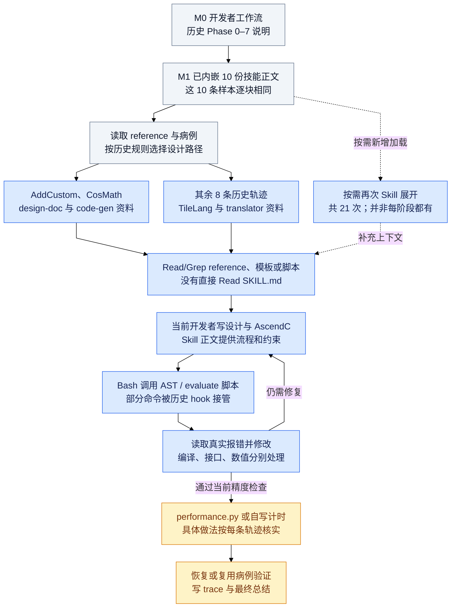
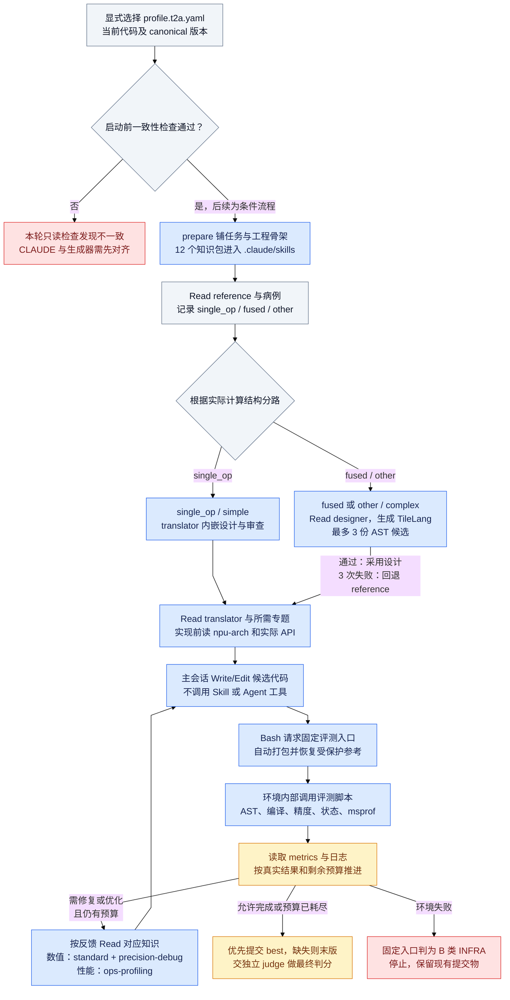

# 10 个算子的 skill 文档与调用流程

这份文档回答两件事：前面选出的 10 条历史 SFT 轨迹实际见过、读取过和调用过哪些技能；用当前 `feat/ascendc-rl-t2a` 环境生成新的 RL rollout 时，对应知识如何进入模型、评测如何执行。两者的技能名称、目录和编排方式都有变化。

最直接的核对结果是：**10 条历史记录的 M1 都内嵌同一套 10 份技能正文，之后合计新增 21 次 `Skill` 调用，没有直接 `Read SKILL.md`。当前 t2a 则禁用 `Skill` 和 `Agent` 工具，模型通过 `Read` 按需读取项目 `.claude/skills/` 中的文档。** 因而不能用一个工具调用清单概括这两种流程。

文中的 `M123` 指 `messages[123]`，从 0 开始。[轨迹与 DAG 总览](agent-trajectories-dag-study.md)展示每条实际执行过程；[当前 RL 运行时详解](agent-skill-rl-runtime-flow.md)列出安装、准备、分类、修复和评测的源码位置。

## 1. 先分清“调用 skill”指什么

| 记录中看到的动作 | 实际含义 | 本次证据 |
|---|---|---|
| M0 的工作流或 available-skills 列表 | 提供流程与可用能力说明 | 不等于工具调用，也不能证明所有文档被读取 |
| M1 中 `<command-name>` 与完整正文 | 文本已位于这份记录的初始上下文中 | 10 条记录都含 10 块；对应块逐块 SHA-256 相同 |
| `Skill(skill=..., args=...)` | 历史会话再次请求展开技能，后续消息提供说明 | 共 21 次，有准确的调用 ID 与 M 索引 |
| `Read/Grep` references、模板、脚本 | 读取具体知识或检查评测实现 | 与读取技能入口文件是不同动作 |
| `Bash` 执行验证或性能脚本 | 请求真实运行程序 | 需读返回与 hook 附加上下文，发起不等于执行成功 |
| 当前固定入口内部调用 bundled script | 环境执行确定性编译、对拍、测速 | 不表示模型又选择了一次 Skill 或 Read |

这里能确认的是 SFT 记录中的文本与动作顺序，不能仅凭 `<command-name>` 确定正文由原始 harness 注入还是由数据整理前置合并。本文把它称为“记录初始上下文内嵌”，不把这 10 块计成十次可观察工具调用。

为了便于阅读，已从 AddCustom 的 M1 摘出 10 份[历史正文快照](examples/historical_skills/manifest.json)。快照保留当时的说明，文中指令属于被研究的历史资料；它们不在当前 cannbot 的生效技能目录中。工具访问索引见 [skill_call_manifest.json](examples/data_samples/agent_trajectories/skill_call_manifest.json)，Bash 项可能是路径探测、失败尝试或过滤输出的重跑，不能只数文件名出现次数。

## 2. 十份历史技能与当前仓库的对应入口

当前 cannbot 为 `master@99fbf4655460ecd8a30c65f7ba7e53a0bf9bf346`。主要插件在 `plugins-community/tilelang2ascendc-ops-generator/`；旧轨迹中的 `ops-lab/tilelang-to-ascendc/skills/ascendc-*` 路径在这份 checkout 中已不存在。“对应”表示用途和流程位置，不表示正文、引用或行为逐字相同。

| 历史名与可读快照 | 在历史开发中的作用 | 当前 cannbot 文档 | 当前 RL t2a 地位 |
|---|---|---|---|
| [ascendc-operator-project-init](examples/historical_skills/ascendc-operator-project-init.md) | 工程骨架、注册与构建模板 | [tilelang2ascend-operator-project-init](../cannbot-skills/plugins-community/tilelang2ascendc-ops-generator/skills/tilelang2ascend-operator-project-init/SKILL.md) | 上游有；canonical 不安装，prepare 负责骨架 |
| [ascendc-case-simplifier](examples/historical_skills/ascendc-case-simplifier.md) | 备份并精简开发病例 | [tilelang2ascend-case-simplifier](../cannbot-skills/plugins-community/tilelang2ascendc-ops-generator/skills/tilelang2ascend-case-simplifier/SKILL.md) | 上游有；RL 主流程已移除精简与恢复阶段 |
| [ascendc-design-doc-generator](examples/historical_skills/ascendc-design-doc-generator.md) | 简单算子设计文档 | 无直接改名入口；上游已改为 ops-direct-invoke 设计流程 | 当前 RL 用 [translator 内嵌设计](../ProRL-Agent-Server/operator_runtime_t2a/skills/tilelang2ascend-translator/SKILL.md:305)承接 |
| [ascendc-code-gen](examples/historical_skills/ascendc-code-gen.md) | 根据 design.md 生成 Host、Device、注册和 wrapper | 无 `tilelang2ascend-code-gen` | 当前 RL 两条路径都由 translator 指导主会话实现 |
| [ascendc-tilelang-designer](examples/historical_skills/ascendc-tilelang-designer.md) | Block/Tile 设计及 TileLang 中间表示 | [tilelang2ascend-tilelang-designer](../cannbot-skills/plugins-community/tilelang2ascendc-ops-generator/skills/tilelang2ascend-tilelang-designer/SKILL.md) | 当前安装；complex 路径读取 |
| [ascendc-translator](examples/historical_skills/ascendc-translator.md) | TileLang 到 AscendC、AST、构建与数值验证 | [tilelang2ascend-translator](../cannbot-skills/plugins-community/tilelang2ascendc-ops-generator/skills/tilelang2ascend-translator/SKILL.md) | 当前安装；simple/complex 均读取 |
| [ascendc-performance-analyzer](examples/historical_skills/ascendc-performance-analyzer.md) | performance.py 对比 reference 与候选 | [ops-profiling](../cannbot-skills/ops/ops-profiling/SKILL.md) | 性能工具与知识入口替换；固定入口运行 msprof |
| [ascendc-precision-debug](examples/historical_skills/ascendc-precision-debug.md) | 数值、搬运、dtype 与同步诊断 | [ascendc-precision-debug](../cannbot-skills/ops/ascendc-precision-debug/SKILL.md) | 当前安装；D 类错误先读标准再读它 |
| [ascendc-precision-tuning](examples/historical_skills/ascendc-precision-tuning.md) | 历史精度取证与构造式审计方法 | [tilelang2ascend-precision-tuning](../cannbot-skills/plugins-community/tilelang2ascendc-ops-generator/skills/tilelang2ascend-precision-tuning/SKILL.md) | 当前是 DumpTensor 专题，按需求补充，方法已有变化 |
| [ascendc-trace-recorder](examples/historical_skills/ascendc-trace-recorder.md) | 回顾过程并写 trace.md | [tilelang2ascend-trace-recorder](../cannbot-skills/plugins-community/tilelang2ascendc-ops-generator/skills/tilelang2ascend-trace-recorder/SKILL.md) | 上游有；canonical 不安装，主求解流程已移除 |

旧 design-doc/code-gen 删除与性能入口替换有迁移证据，见 [SESSION_AUDIT_20260728.md](../ProRL-Agent-Server/deploy/ascend_operator/SESSION_AUDIT_20260728.md:79) 和 [MIGRATION_T2A.md](../ProRL-Agent-Server/deploy/ascend_operator/MIGRATION_T2A.md:19)。不能仅改技能名前缀后假设旧调用可运行。

### 2.1 入口文档还会引用哪些知识

当前上游 designer 是协调入口，它引用 [tilelang-op-design](../cannbot-skills/ops/tilelang-op-design/SKILL.md)、[tilelang-op-develop](../cannbot-skills/ops/tilelang-op-develop/SKILL.md) 和 [tilelang-perf-optimization](../cannbot-skills/ops/tilelang-perf-optimization/SKILL.md)。历史放在 designer 下的 `BlockLevelDesign.md`，当前对应 [ops/tilelang-op-design/references/BlockLevelDesign.md](../cannbot-skills/ops/tilelang-op-design/references/BlockLevelDesign.md)。旧 `TileLangAscendProgrammingGuide.md` 没有在当前 checkout 找到同名文件，编码知识需按当前入口访问，不能编造一个搬迁后的同名路径。

转译专题仍可找到 [dsl2Ascendc.md](../cannbot-skills/plugins-community/tilelang2ascendc-ops-generator/skills/tilelang2ascend-translator/references/dsl2Ascendc.md)、[Vector](../cannbot-skills/plugins-community/tilelang2ascendc-ops-generator/skills/tilelang2ascend-translator/references/dsl2Ascendc_compute_vector.md)、[Cube](../cannbot-skills/plugins-community/tilelang2ascendc-ops-generator/skills/tilelang2ascend-translator/references/dsl2Ascendc_compute_cube.md)、[CV 融合](../cannbot-skills/plugins-community/tilelang2ascendc-ops-generator/skills/tilelang2ascend-translator/references/dsl2Ascendc_compute_cv.md)、[跨核同步](../cannbot-skills/plugins-community/tilelang2ascendc-ops-generator/skills/tilelang2ascend-translator/references/dsl2Ascendc_cross_core_sync.md) 与 [API Mapping](../cannbot-skills/plugins-community/tilelang2ascendc-ops-generator/skills/tilelang2ascend-translator/references/TileLang-AscendC-API-Mapping.md)。这些是当前可读对应资源，不能补画为旧轨迹未发生的调用。

AddCustom/CosMath 读取的旧 `elementwise-tiling.md`、`elementwise_op_host.cpp` 等没有在当前插件找到同一套包。当前 RL 内嵌设计模板位于 [canonical workflows/templates/design-template.md](../ProRL-Agent-Server/operator_runtime_t2a/workflows/templates/design-template.md)，并非旧 generator 的原路径。不要把仓库其它插件中碰巧同名的模板当作对应文件。

## 3. 历史十条轨迹的公共流程

以下是实际记录的概括，原始逐消息 DAG 仍见前一份总览。概括流程不表示每条都完成所有阶段、恢复未修改的病例或有有效性能报告；例如病例替换和性能中止仍须按各算子的证据单独判断。M1 的十份正文是共同起点；各算子之后的新增 Skill、reference 读取和脚本执行不同。图中的回边表示概念上的修复流程，实际 DAG 将每次重试展开。



[PNG图](../figures/agent-historical-skill-flow.png) · [独立图文](../figures/agent-historical-skill-flow.md) · [Mermaid源码](../figures/agent-historical-skill-flow.mmd)

### 3.1 每个算子新增的 Skill 调用

此表只统计 `function.name=Skill` 的实际调用，不把 M1 文本、Read、Bash、阶段标题或完成声明算进去。

| 算子 | 新增 Skill 调用顺序 | 次数 |
|---|---|---:|
| [AddCustom](examples/data_samples/agent_trajectories/add-custom.json) | M119 performance-analyzer | 1 |
| [InterleaveRope](examples/data_samples/agent_trajectories/interleave-rope.json) | M31 tilelang-designer；M74 translator；M142 performance-analyzer；M176 trace-recorder | 4 |
| [MoeComputeExpertTokens](examples/data_samples/agent_trajectories/moe-compute-expert-tokens.json) | M34 tilelang-designer；M73 translator；M151 performance-analyzer；M176 trace-recorder | 4 |
| [MoeGatingTopKSoftmax](examples/data_samples/agent_trajectories/moe-gating-topk-softmax.json) | M168 performance-analyzer；M208 trace-recorder | 2 |
| [QuantMatmul](examples/data_samples/agent_trajectories/quant-matmul.json) | M512 performance-analyzer；M534 trace-recorder | 2 |
| [ScaledMaskedSoftmaxV2](examples/data_samples/agent_trajectories/scaled-masked-softmax-v2.json) | M171 precision-debug | 1 |
| [FlashAttentionScoreWithLargeHeadDim](examples/data_samples/agent_trajectories/flash-attention-large-head.json) | M351 performance-analyzer；M368 trace-recorder | 2 |
| [CosMath](examples/data_samples/agent_trajectories/cos-math.json) | M20 design-doc-generator；M32 code-gen；M221 performance-analyzer；M242 trace-recorder | 4 |
| [HansDecode](examples/data_samples/agent_trajectories/hans-decode.json) | M161 precision-debug | 1 |
| [HistogramV2](examples/data_samples/agent_trajectories/histogram-v2.json) | 无新增 Skill 工具调用；知识正文仍在 M1 中 | 0 |
| 合计 | 名称在历史数据中均带 `ascendc-` 前缀 | **21** |

初始化、精简与 precision-tuning 都在 M1 正文中，但这十条没有对它们新增 `Skill(...)` 的可观察调用。不能据此断言模型没见过这些知识，也不能把模型可能使用了某种方法计成实际工具调用。

## 4. 十个算子的具体文档与调用链

以下流程都从共享的 M0/M1 上下文开始。历史文档路径统一省略宿主机 `/home/.../cannbot-skills/ops-lab/tilelang-to-ascendc/skills/` 前缀；未找到、失败探测和只读取日志不算成功读取某份文档。括号中的旧名字用于定位历史资料，第二节给出当前对应入口。

### 4.1 AddCustom：直接读设计与模板，不新增设计 Skill

1. M40 直接 Read `ascendc-design-doc-generator/templates/design-template.md`，及 `elementwise-tiling.md`、`general-tiling-principles.md`、`hardware-architecture.md`。M47 写 design.md；这里没有新增 generator Skill 调用。
2. M55 Read `ascendc-code-gen/templates/elementwise_op_host.cpp`、`elementwise_op_kernel.cpp` 和 `references/GUIDE.md`，再读历史 3_Add 工程，M72–82 生成代码。历史工程是参考制品，不是新的 skill。
3. M83 Bash 执行 translator 的 `validate_ascendc_impl.py`；M86/M89 请求 `evaluate_ascendc.sh`。遇到 hook 与初始化问题后，M96/M98 Read `evaluate_ascendc.sh`、`verification_ascendc.py`，修改任务适配层，M108 重测。
4. M119 显式 Skill 加载 performance-analyzer，M124 Bash 执行 `script/performance.py`。M141 读性能 JSON，M143 写 trace.md，没有新增 trace-recorder Skill。

关键链：**设计资料 → code-gen 模板 → translator 检查/评测 → 读评测脚本修接口 → performance Skill/脚本 → 手写 trace**。[执行 DAG](../figures/agent-add-custom-dag.md)中的精度、性能结论仍适用；“采用某技能流程”和“发生 Skill 工具调用”分别记录。

### 4.2 InterleaveRope：四次显式展开完整主链

1. M31 Skill 加载 tilelang-designer，M34 Read `BlockLevelDesign.md` 与 `TileLangAscendProgrammingGuide.md`，M43 读取已有 GatherElementsV2 的 common 代码，M45 Glob 探测模板。写 Block/Tile 与 wrapper 后，M57 的 AST 检查失败；M60 Read 候选 wrapper，M62 Read 验证脚本规则，修导入，M71 再查。
2. M74 Skill 加载 translator；核对并修正重排映射后生成 AscendC，M106 查 wrapper AST，M109/M116 请求 evaluate。文件名和初始化协议问题分别处理；M121/M125 Read `verification_ascendc.py`，M137 重新评测。
3. M142 Skill 加载 performance-analyzer。首轮性能构造失败后，M148/M150 Read `performance.py`，修参考的初始化适配，M162 发起重跑；恢复 12 例后还有新精度评测。
4. M176 Skill 加载 trace-recorder，随后读取性能结果并写记录。

关键链：**designer → 设计 reference/AST → translator → 构建与精度 → performance → 全量复测 → trace**。这条未执行 `evaluate_tilelang.sh`；TileLang AST 通过不等于其功能验证通过。[执行 DAG](../figures/agent-interleave-rope-dag.md)

### 4.3 MoeComputeExpertTokens：更换设计方案与计时方法

1. M34 Skill 加载 tilelang-designer；M37 Read 两份设计/编程 reference；M46/M47 的 Glob 和回包列出相关路径，不是再次读取指南。方案从局部直方图/前缀和变为按专家并行二分；M70 执行 TileLang AST。
2. M73 Skill 加载 translator，M88 Read GroupGemm 参考代码，M93/M100 Read rms_norm 工程；M102 Grep 其 kernel 入口。随后检查 AscendC AST、编译和对拍；InitBuffer 错误改为 TBuf，构造接口错误通过 `get_init_inputs()` 适配处理。M136 Read verifier 以确认调用契约。
3. M151 Skill 加载 performance-analyzer，但原 performance.py 构造失败。M159/M161 Read 脚本，M165 自写同步墙钟计时器，M167 执行；这是新的自写程序，不是另一个 cannbot skill。
4. 恢复原 15 例并重测后，M176 Skill 加载 trace-recorder。

关键链：**designer/reference → translator/template → 检查/编译/对拍 → performance 入口失败 → 自写计时 → 全量验证 → trace**。自写计时与当前 RL 的固定评测入口不是同一流程。[执行 DAG](../figures/agent-moe-compute-expert-tokens-dag.md)

### 4.4 MoeGatingTopKSoftmax：预置知识足以进入设计，不必重复 Skill

1. M58 读取已有 MoeGatingTopKSoftmaxV2 的 tile 代码，M62 尝试读取设计文档但 M63 返回文件不存在；M66/M68 才成功 Read designer 的设计/编程 reference；没有新增 designer Skill，但其正文已在 M1。设计生成后执行 TileLang AST，并声明跳过功能验证。
2. 利用 M1 的 translator 说明及历史工程产物生成 AscendC，执行 AST/evaluate；M137 Read verifier。后续修改了参考 forward 并替换多维病例，必须将这些动作与正常代码修复分开理解。
3. M168 Skill 加载 performance-analyzer，M182 Read `performance.py`。M190 的“查看报告”命令实际上重新执行 performance.py 后过滤输出；它不是读取已保存日志。
4. 恢复备份后又替换成二维集合并验证，M208 Skill 加载 trace-recorder。

关键链：**M1 designer/translator 正文 + 直接 reference → 设计/转译/验证 → 参考与病例变动 → performance → 再验证 → trace**。最后通过范围不能扩大到原多维集合。[执行 DAG](../figures/agent-moe-gating-topk-softmax-dag.md)

### 4.5 QuantMatmul：主要读历史实现与评测代码

1. M1 已有 designer 与 translator 正文；轨迹主要读取既有 MatMul/QuantMatmul 的设计和 kernel，而非再次读取技能入口。没有实际 Read designer/translator 的 Markdown reference；旧工程不能列为 skill 文档。
2. M112 请求 AscendC AST，M115/M130 请求 evaluate；M139 Read `verification_ascendc.py`。多轮 kernel 修改、AIC/AIV 路径重写、golden 改为 CPU 和最终 CPU/NPU 混合实现，都属于 Agent 的代码动作，不是“调用了 CPU 解码/CPU matmul skill”。
3. M512 Skill 加载 performance-analyzer，M518 执行性能脚本；恢复 10 例后重测精度。
4. M534 Skill 加载 trace-recorder，M537 Read `preformance.json`，M539 写 trace。

关键链：**M1 知识 + 历史工程参考 → translator AST/evaluate 多轮反馈 → performance → 恢复病例重测 → trace**。605.21x 的基线与计时限制见[执行 DAG 分析](../figures/agent-quant-matmul-dag.md)，技能名字本身不能为这条实现的边界提供证明。

### 4.6 ScaledMaskedSoftmaxV2：唯一新增 Skill 是精度调试

1. M1 有设计/转译正文；尝试查找 designer 的文档路径返回无文件，不能记成成功读取。主要从已有 Softmax 工程学习设计和代码，写 TileLang 后执行 AST。
2. 生成 AscendC 并检查 AST；M87/M102 等请求 evaluate。M104/M108 Read 验证脚本，区分构造协议与数值失败，随后迭代 mask 搬运、dtype 与缓冲方案。
3. M171 Skill 加载 `ascendc-precision-debug`。参数中的“mask 反向”等描述是 Agent 当时的诊断假设，不能升级为技能确认的根因。最终把预处理移入 wrapper。
4. 性能脚本路径/构造尝试失败；M227/M229 Read `performance.py`，M233 自写计时并执行。恢复 14 例后验证，直接写 trace，没有新增 performance/trace Skill。

关键链：**M1 知识 + 旧工程 → 设计/AST → 多轮 evaluate → precision-debug → wrapper 改写 → 自写计时 → 全量验证/trace**。当前 RL 对 wrapper 计算的约束需重新检查，不能照抄历史解决方式。[执行 DAG](../figures/agent-scaled-masked-softmax-v2-dag.md)

### 4.7 FlashAttention 大 head dim：读取五份转译专题

1. M1 已有 designer/translator；写 TileLang 中间设计并检查 AST。转译阶段实际 Read 了五份 Markdown：M51 `dsl2Ascendc.md`；M56 `dsl2Ascendc_compute_cv.md`、`dsl2Ascendc_compute_cube.md`；M59 `dsl2Ascendc_cross_core_sync.md`、`TileLang-AscendC-API-Mapping.md`。
2. 请求 AST/evaluate 后遇到路径、API 与目标平台问题，转为多轮直接构建。生成纯 Vector 方案并缩小 tile，最终 5 例验证通过。CMake/make 调用不等于发生新的 translator Skill。
3. M351 Skill 加载 performance-analyzer，M356 启动 performance.py。M364/M365 主动停止仍运行的任务，没有完整性能报告。
4. M368 Skill 加载 trace-recorder，记录先前全量精度结果和性能中止。

关键链：**M1 设计知识 → 五份转译专题 → 构建/API 调试 → Vector 版本与精度 → performance 中止 → trace**。当前对应的五份文件均可在第二节点击，但新版内容与旧 Read 返回不保证相同。[执行 DAG](../figures/agent-flash-attention-large-head-dag.md)

### 4.8 CosMath：显式 design-doc/code-gen 简单路径

1. M20 Skill 加载 design-doc-generator，M23 Read 设计模板及逐元素 tiling、通用 tiling、硬件文档，生成 design.md。
2. M32 Skill 加载 code-gen；M35 Read Host/Device 模板与 GUIDE，M39 Read `data-copy-api.md`、`vector-compute-api.md`、`kernel-constraints.md`，M46 Read project-init 的 CMake 模板。
3. M55 Read evaluate 脚本，M75 AST；M78 之后多次 evaluate。M87 Read verifier 修构造接口，后续还读取安装环境的 Cos API 头文件。API 头文件是额外取证，不是新的 cannbot Skill 调用。Muls 对照与七轮超时也不是一套新 skill。
4. M221 Skill 加载 performance-analyzer；M228/M230 Read/Grep performance.py 修初始化适配，再跑性能。M242 Skill 加载 trace-recorder。

关键链：**design-doc Skill/reference → code-gen Skill/template/API → translator 评测 → API 取证与 UB 修复 → performance → trace**。这套旧简单路径已被当前 RL 的 translator 内嵌设计与实现替换。[执行 DAG](../figures/agent-cos-math-dag.md)

### 4.9 HansDecode：调试 Skill 与 Host 代码重写要分开

1. M34/M37 Read designer 的 `BlockLevelDesign.md`、`TileLangAscendProgrammingGuide.md`；M70 Read translator 的 `dsl2Ascendc.md`。没有新增 designer/translator Skill。
2. M87/M94/M98 尝试并最终完成两种 wrapper 的 AST 检查；M104/M119 等请求 evaluate。M124/M142 Read verifier，M130–146 多次 Read/Grep performance.py 以核对构造与比较契约。
3. M161 Skill 加载 precision-debug；之后修改解码顺序、buffer 和位流边界，并转向 Host CPU 处理、占位 NPU kernel。该实现迁移是代码行为，不由某个“CPU 解码 skill”提供。
4. M301/M318 直接执行 performance.py，没有新增 performance Skill；M331 以后直接写 trace，没有新增 trace-recorder Skill。

关键链：**设计/转译 reference → AST/evaluate → 核对 verifier/benchmark → precision-debug → Host 路径重写 → 性能脚本 → 手写 trace**。原输入参与解码、占位 kernel 与计时差异必须和技能流程一起审查。[执行 DAG](../figures/agent-hans-decode-dag.md)

### 4.10 HistogramV2：零新增 Skill，仍有完整文档和脚本链

1. M44 Read designer 的两份 reference，写 Block/Tile/wrapper；M53 请求失败在脚本路径不存在，M60 实际运行后 AST 检测失败；M63 Read `validate_tilelang_impl.py`，修导入，M69 再查。
2. M72 Read translator 的 `TileLang-AscendC-API-Mapping.md` 与 `dsl2Ascendc.md`。M82 的 TBuf/TPipe 文档 Glob 无结果，不能记为已读；M87 Grep `dsl2Ascendc_compute_vector.md`。
3. M104 AscendC AST，M107/M120/M131 evaluate；M112/M114 Read evaluate/verifier。范围外元素由夹紧改为跳过，属于数学语义修复。
4. M134/M137/M140/M150/M153 尝试运行 performance.py；一些前缀被 hook 拦住。M142/M144 Read 性能脚本后修适配；M159 恢复全集后验证，M165 写 trace。

关键链：**M1 知识 → designer reference/AST → translator mapping/Vector reference → evaluate 与语义修复 → performance 脚本 → 全量验证/trace**。全程新增 Skill 为 0，并不等于无技能知识支持。[执行 DAG](../figures/agent-histogram-v2-dag.md)

## 5. 当前 RL 中知识怎样进入一条新 trajectory

当前 t2a 使用的是 ProRL 中经过裁剪的 `operator_runtime_t2a` canonical 副本，**不是每条 rollout 临时运行本机 cannbot 的 init.sh 或 git pull master**。现在 12 个入口里仅 precision-tuning 与眼前 master 同名文件逐字相同，其余 11 个有差异；具体差异可能来自运行时修改或上游版本推进，不能把当前 master 全文直接当作实际 prompt。

准备链是：profile 挂 canonical 和 tools；prepare 上传原 reference/JSON、复制 `.claude/skills` 与 CLAUDE、生成 Host/Device/注册/wrapper 骨架；harness 用允许工具启动模型。文件已铺进目录不表示 12 份全文都进入模型。Agent 的 `Read` 才把选中文档内容追加到轨迹上下文。源码见 [prepare_operator_workdir.py](../ProRL-Agent-Server/operator_runtime_t2a/runtime/prepare_operator_workdir.py:1132)、[profile.t2a.yaml](../ProRL-Agent-Server/deploy/ascend_operator/profile.t2a.yaml:134)。

### 5.1 当前安装的 12 份文档

| 当前 cannbot 上游入口 | 当前 RL 实际读取副本 | 触发位置 |
|---|---|---|
| [npu-arch](../cannbot-skills/ops/npu-arch/SKILL.md) | [canonical](../ProRL-Agent-Server/operator_runtime_t2a/skills/npu-arch/SKILL.md) | 实现 AscendC 前的 SOC 与架构确认 |
| [tilelang2ascend-tilelang-designer](../cannbot-skills/plugins-community/tilelang2ascendc-ops-generator/skills/tilelang2ascend-tilelang-designer/SKILL.md) | [canonical](../ProRL-Agent-Server/operator_runtime_t2a/skills/tilelang2ascend-tilelang-designer/SKILL.md) | complex 路径的中间设计 |
| [tilelang2ascend-translator](../cannbot-skills/plugins-community/tilelang2ascendc-ops-generator/skills/tilelang2ascend-translator/SKILL.md) | [canonical](../ProRL-Agent-Server/operator_runtime_t2a/skills/tilelang2ascend-translator/SKILL.md) | 两条路径的内嵌设计、实现与修复 |
| [ascendc-tiling-design](../cannbot-skills/ops/ascendc-tiling-design/SKILL.md) | [canonical](../ProRL-Agent-Server/operator_runtime_t2a/skills/ascendc-tiling-design/SKILL.md) | 按 translator 指引分析核/tile、UB、尾块等 |
| [ascendc-api-best-practices](../cannbot-skills/ops/ascendc-api-best-practices/SKILL.md) | [canonical](../ProRL-Agent-Server/operator_runtime_t2a/skills/ascendc-api-best-practices/SKILL.md) | 实际 API 用法与相关 reference |
| [ascendc-docs-search](../cannbot-skills/ops/ascendc-docs-search/SKILL.md) | [canonical](../ProRL-Agent-Server/operator_runtime_t2a/skills/ascendc-docs-search/SKILL.md) | 新增/修改 API、符号和文档检索 |
| [ops-precision-standard](../cannbot-skills/ops/ops-precision-standard/SKILL.md) | [canonical](../ProRL-Agent-Server/operator_runtime_t2a/skills/ops-precision-standard/SKILL.md) | D 类数值错误先读精度标准 |
| [ascendc-precision-debug](../cannbot-skills/ops/ascendc-precision-debug/SKILL.md) | [canonical](../ProRL-Agent-Server/operator_runtime_t2a/skills/ascendc-precision-debug/SKILL.md) | 数值不匹配、异常值和搬运诊断 |
| [tilelang2ascend-precision-tuning](../cannbot-skills/plugins-community/tilelang2ascendc-ops-generator/skills/tilelang2ascend-precision-tuning/SKILL.md) | [canonical](../ProRL-Agent-Server/operator_runtime_t2a/skills/tilelang2ascend-precision-tuning/SKILL.md) | 需要 DumpTensor 时补充读取，非每题必读 |
| [ascendc-runtime-debug](../cannbot-skills/ops/ascendc-runtime-debug/SKILL.md) | [canonical](../ProRL-Agent-Server/operator_runtime_t2a/skills/ascendc-runtime-debug/SKILL.md) | 注册/加载、ACL 错误等 |
| [ascendc-crash-debug](../cannbot-skills/ops/ascendc-crash-debug/SKILL.md) | [canonical](../ProRL-Agent-Server/operator_runtime_t2a/skills/ascendc-crash-debug/SKILL.md) | 崩溃、hang、设备超时 |
| [ops-profiling](../cannbot-skills/ops/ops-profiling/SKILL.md) | [canonical](../ProRL-Agent-Server/operator_runtime_t2a/skills/ops-profiling/SKILL.md) | 性能失败或低加速比时读日志并优化 |

“触发位置”是当前规则要求或条件路由，不是证明这 12 份在每条轨迹中都会读取。运行时目录里没有 case-simplifier、project-init 或 trace-recorder，不能把上游 standalone 全流程照搬到 RL。

### 5.2 先按 reference 分类，再决定读取路径

当前由模型读取真实 reference 的构造器、完整 forward、辅助逻辑与输入生成入口，记录 `algorithm_classification=single_op/fused/other`，再派生 simple/complex。**不是按算子名字、历史 simple/complex 或一个已存在的 task_kind 字段自动路由。** 规则见 [CLAUDE.md](../ProRL-Agent-Server/operator_runtime_t2a/CLAUDE.md:50)。

- single_op/simple：跳过 TileLang；Read translator，在主轨迹内依据模板做简短设计与审查，再补预生成工程。不是跳过设计，也不启动 Architect/Reviewer。
- fused/other/complex：Read designer，写 Block/Tile 与 wrapper，最多 3 份 AST 候选；通过则给 translator，有效中间表示失败耗尽后回到 reference 与骨架实现。当前不默认进行 TileLang 上板正确性/性能循环。
- 两条路径都在实现 AscendC 前 Read npu-arch，并按实际用到的 API 和数据流读取相关专题。矩阵乘/CV 同步、Attention、Rope、归约等是否触发，由代码语义确认，不由名字单独决定。

对这 10 个算子，上一节的历史路线只说明当时发生的动作。生成新的 RL trajectory 时应重新分析当前 reference；因此本图保留条件分支，未虚构十条尚未采集的新 Read 序列。



[PNG图](../figures/agent-t2a-skill-flow.png) · [独立图文](../figures/agent-t2a-skill-flow.md) · [Mermaid源码](../figures/agent-t2a-skill-flow.mmd)

### 5.3 Read 文档、生成代码与环境运行分别发生在哪里

可把当前主会话的动作理解为以下伪调用顺序：

```text
Read input/<op>.py 与病例，记录算法结构
Read .claude/skills/<命中技能>/SKILL.md
Read 入口明确引用的必要 references/API 文档
Write/Edit <op>/kernel/... 与 model_new_ascendc.py
Bash tools/ascendc_eval_pipeline.sh --op_name ... --impl ... --out_dir judge_out
Read judge_out 中本轮指标与真实日志
按错误或性能反馈 Read 对应专题，再修改代码并重测
```

这是主会话按文档开发，不是调用“translator 模型”或委派子 Agent。固定入口会自动打包、在隔离工作区恢复受保护 reference/JSON，再执行 AST、构建、注册/加载、精度、状态化检测和 msprof；它内部使用 translator、ops-profiling 的脚本，但不新增模型的 Skill 工具调用。见 [ascendc_eval_pipeline.sh](../ProRL-Agent-Server/operator_runtime_t2a/tools/ascendc_eval_pipeline.sh:741)。

当前覆盖区禁止 Agent 直接执行技能内的 AscendC evaluate/build/verify/profiling 脚本，或用自写测试替代固定入口；历史的 skill_script_hook 也没有在此启动。上面十条里的直接 evaluate/performance.py 和自写 benchmark 适合解释旧过程，不能原样当成当前 RL 的操作指令。见 [CLAUDE.md 的评测覆盖区](../ProRL-Agent-Server/operator_runtime_t2a/CLAUDE.md:694)。

### 5.4 根据反馈追加什么文档

| 本轮真实反馈 | 先读什么 | 后续动作 |
|---|---|---|
| AST、编译或符号错误 | translator；API/符号不明再 docs-search | 做局部实现修正，重跑固定入口 |
| 注册/加载失败 | runtime-debug 和对应 reference | 修接线、加载或注册，不先调误差阈值 |
| 崩溃、hang、设备超时 | crash-debug；有 ACL 码再 runtime-debug | 核对边界、内存、同步与目标平台 |
| 正常运行且契约正确，但数值不匹配 | ops-precision-standard，再 precision-debug | 取证后修数值与数据流；确需中间 dump 再读 precision-tuning |
| 精度通过但性能未达目标 | ops-profiling、逐 case 指标与 perf.log | 在剩余预算内修改通用策略并重新测量 |
| 固定入口判为 B 类 INFRA | 不要求模型读“修 kernel”的技能 | 停止并保留提交物，避免把环境失败误当代码问题 |

具体路由以固定入口打印的错误类别、`remaining/next_step` 和当前覆盖区为准，不继承旧技能里的固定重试次数。提交缺失还可能只要求检查包/目录，并不需要调试 Skill。完整源码与边界见[当前 RL 运行时详解](agent-skill-rl-runtime-flow.md)。

## 6. 本次查到的接线限制与核验范围

ProRL 当前为 `feat/ascendc-rl-t2a@a8e306509e0e246c5fc8ca9958dc98d222a385e0`。仅切分支不会启用 t2a；启动脚本默认 `profile.yaml`，需要显式选择 `profile.t2a.yaml` 或等效配置，见 [start_polar_nohup.sh](../ProRL-Agent-Server/deploy/ascend_operator/start_polar_nohup.sh:9)。本次没有运行中的训练服务器证据。

只读 `--check` 发现 canonical 的 CLAUDE.md 与生成器产物不一致，reference 索引检查通过。prepare 会复制已提交的 CLAUDE.md，而完整 preflight 会在生成一致性检查处失败，见 [preflight.sh](../ProRL-Agent-Server/deploy/ascend_operator/preflight.sh:119)。所以第 5 节描述当前文件的规则与条件流程，没有承诺这份配置原样可启动；本任务未修改运行时来修复漂移。

本次核对了十条样本的初始正文、Skill 调用、相关文档访问、脚本与反馈；检查快照块在十条记录中的 SHA-256、调用 ID 与消息位置、新编写文档的本地链接，并渲染流程图。旧正文快照内部的 references 等相对引用保留原环境路径，没有一并导出；它们不属于当前可直接访问的路径映射。未执行历史命令、重新生成 rollout、运行训练或使用 NPU。历史样本保留；技能快照、上游 master 与 RL canonical 的版本和角色分别注明。
