# 10 条额外 Agent 轨迹与执行 DAG

这份文档继续分析此前 GroupedMatmulSliceM 之外的 **10 个不同算子**。全部样本来自 SFT 的 `agent_dataset/train-00000.jsonl`，选择的是包含开发者实际读写与评测过程的轨迹，共 **2,650 条消息、1,365 次工具调用**。本次只分析本地历史记录；精度与性能数字来自当时保存的日志，没有重新执行 NPU 测试。

每节都直接列出一张 DAG，并链接完整分析、PNG、Mermaid 源码与原始 JSON。建议先读 AddCustom，再读 HistogramV2 和 CosMath，最后看 QuantMatmul、HansDecode：先熟悉一次正常开发怎样结束，再辨别“精度 PASS”及大加速比的证据范围。

技能文档与调用顺序见 [10 个算子的 skill 文档与调用流程](agent-skill-call-guide.md)。该文区分 M1 内嵌正文、后续 Skill 展开、reference/模板读取和评测脚本执行，并列出当前 cannbot 上游及 RL t2a canonical 的对应入口。

## 选择与溯源

首分片共 1,000 条记录，按有序 tool-call ID 序列可分为 100 组，每组 10 条。相同序列说明共享交互骨架，不能据此断言完整内容相同或确定具体增强机制。这次在不同组各取一条，并进一步要求算子不同；没有把同一算子的变体凑成 10 条。

选择按开发行为差异进行，覆盖逐元素计算、直方图、旋转位置编码、MoE、量化矩阵乘、Softmax、Attention 与编码任务。它是教学选样，不用于估算全数据集的质量比例。来源、原始行号、各样本 SHA-256 与工具分布见 [样本 manifest](examples/data_samples/agent_trajectories/manifest.json)。源仓库版本为 `0607a29d231cde384c9dfdb8a39f54f91837c327`，解压分片 SHA-256 为 `f9427c7cd478dc6f09cf35080c493a24e8070ca734f255bba0034faa30b3c669`。

## 图怎样读

`M123` 表示原 JSON 的 `messages[123]`，从 0 开始；原分片索引也从 0 开始，JSONL 行号则从 1 开始。图按实际开发阶段聚合，省略重复资料读取、日志分页和任务登记，保留影响结果的修改、失败及重测。它们展示 Agent 的执行推进与反馈使用，底层张量或硬件指令依赖应结合各篇的代码说明理解。

失败之后的重试使用新节点展开，图中没有回边。同一 assistant 消息中的多次工具调用只说明同批发出，缺少时间戳时不能认定实际并行。部分 hook 结果写在后续 `role=user` 的附加上下文里，所以证据核对同时检查 tool 回包和这些上下文。

- 蓝色：可见的读取、生成、修改或工程动作。
- 绿色：对应检查有通过日志；AST 绿色仅代表该静态检查通过。
- 红色：实际可见的编译、工具接口、运行或比较失败。
- 灰色：上下文或中性测量结果。
- 琥珀色：跳过、复用、声明或解释范围受限的结论。

表中的“全量”指这条记录可见并恢复的原始病例集合，不表示覆盖所有合法输入。加速比小于 1 表示在对应测量方法和病例上候选更慢；不同计时方法与不同聚合公式的数字不能直接排序。

## 十条轨迹总览

| 顺序 | 算子 / 完整分析与 DAG | 分片索引 / 行号 | 消息 / 工具调用 | 可确认的精度范围 | 历史性能记录 |
|---:|---|---:|---:|---|---|
| 1 | [AddCustom](../figures/agent-add-custom-dag.md) | 860 / 861 | 148 / 79 | 5/5，同形状 float16 | 5 例：0.5865x |
| 2 | [InterleaveRope](../figures/agent-interleave-rope-dag.md) | 20 / 21 | 184 / 96 | 恢复原 12 例，12/12 | 9 例：比值均值 1.1791x；时延总和比约 0.6125x |
| 3 | [MoeComputeExpertTokens](../figures/agent-moe-compute-expert-tokens-dag.md) | 40 / 41 | 184 / 98 | 恢复原 15 例，15/15 | 8 例：同步墙钟报告 59.20x |
| 4 | [MoeGatingTopKSoftmax](../figures/agent-moe-gating-topk-softmax-dag.md) | 120 / 121 | 216 / 102 | 替换后的自建二维集 10/10 | 替换后 10 例：报告 2.6538x，含计时兜底 |
| 5 | [QuantMatmul](../figures/agent-quant-matmul-dag.md) | 320 / 321 | 542 / 280 | 改过参考后，恢复 10 例，10/10 | 精简 5 例：历史报告 605.21x，口径受限 |
| 6 | [ScaledMaskedSoftmaxV2](../figures/agent-scaled-masked-softmax-v2-dag.md) | 420 / 421 | 248 / 132 | 恢复原 14 例，14/14 | 9 例：同步墙钟均时比约 0.57x |
| 7 | [FlashAttentionScoreWithLargeHeadDim](../figures/agent-flash-attention-large-head-dag.md) | 480 / 481 | 374 / 190 | 原 5 例，5/5 | 未完成：性能进程被 TaskStop |
| 8 | [CosMath](../figures/agent-cos-math-dag.md) | 580 / 581 | 250 / 131 | 原 9 例，9/9 | 9 例：报告 0.8709x |
| 9 | [HansDecode](../figures/agent-hans-decode-dag.md) | 800 / 801 | 336 / 172 | 给定 4 例，4/4；语义受限 | 报告 18.038x，不能认作完整 NPU 解码加速 |
| 10 | [HistogramV2](../figures/agent-histogram-v2-dag.md) | 840 / 841 | 168 / 85 | 恢复原 14 例，14/14 | 精简 10 例：报告 0.4471x |

## 1. AddCustom：精度通过后仍要检查性能

从模板生成逐元素加法，经历 helper 路径错误、hook 命令错误、初始化接口错误和一次缺参调用。最终精度通过，但候选在 5 个 case 上全部比参考慢。全量阶段复用前述验证结果，没有另起一次测量。

[完整分析](../figures/agent-add-custom-dag.md) · [PNG 图](../figures/agent-add-custom-dag.png) · [Mermaid 源码](../figures/agent-add-custom-dag.mmd) · [原始 JSON](examples/data_samples/agent_trajectories/add-custom.json)

```mermaid
%%{init: {"theme":"base","themeVariables":{"fontFamily":"PingFang SC, Arial, sans-serif","fontSize":"18px","lineColor":"#475569"},"flowchart":{"curve":"linear","nodeSpacing":28,"rankSpacing":30}}}%%
flowchart TB
    reference["M6–10 读取参考与目录<br/>torch.add，简单算子"]
    project["M16–20 初始化工程<br/>复制 helper 失败"]
    helper["M21–24 Glob 定位<br/>改路径后复制成功"]
    cases["M29–33 读取并备份<br/>5 个 case，不做精简"]
    design["M40–48 读取设计资料<br/>写入 design.md"]
    templates["M55–71 读取模板<br/>参考历史 3_Add 实现"]
    code["M72–82 生成 AscendC<br/>Host、Device 与封装"]
    ast["M83–85 AST 检查通过<br/>仅证明未检出规定退化"]
    hookFailure["M86–88 Hook 执行失败<br/>把 export 当作可执行文件"]
    initFailure["M89–95 再次构建验证<br/>Model 初始化参数错误"]
    adapter["M96–105 对照验证脚本<br/>初始化参数改为 []"]
    invalidCall["M106–107 Bash 调用失败<br/>缺少 command 参数"]
    verified["M108–112 重测 5/5 通过<br/>MERE 约 7.3e-5"]
    performance["M119–128 性能测试<br/>总体 0.59x，慢于参考"]
    reuse["M131–136 全量阶段<br/>复用前述 5 case 结果"]
    trace["M141–147 读取性能 JSON<br/>写 trace.md 并总结"]
    reference --> project
    project --> helper
    helper --> cases
    cases --> design
    design --> templates
    templates --> code
    code --> ast
    ast --> hookFailure
    hookFailure --> initFailure
    initFailure --> adapter
    adapter --> invalidCall
    invalidCall --> verified
    verified --> performance
    performance --> reuse
    reuse --> trace
    classDef action fill:#dbeafe,stroke:#3b82f6,color:#0f172a;
    classDef pass fill:#dcfce7,stroke:#16a34a,color:#0f172a;
    classDef fail fill:#fee2e2,stroke:#dc2626,color:#0f172a;
    classDef context fill:#f1f5f9,stroke:#94a3b8,color:#0f172a;
    classDef limited fill:#fef3c7,stroke:#d97706,color:#0f172a;
    class reference,cases context;
    class helper,design,templates,code,adapter,trace action;
    class ast,verified pass;
    class project,hookFailure,initFailure,invalidCall fail;
    class performance,reuse limited;
```

## 2. InterleaveRope：加速比的聚合方法

最终代码固定末维 D=64，先实体化广播，再做奇偶重排与旋转融合。9 例性能中，一个小 case 拉高逐例加速比均值；按记录时延总和重算，候选反而更慢。恢复 12 例后有新的精度验证，性能覆盖仍只有 9 例。

[完整分析](../figures/agent-interleave-rope-dag.md) · [PNG 图](../figures/agent-interleave-rope-dag.png) · [Mermaid 源码](../figures/agent-interleave-rope-dag.mmd) · [原始 JSON](examples/data_samples/agent_trajectories/interleave-rope.json)

```mermaid
%%{init: {"theme":"base","themeVariables":{"fontFamily":"PingFang SC, Arial, sans-serif","fontSize":"18px","lineColor":"#475569"},"flowchart":{"curve":"linear","nodeSpacing":28,"rankSpacing":30,"wrappingWidth":340}}}%%
flowchart TB
    reference["M2–4 读取参考算子<br/>交错重排与旋转位置编码"]
    cases["M7–30 初始化并备份<br/>12 例精简为 9 例"]
    design["M31–56 读取技能并写设计<br/>TileLang 与 Python 封装"]
    astFailure["M57–59 TileLang AST 失败<br/>未识别 kernel 导入"]
    importFix["M60–68 检查规则并修改<br/>改为指定的导入形式"]
    astPass["M71–74 TileLang AST 通过<br/>声明跳过功能验证"]
    code["M77–108 重排映射修正<br/>写 AscendC，AST 通过"]
    jsonFailure["M109–113 构建后验证失败<br/>缺少 InterleaveRope.json"]
    jsonFix["M114–115 复制 case 文件<br/>补齐参考期望的文件名"]
    initFailure["M116–120 重测仍失败<br/>构造器收到 9 个多余参数"]
    initFix["M121–136 核对验证器<br/>候选初始化参数改为 []"]
    ninePass["M137–141 重测 通过<br/>9/9 case matched"]
    perfFailure["M145–147 性能脚本报错<br/>双方构造器参数不兼容"]
    perfFix["M148–161 核对性能器<br/>参考初始化参数改为 []"]
    performance["M162–166 取得 9 例性能<br/>日志报逐例均值 1.18x"]
    restore["M167–170 恢复备份<br/>文件重新包含 12 例"]
    fullPass["M171–175 全量重测 通过<br/>12/12 case matched"]
    declaration["M179–183 读报告并总结<br/>声明 0.61x 与 1.18x 两口径"]
    reference --> cases
    cases --> design
    design --> astFailure
    astFailure --> importFix
    importFix --> astPass
    astPass --> code
    code --> jsonFailure
    jsonFailure --> jsonFix
    jsonFix --> initFailure
    initFailure --> initFix
    initFix --> ninePass
    ninePass --> perfFailure
    perfFailure --> perfFix
    perfFix --> performance
    performance --> restore
    restore --> fullPass
    fullPass --> declaration
    classDef action fill:#dbeafe,stroke:#3b82f6,color:#0f172a;
    classDef pass fill:#dcfce7,stroke:#16a34a,color:#0f172a;
    classDef fail fill:#fee2e2,stroke:#dc2626,color:#0f172a;
    classDef context fill:#f1f5f9,stroke:#94a3b8,color:#0f172a;
    classDef limited fill:#fef3c7,stroke:#d97706,color:#0f172a;
    class cases,design,importFix,code,jsonFix,initFix,perfFix,restore action;
    class astPass,ninePass,fullPass pass;
    class astFailure,jsonFailure,initFailure,perfFailure fail;
    class reference context;
    class performance,declaration limited;
```

## 3. MoeComputeExpertTokens：先理解 golden 的真实计算位置

目标是对每个专家求已排序编号的 upper bound，即小于等于该专家编号的 token 数。方案从局部直方图改为多核二分。性能由自写同步计时器得到；参考包含设备到 CPU 复制与 Python/NumPy 二分，所以 59.20x 必须连同基线定义一起读。

[完整分析](../figures/agent-moe-compute-expert-tokens-dag.md) · [PNG 图](../figures/agent-moe-compute-expert-tokens-dag.png) · [Mermaid 源码](../figures/agent-moe-compute-expert-tokens-dag.mmd) · [原始 JSON](examples/data_samples/agent_trajectories/moe-compute-expert-tokens.json)

```mermaid
%%{init: {"theme":"base","themeVariables":{"fontFamily":"PingFang SC, Arial, sans-serif","fontSize":"18px","lineColor":"#475569"},"flowchart":{"curve":"linear","nodeSpacing":28,"rankSpacing":30,"wrappingWidth":340}}}%%
flowchart TB
    reference["M2–5 读取参考与 case 路径<br/>有序专家索引的累积计数"]
    taskFailure["M6–14 登记任务失败<br/>TaskCreate 不接受 status"]
    cases["M15–33 初始化并备份<br/>15 个 int32 case 精简为 8"]
    histogram["M34–45 写初版设计<br/>局部直方图与前缀和"]
    binarySearch["M54–65 重写设计<br/>按专家分工，使用二分查找"]
    tileAst["M66–73 TileLang AST 通过<br/>声明跳过功能验证"]
    code["M76–119 写 AscendC 工程<br/>候选 AST 检查 通过"]
    hookFailure["M120–122 首次评测未执行<br/>Hook 把 export 当程序"]
    compileFailure["M123–125 去掉前缀后编译<br/>TQue.InitBuffer 参数错误"]
    bufferFix["M126–131 修改缓冲区<br/>输入与输出改用 TBuf"]
    initFailure["M132–133 重建进入验证<br/>Model 构造器参数错误"]
    initFix["M134–145 对照验证器<br/>候选 get_init_inputs 返回 []"]
    eightPass["M146–150 重测 通过<br/>8/8 case matched"]
    perfFailure["M154–156 官方性能脚本报错<br/>双方构造器参数不兼容"]
    manualScript["M157–166 检查并写计时器<br/>预热 5 次，同步计时 50 次"]
    performance["M167–168 手写计时返回<br/>8 例时延总和比 59.20x"]
    restore["M169–170 恢复原备份<br/>重新使用 15 例"]
    fullPass["M171–175 全量重测<br/>15/15 case matched"]
    declaration["M176–183 记录并总结<br/>声明完成，删除临时计时器"]
    reference --> taskFailure
    taskFailure --> cases
    cases --> histogram
    histogram --> binarySearch
    binarySearch --> tileAst
    tileAst --> code
    code --> hookFailure
    hookFailure --> compileFailure
    compileFailure --> bufferFix
    bufferFix --> initFailure
    initFailure --> initFix
    initFix --> eightPass
    eightPass --> perfFailure
    perfFailure --> manualScript
    manualScript --> performance
    performance --> restore
    restore --> fullPass
    fullPass --> declaration
    classDef action fill:#dbeafe,stroke:#3b82f6,color:#0f172a;
    classDef pass fill:#dcfce7,stroke:#16a34a,color:#0f172a;
    classDef fail fill:#fee2e2,stroke:#dc2626,color:#0f172a;
    classDef context fill:#f1f5f9,stroke:#94a3b8,color:#0f172a;
    classDef limited fill:#fef3c7,stroke:#d97706,color:#0f172a;
    class cases,histogram,binarySearch,code,bufferFix,initFix,manualScript,restore action;
    class tileAst,eightPass,fullPass pass;
    class taskFailure,hookFailure,compileFailure,initFailure,perfFailure fail;
    class reference context;
    class performance,declaration limited;
```

## 4. MoeGatingTopKSoftmax：参考和用例的变化会改变 PASS 的含义

Agent 未找到配套 JSON，先构造含二维、三维、四维输入的 10 例，随后修改参考 forward，并把用例全部换成二维。最后确有 10/10 PASS，但不能扩展到首次自建的多维集合或正式 benchmark。性能还混入了 profiler 无有效事件时的墙钟兜底。

[完整分析](../figures/agent-moe-gating-topk-softmax-dag.md) · [PNG 图](../figures/agent-moe-gating-topk-softmax-dag.png) · [Mermaid 源码](../figures/agent-moe-gating-topk-softmax-dag.mmd) · [原始 JSON](examples/data_samples/agent_trajectories/moe-gating-topk-softmax.json)

```mermaid
%%{init: {"theme":"base","themeVariables":{"fontFamily":"PingFang SC, Arial, sans-serif","fontSize":"18px","lineColor":"#475569"},"flowchart":{"curve":"linear","nodeSpacing":28,"rankSpacing":30,"wrappingWidth":340}}}%%
flowchart TB
    reference["M20–29 读取参考并查 case<br/>配套 JSON 未找到"]
    createCases["M30–51 初始化并自建 10 例<br/>含 2D、3D、4D，随后备份"]
    design["M56–83 参考相关算子设计<br/>写 TileLang，修正源行号"]
    exportFailure["M84–86 首次 AST 未执行<br/>Hook 把 export 当程序"]
    envFailure["M87–89 改为环境变量前缀<br/>Hook 再次无法启动命令"]
    tileAst["M90–93 去掉前缀重试<br/>TileLang AST 通过"]
    code["M97–125 写 AscendC 工程<br/>多遍扫描，候选 AST 通过"]
    initFailure["M126–132 构建后验证失败<br/>构造器收到多余参数"]
    initFix["M133–144 核对验证器<br/>候选初始化参数改为 []"]
    ndFailure["M145–151 重测失败<br/>参考多维索引不兼容"]
    goldenEdit["M152–157 修改 model.py<br/>参考前向展平所有前导维"]
    maskFailure["M158–159 再测失败<br/>finished 掩码无法 reshape"]
    twoDimCases["M160–161 改写 case JSON<br/>10 例全部换成 2D"]
    twoDimPass["M162–163 重测 通过<br/>修改参考后的 10 个 2D 例"]
    perfFailure["M173–177 性能调用失败<br/>双方初始化参数不兼容"]
    perfFix["M178–187 改参考初始化<br/>get_init_inputs 返回 []"]
    performance["M188–193 性能报告 2.6538x<br/>含 profiler 失效后兜底计时"]
    restore["M198–199 恢复 10 例备份<br/>再次出现 3D / 4D 输入"]
    replaceAgain["M200–201 评测前再次改写<br/>又替换为同一批 2D 例"]
    finalPass["M202–203 新验证 通过<br/>仍是替换后的 10 个 2D 例"]
    reference --> createCases
    createCases --> design
    design --> exportFailure
    exportFailure --> envFailure
    envFailure --> tileAst
    tileAst --> code
    code --> initFailure
    initFailure --> initFix
    initFix --> ndFailure
    ndFailure --> goldenEdit
    goldenEdit --> maskFailure
    maskFailure --> twoDimCases
    twoDimCases --> twoDimPass
    twoDimPass --> perfFailure
    perfFailure --> perfFix
    perfFix --> performance
    performance --> restore
    restore --> replaceAgain
    replaceAgain --> finalPass
    classDef action fill:#dbeafe,stroke:#3b82f6,color:#0f172a;
    classDef pass fill:#dcfce7,stroke:#16a34a,color:#0f172a;
    classDef fail fill:#fee2e2,stroke:#dc2626,color:#0f172a;
    classDef context fill:#f1f5f9,stroke:#94a3b8,color:#0f172a;
    classDef limited fill:#fef3c7,stroke:#d97706,color:#0f172a;
    class createCases,design,code,initFix,goldenEdit,twoDimCases,perfFix,restore,replaceAgain action;
    class tileAst,twoDimPass,finalPass pass;
    class exportFailure,envFailure,initFailure,ndFailure,maskFailure,perfFailure fail;
    class reference context;
    class performance limited;
```

## 5. QuantMatmul：高加速比必须核对参考修改与 CPU 工作

轨迹最长，包含 Cube/Vector 方案探索、编译与数值调试。最终候选用 AIC 做矩阵乘，反量化在 CPU 完成；参考也被改成 CPU int32 matmul 与反量化。恢复病例 JSON 没有恢复原 forward，因此精度与 605.21x 均需限定在改过的评测条件下。

[完整分析](../figures/agent-quant-matmul-dag.md) · [PNG 图](../figures/agent-quant-matmul-dag.png) · [Mermaid 源码](../figures/agent-quant-matmul-dag.mmd) · [原始 JSON](examples/data_samples/agent_trajectories/quant-matmul.json)

```mermaid
%%{init: {"theme":"base","themeVariables":{"fontFamily":"PingFang SC, Arial","fontSize":"18px"},"flowchart":{"curve":"linear","htmlLabels":true,"nodeSpacing":30,"rankSpacing":42,"wrappingWidth":340}}}%%
flowchart TB
    reference["M2–M10｜读取参考与病例<br/>int8 矩阵乘；全量 10 case"]:::context
    design["M19–M53｜备份后精简到 5 case<br/>生成 TileLang；AST 检查通过"]:::action
    firstbuild["M87–M151｜初版 AscendC 构建<br/>编译修补后遇到初始化错误"]:::fail
    referror["M152–M158｜修正初始化接口再测<br/>参考 NPU matmul 不支持 int32"]:::fail
    cpuref["M167–M168｜改写参考 forward<br/>CPU 矩阵乘与反量化，再回 NPU"]:::unverified
    mixfail["M169–M237｜混合核多轮修改和重测<br/>设备同步超时；中间也有编译错误"]:::fail
    dualfail["M240–M354｜拆分 AIC 与 AIV 并重测<br/>API 编译、Vector 异常、精度失败"]:::fail
    mixretry["M355–M404｜再次改为混合核<br/>两次测试仍报 507014 超时"]:::fail
    dualretry["M405–M424｜再次拆分双核<br/>两次测试报 PythonDispatcher 异常"]:::fail
    hybrid["M429–M436｜清理后写新方案<br/>AIC 矩阵乘，加 CPU 反量化"]:::action
    wrongrows["M438–M467｜修指针、核数、预取<br/>多轮精度仍失败"]:::fail
    locate["M468–M493｜独立检查矩阵输出<br/>首行片段正确，后续行不匹配"]:::action
    stride["M496–M499｜修改 Fixpipe CopyOut<br/>目标行跨度改为实际 N"]:::action
    fivepass["M502–M503｜重新编译和验证<br/>精简集 5/5 通过"]:::pass
    prefetch["M504–M509｜恢复预取与 K 补齐配置<br/>再次验证 5/5 通过"]:::pass
    perfargs["M515–M517｜首次性能调用<br/>hook 将重定向当参数，报错"]:::fail
    perf["M518–M526｜性能工具完成<br/>报 605.21x；参考已改到 CPU"]:::unverified
    restore["M527–M528｜恢复原始病例 JSON<br/>重新得到 10 case"]:::action
    tenpass["M529–M533｜全量精度验证<br/>10/10 通过；MERE 与 MARE 为 0"]:::pass
    claim["M537–M541｜读 JSON 并写 trace<br/>605.2087x；完成属声明"]:::unverified

    reference --> design
    design --> firstbuild
    firstbuild --> referror
    referror --> cpuref
    cpuref --> mixfail
    mixfail --> dualfail
    dualfail --> mixretry
    mixretry --> dualretry
    dualretry --> hybrid
    hybrid --> wrongrows
    wrongrows --> locate
    locate --> stride
    stride --> fivepass
    fivepass --> prefetch
    prefetch --> perfargs
    perfargs --> perf
    perf --> restore
    restore --> tenpass
    tenpass --> claim

    classDef action fill:#DBEAFE,stroke:#2563EB,color:#172554,stroke-width:2px;
    classDef pass fill:#DCFCE7,stroke:#16A34A,color:#14532D,stroke-width:2px;
    classDef fail fill:#FEE2E2,stroke:#DC2626,color:#7F1D1D,stroke-width:2px;
    classDef context fill:#F3F4F6,stroke:#6B7280,color:#1F2937,stroke-width:2px;
    classDef unverified fill:#FEF3C7,stroke:#D97706,color:#78350F,stroke-width:2px;
    linkStyle default stroke:#475569,stroke-width:2px;
```

## 6. ScaledMaskedSoftmaxV2：完整前向与自定义 kernel 的工作分配

经过多轮误差定位，最终 wrapper 在 NPU tensor 上预计算 mask 与 scale，再传零 mask 和 scale=1 给自定义 kernel。Device 相关路径仍存在，不能仅凭注释推断搬运与计算已经消失。手写同步墙钟测量覆盖 9 例，候选更慢；恢复 14 例后只有精度复测。

[完整分析](../figures/agent-scaled-masked-softmax-v2-dag.md) · [PNG 图](../figures/agent-scaled-masked-softmax-v2-dag.png) · [Mermaid 源码](../figures/agent-scaled-masked-softmax-v2-dag.mmd) · [原始 JSON](examples/data_samples/agent_trajectories/scaled-masked-softmax-v2.json)

```mermaid
%%{init: {"theme":"base","themeVariables":{"fontFamily":"PingFang SC, Arial","fontSize":"18px"},"flowchart":{"curve":"linear","htmlLabels":true,"nodeSpacing":30,"rankSpacing":42,"wrappingWidth":340}}}%%
flowchart TB
    reference["M2–M5｜读取参考与 14 case<br/>缩放、布尔掩码、末维 softmax"]:::context
    setup["M18–M34｜修复模板路径并备份<br/>成功精简为 9 case"]:::action
    design["M51–M59｜生成 TileLang 设计<br/>AST 检查通过，未见功能运行"]:::action
    ascend["M73–M86｜生成初版 AscendC<br/>当时的 wrapper AST 检查通过"]:::action
    compilefail["M87–M91｜首次编译失败<br/>DataCopyPad 参数不匹配"]:::fail
    initfail["M94–M103｜修复制接口并重建<br/>编译后遇到模型初始化错误"]:::fail
    precisionfail["M112–M118｜修正初始化接口<br/>9 case 数值验证失败"]:::fail
    queuefail["M121–M136｜改 mask 缓冲与队列<br/>两轮重测仍失败"]:::fail
    dtypefail["M139–M179｜改 dtype、搬运和缓冲<br/>多轮重测仍失败"]:::fail
    rewritefail["M180–M193｜做拷贝诊断并重写<br/>新的验证仍报精度失败"]:::fail
    preprocess["M194–M200｜将 mask 和 scale<br/>移到 Python wrapper 的 NPU 运算"]:::action
    ninepass["M202–M203｜重新编译验证<br/>精简集 9/9 通过"]:::pass
    finalwrapper["M204–M207｜重写最终 wrapper<br/>预处理后传零 mask 与 scale 1"]:::action
    perffail["M211–M232｜尝试性能脚本<br/>路径、初始化及解包错误"]:::fail
    timing["M233–M234｜自写同步 wall-clock 测试<br/>9 case 均时比 0.57x，未加速"]:::unverified
    restore["M238｜恢复 14 case JSON<br/>立即调用完整精度验证"]:::action
    fullpass["M239｜全量 14/14 通过<br/>各 case 有独立 matched 输出"]:::pass
    claim["M243–M247｜写 trace 并总结<br/>全量性能及最终 AST 无新证据"]:::unverified

    reference --> setup
    setup --> design
    design --> ascend
    ascend --> compilefail
    compilefail --> initfail
    initfail --> precisionfail
    precisionfail --> queuefail
    queuefail --> dtypefail
    dtypefail --> rewritefail
    rewritefail --> preprocess
    preprocess --> ninepass
    ninepass --> finalwrapper
    finalwrapper --> perffail
    perffail --> timing
    timing --> restore
    restore --> fullpass
    fullpass --> claim

    classDef action fill:#DBEAFE,stroke:#2563EB,color:#172554,stroke-width:2px;
    classDef pass fill:#DCFCE7,stroke:#16A34A,color:#14532D,stroke-width:2px;
    classDef fail fill:#FEE2E2,stroke:#DC2626,color:#7F1D1D,stroke-width:2px;
    classDef context fill:#F3F4F6,stroke:#6B7280,color:#1F2937,stroke-width:2px;
    classDef unverified fill:#FEF3C7,stroke:#D97706,color:#78350F,stroke-width:2px;
    linkStyle default stroke:#475569,stroke-width:2px;
```

## 7. FlashAttentionScoreWithLargeHeadDim：性能进程启动后，还要等有效报告

多轮 Cube/Fixpipe 尝试后转向纯 Vector 路径，最终 5 个 case 精度通过。性能进程仍运行时被主动停止，日志中没有完整耗时和有效加速比。恢复病例之后没有新增验证调用。参考的 head_num 参数未实际使用，也没有 mask、causal 或 dropout，不能扩大任务覆盖。

[完整分析](../figures/agent-flash-attention-large-head-dag.md) · [PNG 图](../figures/agent-flash-attention-large-head-dag.png) · [Mermaid 源码](../figures/agent-flash-attention-large-head-dag.mmd) · [原始 JSON](examples/data_samples/agent_trajectories/flash-attention-large-head.json)

```mermaid
%%{init: {"theme":"base","themeVariables":{"fontFamily":"PingFang SC, Arial","fontSize":"18px"},"flowchart":{"curve":"linear","htmlLabels":true,"nodeSpacing":30,"rankSpacing":42,"wrappingWidth":340}}}%%
flowchart TB
    reference["M2–M20｜读取参考与备份病例<br/>全量 5 case，没有精简"]:::context
    design["M31–M50｜生成 TileLang 设计<br/>修检查路径后 AST 通过"]:::action
    mixed["M81–M117｜生成 Cube/Vector 方案<br/>初版 wrapper AST 通过"]:::action
    paths["M118–M137｜评测入口调用失败<br/>调整环境变量与脚本路径"]:::fail
    queue["M140–M211｜直接构建并修队列 API<br/>编译多次失败"]:::fail
    fixpipe["M212–M257｜修 Fixpipe 后再编译<br/>仍失败；读取当前目标 API 实现"]:::fail
    vector["M260–M262｜重写成纯 Vector<br/>逐元素点积与在线 softmax"]:::action
    vectorfail["M264–M309｜修 SetValue、Exp、搬运<br/>多次编译失败后到 host 构建"]:::fail
    hostfix["M310–M320｜调整 SOC 与头文件<br/>将 tiling 定义从 device 头拆出"]:::action
    build["M322–M325｜重建并打包安装<br/>扩展库构建完成"]:::pass
    adapter["M326–M342｜修验证调用和模型接口<br/>JSON 路径、初始化参数适配"]:::action
    ubfail["M343–M344｜首次实际数值验证<br/>设备报 UB 地址越界"]:::fail
    smaller["M345–M348｜按 head dim 缩小块<br/>8、16、32；重建并安装"]:::action
    accuracy["M349–M350｜重新验证全部病例<br/>5/5 通过，MERE 与 MARE 为 0"]:::pass
    perfstart["M356–M357｜启动性能测试<br/>后台任务 b1r4vnfuu"]:::action
    running["M358–M363｜轮询日志及进程<br/>profiler 仍在运行，无完整报告"]:::unverified
    stop["M364–M365｜主动 TaskStop<br/>工具确认停止性能进程"]:::action
    restore["M366–M368｜恢复同一份 5 case<br/>未观察到恢复后的新验证调用"]:::unverified
    claim["M371–M373｜写 trace 与最终总结<br/>精度可追溯，性能加速比未知"]:::unverified

    reference --> design
    design --> mixed
    mixed --> paths
    paths --> queue
    queue --> fixpipe
    fixpipe --> vector
    vector --> vectorfail
    vectorfail --> hostfix
    hostfix --> build
    build --> adapter
    adapter --> ubfail
    ubfail --> smaller
    smaller --> accuracy
    accuracy --> perfstart
    perfstart --> running
    running --> stop
    stop --> restore
    restore --> claim

    classDef action fill:#DBEAFE,stroke:#2563EB,color:#172554,stroke-width:2px;
    classDef pass fill:#DCFCE7,stroke:#16A34A,color:#14532D,stroke-width:2px;
    classDef fail fill:#FEE2E2,stroke:#DC2626,color:#7F1D1D,stroke-width:2px;
    classDef context fill:#F3F4F6,stroke:#6B7280,color:#1F2937,stroke-width:2px;
    classDef unverified fill:#FEF3C7,stroke:#D97706,color:#78350F,stroke-width:2px;
    linkStyle default stroke:#475569,stroke-width:2px;
```

## 8. CosMath：区分编译、运行超时与对照实验

七轮可见设备超时之间夹有 DataCopyPad 编译修复、同步与设备切换等尝试。Muls 对照通过不能当作 Cos 通过。增加 UB 预算后，Cos 的 9 例最终通过；性能仍慢于参考。轨迹提供了最后修改与通过的先后证据，没有独立实验把全部超时统一归因。

[完整分析](../figures/agent-cos-math-dag.md) · [PNG 图](../figures/agent-cos-math-dag.png) · [Mermaid 源码](../figures/agent-cos-math-dag.mmd) · [原始 JSON](examples/data_samples/agent_trajectories/cos-math.json)

```mermaid
%%{init: {"theme":"base","themeVariables":{"fontFamily":"PingFang SC, Arial, sans-serif","fontSize":"18px"},"flowchart":{"curve":"linear","htmlLabels":true,"wrappingWidth":340}}}%%
flowchart TB
    cosContext["M3、M7｜参考与用例<br/>逐元素 cos，9 个 case"]:::context
    cosDesign["M9–31｜修正模板路径<br/>保留 9 例，写 design.md"]:::action
    cosCode["M66–77｜生成完整工程<br/>初版 wrapper AST 通过"]:::passed
    cosHook["M78–82｜修正 hook 命令后<br/>DataCopyPad 三参编译失败"]:::failed
    cosInitFail["M83–86｜补第四参数<br/>构建成功，初始化参数失败"]:::failed
    cosTimeout1["M91–102｜修复初始化接口<br/>第 1 轮设备超时"]:::failed
    cosTimeout2["M105–112｜调整尾块长度<br/>第 2 轮设备超时"]:::failed
    cosTimeout3["M115–126｜改搬运并回模板<br/>第 3 轮设备超时"]:::failed
    cosTimeout4["M137–146｜加 barrier 与 padding<br/>第 4 轮设备超时"]:::failed
    cosTimeout5["M147–156｜换到设备 0<br/>第 5 轮设备超时"]:::failed
    cosTimeout6["M157–170｜清理重编与 bf16<br/>第 6 轮设备超时"]:::failed
    cosControl["M177–178｜运行 Muls 对照<br/>Muls 的 9 个 case 通过"]:::passed
    cosDispatch["M179–182｜运行时 dtype 分发<br/>再次发生搬运编译错误"]:::failed
    cosTimeout7["M185–192｜保留 Muls 结构改 Cos<br/>第 7 轮设备超时"]:::failed
    cosUbFix["M193–215｜查 Cos 头文件<br/>UB 系数改为 40"]:::action
    cosPass["M217–220｜重新评测<br/>CosMath 9 / 9 matched"]:::passed
    cosPerfFail["M224–225｜首次性能测试<br/>初始化参数再次失败"]:::failed
    cosPerfRepair["M232–235｜修改本地 reference<br/>get_init_inputs 返回空列表"]:::action
    cosPerf["M236–239｜9 例性能报告<br/>约 0.87 倍，整体更慢"]:::context
    cosSummary["M240–249｜无新增全量重测<br/>读取精确值 0.8709，声明完成"]:::uncertain
    cosContext --> cosDesign
    cosDesign --> cosCode
    cosCode --> cosHook
    cosHook --> cosInitFail
    cosInitFail --> cosTimeout1
    cosTimeout1 --> cosTimeout2
    cosTimeout2 --> cosTimeout3
    cosTimeout3 --> cosTimeout4
    cosTimeout4 --> cosTimeout5
    cosTimeout5 --> cosTimeout6
    cosTimeout6 --> cosControl
    cosControl --> cosDispatch
    cosDispatch --> cosTimeout7
    cosTimeout7 --> cosUbFix
    cosUbFix --> cosPass
    cosPass --> cosPerfFail
    cosPerfFail --> cosPerfRepair
    cosPerfRepair --> cosPerf
    cosPerf --> cosSummary
    classDef action fill:#DBEAFE,stroke:#2563EB,color:#172554,stroke-width:1.5px;
    classDef passed fill:#DCFCE7,stroke:#16A34A,color:#14532D,stroke-width:1.5px;
    classDef failed fill:#FEE2E2,stroke:#DC2626,color:#7F1D1D,stroke-width:1.5px;
    classDef context fill:#F1F5F9,stroke:#64748B,color:#0F172A,stroke-width:1.5px;
    classDef uncertain fill:#FEF3C7,stroke:#D97706,color:#78350F,stroke-width:1.5px;
```

## 9. HansDecode：原始答案可见、计算位置与计时边界

参考直接返回 input_tensor；最终 Host 又读取这个原始输入辅助 CPU 解码，NPU kernel 只做 barrier。4/4 matched 说明给定输出相等，不能证明仅凭压缩产物独立恢复。测速两边涉及不同统计范围，18.038x 也不能直接解释为端到端加速。

[完整分析](../figures/agent-hans-decode-dag.md) · [PNG 图](../figures/agent-hans-decode-dag.png) · [Mermaid 源码](../figures/agent-hans-decode-dag.mmd) · [原始 JSON](examples/data_samples/agent_trajectories/hans-decode.json)

```mermaid
%%{init: {"theme":"base","themeVariables":{"fontFamily":"PingFang SC, Arial, sans-serif","fontSize":"18px"},"flowchart":{"curve":"linear","htmlLabels":true,"wrappingWidth":340}}}%%
flowchart TB
    hansContext["M5｜reference 为恒等占位<br/>直接返回原始 input_tensor"]:::context
    hansDesign["M11–101｜4 例建工程与设计<br/>初版静态检查通过"]:::passed
    hansCompileFail["M104–108｜首次构建<br/>DataCopyPad 类型不匹配"]:::failed
    hansCompileRepair["M111–123｜修搬运及写出<br/>构建完成，初始化失败"]:::failed
    hansMismatch1["M152–160｜补初始化接口<br/>4 个 case 全部不匹配"]:::failed
    hansMismatch2["M164–170｜改成逆序解码<br/>重测仍全部不匹配"]:::failed
    hansMismatch3["M171–177｜加载最终 buffer<br/>重测仍全部不匹配"]:::failed
    hansCpuMove["M178–188｜改为 CPU host 解码<br/>设备 kernel 缩减为占位"]:::uncertain
    hansLinkFail["M192–224｜共享库符号错误<br/>检查依赖并反复修链接"]:::failed
    hansNoop["M225–235｜加入 no-op kernel 调用<br/>随后出现 host 内存错误"]:::failed
    hansProbe["M236–247｜Python 编解码对照<br/>调查 buffer 与位流边界"]:::action
    hansOriginalInput["M248–263｜host 读取原始输入<br/>模拟编码器求溢出信息"]:::uncertain
    hansMeta["M264–270｜头部改为 256 个 uint16<br/>评测报 Byte / Half 类型错误"]:::failed
    hansBytes["M271–295｜修 CPU 字节视图<br/>CPU 组装后传回设备"]:::action
    hansPass["M297｜最终精度结果<br/>4 / 4 matched，MERE 与 MARE 为 0"]:::passed
    hansPerfFail["M301–303｜首次性能命令退出 0<br/>报告却有两项初始化 ERROR"]:::failed
    hansPerfRepair["M304–320｜改 reference 初始化接口<br/>重新运行性能脚本"]:::action
    hansPerf["M322｜性能报告约 18.04 倍<br/>端到端解码加速未证实"]:::uncertain
    hansFull["M323–328｜沿用原 4 例通过结果<br/>未新增全量重测"]:::context
    hansSummary["M329–335｜读取精确值 18.038<br/>完成声明不证明独立 NPU 解码"]:::uncertain
    hansContext --> hansDesign
    hansDesign --> hansCompileFail
    hansCompileFail --> hansCompileRepair
    hansCompileRepair --> hansMismatch1
    hansMismatch1 --> hansMismatch2
    hansMismatch2 --> hansMismatch3
    hansMismatch3 --> hansCpuMove
    hansCpuMove --> hansLinkFail
    hansLinkFail --> hansNoop
    hansNoop --> hansProbe
    hansProbe --> hansOriginalInput
    hansOriginalInput --> hansMeta
    hansMeta --> hansBytes
    hansBytes --> hansPass
    hansPass --> hansPerfFail
    hansPerfFail --> hansPerfRepair
    hansPerfRepair --> hansPerf
    hansPerf --> hansFull
    hansFull --> hansSummary
    classDef action fill:#DBEAFE,stroke:#2563EB,color:#172554,stroke-width:1.5px;
    classDef passed fill:#DCFCE7,stroke:#16A34A,color:#14532D,stroke-width:1.5px;
    classDef failed fill:#FEE2E2,stroke:#DC2626,color:#7F1D1D,stroke-width:1.5px;
    classDef context fill:#F1F5F9,stroke:#64748B,color:#0F172A,stroke-width:1.5px;
    classDef uncertain fill:#FEF3C7,stroke:#D97706,color:#78350F,stroke-width:1.5px;
```

## 10. HistogramV2：语义修复与精度、性能覆盖集的区别

初版把范围外元素夹到首尾 bin，造成计数偏大；改为跳过范围外元素、把等于 max 的元素放到最后 bin。最终原 14 例全部通过。实现采用单核标量累加，10 例性能明显更慢；这是该实现的结果，不能推出所有直方图实现的性能下界。

[完整分析](../figures/agent-histogram-v2-dag.md) · [PNG 图](../figures/agent-histogram-v2-dag.png) · [Mermaid 源码](../figures/agent-histogram-v2-dag.mmd) · [原始 JSON](examples/data_samples/agent_trajectories/histogram-v2.json)

```mermaid
%%{init: {"theme":"base","themeVariables":{"fontFamily":"PingFang SC, Arial, sans-serif","fontSize":"18px"},"flowchart":{"curve":"linear","htmlLabels":true,"wrappingWidth":340}}}%%
flowchart TB
    histContext["M3｜参考算子语义<br/>histc 计数后转 int32"]:::context
    histInit["M9–34｜模板、Histc 参考<br/>读取并备份原始 14 例"]:::action
    histSubset["M35–36｜写入 10 例子集<br/>保留 7 种 dtype"]:::action
    histDesign["M47–52｜写 Block / Tile 设计<br/>以及 TileLang wrapper"]:::action
    histAstFail["M53–62｜AST 检测失败<br/>动态导入未被识别"]:::failed
    histAstPass["M67–71｜改成标准导入<br/>TileLang AST 通过"]:::passed
    histTlSkip["M72｜跳过 TileLang 功能验证<br/>设计没有运行正确性证据"]:::uncertain
    histKernel["M92–103｜写 AscendC 工程<br/>单核标量累加 histogram"]:::action
    histAscAst["M104–106｜初版 wrapper<br/>AscendC AST 通过"]:::passed
    histCtorFail["M107–111｜构建及安装完成<br/>模型初始化参数失败"]:::failed
    histCtorFix["M118–119｜补初始化接口<br/>准备重新运行 verifier"]:::action
    histMismatch["M120–126｜第二轮结果<br/>10 个 case 都有计数错误"]:::failed
    histRangeFix["M129–130｜改边界语义<br/>跳过范围外元素"]:::action
    histSubsetExit["M131–133｜修复后重测<br/>exit 0；逐例尾部未展开"]:::uncertain
    histPerfFail["M134–145｜性能脚本重试<br/>hook 与初始化先后失败"]:::failed
    histPerfFix["M148–154｜修 reference 初始化<br/>改 env 前缀后重跑"]:::action
    histPerf["M156｜10 例性能报告<br/>overall 约 0.45 倍"]:::context
    histRestore["M157–160｜恢复备份 14 例<br/>执行全量评测"]:::action
    histPass["M162｜完整逐例结果<br/>14 / 14 matched"]:::passed
    histSummary["M163–167｜读取精确值 0.4471<br/>记录完成声明，非性能下界"]:::uncertain
    histContext --> histInit
    histInit --> histSubset
    histSubset --> histDesign
    histDesign --> histAstFail
    histAstFail --> histAstPass
    histAstPass --> histTlSkip
    histTlSkip --> histKernel
    histKernel --> histAscAst
    histAscAst --> histCtorFail
    histCtorFail --> histCtorFix
    histCtorFix --> histMismatch
    histMismatch --> histRangeFix
    histRangeFix --> histSubsetExit
    histSubsetExit --> histPerfFail
    histPerfFail --> histPerfFix
    histPerfFix --> histPerf
    histPerf --> histRestore
    histRestore --> histPass
    histPass --> histSummary
    classDef action fill:#DBEAFE,stroke:#2563EB,color:#172554,stroke-width:1.5px;
    classDef passed fill:#DCFCE7,stroke:#16A34A,color:#14532D,stroke-width:1.5px;
    classDef failed fill:#FEE2E2,stroke:#DC2626,color:#7F1D1D,stroke-width:1.5px;
    classDef context fill:#F1F5F9,stroke:#64748B,color:#0F172A,stroke-width:1.5px;
    classDef uncertain fill:#FEF3C7,stroke:#D97706,color:#78350F,stroke-width:1.5px;
```

## 用这些轨迹学习 SFT 与 RL 数据

读一条记录时，先从 Read 返回或写入内容确定算子的输入输出合同，再找真正的编译、精度与性能结果。最后检查结果对应哪个代码版本、哪个参考实现、哪组病例。`TaskUpdate(completed)` 是进度登记；命令 `exit_code=0` 是进程退出状态；AST PASS 是静态规则结果；matched 是该次比较结果。四种信号各自回答不同问题。

用于 SFT 时，这些记录提供的价值包括调用工具、按真实错误改代码、理解接口适配及测试覆盖。模型会学习 assistant 的修改动作和工具参数，所以改变参考 forward、缩小病例集、把核心计算移到 CPU 等动作也需要审查。不能只因最终摘要写 PASS，就将整条轨迹作为满足“高精度、高加速比”目标的示范；需要根据最终代码与评测证据筛选监督片段，并适配当前环境允许的工具。

用于 RL 时，历史轨迹适合解释开发过程和构造任务学习材料。奖励仍应由当前受保护的参考实现、测试集合与统一测量方法重新计算。样本中的 605.21x、59.20x 或 18.038x 是特定历史条件下的报告值，不能直接给新 rollout 赋相同奖励。需要保留精简集与恢复后的全集之间的映射，分别记录开发阶段性能与最终全量评测。

这十条中，参考修改和测试替换、CPU 与 NPU 混合计算、设备事件与墙钟兜底、逐例比值均值与时延总和比，都会改变结论。用 DAG 把反馈和动作串起来后，再回到原始消息核对这些边界，才能判断模型是在解决算子问题、适配评测接口，还是改变了被评测的任务。

## 文件与核验范围

独立图文保存于 `figures/agent-<算子>-dag.{md,mmd,png}`；10 条完整 UTF-8 JSON 保存于 `docs/examples/data_samples/agent_trajectories/`。原始分片及此前 GroupedMatmulSliceM 样本保留。图中文字和各篇证据表均可通过 M 索引定位，源码可继续编辑。

结构核验包括：10 份摘出 JSON 与源记录内容相等；1,365 次调用均有同 ID 的后续 tool 回包；10 图有向无环；独立 `.mmd`、分析文档及本页的 Mermaid 一致；Mermaid CLI 实际渲染，并逐图核对节点、箭头和文字可读性。历史运行日志只用于追溯，不替代当前硬件上的复评。
