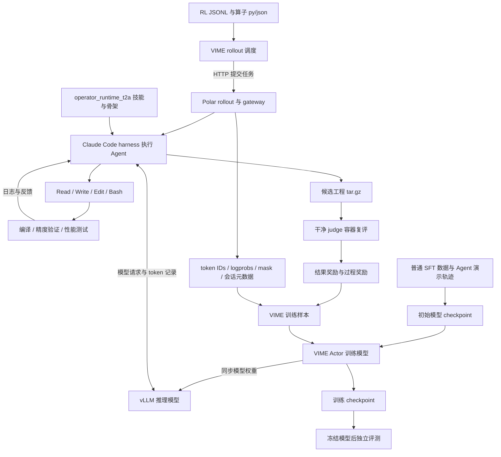
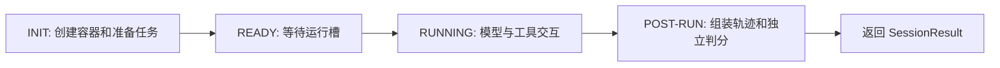
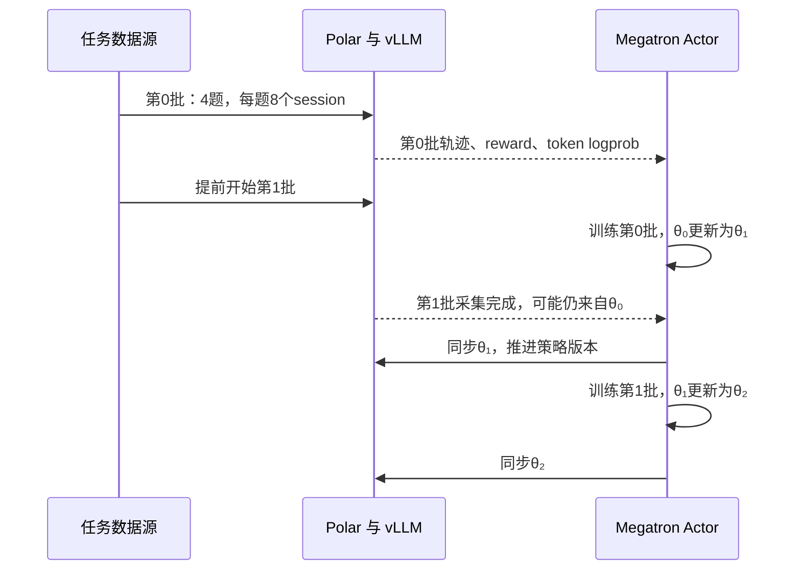

# AscendC 算子生成 Agentic RL：基础、一次 epoch 与训练后评测

这份文档面向第一次系统阅读这套工程的人。学习目标是：拿到一个 PyTorch 算子任务后，能解释它怎样变成 Agent 会话、AscendC 工程、评测结果、训练样本和模型参数更新；训练结束后，能用固定条件比较 SFT 模型与 RL 模型。

全文使用本地源码作依据，核对日期为 2026-09-23。文中的训练轮次和奖励数值有一部分是教学演算，均单独注明。本次只检查代码、配置和数据文件，没有启动 NPU 训练，没有执行实机算子评测，也没有把历史日志中的成绩当成本次结果。

阅读顺序：先读第 1 至 3 节建立概念，再跟第 4 至 6 节走完一条 Add 任务和一次 epoch，最后读第 7 至 10 节理解验证、最终评测和启动条件。第 11 节提供按源码学习的路线和自测题。

数据的详细教学已单独整理为 [SFT 与 RL 数据学习文档](ascendc-data-learning-guide.md)，补充了本次取回并校验的真实 SFT 记录、转换工具、RL 用例和两套评测入口。本文的数据概览保留整体 pipeline 视角，真实样本与数据质量检查请结合新文档阅读。

文档导航：

| 章节 | 内容 |
|---|---|
| [1. 工程边界](#1-当前工程的边界) | 五个仓库、提交快照、整体结构 |
| [2. 基础概念](#2-理解-pipeline-需要的基础) | AscendC、Tiling、SFT、RL、计数单位 |
| [3. 数据](#3-数据怎么进入训练) | SFT 和 RL 格式、Add 合同、数据划分 |
| [4. Agent 环境](#4-一条算子任务在-agent-环境里怎样执行) | 工具循环、编译、精度、性能、奖励 |
| [5. 一次 epoch](#5-一次训练-epoch) | 8 题、两轮 rollout、异步时序 |
| [6. 参数更新](#6-轨迹如何参与参数更新) | token mask、GRPO、attempt credit、TIS、KL |
| [7. 保存与验证](#7-checkpoint-与训练中验证) | checkpoint、导出、训练中 eval |
| [8. 训练后评测](#8-训练完成后怎样评测) | 冻结配置、真实接口、统计分母 |
| [9. 配置实践](#9-把教学例落到配置和操作上) | 教学数据脚本、资源布局、启动参数 |
| [10. 日志和报告](#10-怎样读日志排查异常和判断改进) | 故障定位、报告字段、当前接口问题 |
| [11. 学习路线](#11-按源码学习的顺序与自测) | 六次阅读与十道自测题 |
| [12. 源码索引](#12-源码定位索引) | 关键文件和函数定位 |

## 1. 当前工程的边界

### 1.1 仓库各自负责什么

| 仓库 | 本文使用的分支与提交 | 在整个流程中的职责 |
|---|---|---|
| `ascendc-kernelgen-data` | `master`，`0607a29d231cde384c9dfdb8a39f54f91837c327` | 提供普通 SFT 数据、Agent 轨迹数据，以及另一套 NPU 算子评测框架 |
| `ascendc-rl-datasets` | `main`，`5f7df0c4700b20d5872a6a8aeb63f735f8e620ea` | 提供 RL 任务清单、PyTorch reference 和测试 case |
| `ProRL-Agent-Server` | `feat/ascendc-rl-t2a`，`a8e306509e0e246c5fc8ca9958dc98d222a385e0` | Polar 服务、Agent harness、任务容器、轨迹记录、正式 judge 与奖励 |
| `cannbot-skills` | `master`，`99fbf4655460ecd8a30c65f7ba7e53a0bf9bf346` | 算子开发知识、流程、模板与评测脚本的上游来源 |
| `vime` | `a3-pd`，`a9b37736091e911c6ce0414a38f29b2bfa5bef46` | 模型推理、rollout 调度、轨迹转训练样本、GRPO 更新、权重同步与 checkpoint |

已经按要求完成分支切换。Agent 仓库中没有字面名为 `rl-t2a` 的分支，本文采用已有的 `origin/feat/ascendc-rl-t2a`。`vime/vime/` 是 Python 包目录，Git 仓库根目录是外层 `vime/`。以上是本地已有提交快照，没有执行远程更新。

### 1.2 先记住几个会影响理解的现状

1. `scripts/start-ascendc.sh` 固定启用 `DEBUG_ROLLOUT_ONLY=1`。直接启动这份脚本会生成并评测轨迹，不会训练模型。底层脚本也默认开启这个选项。
2. 当前 RL 数据目录没有 `cudallm`。本地能够核验的是 `CANN_Ops` 与 `NPUKernelBench`。不能把前者自动当成你提到的 cudallm。
3. SFT 数据主体是 Git LFS 指针。README 给出的样本数量有文档依据，当前 checkout 还不能核实真实样本内容。
4. Agent 用的是 `ProRL-Agent-Server/operator_runtime_t2a/` 内的运行时副本。旁边的 `cannbot-skills/` 不是自动热更新的数据源。
5. 训练脚本、Polar profile 和 RL JSONL 来自不同配置阶段。数据路径、同名 `.json`、提示词、NPU 卡池和端口需要对齐。
6. 当前代码有完整的训练与评测组件，但现成 AscendC 启动脚本没有直接配置独立验证集，也没有完整的 t2a 最终报告生成器。

这些事实会在后面具体展开。本文会把当前行为和建议的实验设置分开，方便沿代码核验。

### 1.3 整体结构



图中的 SFT 接线表示预期实验流程。当前默认 checkpoint 目录没有附带 SFT 来源记录，需要由实验方核对。

图中有两种完全不同的 NPU 工作。vLLM 和 Actor 用 NPU 运行语言模型；Agent 评测池用 NPU 编译运行生成的算子。它们各自有队列和资源预算。算子测试慢，可能让 rollout 缺数据；语言模型推理慢，也会让算子测试卡处于空闲状态。

## 2. 理解 pipeline 需要的基础

### 2.1 算子、kernel 与 reference

一个算子定义输入、输出和数学语义。例如本地 Add 的语义是 `torch.add(x, y, alpha=alpha)`，即支持广播的 `x + alpha * y`。shape、dtype、alpha 和输出结构都属于这个合同。

reference 是测试所依据的 PyTorch 实现。生成的 AscendC 实现需要履行相同合同。kernel 是在 NPU 上执行的设备端计算函数；一个可提交的算子工程还包含 Host 逻辑、注册代码、编译配置和 Python wrapper。只生成一段 kernel C++，通常还不能被这个环境评测。

对这个任务来说，训练对象是生成这些文件和工具调用的语言模型。生成出来的 Add kernel 没有需要通过 GRPO 更新的神经网络参数。编译器也不需要可微：judge 给出奖励后，VIME 更新的是语言模型生成各个 token 的概率。

### 2.2 AscendC 为什么需要 Host、Device 和 Tiling

Host 代码根据输入 shape 等信息计算切分方案、准备参数并启动 kernel。Device 代码在 NPU 上执行。Tiling 描述怎样把整项任务分给多个核，以及每个核每次处理多少数据。这个分工可对照[昇腾官方的异构计算说明](https://www.hiascend.com/document/detail/zh/canncommercial/83RC1/opdevg/ascendcbestP/atlas_ascendc_best_practices_10_0002.html)。

阅读本工程时需要认识这些术语：

| 术语 | 在算子中的作用 | 常见错误 |
|---|---|---|
| GM | 全局内存，放输入和输出张量 | 越界访问、错误 stride、无效地址 |
| UB / local buffer | 核内用于向量计算和临时数据的片上空间 | 申请过大、多个临时 buffer 生命周期冲突 |
| CopyIn / Compute / CopyOut | 搬入数据、计算、写回输出 | 尾块处理不完整、同步顺序错误 |
| Tiling | 多核划分、tile 大小、循环和尾块参数 | 小 shape 过度切分、大 shape 并行度不足 |
| Vector | 逐元素、归约等计算涉及的向量能力 | API dtype 不支持、数据对齐不满足要求 |
| Cube | 矩阵乘等计算涉及的矩阵能力 | 布局和分块与硬件接口不匹配 |
| Double buffer | 用多份 buffer 支持搬运与计算交叠的组织方式 | 额外空间不足、依赖关系没有同步 |

这张表用于读懂源码，不替代具体芯片和 CANN 版本的 API 文档。项目中的[tiling 技能](../cannbot-skills/ops/ascendc-tiling-design/SKILL.md)把设计拆成多核划分、UB 切分、buffer 规划和分支覆盖；[架构技能](../cannbot-skills/ops/npu-arch/SKILL.md)说明怎样识别目标平台。不要把某一代芯片的 UB 容量硬套给另一代。

教学假设：两个相同 shape 的 float32 输入各有 1024 个元素，先忽略广播和对齐问题。若一个 tile 处理 256 个元素，单份 x、y、输出 buffer 合计需要 `3 × 256 × 4 = 3072` 字节。实际实现还要计入临时空间、队列、多份 buffer 和 API 限制。tile 变大可以减少循环次数，也可能增加局部空间压力；用更多核可以增加并行度，也可能让小任务的调度开销占比升高。这些取舍要由测速决定。

### 2.3 精度高和加速比高分别在说什么

本项目通常把精度转化为测试是否通过。浮点运算存在舍入误差，运算顺序和中间 dtype 都会影响结果，因此不能把所有浮点任务都按逐 bit 相等验收。另一方面，索引、整数输出、输出 shape 和特殊值处理有各自的约束。

"精度通过率"还可能指三个不同分母：一个输出张量中合格元素的比例，一个算子通过的 case 比例，或者整个数据集中成功的算子比例。记录指标时必须写出分母。第 4 节说明当前 verifier 真正使用的判据。

对一个 case，定义加速比：

\[
s_c = \frac{t_{\mathrm{torch},c}}{t_{\mathrm{generated},c}}.
\]

`2.0x` 表示生成实现的耗时是基线的一半，`0.5x` 表示耗时是基线的两倍。本工程运行时采用 msprof 的设备侧性能数据。Python 调用耗时、编译时间和 Agent 花费的总时间应另记，不能直接用设备侧加速比解释。

一个算子有多个 case 时，几何平均可写为：

\[
s_{\mathrm{geo}}=\exp\left(\frac1M\sum_{c=1}^{M}\log s_c\right).
\]

教学例：两个 case 分别是 `2x` 和 `0.5x`，几何平均为 `1x`，算术平均为 `1.25x`。只报告后者会遮住性能退化。还要明确 `M` 是全部 case 还是成功测速的 case；本仓库的实际行为见第 4 节。

### 2.4 SFT、RL 和 Agentic RL

SFT 给模型示范输出。普通样本可以是"算子需求，正确实现"；Agent 样本还可以包含读文件、修改代码、调用评测和修复错误的过程。概念上的目标是提高示范中目标 token 的条件概率：

\[
L_{\mathrm{SFT}}=-\sum_{t\in\mathrm{target}}\log\pi_\theta(y_t\mid x,y_{<t}).
\]

这里的 `target` 由具体 SFT 数据转换器和训练器决定。本地并没有足够证据证明所有 SFT 轨迹都按同一种 mask 训练，不能从目录名字推断。

RL 让当前模型自己生成候选，再根据实际执行结果更新参数。一个任务可以采多条轨迹。同一任务内，表现较好的轨迹获得相对更高的训练权重。SFT 提供能做事的起点；RL 利用编译、精度和性能反馈继续改变生成策略。实际收益需要固定评测比较，不能因为训练 loss 降低就断言算子更快。

Agentic RL 的一次输出跨越多个模型请求和工具执行。模型可能先读 reference 和技能，再写 kernel，运行评测，读到错误后修改，最后提交工程。一次轨迹包含整个会话，而不是单次聊天回答。

当前启动脚本配置 GRPO。同任务多条轨迹的奖励构成组内基线，不需要为这条配置额外训练一个 critic。算法背景可读 [DeepSeekMath 第 4.1 节](https://arxiv.org/html/2402.03300v3#S4.SS1)。本项目另外实现了轨迹归一、mask、过程奖励等工程机制，应以本地实现为准。

### 2.5 几个相似的计数单位

| 名称 | 本文含义 | Add 示例 |
|---|---|---|
| task / prompt | 一项算子生成需求 | 生成符合 Add 合同的工程 |
| case | 该算子的一个测试输入配置 | 某个 shape、dtype、alpha 组合 |
| session / trajectory | 一次独立 Agent 求解过程 | 候选 A 从读文件到最终提交 |
| turn / request | 会话中的一次模型交互；具体计数按 harness 定义 | 模型决定执行一次 Read 或 Bash |
| attempt | 固定评测入口记录的一次候选评测 | 第一版编译失败，第二版通过 |
| trace | 轨迹构建器输出的一段 token 序列 | 合并兼容前缀后的一个训练片段 |
| rollout batch | 一轮调度产生的一批任务组和轨迹 | 4 个任务，各采样 8 个 session |
| optimizer step | 一次优化器更新 | 聚合若干训练片段后更新参数 |
| epoch | 对某个数据源遍历一遍的意图或框架计数 | 本框架用任务数和 batch 大小计算，存在整除与异步采样限制 |

一个 session 可以有多个 attempt 和多个 trace。增加 attempt 是让同一次求解多试几次；增加 `n_samples_per_prompt` 是重新启动更多独立求解。它们会产生不同的成本和统计含义。

`Claude Code` 在这里是执行读写文件、Bash 和多轮交互的 harness 名称。实际模型请求可以路由到 VIME 的 Qwen/vLLM。profile 中的 `claude-opus-4-5` 请求名称不证明使用了该厂商模型；需要查看展开后的路由和真实推理服务。


## 3. 数据怎么进入训练

### 3.1 普通 SFT、Agent SFT 和 RL 任务分别提供什么

普通 SFT 提供任务与示范答案。模型读到算子需求、API 问题或编译错误，学习生成已有的回答和代码。Agent SFT 还提供多轮对话和工具调用，模型可以学习先读文件、调用编译器、看报错再修改代码的过程。RL 数据提供待解决的算子任务及测试条件；训练时，当前模型自己尝试实现，环境运行它提交的代码，再给出奖励。

这里的三个"样本"不能混算。一条普通 SFT 样本是一段教学输入及答案，一条 Agent SFT 样本是一条对话轨迹，一条 RL task 是一个算子题目。一个 RL task 可以生成多条 rollout，每条 rollout 又会接受多个测试 case 的验证。

[SFT 数据说明](../ascendc-kernelgen-data/dataset/README.md) 将普通 SFT 分为基础数据和纠错、蒸馏数据。下表是 README 声明的数量：

| 数据目录 | 条数 | 主要内容 |
|---|---:|---|
| `doc_data_8.3.0` | 27,133 | CANN 8.3.0 文档问答 |
| `doc_data_9.1.0` | 5,969 | CANN 9.1.0 文档问答 |
| `vector_data` | 5,468 | Vector 算子实现 |
| `cube_data` | 50 | Cube 算子实现 |
| `cv_fusion_data` | 200 | Cube 与 Vector 融合实现 |
| `flywheel` | 11,119 | 错误分析、API 修正、kernel 修复 |
| `sft_distill_data` | 552 | 从 Agent 轨迹提取的生成与 debug 答案 |
| 合计 | 50,491 | README 统计口径 |

`instruction`、`input`、`output`、`system`、`history` 是普通 SFT 的常见字段。不要仅根据扩展名决定读取方式：顶层 README 说 JSONL，但[蒸馏数据说明](../ascendc-kernelgen-data/dataset/dataset/sft_distill_data/README.md)明确这两个文件是 JSON 数组。蒸馏数据包含 316 条生成和 236 条修复样本，它去掉工具中间过程，保留最终推理与代码。

Agent SFT 的 README 声明有 15,020 条 `messages` 轨迹，放在 16 个 `.jsonl.zst` 分片中。文档说明同一次算子任务会产生主 Agent 与 Subagent 两条轨迹，所以轨迹数也不等于独立算子数。发布内容中已有轨迹，使用者需要先取回数据。

当前本地检出有一个实际限制：62 个普通 SFT JSON 文件和 16 个 Agent 分片都是 Git LFS 指针。以 `dataset/agent_dataset/train-00000.jsonl.zst` 为例，文件开头是 `version https://git-lfs.github.com/spec/v1`，并非 zstd 数据。因此，50,491 和 15,020 是仓库声明，本文没有把它们写成本机解析验证后的样本数。要训练 SFT，需要先执行 `git -C ascendc-kernelgen-data lfs pull` 取回对象，再校验、解压和统计。[LFS 配置](../ascendc-kernelgen-data/.gitattributes)记录了相应文件规则。

### 3.2 这份 RL 数据在本地究竟有哪些

本地 `ascendc-rl-datasets` 的 `main` 分支包含 `CANN_Ops` 和 `NPUKernelBench`，没有 cudallm 目录。ProRL 的[历史交接说明](../ProRL-Agent-Server/deploy/ascend_operator/HANDOFF_20260805_rl_pipeline_fixes.md)第 74 行记录过服务器上的 `/home/docker/datasets/op_tasks/op_assets_cudallm_filtered189/`，并称其有 189 题；当前工作区没有这些资产，无法核对其实际题目、测试范围或可用性。CANN_Ops 是另一套数据，不能自动用它代替 cudallm。

对当前可读取文件逐行解析后，得到：

| 数据集合 | 算子任务数 | level1 / level2 / level3 | 测试 case 行数 |
|---|---:|---|---:|
| `NPUKernelBench/src` | 43 | 23 / 20 / 0 | 1,910 |
| `NPUKernelBench/src_simple` | 同一批 43 个 | 23 / 20 / 0 | 429 |
| `CANN_Ops/src` | 280 | 74 / 166 / 40 | 3,382 |

43 是当前这份 RL 数据的算子数。SFT 仓中的 `npu-kernelbench/data/kernel_generator` 本地有 105 个算子，使用另一套文件协议，不属于这张表。本文说 NPUKernelBench 的"全量"，指这 43 个任务使用 `src` 中全部测试 case。

两套 NPUKernelBench 资产的 `.py` 内容逐字节一致，差别在测试 JSON。`src_simple` 有 42 个算子各 10 条 case，还有一个只有 9 条，总计 429 条；这些 case 都能在对应的 `src` 文件中找到。full 的 1,910 是文件行数，其中有 4 条与所在文件其他行重复。这里没有把原始行数当作去重后的规模。

[数据集说明](../ascendc-rl-datasets/NPUKernelBench/README.md)建议在线 RL 用 simple，以缩短持卡验证时间，离线复评用 full。如果训练也要求全量 case，应让环境读取 `src`。这会增加每次提交的验证工作量，训练题目仍是 43 个，不会变成 1,910 个 prompt。

这些数量代表不同成本。算子数决定一轮遍历要抽取多少题，case 数影响每条 rollout 的验证耗时。模型采样次数还会把开发与验证工作重复多遍。例如给每题采样四次，四十三个题目对应一百七十二次开发尝试；每次尝试若调用验证工具多轮，真实硬件评测次数还会更多。这个算例只说明计数关系，不代表仓库当前启动参数。

数据文件也没有预存所有随机张量。Add 的输入函数读取 shape、dtype、alpha，然后调用随机数生成函数创建张量。因此，保存 case 清单不等于保存每次实际输入。比较不同 checkpoint 时，需要同时固定输入生成规则和评测随机性，才能区分模型差异与输入差异。

### 3.3 一行 task 怎样找到参考实现和测试

[任务生成器](../ascendc-rl-datasets/utils/gen_tasks/gen_op_tasks.py)的 `build()` 为每个算子生成一行 `{prompt, label, metadata}`。以 Add 为例，其任务在 [operator_tasks.npukernelbench.jsonl](../ascendc-rl-datasets/NPUKernelBench/operator_tasks.npukernelbench.jsonl) 第 18 行。

| 字段 | Add 的值或作用 |
|---|---|
| `prompt` | 用户消息，要求实现算子并按约定提交项目 |
| `label` | `npukernelbench_level1_3_Add`，用于标识题目 |
| `metadata.op_name` | 同上，连接 task 与算子资产的键 |
| `metadata.entry_point` | `Model`，参考实现入口 |
| `metadata.operator_backend` | `ascendc` |
| `metadata.arch` | 当前文件为 `ascend910b1` |
| `metadata.ops` | `["Add"]` |
| `metadata.level` | `"1"` |
| `metadata.data_source` | `"npu-kernel-bench"` |
| `metadata.uid` | 算子任务标识 |

`label` 不是标准 AscendC 答案。它没有告诉模型正确 kernel 怎么写，奖励也不在这行数据中。环境通过 `op_name` 找到同名 `.py` 与 `.json`，把参考实现和任务材料放进 Agent 工作目录。

`.py` 定义 `Model`、`get_input_groups()` 和 `get_init_inputs()`；`.json` 实际按 JSONL 存储，每行一个 `{"inputs": [...]}`，输入可以是张量规格、属性或张量列表。judge 会把参考文件改名为 `model.py`，所以 `get_input_groups()` 内部需要保留明确的 case 文件名。若按 `__file__` 的 stem 推导名称，就会错误地寻找 `model.json`。

任务列表还包含运行约定，例如 `ModelNew`、源代码目录和固定验证入口。这类提示词也有版本：当前数据仓模板仍提到 simple 算子的 Architect/Developer/Reviewer 路线，训练必须核对它与 `rl-t2a` 工作流是否一致。`metadata.arch` 也应与实际 SoC 配置核对，不能把数据中的字符串直接当作当前硬件事实。

### 3.4 用 Add 读懂算子合同

[Add 的参考代码](../ascendc-rl-datasets/NPUKernelBench/src/npukernelbench_level1_3_Add.py)定义：

```python
class Model(nn.Module):
    def forward(self, x, y, alpha=1.0):
        return torch.add(x, y, alpha=alpha)
```

数学上是 `z = x + alpha * y`，并遵守广播规则。full 有 50 条 case，simple 有 10 条。[simple case 文件](../ascendc-rl-datasets/NPUKernelBench/src_simple/npukernelbench_level1_3_Add.json)中的几条真实输入如下：

| 行号 | dtype | x shape | y shape | alpha |
|---|---|---|---|---:|
| 1 | float32 | `[128]` | `[128]` | 1 |
| 4 | float16 | `[256,256]` | `[256]` | 0.5 |
| 8 | bfloat16 | `[512,512]` | `[1,512]` | -0.5 |
| 10 | bfloat16 | `[32,64,128,256]` | 同 x | 1 |

如果 Agent 只写相同 shape 的 `x+y`，第一个 case 可能通过，但 alpha 与广播相关的 case 会失败。实现还要处理多个 dtype。只有同时满足任务合同，性能结果才有意义。

一个 Add rollout 的含义是：模型经历若干工具调用，完成一次开发尝试，最终留下可验证的代码制品。50 个 case 验证这一个制品，不会独立产生 50 条语言模型轨迹。同一任务采样多次，才会得到可用于比较的多条 rollout。

### 3.5 从 SFT 走到 RL 还需要哪些准备

数据目录不会自动串成训练。通常先取回 SFT 数据，检查格式、清洗重复、按目标模型聊天模板构造输入，并决定哪些 assistant token 参与监督；工具返回和用户消息通常作为条件，具体 mask 要由采用的 SFT recipe 确认。训练得到的权重和 tokenizer 才是 RL 初始化所用的模型资产。

当前数据仓提供数据和说明，没有给出这五个仓库之间一键完成 SFT 再启动 RL 的完整 recipe。不能把 Alpaca JSON 直接当作 RL `prompt-data`，也不能把 RL 的 `label` 当成监督答案。开始 RL 前需要核对模型路径、任务 JSONL、`op_name` 对应资产、运行时 skill 版本以及 judge 合同。

准备普通 SFT 时，应先确认"输入"和"答案"边界。比如编译报错是题目条件，修复建议和代码是监督目标；若把标准答案误拼进用户消息，训练指标会失真。准备 Agent SFT 时，还要保留工具调用与工具返回的对应关系，检查调用标识、消息顺序与终止状态。把所有消息简单拼成一段文本，会丢失模型在何时行动、何时接收反馈的信息。

轨迹筛选也需要明示标准。仓库称这些轨迹为高质量数据，但本次没有读到实际分片，不能进一步保证每条轨迹都包含成功编译、全量精度通过或足够好的加速比。恢复数据后，应统计可解析比例、工具调用完整率、长度分布，并检查成功标签是否有对应评测记录。训练样本长到超过上下文限制时，也应说明截断策略，避免只留下早期失败步骤而删掉修复结果。

资产健康检查也只完成一部分工作。[op_verify](../ascendc-rl-datasets/utils/op_verify/README.md)检查参考模块能加载、输入能生成、参考 forward 能运行。这不能替代对新生成 AscendC 代码的编译、精度和性能评测。

### 3.6 什么算训练集，什么算真正的测试集

当前可见文件只有统一任务列表，没有独立的 train/validation/test 划分清单。下面是实验设计建议：先按算子或近似计算图分组，再确定训练、验证和测试集合，并保存清单与哈希。根据验证结果挑 checkpoint，最终报告使用固定测试集。

从 simple 训练切换到 full 复评，可以发现同一题目上遗漏的 dtype、shape、属性组合。由于算子相同，而且 simple 本身包含在 full 内，这只能称为同任务的更完整验证。未见算子泛化需要另外留出题目；未见输入泛化可用新 shape、新随机种子等条件单独评测。

SFT 的 benchmark 污染也需要审计。README 明说部分 flywheel 数据来自 AscendKernelGen 的失败样本，不能默认它与所有评测题互不重叠。目前 SFT 正文仍是 LFS 指针，无法完成内容去重。下载后应比较任务来源、参考代码与计算图近重复；同一算子的主 Agent、Subagent 和蒸馏样本应按来源共同分组，避免一部分用于训练，另一部分被当作独立测试。

为了让复现实验时能追溯数据，建议给每次运行保留一份简短的数据清单：仓库提交号、任务文件哈希、资产目录、使用 full 还是 simple、每个算子的 case 数、划分版本以及输入生成种子。这样，某个 checkpoint 的通过率发生变化时，能够先排除题目集合或测试覆盖变化，再判断训练本身的影响。

## 4. 一条算子任务在 Agent 环境里怎样执行

以 `npukernelbench_level1_3_Add` 为例。任务要求实现的是 `x + alpha * y`，还要支持 reference 和用例规定的广播、shape、dtype。名字中的 Add 不能替代完整输入契约。训练的语言模型读 reference、查资料、改代码、调用评测，并根据工具返回修复实现；最终交付一个能在干净环境里重新编译的 AscendC 工程。

这里有两种不同的模型。任务文件中的 `Model` 是用于核对输出的 PyTorch 参考实现；VIME 更新的是生成代码和工具调用的语言模型。训练不会给 Add 的 C++ 参数做梯度下降，C++ 代码只是语言模型一次求解过程的产物。

### 4.1 从训练请求到一段 Agent 会话

Polar 暴露的是异步任务接口，没有一个供 VIME 逐步调用的 Gym `reset()` / `step()` 接口。VIME 向 `POST /rollout/operator_samples/submit` 提交任务，Polar 依据 `operator_npu` profile 补齐容器、Agent、评测器和轨迹构造器配置，然后返回 `task_id`。调用方用 `GET /rollout/task/{task_id}` 获取状态和最终结果。接口和数据结构见 [server.py](../ProRL-Agent-Server/src/polar/rollout/server.py) 的 `submit_operator_samples_async` 与 [models.py](../ProRL-Agent-Server/src/polar/rollout/models.py) 的 `OperatorSampleRequest`。

`task_id` 标识一次提交，`session_id` 标识其中一条独立求解轨迹。`num_samples=4` 表示该任务产生四个独立 Agent 会话，每个会话有自己的工作目录和工具历史。它不表示给同一个 Python forward 连续传四组 tensor。

一条会话依次经历：



准备环境可以看作 `reset` 的对应动作；一次模型输出工具调用、工具返回观察结果，可以看作一次交互 `step`。这只是帮助理解的对应关系，真实调用由 Claude Code CLI 驱动，不是 VIME 在每个工具调用后直接控制容器。[Claude Code harness](../ProRL-Agent-Server/src/polar/agent/presets/claude_code.py) 会以非交互模式运行 `claude ... -p <instruction>`。

CLI 发出的模型请求先到 Polar gateway。gateway 将 Anthropic 格式转换为模型服务需要的格式，转给 VIME 管理的 vLLM，并记录每次调用的 token ID 和 logprob。配置中的 `claude-opus-4-5` 是 CLI 使用的模型别名；实际推理模型由 `service.model_served` 和模型服务决定。它不表示训练正在更新 Claude 的权重。[engine.py](../ProRL-Agent-Server/src/polar/gateway/engine.py) 的 `VLLMEngine.prepare_request` 会开启 `logprobs`、`return_token_ids` 和 `top_logprobs=0`。

### 4.2 运行时到底带进了哪些资料

当前 [profile.t2a.yaml](../ProRL-Agent-Server/deploy/ascend_operator/profile.t2a.yaml) 选择 `operator_runtime_t2a`。Polar 将它只读挂载到容器的 `/opt/canonical`，再由 [prepare_operator_workdir.py](../ProRL-Agent-Server/operator_runtime_t2a/runtime/prepare_operator_workdir.py) 准备工作目录：

```text
/opt/workspace/agent_workdir/
├── input/
│   ├── npukernelbench_level1_3_Add.py
│   └── npukernelbench_level1_3_Add.json
├── CLAUDE.md
├── .claude/
│   ├── skills/
│   ├── workflows/
│   └── settings.json
├── tools/                         # 固定评测入口，只读挂载
├── npukernelbench_level1_3_Add/    # 预生成工程骨架
└── judge_out/                     # 自检结果
```

训练端提交的 `.py` reference 可以通过请求里的 `sample.task_source` 传到 Polar，并用 SHA-256 校验。NPUKernelBench 的同名 `.json` 不走这个通道，Polar 从 `operator_runtime.task_assets_dir` 另行上传。Add 的 `get_input_groups()` 要读同名 JSON；只有 Python 文件，环境仍然不完整。准备脚本会提前检查这种缺件。

`cannbot-skills` 是资料和工作流的来源仓库，而这次训练真正装入容器的是 `operator_runtime_t2a` 中的快照及本项目修改。改动相邻的 `cannbot-skills/` 不会自动改变已经配置的运行时。研究效果时应一起记录模型 checkpoint、数据版本、Polar commit 和 runtime 快照；否则技能变化也可能造成成功率上升。

当前 [CLAUDE.md](../ProRL-Agent-Server/operator_runtime_t2a/CLAUDE.md) 按 reference 的计算结构分流：简单任务先做简短设计与 API 核对，再补全预生成 AscendC 骨架；复杂融合任务先写 TileLang 设计表达，再落到同一套 AscendC 工程。Add 属于前一类，但广播和 `alpha` 仍需正确实现。TileLang 是复杂路径中的设计表达，不是最终接受提交的后端。

该 profile 允许 `Bash Read Edit Write Grep Glob`，禁用 `Skill` 和 `Agent` 工具。所谓使用 skill，是用 `Read` 打开 `.claude/skills/<name>/SKILL.md` 及相关参考文件，不能据此写成 Architect、Developer、Reviewer 三个子 Agent 真的并行执行。数据目录中旧任务 prompt 仍含这些旧约定，正式训练前需与当前 runtime 合同统一。

### 4.3 Add 的第一版代码怎样走到设备上

准备脚本根据 reference 签名生成 wrapper、注册文件、host 和 kernel 骨架。对 Add 来说，模型首先确认 `x`、`y`、`alpha`、广播规则和输出 dtype，再安排每个计算核处理的数据范围及块内计算。骨架中的输出分配、dtype 判断、tiling 和 identity copy 都可能只是占位，不能当成题目语义。

工程中的调用关系是：

```text
ModelNew.forward(x, y, alpha)
  → torch.ops.npu.<注册名>(x, y, alpha)
  → register.cpp 注册的 C++ 函数
  → op_host/<op>.cpp 分配输出、计算 tiling、启动 kernel
  → op_kernel/<op>_kernel.cpp 搬入、计算、搬出
  → 输出交给 Python verifier
```

语言模型完成首版实现后，通过 `Bash` 调用固定入口。此命令在 Agent 工作目录内执行：

```bash
bash tools/ascendc_eval_pipeline.sh \
  --op_name npukernelbench_level1_3_Add \
  --impl output/submission/npukernelbench_level1_3_Add_impl.tar.gz \
  --out_dir judge_out
```

入口会自动打包 `{op}/`。`output/submission/` 存放 tarball，不是写 C++ 源码的位置。模型从工具返回中获得当前阶段、错误分类、错误上下文、用例通过数和性能结果，接着查相关 skill、修改源码，再运行同一入口。

一个 `turn` 是 CLI 的交互轮次，一个 `attempt` 是实际执行的一次候选评测；两者都不是训练 optimizer step。当前 profile 的有效值是最多 150 个 turn、21600 秒会话预算、generation 最多 15 次候选评测，首次完整成功后另有 4 次 optimization 评测。有效配置以 YAML 值为准，文件中部分注释还留有 8 次、200 轮、9000 秒等旧值。

固定入口会比较源码 hash。源码完全不变时，它复用上次结论，不再编译、对拍和测速，也不消耗本地评测预算。有效修改后的新候选才进入完整流程。

### 4.4 一次候选评测检查什么

[ascendc_eval_pipeline.sh](../ProRL-Agent-Server/operator_runtime_t2a/tools/ascendc_eval_pipeline.sh) 的执行顺序如下：

| 阶段 | 检查内容 | 典型失败含义 |
|---|---|---|
| 解包和准备基准 | 找到 wrapper 与 kernel，移除预编译产物，注入原版 reference 和 JSON | 未打包、布局错误、基准缺件 |
| AST 检查 | 检查 wrapper 是否退化成普通 Torch 计算等情况 | 没有交付符合约束的自定义算子 |
| 编译 | 用 CANN/AscendC 工具链构建工程 | API、类型、链接或工程配置错误 |
| 注册冒烟 | 检查自定义算子是否成功加载和注册 | `.so` 加载失败、注册名不匹配 |
| 精度对拍 | 执行 reference 与候选，比较全部输入组 | shape、数值、NaN/Inf 或运行异常 |
| 状态检查 | 检查缓存、常量输出等不可信实现 | 当前输入没有获得真实计算结果 |
| 性能评测 | 用 msprof 测 reference 与候选的设备计算时间 | 无法形成有效测速结果 |

编译和注册检查不占 NPU。对拍、状态检查和测速分别通过 `npu_lease_exec.py` 从共享卡池抢锁，用完释放。profile 设置 `lease_at_start=False`，因此 Agent 阅读资料、思考或编译时不会长期占卡。卡池锁能避免同一批受管理进程抢同一张卡，但还需确保训练、推理和其他服务按部署规划使用设备。

精度通过也不一定允许会话结束。`operator_valid=true` 表示本次实现通过正确性和测速流程，`task_complete` 才是 Stop hook 的完成信号。当前默认目标是几何平均加速比达到 1.1。若尚未达标且 optimization 预算仍有余量，工具返回 `task_complete=false`，模型应分析性能并继续修改；在这个正常优化分支，达到目标或优化预算耗尽可以结束。generation 预算耗尽、基础设施错误、turn 上限和会话超时也可能终止求解，并不表示已达到性能目标；状态缺失时 Stop hook 也不阻断结束。这个 1.1 是求解工作流的目标，不是奖励函数的硬阈值。

### 4.5 为什么要再开一个 judge 容器

Agent 自检用于修复代码，最终 outcome reward 来自独立 judge。当前配置使用延迟创建的 fresh runtime：先提取 best 提交物，停止 Agent 容器，再创建判分容器。判分器重新准备原始任务和可信工具，只接收提交工程并从源码重编，不采用 Agent 自报的 `metrics.json` 作为最终成绩。实现见 [node.py](../ProRL-Agent-Server/src/polar/gateway/node.py) 的 `_run_lazy_eval` 和 [operator_judge.py](../ProRL-Agent-Server/src/polar/trajectory/evaluator/operator_judge.py) 的 `evaluate`。

固定入口把本轮真正评测的 tarball 保存为不可变 candidate，记录 hash，再决定是否提升为 `.best.tar.gz`。[pack_submission.sh](../ProRL-Agent-Server/operator_runtime_t2a/tools/pack_submission.sh) 按 outcome 奖励阶梯严格比较，只有更高分的版本才覆盖 best，相同分数保留较早版本。失败候选也可能成为当前 best，例如编译失败修成部分精度通过；有成功候选后，成功版本间的比较等价于比较加速比。这样，后一次性能优化写坏了 kernel，judge 仍可拿到先前表现最好的实现。

best 还会镜像到 session 目录。gateway 先取该镜像，再尝试 profile 配置的提交路径。最终评测的对象是选出的工程快照，不一定等于 Agent 最后一次修改留下的工作目录。

### 4.6 精度与性能的数字怎样得来

[verification_ascendc.py](../ProRL-Agent-Server/operator_runtime_t2a/skills/tilelang2ascend-translator/scripts/verification_ascendc.py) 固定随机种子为 0，从 reference 构造输入组，用各自的输入副本执行 `Model` 与 `ModelNew`，逐组记录 `case_oks`，全部通过才置 `ok=true`。reference 在 NPU 上不能执行时，可整体回退 CPU 计算基准，并在报告中写 `ref_fallback`；候选始终在 NPU 上运行。

浮点比较先检查 shape 与 NaN/Inf，再检查三项条件同时成立：所有有限元素满足 allclose；分桶匹配比例至少 0.9；平均相对误差 MERE 小于对应 dtype 阈值。因此 `matched_ratio>=0.9` 不等于允许随意错 10% 元素。另两项仍然会否决结果。

| reference dtype | allclose 的 atol | allclose 的 rtol | 小值域界线 | 小值域绝对误差上限 |
|---|---:|---:|---:|---:|
| FP32 | 0.001 | 2⁻¹³ | 2⁻¹⁴ | 2⁻³⁰ |
| FP16 | 0.09 | 2⁻¹⁰ | 2⁻¹¹ | 2⁻¹⁶ |
| BF16 | 0.1 | 2⁻⁷ | 2⁻⁸ | 2⁻¹⁶ |

正常值域相对误差阈值及 MERE 阈值与表中 rtol 相同。整数、布尔和复数另有比较分支，不应把这一张浮点表推广到所有输出。

这里还有一个需要复核的实现细节：`_run_comparisons` 传入 `(reference, candidate)`，但 `_compare_float_tensors` 调用底层精度函数时交换了两个参数。因此当前相对误差分母和小值分桶实际以 candidate 为基准，而函数注释写的是 golden。浮点 candidate dtype 不同也会先转换到 reference dtype。读实验结论时应以当前源码行为为准，不能将它描述成严格 dtype 相等、始终以 reference 作分母的检测。

性能使用 [msprof_perf_summary.py](../ProRL-Agent-Server/operator_runtime_t2a/skills/ops-profiling/scripts/msprof_perf_summary.py)。固定入口当前采用同进程 30 次 warmup、1 次正式测量、grouped quick 模式。它在一次 msprof 采集中按 case 和实现放置事件标记，统计标记之间的计算 kernel 耗时；一个 forward 含多个 kernel 时，累加这些计算耗时。grouped 模式失败后会退到逐 case 采集。

若第 j 个有效 case 的 reference 时间为 `t_ref,j`、候选时间为 `t_impl,j`：

```text
s_j = t_ref,j / t_impl,j
s_op = exp(mean(log(s_j)))
```

`speedup_vs_torch` 优先使用这个算子所有有效测速 case 的几何平均加速比。它不是 Python 调用耗时，也不是生成代码、编译和整个 Agent 求解的端到端加速比。空 tensor case 不测速；逐 case 回退时无法测速的 case 也可能不进入均值。当前 pipeline 只要求存在有效聚合值，正式报告还应检查 `performance.json` 的 `n_cases_valid`、`n_cases_total` 和逐 case 错误，不能仅看一个平均数。

### 4.7 reward 如何回到训练端

[operator_reward.py](../ProRL-Agent-Server/src/polar/trajectory/evaluator/operator_reward.py) 先将 fresh judge 的结果映射成 outcome 奖励：

| 结果 | 默认 outcome reward |
|---|---:|
| AST 不通过、未交有效实现 | 0 |
| AST 通过，AscendC 编译失败 | 0.1 |
| 注册、加载、崩溃、超时、启动或状态检查失败 | 0.2 |
| 已过 AST 的其他未分类失败 | 0.25 |
| 对拍完成但未全过 | `0.3 + 0.1 × case_pass_ratio` |
| 全部正确，但 benchmark 失败 | 0.4 |
| 正确且测速成功 | `0.75 + 0.25 × (s²-1)/(s²+1)` |

通过率缺失时，精度失败档回退 0.35；源码用 `min(ratio, 0.999)` 处理统计为全过却判失败的不一致情况。成功公式在 1× 时为 0.75，在 2× 时为 0.9，继续加速还能增加奖励。基础设施故障，例如任务缺件、设备不可用、profiler 缺失或指标损坏，进入 `ERROR / retry`，reward 为 `None`，不会伪造一个失败算子的零分。

默认还启用幅度 `Δ=0.10` 的过程奖励。记 `G` 为 generation 预算；`k` 为最终到达的最深已通过子阶段首次通过的评测序号；`L` 为相同 `(stage,error_type)` 的连续失败最长次数；`g` 为成功尝试中的最佳加速比相对首次成功加速比的提升：

```text
B_first = 0.6Δ × max(0, G+1-k) / G              # 无已通过子阶段时为 0
B_opt   = 0.4Δ × (0.5I_opt + 0.5min(1, g/0.2)) # 仅最终 success 时计入
P_repeat = min(0.01 × max(0, L-1), 0.4Δ)
R_process = clip(B_first + B_opt - P_repeat, -Δ, Δ)
```

`I_opt=1` 表示确实进入过 optimization。过程分来自 `process_info.json` 的事件序列，判分器会重算，并检查它与 fresh judge 的终局是否一致；数据缺失或校验失败时过程分为 0。`POLAR_PROCESS_REWARD=0` 可关闭该部分。

最后，若发生 `T` 次输出截断：

```text
R_base  = clip(R_outcome + R_process, 0, 1)
R_final = max(R_base - min(0.01 × T, 0.05), 0)
```

默认截断惩罚针对事件次数，不按正常思考的长度扣分。上述系数可以通过相关环境变量修改，实验记录应保存实际值。

gateway 将 `R_final` 写入会话的评价元数据，并广播给各条 trace。`prefix_merging` 将多轮对话按 token 前缀拼接；工具结果不参与策略损失，只有符合条件的模型采样 token 带训练 mask。当前还会标记每次评测对应的 `attempt_spans`，VIME 可据此计算 attempt credit。builder 的 `POLAR_POST_BEST_MASK` 默认值是 1，但实际 [start_polar_nohup.sh](../ProRL-Agent-Server/deploy/ascend_operator/start_polar_nohup.sh) 将其启动默认值覆盖为 0，因此用该入口启动时，best 之后的片段默认不会因这项机制被屏蔽。若显式设为 1，才从 best 后的下一次 attempt 开始屏蔽。标量过程分、token mask 和训练端的 attempt credit 是三个不同机制，最终以进程实际环境变量为准。


### 4.8 把 Add 的三次尝试连起来算一次奖励

下面全部是教学假设，帮助连接源码、测试和分数，不代表发生过的运行。

| attempt | Agent 的修改与结果 | full 精度结果 | 加速比 | outcome 分数 |
|---|---|---:|---:|---:|
| 1 | 第一版遗漏部分广播和 alpha 处理 | 30 / 50 | 不计 | 0.36 |
| 2 | 补齐计算合同，通过测速 | 50 / 50 | 0.8x | 约 0.695122 |
| 3 | 优化分块和搬运，仍保持正确 | 50 / 50 | 1.2x | 约 0.795082 |

第 2 次实现已正确，但未达到 1.1x 目标，因此第 3 次属于 optimization。假设 judge 在干净环境复现第 3 次结果，过程记录有效，generation 预算为 15，没有重复失败和截断，则 `B_first = 0.06 × 14/15 = 0.056`。优化加速比提高 0.4，`B_opt = 0.04`，过程分为 0.096，最终 reward 约为 `0.891082`。若另有一次计入的截断事件，则减去 0.01。

这个最终 reward 加入 Add 的 8 条独立轨迹组，参与第 6 节的组内比较。它不会单独触发一次 optimizer step。该 session 的三次 attempt 可以提供分段 credit，但仍然只是一条独立求解轨迹。

## 5. 一次训练 epoch

`a3-pd` 分支的 AscendC 入口是 [start-ascendc.sh](../vime/scripts/start-ascendc.sh)，它调用 [run-qwen36-35b-polar-ascendc.sh](../vime/scripts/run-qwen36-35b-polar-ascendc.sh)，最终执行 `train_async.py`。当前入口固定开启 `DEBUG_ROLLOUT_ONLY=1`，所以运行的是 Agent 采样和评测反馈，不会更新模型参数。Actor 的初始化、训练、保存和权重同步都会提前返回。[源码：actor.py，第 62、473、656、683 行](../vime/vime/backends/megatron_utils/actor.py)

父脚本还固定设置 `ROLLOUT_BATCH_SIZE=8`、`N_SAMPLES_PER_PROMPT=8`、`GLOBAL_BATCH_SIZE=64`、`NUM_ROLLOUT=200`。这表示按 200 轮设置采集预算；不能把它读成训练 200 个 epoch。为了读清楚数据如何流动，下面单独设一个教学实验：从训练集选出 8 个任务，运行一次名义 epoch。它是参数和数量的演算，没有执行训练，也不代表实测效果。

| 教学参数 | 数值 | 计数对象 |
|---|---:|---|
| 训练子集大小 N | 8 | 8 个算子任务 prompt |
| rollout batch size B | 4 | 每轮接受 4 个任务组 |
| samples per prompt G | 8 | 每个任务独立启动 8 个 Agent session |
| global batch size | 32 | 每次 optimizer step 使用 32 条 trajectory |
| rollout 轮数 | 2 | 理想情况下两轮覆盖这 8 个任务 |

暂时假设没有失败、超长过滤、补采和额外预取。第 0 轮取任务 1 到 4，每题生成 8 个 session，总计 32 条 trajectory；第 1 轮取任务 5 到 8，同样得到 32 条 trajectory。一个 epoch 因而有 64 条被接受的轨迹。这里的 8 次尝试是 8 个独立 Agent 会话，每个会话内部仍可以多轮调用工具和修改代码。

每轮的 32 条 trajectory 构成一次 optimizer step。某个 Agent 会话可能拆出 1 条 trace，也可能拆出多条，但这些 trace 共用同一个轨迹标识。训练调度器先按轨迹标识分组，再按 global batch size 切训练 step，所以 trace 数量变多不会自动增加 optimizer step 数。trace 变长会降低每个 microbatch 可容纳的完整 trace 数量，整批可能需要更多 microbatch；过长的单条 trace 仍会被过滤。microbatch 是内存预算下的梯度累积分块，并非任意切断单条轨迹。[源码：rollout.py，第 1195、1323 行](../vime/vime/ray/rollout.py)；[dp_schedule.py，第 111 行](../vime/vime/utils/dp_schedule.py)

单轮采集实际经过以下过程。

1. 数据源从 `operator_tasks.jsonl` 读取 `prompt`、`label`、`metadata`。它为每个 prompt 复制 G 个 Sample，给同题样本相同的 `group_index`，给每次尝试不同的 `index`。[源码：data_source.py，第 61、90 行](../vime/vime/rollout/data_source.py)
2. Bridge 从 `metadata.op_name` 找任务名，从 `OPERATOR_TASKS_DIR/{op_name}.py` 读取任务源码，将源码和 SHA-256 放进请求。它向 Polar 的 `/rollout/operator_samples/submit` 提交任务。现行源码要求 `.py`，部署脚本注释中的 `.json` 不能替代这份接口约定。[源码：bridge/rollout.py，第 1261、1313 行](../vime/vime_bridge/rollout.py)
3. Polar 创建独立 session。Agent 读取任务和 skill，生成 AscendC 实现，调用编译、精度与性能工具，再根据反馈修改。一个 session 的多次尝试最终形成一条 trajectory。
4. Polar 返回 trajectory、trace、token、mask、生成时 logprob 和 reward。Vime 负责把这些结果转成可训练张量。
5. 调度器收够 B 个可接受的任务组，才将这一轮数据交给训练器。当前脚本设置完成比例阈值为 0.8，G=8 时至少需要 7 个完成且有训练 token 的 session。这个条件衡量轨迹可用性；它不要求 7 个算子都通过精度检查。[源码：bridge/rollout.py，第 1778 行](../vime/vime_bridge/rollout.py)

实际运行中的采集数经常超过 `B × G`。请求错误、超长 trace、坏 logprob 或陈旧策略轨迹会触发过滤或补采，后台 worker 也可能提前读取后续任务。这里要分别记录"启动了多少会话"和"最终训练用了多少轨迹"。

当前 `train_async.py` 还会提前生成下一轮。训练第 0 批以前，它已经发起第 1 批采集，因此不能把两轮画成严格的"用 θ₀ 采样，更新 θ₁，再用 θ₁ 采样"。第 1 批可能仍由 θ₀ 生成。默认 `update_weights_interval=1` 时，训练器先等待已发起的下一批生成，再把新权重推给推理端，后续请求才使用新版本。[源码：train_async.py，第 43 至 102 行](../vime/train_async.py)



图中省略了后台额外预取和过滤。若学习时需要严格的同步步骤，仓库另有 `train.py` 和 `generate_rollout_polar_sync`。同步桥接保证返回时没有继续生成的 Polar session；它属于另一套配置，现行 AscendC launcher 没有选择它。

Vime 的 `--num-epoch` 是计算 rollout 预算的参数。仅当没有指定 `--num-rollout` 时，框架才计算：

\[
\text{num_rollout}=\text{num_epoch}\times\left\lfloor\frac{N}{B}\right\rfloor.
\]

本地 43 个 NPUKernelBench 任务，若 B=4，一个名义 epoch 默认是 10 轮。理想情况下只取 40 个任务；它不保证这一轮遍历了全部 43 个任务。数据源下一次取数时会取剩余 3 个，再进入下一次 shuffle，补 1 个新 epoch 的任务。仓库的 `CeilEpochRolloutDataSourceWithBuffer` 可以让轮数向上取整为 11，但这意味着额外取 1 个任务，而且异步预取和补采仍会影响严格遍历语义。[源码：placement_group.py，第 403 行](../vime/vime/ray/placement_group.py)；[data_source.py，第 90 行](../vime/vime/rollout/data_source.py)；[向上取整数据源](../vime/vime_bridge/data_source.py)

把教学参数落到启动配置前，需要制作独立的训练脚本副本：关闭 debug，重新划分 actor 与 rollout 卡数，设置 8 条任务的 JSONL 和任务源码目录，并将轮数改成 2。父脚本内的固定赋值会覆盖同名外部环境变量；子脚本也没有透传 `"$@"`，所以在 shell 命令末尾追加 `--num-epoch 1` 不会生效。修改参数数组时，若选择 `--num-epoch 1`，须删除已有的 `--num-rollout`。保留默认 actor 8 卡和 rollout 12 卡却只开放 12 张卡，也不能构成可训练拓扑。

## 6. 轨迹如何参与参数更新

训练器接收的对象不只有"最终代码和一个分数"。每条 trace 包含 `prompt_ids`、`response_ids`、`loss_mask`、`rollout_log_probs` 和 reward。Prompt 里可能有任务说明、skill、先前对话与工具反馈，response 也可能包含由轨迹构建器合并的上下文片段。模型必须看见这些上下文，才能理解为什么下一步要修改代码；计算梯度时则只使用 mask 标记的 token。[源码：adapter.py，第 142 行](../vime/vime_bridge/adapter.py)

可以用下面的教学 trace 理解 mask。具体哪些 reasoning token 参与训练，以 Polar builder 的配置为准。

| token 片段 | 作用 | 示例 mask |
|---|---|---:|
| 任务、skill、已有代码 | 条件上下文 | 不属于 response loss |
| Agent 生成的分析和工具调用 | 可学习的行为 | 1 |
| 编译器返回的报错 | 下一步决策依据 | 0 |
| Agent 根据报错生成的修复 | 可学习的行为 | 1 |

Bridge 直接使用 Polar 提供的 mask，不根据角色文本重新猜测位置。Agent ERROR/TIMEOUT 对应的失败轨迹会被完全遮掉；正常完成但代码编译失败或精度不通过的轨迹仍可能作为低分结果参与学习。这两种失败含义不同：前者缺少可靠的任务结果，后者提供了可学习的负面反馈。

Token 和生成时 logprob 必须一一对应。训练器不能把 Agent 最后输出的文本随意重新 tokenize，再声称它等价于生成时采取的动作。当前 adapter 会检查 logprob integrity，并移除有问题的样本。超长 trace 也会过滤：桥接上限按 `max_tokens_per_gpu × CP` 计算。父启动脚本为 `32768 × 4 = 131072`，低于推理端的 262144 context；"推理放得下"和"训练接得住"是两项限制。[源码：adapter.py，第 249 行](../vime/vime_bridge/adapter.py)；[bridge/rollout.py，第 1704 行](../vime/vime_bridge/rollout.py)

当前脚本选择 GRPO。它用同一题的多条轨迹相互比较，形成相对优势，而没有额外训练 critic。对一个任务，先将同一 session 的多个 trace 折叠为一条 trajectory reward，再对有效轨迹计算均值和样本标准差：

\[
A_i=\frac{R_i-\bar R}{\max(s_R,0.05)}.
\]

分母中的 0.05 是实现中的标准差下限。失败或中止轨迹不参与均值与标准差，其优势置 0；有效轨迹只有一条时也无法形成组内比较。代码使用 `torch.std()` 的样本标准差。算完后，同一 trajectory 的所有 trace 获得相同的轨迹优势。[源码：reward_post_process.py，第 42 至 107 行](../vime/vime_bridge/reward_post_process.py)

假设某题 8 条正常完成的轨迹得分如下。这组数字只用于演算，不是本项目的实验结果，也不用于定义环境的实际评分函数。

| 轨迹 | reward | 组内 advantage，约值 |
|---|---:|---:|
| 1 | 0 | -1.2838 |
| 2 | 0 | -1.2838 |
| 3 | 0.25 | -0.7132 |
| 4 | 0.50 | -0.1426 |
| 5 | 0.75 | 0.4279 |
| 6 | 1.00 | 0.9985 |
| 7 | 1.00 | 0.9985 |
| 8 | 1.00 | 0.9985 |

这里均值是 0.5625，样本标准差约 0.438137。得分高于本组均值的轨迹产生正的轨迹级优势，低于均值则产生负的轨迹级优势。只考虑这个项时，它分别鼓励或抑制对应行为；最终每个 token 的更新还受 attempt credit、mask、TIS 和 KL 等影响。零优势不代表这条代码"没有价值"，只表示本组没有给出区分方向。如果 8 条 reward 全相同，轨迹级优势为 0；当前默认开启的 attempt credit 仍可能产生非零的分段优势，KL 正则也仍可能产生梯度。

轨迹级优势之外，当前 [attempt_credit.py](../vime/vime_bridge/attempt_credit.py) 的 `enabled()` 默认返回开启，`POLAR_ATTEMPT_CREDIT=0` 才关闭。它依据 builder 提供的 `attempt_spans`，把尝试过程的进展加到对应 token 上。没有有效 span 或可比较组员不足时，这个附加项退化为 0。文件头关于默认关闭的旧注释不能替代函数行为。

设某条轨迹第 e 次真实评测的 outcome 分数为 q_e，先计算刷新历史最好成绩带来的增量，再计算折扣后的后续进展：

```text
b_e = max(q_0, ..., q_e), b_-1 = 0
r_e = max(0, b_e - b_(e-1))
Q_e = sum(gamma^(j-e) * r_j, j >= e), gamma = 0.4
A_attempt(i,e) = 0.3 * (Q_(i,e) - mean(Q_(other,e))) / max(s_R, 0.05)
A_(i,t) = A_i + A_attempt(i, segment(t))
```

基线使用同题其他轨迹在相同 attempt 序号上的可用值。这个位置至少需要 3 条轨迹有值，否则附加项为 0。`0.3` 是默认权重，也是该权重的上限；它不保证附加优势的绝对值小于 0.3。重复相同结果不会再产生 best 增量，缺失 verdict 也不会被猜成分数。开头尚未调用评测的片段使用第一次有分数事件的后续进展。训练不会为每个 attempt 重新复制一个完整样本，只改变相应片段的 advantage。

因此，上表计算的是 `A_i`，完整损失使用的是 `A_(i,t)`。它与第 4 节加进最终 reward 的标量过程奖励是两层机制。实现入口是 `reward_post_process.py` 中的 `_write_attempt_advantage`，训练端在 `compute_advantages_and_returns` 中按相同 token 位置加入这一项。

更新时还要避免一次梯度步让概率变化过大。令 `π_old_train` 表示训练侧更新前的策略，`π_θ` 表示当前待优化策略，对每个有效 token 计算概率比值：

\[
\rho_t=\exp(\log\pi_\theta(a_t|s_t)-\log\pi_{old\_train}(a_t|s_t)).
\]

当前 `eps_clip=0.2`，用包含 attempt credit 的实际 token 优势，最小化的策略损失写成：

\[
\ell_{PG,t}=\max\left(-\rho_tA_{i,t},-\operatorname{clip}(\rho_t,0.8,1.2)A_{i,t}\right).
\]

这解释了为什么实现里能看到 PPO 风格的 clipped policy loss，但当前训练仍是 GRPO：优势来自组内 reward，而不是 critic 和 GAE。[源码：ppo_utils.py，第 125 行](../vime/vime/utils/ppo_utils.py)；[critic 开关：arguments.py，第 1843 行](../vime/vime/utils/arguments.py)

异步采样带来另一种概率差异。生成轨迹的 `π_rollout` 可能比训练当前批次时的旧策略更早，推理与训练实现也可能存在数值差别。脚本开启的 TIS 额外乘以下权重：

\[
w_t=\operatorname{clip}\left(\exp(\log\pi_{old\_train}(a_t|s_t)-\log\pi_{rollout}(a_t|s_t)),0,2\right).
\]

TIS 使用真实 rollout logprob 修正这种差异，截断上限控制权重过大。当前没有开启 `--use-rollout-logprobs`，所以 PPO 概率比的分母默认是训练侧旧概率，不能将上面两个比值合并成同一个概念。当本轮只有一个 optimizer step 且满足代码条件时，训练器会直接复用本次 forward 的 detach 结果作为旧概率，省下一次单独 forward。[源码：actor.py，第 563 行](../vime/vime/backends/megatron_utils/actor.py)；[TIS：loss.py，第 817 行](../vime/vime/backends/megatron_utils/loss.py)

最后加上参考模型约束：

\[
L=\operatorname{mean}_{trajectory}\!\left[\operatorname{mean}_{有效token}(w_t\ell_{PG,t})\right]
 +0.001\,\widehat{D}_{KL}(\pi_\theta\|\pi_{ref}).
\]

这个公式省略了分布式归约细节；其中策略项使用上文实际生效的 token advantage，轨迹计权按当前默认方式归一。一个 session 拆出多条 trace 后，训练器使用整条 trajectory 的有效 token 总数作分母，因此长 trace 在其所属轨迹内贡献更多 token，多个 trace 不会让这条轨迹在批次中重复获得整份权重。KL 使用 `low_var_kl` 估计，`entropy_coef=0`，所以当前没有额外熵奖励。[源码：rollout.py，第 1245 行](../vime/vime/ray/rollout.py)；[loss.py，第 1040 行](../vime/vime/backends/megatron_utils/loss.py)

Megatron Actor 完成必要的参考模型与旧策略 forward，计算优势，然后按 microbatch 执行前向、反向和梯度累积。`optimizer.step()` 才真正改变参数。当前脚本用 Adam，学习率 `2e-6`，weight decay `0.1`，betas 为 `0.9/0.98`。这些超参数来自入口配置，并不能单独保证算子性能提高。

参数更新后，Actor 备份最新权重，再将训练模型的参数布局转换成推理引擎需要的布局。分卡训练路径使用分布式同步器，它暂停推理、传输权重、更新版本，再恢复服务。Bridge 根据版本跟踪轨迹陈旧程度，过旧的组会被过滤。这样下一批新请求才能使用已更新模型。[源码：actor.py，第 639、683 行](../vime/vime/backends/megatron_utils/actor.py)；[同步器，第 143 行](../vime/vime/backends/megatron_utils/update_weight/update_weight_from_distributed.py)

## 7. checkpoint 与训练中验证

训练 checkpoint 保存模型参数及配置；是否包含优化器状态要看保存参数。当前入口设置 `--save-interval 10 --no-save-optim`。它通常每 10 个 rollout 保存一次，最后一个 rollout 也会保存。因此教学示例即使只跑 2 轮，在关闭 debug 的前提下，也会在第 1 号 rollout 后触发保存。[源码：train_async.py，第 64 行](../vime/train_async.py)；[周期条件，第 80 行](../vime/vime/utils/misc.py)

`--no-save-optim` 会丢掉 Adam 的历史状态，所以这种 checkpoint 可以保留模型成果，却不能提供优化器意义上完全连续的续训。数据源另存 `rollout/global_dataset_state_dict_{rollout_id}.pt`，包含读取位置、epoch_id 和样本编号；这份文件没有保存整个异步系统所有在飞任务。[源码：data_source.py，第 123 行](../vime/vime/rollout/data_source.py)

默认 `--save` 产生 Megatron checkpoint，不会自动产生供普通 vLLM 部署的 Hugging Face 模型目录。需要在训练脚本副本的参数数组加入 `--save-hf '/路径/hf/rollout_{rollout_id}'`，或者训练后使用仓库的 [convert_torch_dist_to_hf.py](../vime/tools/convert_torch_dist_to_hf.py) 转换。离线工具的 `--input-dir` 应指向含 `common.pt` 和 `.metadata` 的具体迭代目录，`--origin-hf-dir` 提供 config 与 tokenizer 等资源。导出后应核对文件、权重键和 shapes，并做一次推理确认实际加载的是目标模型。

训练中验证用来观察当前模型在固定验证集上的表现。当前 AscendC 脚本虽然指定了 `eval-function-path`，但没有配置 `eval-interval` 和验证数据，因此默认不进行训练中验证。若制作训练副本，可在 Python 参数数组加入如下结构；这不是给现有 shell 末尾追加即可生效的命令。

```text
--eval-interval 1
--eval-prompt-data heldout /绝对路径/heldout_operator_tasks.jsonl
--n-samples-per-eval-prompt 1
```

参数校验要求启用 eval_interval 时提供 eval 数据，遗漏会直接失败。评测时，Bridge 读取验证 JSONL 的全部任务，每题按 `n_samples_per_eval_prompt` 启动独立 session，再通过同样的编译、精度和性能流程取得结果。它不会对这些验证轨迹执行反向传播或 GRPO 组内归一化。验证任务的 `op_name` 仍需在配置的任务源码目录中找到对应 `.py`。[源码：arguments.py，第 1679、1794 行](../vime/vime/utils/arguments.py)；[评测路径，第 3164、3342 行](../vime/vime_bridge/rollout.py)

离线转换的参数示例，需在模型依赖齐全的环境执行，并替换三个路径：

```bash
cd /ABS/PATH/ascend-project/vime
python3 tools/convert_torch_dist_to_hf.py \
  --input-dir /ABS/PATH/checkpoint/CONCRETE_ITERATION_DIRECTORY \
  --output-dir /ABS/PATH/exported-rl-model \
  --origin-hf-dir /ABS/PATH/initial-hf-model \
  --model-name qwen3_5moeforconditionalgeneration
```

上面的模型映射与当前 AscendC launcher 一致，不是任意模型的通用值。用导出的 HF 模型做 rollout-only 评测时，要把推理的 `HF_CKPT` 真正指向新目录；只改训练侧 `--load` 而保留旧 `HF_CKPT`，debug 路径不会替你加载 Actor 并同步新权重。

当前异步训练只在训练循环中按周期调用 eval，没有自动的训练前基线评测；`train.py` 才有训练前验证和 `num_rollout=0` 的 eval-only 特例。因此，不能设置原 launcher 的 `NUM_ROLLOUT=0` 就以为它会评测模型。若选择 Vime 做训练后独立评测，需要制作以 `train.py` 为入口的评测配置，使用导出后的 HF 模型、`--debug-rollout-only --num-rollout 0 --eval-interval 1` 和明确的测试集。其他 NPU、vLLM、Polar 和任务源码参数仍须配齐。

还要确认参数最终传到了模型请求。默认 `operator_samples` 请求没有转发 Vime 的 `rollout_temperature` 或 `eval_temperature`，所以单独写 `--eval-temperature 0` 不能保证 Agent 使用贪心解码。评测的温度、token 预算和工具次数应在 Polar 实际 profile 或 gateway 配置中固定，并从请求记录核对。

日志中的 `eval/heldout` 也不能直接叫正确率。桥接返回的是完成 session 的 trace reward 列表，Vime 对这份列表求均值；同一 session 拆多条 trace 时可能重复计权。`polar/rollout_success_rate` 则是非 placeholder 会话占比，没有检查生成算子是否正确。最终结论应回到任务和 session 的原始评测报告，去重后统计正确率、各类失败、加速比及测试预算。训练 reward 和这些最终指标的关系，需要一起看，不能只看 reward 均值上涨。

## 8. 训练完成后怎样评测

训练内的 reward 回答"这条轨迹应怎样影响权重"，冻结 checkpoint 后的评测回答"这个模型在固定预算和固定题集下，能生成多少正确且更快的算子"。正式报告应直接呈现正确率、加速比和资源开销，不能只报告平均 reward。

### 8.1 先冻结一次可复现的评测配置

选定 checkpoint 后，为它启动独立推理服务和独立 Polar run，并把评测 profile 的 `service.model_served`、推理 URL、rollout/gateway URL、输出目录、`task_assets_dir` 改为这次评测的值。保留 checkpoint 标识、数据清单、prompt 版本、运行时 commit、NPU/CANN/镜像版本、sampling 参数、turn/attempt/token/time 预算。SFT 模型和各 RL checkpoint 应使用同一套设置比较。

`num_samples=1` 表示一次完整 Agent 求解，里面仍允许 15 次 generation 和 4 次 optimization。这种结果应称为固定 Agent 预算下的一次求解成功率。它不同于模型只生成一次代码、不给工具反馈的一次生成成功率。增加 session 数 `k` 以后，还应报告额外消耗的 token、时间和上板次数。

任务 prompt 与技能版本必须一起冻结。目前数据 JSONL 内的一些旧提示与 t2a 的预生成骨架、禁用子 Agent 等规则冲突。下面的示例复用当前 Polar prompt 生成器，适合学习当前接口；严谨对比实验应先统一训练、验证、测试采用的 prompt，不能只给某个 checkpoint 换更好的提示。

### 8.2 用真实接口评测一个 Add 任务

以下命令从 `ascend-project` 根目录执行。假定已经在有 NPU 的评测机配置并启动全新的独立 Polar t2a 服务，未启用训练协调器的策略准入约束，其 `task_assets_dir` 指向这次评测的 NPUKernelBench `src` 目录，同名 Add JSON 已就位。地址使用示例变量，需替换为实际独立服务地址。这里仅展示命令，本文没有执行远程评测。

```bash
export POLAR_URL=http://127.0.0.1:8180
mkdir -p eval_results

python3 - <<'PY'
import hashlib
import importlib.util
import json
import uuid
from pathlib import Path

op = 'npukernelbench_level1_3_Add'
source = Path(f'ascendc-rl-datasets/NPUKernelBench/src/{op}.py').read_text()
generator = Path('ProRL-Agent-Server/deploy/ascend_operator/gen_ascendc_tasks.py')
spec = importlib.util.spec_from_file_location('task_prompt', generator)
module = importlib.util.module_from_spec(spec)
spec.loader.exec_module(module)
request = {
    'task_id': f'eval-{op}-{uuid.uuid4().hex[:8]}',
    'profile': 'operator_npu',
    'instruction': module._instruction(op, f'input/{op}.py'),
    'num_samples': 1,
    'sample': {
        'op_name': op,
        'task_source': source,
        'task_source_sha256': hashlib.sha256(source.encode()).hexdigest(),
    },
    'metadata': {'purpose': 'frozen_checkpoint_evaluation'},
}
Path('eval_results/request.json').write_text(json.dumps(request, ensure_ascii=False))
PY

curl -fsS "$POLAR_URL/rollout/operator_samples/submit" \
  -H 'Content-Type: application/json' \
  --data-binary @eval_results/request.json \
  -o eval_results/submitted.json

TASK_ID=$(python3 -c 'import json; print(json.load(open("eval_results/submitted.json"))["task_id"])')
curl -fsS "$POLAR_URL/rollout/task/$TASK_ID" \
  -o "eval_results/${TASK_ID}.status.json"
```

最后一次 GET 是查询，不会等完整会话结束。间隔查询直到顶层 `status` 为 `completed`、`failed` 或 `cancelled`，保存最终状态文件；取消时记录原因并停止轮询。`results` 里是各 session 的结果，应继续检查 session 和 trajectory 状态，而不是把"任务已结束"当成"算子正确"。改变 `num_samples` 可以评估同一任务的多次独立求解；测试集批量运行则遍历任务清单，给每个提交唯一 `task_id`。

当前环境仓有 [submit_operator.py](../ProRL-Agent-Server/examples/ascend/submit_operator.py)，但它硬编码 Triton 的单 `.py` 提交和 Triton 评测命令，不能直接用作这条 AscendC t2a 流程的一键 driver。当前可确认的 t2a 通用入口就是上述 POST/GET；环境仓未提供完整的"冻结 checkpoint、跑全题集、生成标准报告"一键脚本。训练框架自带的验证入口也应核对实际是否执行了 Polar rollout 和 fresh judge，不能只凭 `eval` 这个名字判断。

### 8.3 结果按 session 统计，性能按题目聚合

每个结果的准确读取位置是：

```text
TaskStatus.results[i]
  ├── session_id / status / timing
  └── trajectory
      ├── status / traces
      └── metadata.evaluation
          ├── reward / reward_outcome_raw / process_reward
          ├── success / error_type / speedup_vs_torch
          ├── cases_passed / cases_total
          └── metrics
```

同一 session 的多条 trace 会携带同一个终局 reward。不能把 trace 当作不同样本统计，否则长轨迹被重复计算。下面的学习用汇总代码读取最终 TaskStatus 文件，以 `session_id` 去重，并将未形成有效判分的会话单列。它是本说明的示例，不是仓库已有的 benchmark driver。

```python
import json
import math
import statistics
from pathlib import Path

rows = {}
for path in Path('eval_results').glob('*.status.json'):
    task = json.loads(path.read_text())
    for result in task.get('results', []):
        trajectory = result.get('trajectory') or {}
        evaluation = (trajectory.get('metadata') or {}).get('evaluation') or {}
        rows[result['session_id']] = (result, trajectory, evaluation)

valid, unresolved = [], []
for result, trajectory, evaluation in rows.values():
    if (str(result.get('status')).upper() == 'COMPLETED'
        and str(trajectory.get('status')).upper() == 'COMPLETED'
        and evaluation.get('reward') is not None):
        valid.append(evaluation)
    else:
        unresolved.append(result['session_id'])

correct = [e for e in valid if (e.get('metrics') or {}).get('correctness_ok')]
fully_scored = [e for e in valid if e.get('success')]
speeds = [float(e['speedup_vs_torch']) for e in fully_scored
          if e.get('speedup_vs_torch') is not None
          and math.isfinite(float(e['speedup_vs_torch']))
          and float(e['speedup_vs_torch']) > 0]
report = {
    'sessions_seen': len(rows),
    'valid_judged_sessions': len(valid),
    'unresolved_sessions': len(unresolved),
    'correctness_rate_among_judged': len(correct) / len(valid) if valid else None,
    'full_pipeline_success_rate': len(fully_scored) / len(valid) if valid else None,
    'fast_1_among_judged': sum(e.get('success') and
        float(e.get('speedup_vs_torch') or 0) > 1 for e in valid) / len(valid) if valid else None,
    'speedup_geomean_success_only': statistics.geometric_mean(speeds) if speeds else None,
}
print(json.dumps(report, indent=2, ensure_ascii=False))
```

这段代码给出已获得有效判分的条件统计。正式提交成绩前，要将结果与事先冻结的完整评测清单核对，补跑基础设施失败，报告仍未解决的任务数量。既不能把设备故障等同模型失败，也不能无声删掉这些任务，再把剩余样本说成完整测试集。

对于每题一次求解，报告至少列出：全部测试题数、有效判分覆盖率、精度全过率、完整流程成功率、正确且加速超过 1 的题目比例、成功样本的加速比几何均值，以及 token、评测次数和墙钟时间。`fast_p` 可以统一定义为全部计划测试任务中"正确且加速比大于 p"的比例，并明确 unresolved 的处理方式。只在成功题目上算的几何均值有选择偏差，必须与正确率和覆盖率一起看。 正式性能比较还应在固定设备条件下重复测量，报告波动；当前 quick 默认的一次正式采集不足以单独描述测量方差。这属于最终评测建议，不是当前 pipeline 已自动执行的行为。

多次求解时可以报告每题 `k` 次中是否至少一次成功，也可以在每题有 `n` 次独立采样、`c` 次成功时在 `n >= k` 时用 `1-C(n-c,k)/C(n,k)` 估计每题 pass@k，再对题目取平均；`n-c < k` 时该估计为 1。该估计方法见 [Evaluating Large Language Models Trained on Code，第 2.1 节](https://arxiv.org/pdf/2107.03374)。采用哪一种就写清哪一种；不能把每条轨迹内部自检了多少次算进这个 `k`。最终还应抽取候选 tarball，在相同硬件和原始全量用例上复评，检查逐 case 性能覆盖、异常和失败原因。训练 reward 里的过程分和截断扣分不应被当作算子加速比报告。

### 8.4 用四题验证读懂分母

延续第 5 节的一次 epoch，假设对四题验证集各运行一个完整 session，结果如下。数值仍是教学假设。

| 题目 | 结果 | 精度是否全过 | 加速比 |
|---|---|---|---:|
| V1 | 正式 judge 成功 | 是 | 1.2x |
| V2 | 正式 judge 成功 | 是 | 0.8x |
| V3 | 部分 case 精度失败 | 否 | 不计 |
| V4 | judge 的 NPU 不可用 | 未判定 | 不计 |

计划评测 4 题，有效判分 3 题。已判分条件下精度全过率是 `2/3`，按全部计划任务计算的已确认成功覆盖是 `2/4`，尚有 `1/4` 基础设施未决。正确且更快的题目只有 V1：全部题目中的 `fast_1` 为 `1/4`，已判分条件下为 `1/3`。成功测速样本的几何平均为 `sqrt(1.2 × 0.8) ≈ 0.979796x`，不能用 V1 的 1.2x 概括整体。

验证集用于决定 checkpoint。确定选择后，再在固定的测试集运行同样协议。配套教学划分有 31 个测试任务；若用 `all43.jsonl` 评测，应明确其中含 8 个训练任务和 4 个验证任务，属于全题回归，不能当作 43 道未见测试题。补跑基础设施失败时也要记录重试次数，避免只保留成功运行造成口径变化。

## 9. 把教学例落到配置和操作上

这一节给出准备和检查顺序。所有启动命令都面向已经安装训练依赖、模型和 Ascend 环境的 Linux 机器。当前工作区用于源码学习，不包含可以直接启动这些服务的完整运行环境。

### 9.1 先生成一份与当前 t2a 合同一致的教学数据

配套脚本 [prepare_learning_data.py](examples/prepare_learning_data.py)只使用 Python 标准库。它保留原始数据，另建教学目录，把 Add 放进 8 题训练集，再取 4 题作验证，其余 31 题作测试。它为三个集合统一调用当前 ProRL 的提示词生成函数，避免旧 JSONL 要求调用 Subagent，而 t2a profile 又禁止 `Agent` 工具。

这个划分用于走通学习例，不是已经完成去污染的论文测试划分。尤其是 SFT 分片尚未下载，无法保证这 31 题没有出现在 SFT 中。

从工作区根目录执行：

```bash
python3 docs/examples/prepare_learning_data.py \
  --project-root "$PWD" \
  --out "$PWD/learning-data/npukernelbench-full" \
  --case-set src
```

脚本拒绝覆盖已有输出目录。使用 `src` 满足本文的全量 case 设置；若有意改为简化 case，换一个输出目录并传 `--case-set src_simple`。它不会创建 PyTorch 张量，也不会执行算子。生成文件中，`manifest.json` 记录各集合成员、原始文件位置及哈希。

这一步没有运行 SFT，也没有把 SFT 数据转成 RL 轨迹。`train.jsonl` 的八行只是八个待解决的任务，轨迹要由当前模型在线生成。

### 9.2 配置中最容易接错的关系

| 配置位置 | 要填的内容 | 为什么必须一致 |
|---|---|---|
| VIME `OPERATOR_TASK_JSONL` | 教学 `train.jsonl` 在训练机器上的路径 | 决定本轮抽哪些任务 |
| VIME `OPERATOR_TASKS_DIR` | 所选 `NPUKernelBench/src` 在训练进程中的可读路径 | bridge 从这里读取 `{op_name}.py`，随请求发送源码 |
| Polar `operator_runtime.task_assets_dir` | 同一组资产在 Polar 宿主机上的路径 | 独立上传 `{op_name}.json`，不能只让 VIME 找到 `.py` |
| Polar `paths.operator_runtime_dir` | 当前 repo 的 `operator_runtime_t2a` | 决定注入哪个技能、骨架和 judge 版本 |
| Polar `service.sglang_router_url` | 当前 VIME 推理 router 的地址 | 字段名保留了历史名称，profile 的 `inference_engine` 可以是 `vllm` |
| VIME `POLAR_ROLLOUT_URL` | 当前 Polar rollout 服务地址 | 提交任务和轮询结果 |
| Polar `service.model_served` | router 真正提供的模型标识 | 要与部署的 SFT 或 RL checkpoint 对上 |
| Polar SoC、镜像、asc-devkit | 实机支持的配置和文档版本 | 避免 Agent 按另一代芯片 API 写代码 |
| VIME `HF_CKPT` / `REF_LOAD` | 相同初始化模型的 HF / Megatron 格式资产 | 防止 Actor、reference 和推理初始权重错配 |
| VIME `SAVE` | 这次实验独立的保存目录 | 把训练制品与别的运行分开 |

VIME 与 Polar 可以在不同机器、不同容器里。同一个宿主机绝对路径不保证在两侧都可见。应在各自的命名空间检查读取权限和文件哈希，尤其是 `.py` 和 `.json` 是否来自同一个 full/simple 版本。

### 9.3 先分清三类计算资源

仓库提供一个单机资源布局示例：[resource_layout.single_agent0-3_rollout4-7_train8-15.yaml](../vime/scripts/resource_layout.single_agent0-3_rollout4-7_train8-15.yaml)。它把 0 至 3 分给算子环境，4 至 7 分给推理，8 至 15 分给 Actor。节点名还是占位符，需要按部署填写。

这是理解资源分工的例子，不是对当前机器的容量承诺。模型上下文、训练并行度和 dtype 都会改变内存需求。`TP=2, CP=4, EP=8` 也不能直接相乘得到卡数，专家并行与其他并行组存在组织关系，应按框架构造的进程组核验。

尤其要修正一个具体冲突：当前 `profile.t2a.yaml` 的有效 `npu_lease.pool` 是 `[0,1,2,3,4,5,6,7]`，当前 `start-ascendc.sh` 给 VIME 指定 4 至 15。若按同机物理卡编号直接套用，两者会重叠使用 4 至 7。profile 注释写的 0 至 3 不能替代 YAML 实际值。分机时则应分别核对本机卡号，不能只比较数字。

关闭 rollout-only 后，还要减少或重新分配推理资源。底层默认 Actor 8 卡、rollout 12 卡，总计需要 20 卡；原父脚本的 12 卡视图不满足这个配置。教学拓扑中的 Actor 8 卡、rollout 4 卡只是资源规划起点，仍需验证模型能运行。

### 9.4 为一个 epoch 制作启动副本

在训练环境中，以 [run-qwen36-35b-polar-ascendc.sh](../vime/scripts/run-qwen36-35b-polar-ascendc.sh)为基础制作实验副本。若复制脚本，保留在 `vime/scripts/` 下，或相应修正脚本通过所在目录计算 `VIME_ROOT` 的逻辑。

教学设置如下：

| 参数 | 教学值或要求 |
|---|---|
| `DEBUG_ROLLOUT_ONLY` | `0`，必须发生 Actor 更新 |
| `OPERATOR_TASK_JSONL` | 8 题 `train.jsonl` |
| `ROLLOUT_BATCH_SIZE` | `4` |
| `N_SAMPLES_PER_PROMPT` | `8` |
| `GLOBAL_BATCH_SIZE` | `32` |
| `NUM_ROLLOUT` | `2`，作为教学的一遍数据预算 |
| `ROLLOUT_SEED` | 固定并记录，例如脚本默认 `42` |
| `ACTOR_NUM_GPUS_PER_NODE`、`ROLLOUT_NUM_GPUS` | 按实际资源布局，不能沿用冲突值 |
| `HF_CKPT`、`REF_LOAD`、`SAVE` | 显式填写本次模型和保存位置 |
| `MAX_TOKENS_PER_GPU`、`CP` | 与可训练 trace 长度和内存共同核对 |

父脚本在命令内部把 `DEBUG_ROLLOUT_ONLY` 重新赋为 1，所以 `DEBUG_ROLLOUT_ONLY=0 bash scripts/start-ascendc.sh` 不能实现这个切换。直接使用底层脚本的可覆盖变量，或者修改实验副本。

底层脚本也没有把 `"$@"` 传给 Python，不能通过在 shell 命令末尾追加参数完成配置。需要在最终 Python 命令的参数数组里增加验证与 HF 保存参数，例如：

```text
--eval-interval 1
--eval-prompt-data validation /ABS/PATH/validation.jsonl
--n-samples-per-eval-prompt 1
--save-hf /ABS/PATH/hf/rollout_{rollout_id}
```

这四行是要加入 launcher 的参数片段，不是一条独立可执行命令。若改用 `--num-epoch 1`，还必须去掉已经存在的 `--num-rollout`；两者同时存在时框架优先使用后者。

长上下文还有两个不同上限。vLLM 能接受 262144 token，并不保证 Actor 能训练同样长的 trace。桥接层的长度限制使用 `max_tokens_per_gpu × CP`。直接启动底层脚本时，这两个默认值为 512 和 4，只得到 2048；父脚本改成 32768 和 4，也只有 131072。超过上限的 trace 会被丢弃。应先观察真实轨迹长度分布，再协调推理上下文、trace 上限和训练内存，不能只调大 vLLM 上下文。

### 9.5 按层检查，再运行教学 epoch

1. 检查数据合同。确认 Add 的 `.py` 和 `.json` 都能在对应侧找到，任务中的 `op_name` 一致。
2. 检查模型合同。确认实际服务的权重目录、tokenizer、模型配置和 Actor 初始化来源。默认目录名不能证明已经做过这份 SFT。
3. 检查环境合同。确认 t2a runtime、镜像、SoC、asc-devkit、NPU 租约池和 router 地址。
4. 用 Add 的单任务 rollout 验证开发链路。看是否有可取回的 tarball、正式 judge 输出、有效 token/logprob 与非全零 mask。
5. 做一次短训练更新。确认 Actor 有有效样本、梯度和优化器更新，权重版本推进；只看到 reward 日志还不够。
6. 运行两轮教学配置，保存训练 checkpoint，再对四题验证集采样。最后按第 8 节冻结 checkpoint 做评测。

可以参照 Polar [部署说明](../ProRL-Agent-Server/deploy/ascend_operator/README.md)运行 `preflight.sh` 和 `run_no_npu_checks.sh`，但它们通过也不能证明 NPU 编译、性能采集和模型更新都已成功。还需要上述实机检查。

启动脚本确实会管理现有进程：VIME 底层脚本包含 `ray stop --force` 和 Ray 临时目录清理，Polar 脚本会清理匹配的服务进程。运行时应使用为该实验准备的服务环境；本文没有执行这些命令。

### 9.6 哪些现象能证明 pipeline 的哪一段成功

| 观察到的证据 | 能证明什么 | 还不能证明什么 |
|---|---|---|
| 任务被服务接受 | HTTP 请求与 profile 展开成功 | Agent 已完成、算子已正确 |
| Agent 产生工具调用和源文件 | harness 与模型能进行多轮交互 | 最终制品可编译 |
| 固定入口产生通过结果 | 该次候选通过了当次自检 | 干净 judge 可复现，或达到目标加速比 |
| 正式 judge 有精度和性能结果 | 提交工程可在 judge 中复评 | 模型已经发生训练更新 |
| trace 带完整 token IDs、logprobs、有效 mask | 有可交给 RL 的行为记录 | batch 已采纳或损失实际非零 |
| Actor 更新日志、优化器 step、权重版本推进 | 已执行训练步骤 | 新模型在固定测试集上变好 |
| 冻结 checkpoint 的同条件报告 | 可以比较模型生成能力 | 对未覆盖算子和平台的泛化 |

## 10. 怎样读日志、排查异常和判断改进

### 10.1 先定位失败归属

| 现象 | 优先看什么 |
|---|---|
| 全部 session 初始化失败 | `.py/.json` 上传路径、容器镜像、准备目录、权限 |
| task 正常提交但一直没有模型输出 | Polar 到推理 router 的连接、真实模型名、上下文上限 |
| Agent 不断寻找不存在的 Skill 或 Subagent | JSONL prompt 与当前 `CLAUDE.md`、allowed tools 是否一致 |
| AST 检查失败 | wrapper 是否调用真实自定义算子，是否含框架回退 |
| 编译失败 | 对应 API、dtype、构建日志、SoC 与 CANN 文档版本 |
| 对拍部分失败 | 具体 shape、dtype、alpha、广播、尾块和中间精度 |
| 精度全过但没有性能值 | msprof 是否工作、是否空输入、性能用例失败和超时 |
| reward 有值却没有模型更新 | rollout-only、有效 mask、超长 trace、batch 接纳情况 |
| 大量 group 被丢弃 | 完成比例、token/logprob 校验、policy staleness、长度限制 |
| 训练 reward 上升，最终通过率不升 | 过程奖励变化、任务组成变化、trace 重复计数、评测条件是否一致 |

基础设施失败与模型实现失败应分开统计。把缺 `.json`、NPU 不可用都计成模型答错，会把环境故障写入训练信号；完全隐藏这些失败，又会让最终交付成功率显得过高。报告可以同时提供端到端结果、排除基础设施故障后的模型指标和基础设施故障率，并保留各自分母。

### 10.2 最终报告至少保留这些字段

建议一行对应 `checkpoint × task × session`，另存每个 case 的精度和性能明细。

```text
checkpoint_id, checkpoint_hash, task_id, op_name, session_id,
dataset_commit, case_set, case_hash, runtime_commit, profile_hash,
status, error_type, correctness_ok, cases_passed, cases_total,
success, speedup_vs_torch, perf_cases_valid, perf_cases_total,
outcome_reward, process_reward, truncation_penalty, final_reward,
attempt_count, model_tokens, wall_time_seconds, artifact_path
```

这是建议的报告 schema，不表示仓库已经用相同字段名生成了一张 CSV。字段来源需要从任务结果、`trajectory.metadata.evaluation`、metrics、性能报告和时间记录拼接；不存在的字段应留空并注明，不能填默认成功值。

报告的第一层比较建议包含：基线 SFT checkpoint、RL 最终 checkpoint，以及按验证集选择的最佳 checkpoint。三者使用相同技能与 Agent 预算。否则增加迭代次数、替换技能或者改用更小 case 集，也可能改善成绩，难以归因给参数训练。

建议将资源成本与效果一同报告：每题总模型 token、开发轮次、首次正确所需 attempt、总耗时和 NPU 测试时间。一个模型可能通过率更高，却要多花数倍工具调用。是否接受这个成本，取决于实际使用场景。

### 10.3 当前快照中需要重点核对的接口

| 问题 | 当前证据 | 对学习和实验的影响 |
|---|---|---|
| cudallm 不在本地 | RL 仓目录和已有分支清单 | 无法核实它与 SFT、测试集的重叠及任务规模 |
| SFT 内容未落地 | Git LFS 指针 | 尚不能验证数据格式、质量和去重 |
| 默认仅 rollout | AscendC 两层启动脚本 | reward 增减不代表已经训练 |
| 数据 prompt 与环境版本不同 | 旧角色流程与 t2a 工具限制 | 同一任务内可能出现矛盾指令 |
| `.py` 和 `.json` 两条传输路径 | bridge 与 Polar profile | 可以出现源码已到位、case 却缺失的情况 |
| 配置注释与有效值不同 | pool、预算、镜像、turn 数 | 读 YAML 实际字段，不能只读注释 |
| sample epoch 不能保证严格遍历 | floor 计数、补采、预取 | 要另外保存实际采纳任务清单 |
| 桥接未转发部分采样参数 | thin operator 请求 | 仅修改 VIME temperature flag 不足以证明温度改变 |
| 当前性能聚合可排除失败测速 case | msprof summary 与 pipeline | 必须同时报告有效测速覆盖率 |
| `--use-dynamic-global-batch-size` 的作用未核实 | launcher 使用该参数，当前 VIME 源码没有定义或消费，未知参数可被忽略 | 不能据此推断 global batch 自动调整；外部 Megatron 环境还需核对 |
| 日志中的成功含义不统一 | session 完成、算子正确、性能成功分属不同字段 | 不能拿 `rollout_success_rate` 替代正确率 |

## 11. 按源码学习的顺序与自测

### 11.1 六次阅读，每次完成一个具体动作

| 次序 | 阅读材料 | 读完应能完成的动作 |
|---|---|---|
| 1 | 本文第 1 至 3 节；Add 的 `.py`、full/simple `.json` | 手写 Add 的完整输入输出合同，并解释一题与一个 case 的区别 |
| 2 | `operator_runtime_t2a/CLAUDE.md`、预生成骨架、`prepare_operator_workdir.py` | 画出 reference、wrapper、Host、Device、注册代码分别放在哪里 |
| 3 | `ascendc_eval_pipeline.sh`、`verification_ascendc.py`、`operator_reward.py` | 根据一次失败日志找出阶段，算出对应 outcome reward |
| 4 | `vime_bridge/rollout.py`、`adapter.py`、`reward_post_process.py` | 说明一条 session 怎样展开成多条 trace，又怎样按 trajectory 归一 |
| 5 | `train_async.py`、`actor.py`、`loss.py` | 区分采样权重、训练权重、reference 权重，并画出两轮异步时序 |
| 6 | 第 7 至 10 节、Polar TaskStatus 与原始 evaluation 结果 | 给两个 checkpoint 制作相同分母的正确率、加速比和成本报告 |

初读时不用从头读完 `rollout.py`。先按函数名定位 `_build_submission_payload`、`_attach_operator_task_source`、`_convert_task_result_to_samples`、`_run_eval_rollout` 和对应调用方。遇到配置开关时，同时查 Python 默认值、shell `export` 和 profile，最后确认传到进程里的有效值。

### 11.2 自测题

1. Add full 有 50 条 case。每题采样 8 次，是否得到 400 条 Agent 轨迹？
2. 一个候选算子精度通过，速度为 `0.5x`。它的纯 outcome reward 是多少？
3. 为什么不能把每条 trace 当作一个独立候选做 GRPO 归一？
4. 原启动脚本跑完 200 个 rollout，是否能直接得到经过 RL 更新的 checkpoint？
5. 同一 43 题在 simple 上训练，再在 full 上通过，是否证明了未见算子泛化？
6. VIME 能读到 Add 的 `.py`，为什么 Polar 仍可能报输入加载失败？
7. 第二批轨迹是否必然来自第一次更新后的模型？
8. 为什么训练的平均 reward 不能作为唯一的最终评测指标？
9. `correctness_ok=true`、`success=true`、`task_complete=true` 是否表示同一件事？
10. 怎样证明最终评测用的是 RL 权重，而不是仍在服务原始 SFT 权重？

答案：

1. 得到 8 个 session。每个 session 的候选需要接受多个 case，且可能在内部验证多次。
2. `0.75 + 0.25 × (0.25 - 1)/(0.25 + 1) = 0.6`。最终训练奖励还可能受过程项和截断惩罚影响。
3. 一条长 session 可能拆成多条 trace。逐 trace 计数会让它改变组内基线和权重，偏离按独立候选比较的含义。
4. 不会。当前父脚本固定为 rollout-only，没有 Actor 参数更新。
5. 不会。这验证了同一批算子的更完整输入覆盖；独立算子泛化需要留出题目，并审计 SFT 重叠。
6. `.py` 由 VIME 在请求中发送，`.json` 依赖 Polar 宿主机的 `task_assets_dir`，两条路径需要分别配置。
7. 不必然。当前异步入口会先启动下一批生成，再训练当前批。
8. reward 包括结果、过程及惩罚项，且在线指标可能筛除或重复加权部分样本。最终还需报告固定集合的正确率、有效测速覆盖、速度与成本。
9. 不同。精度通过、评测整体成功、Agent 是否应该结束分属不同判断；预算耗尽也可以使会话需要结束。
10. 固定导出的 checkpoint 目录和哈希，核对推理加载日志与模型配置，记录 router 的实际后端，并保存此次评测的运行配置。仅改目录标签或请求中的模型别名不够。

## 12. 源码定位索引

正文链接负责跳转文件，这张表提供进一步搜索的函数或符号。它们对应文首提交快照，代码变更后应重新核对。

| 要回答的问题 | 文件与定位点 |
|---|---|
| 一次异步训练循环做什么 | [train_async.py](../vime/train_async.py)，`train`，约第 10 至 107 行 |
| 同步入口如何独立 eval | [train.py](../vime/train.py)，`num_rollout == 0` 分支 |
| epoch 和数据游标如何计算 | [data_source.py](../vime/vime/rollout/data_source.py)，`get_samples`；轮数计算在 [ray/rollout.py](../vime/vime/ray/rollout.py) 的 `get_num_rollout_per_epoch` |
| 任务怎样发给 Polar | [rollout.py](../vime/vime_bridge/rollout.py)，`operator_samples` 请求、`task_source`、`evaluation=True` 分支 |
| token 与 mask 怎样进入训练 | [adapter.py](../vime/vime_bridge/adapter.py)，trace 转 Sample 的代码 |
| 组内奖励如何归一 | [reward_post_process.py](../vime/vime_bridge/reward_post_process.py)，`post_process_rewards` |
| 尝试级 credit 如何参与训练 | [attempt_credit.py](../vime/vime_bridge/attempt_credit.py)，`enabled`、`build_batch` |
| 训练损失如何计算 | [loss.py](../vime/vime/backends/megatron_utils/loss.py)，`policy_loss_function`、`compute_advantages_and_returns` |
| 模型怎样更新、同步、保存 | [actor.py](../vime/vime/backends/megatron_utils/actor.py)，`train`、`update_weights`、`save_model` |
| Polar HTTP 请求和结果格式 | [models.py](../ProRL-Agent-Server/src/polar/rollout/models.py)，`OperatorSampleRequest`、`TaskStatus`、`SessionResult` |
| profile 怎样展开成会话 | [operator_profile.py](../ProRL-Agent-Server/src/polar/rollout/operator_profile.py)，`expand_operator_sample_request` |
| 工作目录怎样准备 | [prepare_operator_workdir.py](../ProRL-Agent-Server/operator_runtime_t2a/runtime/prepare_operator_workdir.py) |
| 当前 Agent 的工作流 | [CLAUDE.md](../ProRL-Agent-Server/operator_runtime_t2a/CLAUDE.md) |
| 正式 judge 如何重新判分 | [operator_judge.py](../ProRL-Agent-Server/src/polar/trajectory/evaluator/operator_judge.py) |
| 结果与过程奖励怎样计算 | [operator_reward.py](../ProRL-Agent-Server/src/polar/trajectory/evaluator/operator_reward.py)，`reward_from_metrics`、`judge_outcome`、`process_reward` |
| 精度验证逻辑 | [verification_ascendc.py](../ProRL-Agent-Server/operator_runtime_t2a/skills/tilelang2ascend-translator/scripts/verification_ascendc.py)，`_check_accuracy_npu_benchmark`、`_compare_float_tensors` |
| 性能统计逻辑 | [msprof_perf_summary.py](../ProRL-Agent-Server/operator_runtime_t2a/skills/ops-profiling/scripts/msprof_perf_summary.py)，`geomean_speedup`、`n_cases_valid` |
| Agent 自检及提交入口 | [ascendc_eval_pipeline.sh](../ProRL-Agent-Server/operator_runtime_t2a/tools/ascendc_eval_pipeline.sh) 与 [pack_submission.sh](../ProRL-Agent-Server/operator_runtime_t2a/tools/pack_submission.sh) |
| 上游技能与运行时副本为何不同 | [MIGRATION_T2A.md](../ProRL-Agent-Server/deploy/ascend_operator/MIGRATION_T2A.md)、[build_claude_md.py](../ProRL-Agent-Server/deploy/ascend_operator/build_claude_md.py) |
