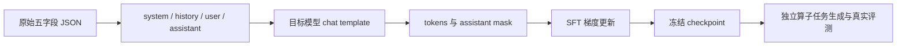

# AscendC 的 SFT 与 RL 数据：从真实样本到训练与评测

这份文档专门讲数据。读完后，你应当能回答：一个文件里装的是什么；一条记录如何变成训练输入；模型究竟学习哪些 token；评测器怎样根据题目生成输入、判断精度并计算加速比。

建议按顺序阅读前四节，再对照第五节的 Add、Sum、GroupNormSwish 做练习。第六节解释真正的算子评测，第七节把数据准备、训练与最终测试连成一次实验。训练服务、模型同步和 RL 优化器的完整调用链另见 [pipeline 学习文档](ascendc-agentic-rl-learning-guide.md)。

本文依据本地仓库及实际取回的 SFT 数据编写。SFT 仓库版本为 `0607a29`，RL 数据为 `5f7df0c`，ProRL 为 `feat/ascendc-rl-t2a@a8e3065`，Vime 为 `a3-pd@a9b3773`。SFT 的五个代表文件已从公开 LFS 接口下载，并逐文件核对字节数和 SHA-256；正文示例均能追溯到文件与记录索引。这里只完成了数据读取、结构检查、转换和数学演算，没有执行模型训练、AscendC 编译或 NPU 测速。

## 1. 先把六个概念分清楚

**SFT 学习示范，RL 根据运行结果改进生成策略。** 两者都训练语言模型，但数据提供的监督不同。

SFT 的一条普通记录已经给出需求和示范回答。训练时，模型读取需求，学习提高示范回答的概率。Agent SFT 还给出了历史工具调用和工具返回，模型可以学习何时读代码、怎样调用编译器、怎样根据报错修改实现。

RL 的一条任务通常只给出题目及资产索引。模型在线生成代码，通过工具修改和验证；评测器运行实际算子，反馈正确性、耗时等结果，再由奖励函数把结果变成训练信号。参考 PyTorch 实现定义了语义，但没有唯一的标准 AscendC 程序要求模型照写。

| 概念 | 在这里具体指什么 | 例子 |
|---|---|---|
| SFT record | 一条已有示范的训练记录 | 一次 Logit 编译错误及修复回答 |
| RL task | 一个需要完成的算子题目 | 实现支持广播、alpha 和多种 dtype 的 Add |
| case / workload | 某道题的一组具体输入规格 | x 为 `[256,256]`、y 为 `[256]`、alpha 为 0.5 |
| trajectory | 一次交互过程 | 读 reference、写 kernel、编译失败、修复、提交 |
| artifact / solution | 最终接受评测的代码制品 | 带 host、kernel、wrapper 的工程或 solution.json |
| epoch | 对所定义训练集合的一次遍历 | SFT 遍历记录；RL 遍历任务并重新采样轨迹 |

一条 Add 任务可以有 50 条 case。模型为这道题采样 8 次，可以得到 8 条轨迹，每条轨迹又可能尝试若干次编译。这里有 1 道题、50 条 case、8 条轨迹，不能把这些数字互换。真实的 step 数还取决于 batch、最后一批的处理、过滤和采样器行为。

SFT 的基础目标可以写成：

\[
L_{\mathrm{SFT}}=-\frac{1}{\sum_t m_t}\sum_t m_t\log p_\theta(y_t\mid y_{<t},x).
\]

`x` 是上下文，`y_t` 是示范 token，`m_t` 决定这个 token 是否参与损失。对于工具轨迹，tool 返回的错误日志属于上下文；assistant 生成的工具调用及回答才通常是监督目标。具体 mask 必须由实际 tokenizer 和 chat template 生成。

RL 则先采样 `trajectory ~ policy(task, environment)`，再用真实评测结果计算 reward。任务 JSON 中的 `label` 不是这个 reward，也不是 SFT 的 `output`。

## 2. 文件怎样组织，数据各有什么特点

### 2.1 SFT 的两种主体

```text
ascendc-kernelgen-data/
├── dataset/
│   ├── dataset/                    # 普通 SFT
│   │   ├── doc_data_8.3.0/
│   │   ├── doc_data_9.1.0/
│   │   ├── vector_data/
│   │   ├── cube_data/
│   │   ├── cv_fusion_data/
│   │   ├── flywheel/
│   │   └── sft_distill_data/
│   │       ├── sft_gen.json
│   │       └── sft_debug.json
│   ├── agent_dataset/              # 多轮 Agent SFT
│   │   └── train-00000.jsonl.zst ... train-00015.jsonl.zst
│   └── tools/cot_scoring/          # 思考文本审核与改写
├── rl-seed-task/                   # 另一套任务资产，非 SFT 回答
└── npu-kernelbench/                # 独立算子评测框架
```

嵌套的 `dataset/dataset` 是实际路径，不是笔误。分类与发布量见 [SFT 数据说明](../ascendc-kernelgen-data/dataset/README.md)。下表的完整分类数量来自该说明，只有“本次核实”列属于本次实际读取。

| 类别 | README 报告记录数 | 主要学习内容 | 本次核实范围 |
|---|---:|---|---|
| doc 8.3.0 | 27,133 | API、编程规则、类型与约束 | 未取回这四个训练文件 |
| doc 9.1.0 | 5,969 | 9.1.0 版本的 API 知识 | 实读全部 5,969 条 |
| vector | 5,468 | 向量算子与部分单文件实现 | 实读 `202605_0004.json` 的 94 条 |
| cube | 50 | 矩阵类算子实现 | 未取回 |
| cv_fusion | 200 | CV 融合算子实现 | 未取回 |
| flywheel | 11,119 | 从失败结果收集的修复、纠错等 | 未取回 |
| distill | 552 | 将 Agent 经验压缩为生成和修复回答 | 实读生成 316 条、修复 236 条 |
| Agent | 15,020，另计 | 多轮工具调用、反馈与修改 | 实读首个分片的 1,000 条 |

普通 SFT 发布量合计 50,491；Agent 的 15,020 另计。版本 V1 至 V6 选择的数据不同，不能把库存总量当作每次训练实际使用的数量。API 文档里的 Markdown 和图片、figure index 缓存、评分工具配置，也不应当直接算成 SFT 记录。

这些分类说明数据来源，不能保证每条记录都符合当前 RL 环境。比如 debug 中有 TileLang 检测问题，也有允许在 host 上调用 PyTorch 的修复建议；当前 AscendC 正式 judge 的执行约束可能不同。筛选必须检查内容。

### 2.2 普通 SFT：外层容器与内层字段分开看

本次取回的四个普通 SFT 文件都是 **JSON 数组**。数组里的每个对象都有下面五个键：

| 字段 | 在本数据中的作用 | 训练前怎样处理 |
|---|---|---|
| `instruction` | 当前任务指令，可能为空 | 与 input 按固定规则组合 |
| `input` | API 问题、算子需求、case 或编译错误 | 成为当前 user 上下文 |
| `output` | 示范推理、解释和代码 | 成为当前 assistant 目标 |
| `system` | 系统角色与输出约束，可能非空 | 保留为 system 消息 |
| `history` | 先前对话 | 按已核实格式恢复，不能无声丢弃 |

这四个文件的 history 均为空。API、gen、debug 的 system 全空；抽查的 Vector 分片 94 条都有非空 system。四个文件的所有 output 都含 `<think>` 与 `</think>`，这只是这次读取范围的事实，不代表所有未取回目录都相同。

顶层 README 曾将训练数据统称 JSONL，但 [distill 说明](../ascendc-kernelgen-data/dataset/dataset/sft_distill_data/README.md)明确写 JSON 数组，实际数据也支持后者。正确做法是按内容读取。把 `a.json` 改名 `a.jsonl` 不会完成格式转换。

### 2.3 Agent SFT：保存的是交互过程

首分片 `train-00000.jsonl.zst` 是 Zstandard 二进制压缩文件。直接用文本编辑器打开会看到乱码，这是压缩内容，不是编码损坏。阅读完整的 1,000 条记录请打开同目录下已解压的 [train-00000.jsonl](../ascendc-kernelgen-data/dataset/agent_dataset/train-00000.jsonl)，原 `.zst` 文件仍保留。解压文件约 333 MiB，较大；先读单条轨迹可打开已排版的 [agent_groupedmatmul.json](examples/data_samples/agent_groupedmatmul.json)。

解压后的 JSONL 每行一个对象，实际顶层只有 `messages`。每条消息都有 `role`、`content`、`tool_calls`、`tool_call_id`；非工具调用消息也可能带空列表或空字符串。

在这个分片中，content 为字符串。调用放在 assistant 的 `tool_calls` 中，参数 `function.arguments` 是一个 JSON 字符串；tool 回复通过 `tool_call_id` 对应之前调用的 `id`。部分 assistant 的 content 为空，但 tool_calls 非空，这仍是需要学习的有效输出。

首分片每条记录有 7 至 542 条消息，中位数 73 条。不要根据 `.zst` 文件只有十几 MB 就判断 token 很少，压缩率、重复模板和工具日志都会影响文件大小。历史轨迹还包括主 Agent 与子 Agent，两者承担的工作不同。

### 2.4 RL：题目索引与可执行资产

`ascendc-rl-datasets` 的当前 main 包括 `NPUKernelBench` 和 `CANN_Ops`。前者有 43 道题，后者有 280 道题，具体格式和例子见第五节。本地没有找到 cudallm 的任务文件及资产，不能用 CANN_Ops 代替，也不能依据服务器目录名字推断它的完整 schema。

还要区分三套名字相近的数据：SFT 仓库的 `rl-seed-task` 有 317 个 definition/workload 任务；同仓库 `npu-kernelbench/data/kernel_generator` 有 105 个 benchmark 任务；RL 仓库当前 `NPUKernelBench` 有 43 个任务。它们不是同一个集合的三种随意叫法。

## 3. 五个真实 SFT 样本，逐个读懂

下面五条完整原始记录已经保存在 [data_samples](examples/data_samples/)。它们来自真实数据，保留 JSON 值，只有排版改变。[manifest.json](examples/data_samples/manifest.json)记录原仓库版本、原文件 SHA-256、原记录索引和摘出文件的 SHA-256。

原记录索引从 0 开始。比如 `logit_debug.json` 是原数组 index 3，但摘出后文件只装这一条，所以使用教学工具时选 `--index 0`。正文只展示需要讲解的片段，完整训练目标以文件为准。

### 3.1 API 问答：它训练知识，不要求生成完整算子

来源：`doc_data_9.1.0/ascendc_api_qa_910.json`，index 0。完整样本：[api_qa.json](examples/data_samples/api_qa.json)。

用户给出了这段代码，并询问作用及默认参数：

```cpp
asc_load3d_v2_config config;
asc_set_l13d_rpt(config);
```

原回答包含 think 文本，随后解释：`asc_set_l13d_rpt` 配置 Load3Dv2 的 repeat 参数，默认 `rpt_stride=0`、`rpt_time=1`、`rpt_mode=0`。这些具体信息与仓内 [9.1 API 文档](../ascendc-kernelgen-data/dataset/dataset/doc_data_9.1.0/ascendc_api_910_md/SIMD-API/C-API/cube_datamove/asc_set_l13d_rpt.md)的功能、原型和调用示例相符。

这一条 `instruction=""`、`system=""`、`history=[]`，问题完整放在 input。如果转换器只读取 instruction，模型就会收到空问题。因此先检查五个字段，再选择拼接策略。

如何评测这一类数据：先与对应版本 API 文档核对函数名、参数、默认值、适用产品和限制；再检查转换后模型是否看到完整问题。它没有提供完整 AscendC 工程，也没有延迟基线，不能直接为这条 QA 计算“算子加速比”。若要验证代码能力，需要另写使用该 API 的可编译任务并在相应硬件运行。

### 3.2 Vector 实现：一条记录可能绑定具体 case 与硬件

来源：`vector_data/202605_0004.json`，index 6。完整样本：[vector_mse.json](examples/data_samples/vector_mse.json)。

它要求实现 `MSELossV2`。system 要求输出 host 算子定义、tiling 计算和 kernel；input 先解释 MSE 的 none、mean、sum 语义，再给具体 case 与 Ascend910B3 硬件信息。本条关注：

```text
shape = [4, 8, 16, 32]
dtype = float16
reduction = none
output[i] = (input[i] - target[i]) ** 2
```

共有 `4×8×16×32=16,384` 个元素。因为选 none，每个元素独立得到一个平方差，输出保留原 shape。小数值演算：输入 `[1,3]`、target `[0,1]` 时，输出应为 `[1,4]`；若实现返回均值 2.5，数学公式中有平方差也仍然答错了本条需求。

output 包括 think 和多个 host/kernel 文件段。阅读顺序应是：先找输入输出合同，再看 host 怎样计算切分，最后看 kernel 的搬入、计算、搬出。直接只读 `Sub`、`Mul` 两个计算指令，会漏掉 tiling、边界、接口注册和输出分配。

原始 output 有 33,208 字符，已经是这个分片里最短的一条；最长为 599,391 字符。字符数不是 token 数，训练前必须用目标 tokenizer 实测。也不要仅凭一个超长 output 就认定它包含更多独立知识，后文会检查实现重复。

如何使用和评测：它适合学习从需求、case、硬件条件组织实现。先检查生成代码是否覆盖本条指定的 none 路径；若想宣称支持完整 MSELossV2，还要加入 mean/sum、其他 dtype、尾块和更多 shape。把它的输出接到 benchmark 时须打包完整工程，样本里的“实测”“通过”字样只代表原文本叙述，本次没有复验。

### 3.3 生成蒸馏：Logit 从需求到代码

来源：`sft_distill_data/sft_gen.json`，index 3。完整样本：[logit_generation.json](examples/data_samples/logit_generation.json)。

instruction 为“请根据算子描述，设计并实现对应的 AscendC 算子 kernel 代码”。input 描述 Logit：

\[
\operatorname{logit}(x)=\log\frac{x}{1-x}=\log x-\log(1-x).
\]

若 eps 非空，先按样本描述把输入裁剪到 `[eps,1-eps]`。样本列出 fp16/fp32、同 shape 输出，以及 `[3,4]` 等测试规格。原 input 对 eps 同时出现了 C++ `double` 签名和 None 可选语义，接入实际 wrapper 时必须明确如何表示缺省参数，不能把文本里的两种表示直接当作已落实的接口。

小数值演算：eps 不起裁剪作用时，x 为 0.5 得到 0，x 为 0.25 得到约 -1.0986。这能帮助理解公式；精度评测仍要用实际浮点 dtype 和 verifier。

output 是 12,543 字符的推理及实现。它把多轮开发经验变成一条完整回答，但不再展示每次工具调用。SFT 学习的是“给定完整需求，直接组织回答与实现”。模型不会从这一条自动学到怎样调用当前环境的 Bash 工具。

### 3.4 修复蒸馏：相同算子，不同监督任务

来源：`sft_distill_data/sft_debug.json`，index 3。完整样本：[logit_debug.json](examples/data_samples/logit_debug.json)。

这一条输入已经给出错误代码与编译反馈：

```text
requires 4 arguments, but 3 were provided
```

错误片段是：

```cpp
AscendC::DataCopyPad(xLocal, xGm[progress * this->tileLength], copyParams);
```

示范回答在此调用处补上参数：

```cpp
AscendC::DataCopyPadExtParams<T> padParams{false, 0, 0, 0};
AscendC::DataCopyPad(
    xLocal, xGm[progress * this->tileLength], copyParams, padParams);
```

这里学习的是“从报错定位本次重载匹配问题并给出修改”。代码片段有上下文依赖，不能把这五行保存成一个文件就期待编译完整算子。上一个生成样本已经包含四参调用，两条可以作为内容对应的教学对；数据未提供共同 trajectory_id，不能据此认定它们来自同一次原始运行。

修复能力的评测应固定错误工程和报错上下文，给模型一次或规定次数的修复机会，再重新编译、运行精度和测速。只比较它是否输出 `padParams`，评的是文本匹配；只看到编译恢复，也不足以说明精度和性能正确。应另外记录“修复后编译通过率”“修复后全部 case 通过率”和修复预算。

### 3.5 Agent 轨迹：工具动作也属于模型输出

来源：`agent_dataset/train-00000.jsonl.zst`，index 10，即解压后的第 11 条。完整样本：[agent_groupedmatmul.json](examples/data_samples/agent_groupedmatmul.json)。

这是 `GroupedMatmulSliceM` 的一条主 Agent 轨迹，共 8 条消息。下面按原顺序概括，未复制冗长系统提示和本地路径：

| 消息索引 | role | 实际内容或动作 | 通常参与 SFT 损失？ |
|---:|---|---|---|
| 0 | system | 系统角色、工程任务规则 | 否 |
| 1 | user | 算子任务及可用 skill 的上下文 | 否 |
| 2 | assistant | 同一条消息调用 `Read` 和 `Bash`，content 为空 | 是，工具调用要学 |
| 3 | tool | Read 返回算子参考文件 | 否，作为上下文 |
| 4 | tool | Bash 返回目录检查结果 | 否 |
| 5 | assistant | 分析算子并调用 `Agent` 委派开发 | 是，但需先审查目标环境兼容性 |
| 6 | tool | 子 Agent 返回开发与验证摘要 | 否 |
| 7 | assistant | 汇总结果 | 是 |

两个同批调用的 ID 分别对应后面两条 tool 消息；没有执行时间戳，不能据此确认它们实际并行。工具参数是字符串形式的 JSON，不是已经解析好的 Python 字典；转换器需要保留这一结构，实际 tokenizer 是否需要规范化则另行验证。

这条主轨迹的验证细节来自子 Agent 的摘要。摘要中的“精度 PASS”是历史工具消息，不能当成本次运行证据。要复评原制品，还需要对应代码、完整测试资产和环境；仅有聊天记录通常不足以重建所有文件状态。

此分片没有顶层 `tools` schema。历史系统消息里出现工具或 skill 名，不等于已经提供当前训练器需要的函数定义。若要训练当前 t2a 工具接口，需要明确工具名、参数 schema 和模板如何表示调用。

尤其注意：这条轨迹含用于委派子任务的 `Agent`，同分片其他轨迹还含用于加载技能说明的 `Skill`。使用当前 [profile.t2a.yaml](../ProRL-Agent-Server/deploy/ascend_operator/profile.t2a.yaml) 时，这两种工具被禁用。`Agent` 与 `Skill` 不是同一类动作：前者启动子 Agent，后者加载技能；原文把它们统称为“两类委派调用”不准确。

这里的意思是：**历史示范中有些动作，在准备训练和部署的工具环境里不能执行。** 如果直接监督历史 assistant 中的 `Agent(...)` 或 `Skill(...)`，就可能鼓励模型生成当前环境不接受的调用。它不说明这些轨迹没有知识价值，也不意味着用过它们的模型一定失败；需要区分“学习算子开发知识”与“学习当前环境允许的操作步骤”。

当前配置允许 `Bash Read Edit Write Grep Glob`。模型仍可以使用技能知识：通过 `Read` 打开 `.claude/skills/<skill-name>/SKILL.md` 及必要引用，再由当前会话修改工程、调用 Bash 编译评测。禁止 `Skill` 工具不等于禁止读技能文档，也不等于禁止使用 cannbot-skills 提供的知识。

适配时，可以筛选工具名、参数格式和状态依赖都兼容的完整轨迹，或者在目标环境重新采集。不能只把 `Agent` 改名成 `Bash`，因为“委派任务描述”不是 shell 命令；也不能只把 `Skill` 改名成 `Read`，还需要正确文件路径、参数以及真实读取结果。子 Agent 可能创建了后续步骤依赖的文件，直接删除调用同样可能破坏轨迹。

上述约束以实际加载的 profile 为准。仅切换到 `feat/ascendc-rl-t2a` 分支不会自动启用它：[start_polar_nohup.sh](../ProRL-Agent-Server/deploy/ascend_operator/start_polar_nohup.sh) 在未设置 `POLAR_PROFILE` 时默认读取 `profile.yaml`。

继续阅读：[10 条额外 Agent 轨迹与执行 DAG](agent-trajectories-dag-study.md)。该文选择了 10 个不同算子的开发者完整轨迹，包含 2,650 条消息、1,365 次工具调用，逐条展示代码生成、失败修复、精度验证和性能测量。每张图均可追溯到原始 JSON 的消息索引；参考实现改动、用例范围变化和计时边界也分别标出。

这些轨迹使用的技能正文、reference、模板和脚本，以及当前 t2a 的对应读取流程，见 [技能调用指南](agent-skill-call-guide.md)。历史记录的 M1 已内嵌多份完整 skill 正文，不能只按后续 Skill 工具次数判断模型读过哪些知识。

## 4. SFT 数据怎样读取、转换并接入训练

### 4.1 先取得正文，再检查格式

初始工作区里的 SFT 主文件是 Git LFS 指针。指针形如 `version https://git-lfs.github.com/spec/v1`，随后记录 oid 与 size；它不是 JSON 数据。2026-09-28 已将本教学使用的五个完整文件放回原仓库：四个普通 SFT 文件位于 `dataset/dataset/` 对应子目录，Agent 首分片位于 `dataset/agent_dataset/`。这些文件的字节数和 SHA-256 均与原 LFS 指针一致。教学目录中的五条摘出记录仍保留；其余尚未取回的分片仍是指针。

在已经安装 Git LFS 的机器上，可按需取回完整文件。下面命令会写入 SFT 仓库的工作树，适用于重新克隆仓库或这些文件缺失时；当前工作区的这五个文件已经就位：

```bash
cd ascendc-kernelgen-data
git lfs install --local
git lfs pull --include="dataset/dataset/doc_data_9.1.0/ascendc_api_qa_910.json,dataset/dataset/vector_data/202605_0004.json,dataset/dataset/sft_distill_data/sft_gen.json,dataset/dataset/sft_distill_data/sft_debug.json,dataset/agent_dataset/train-00000.jsonl.zst"
cd ..
```

当前机器未安装 Git LFS；本次用公开 LFS batch/download 接口读取并核对对象，不需要你先完成上面命令才能阅读五条教学样本。完整对象的哈希在教学 manifest 中。Agent 发布的 checksums 文件带 `data/` 旧目录前缀，实际分片在 agent_dataset 根下，使用其检查命令前应先处理路径对应。

当前工作区已经解压完成，无需再次运行命令或更改文本编码。仅在重新取回压缩分片且同目录的 `.jsonl` 尚不存在时，从 workspace 根目录执行以下命令。`-d` 表示解压，`-k` 保留原 `.zst`。

```bash
zstd -d -k ascendc-kernelgen-data/dataset/agent_dataset/train-00000.jsonl.zst
```

### 4.2 直接运行本次附带的检查与转换工具

[inspect_sft_data.py](examples/inspect_sft_data.py)不加载模型，不执行记录中的代码，也不发送网络请求。它识别 JSON 数组、JSONL、单记录 JSON，以及通过系统 zstd 解压的 `.zst`。它会拒绝 LFS 指针和不符合约定的结构。

从 workspace 根目录执行：

```bash
# 查看一条完整 Logit 修复记录的结构
python3 docs/examples/inspect_sft_data.py \
  --input docs/examples/data_samples/logit_debug.json

# 输出选中记录、messages 和来源 manifest；输出目录必须尚不存在
python3 docs/examples/inspect_sft_data.py \
  --input docs/examples/data_samples/logit_debug.json \
  --index 0 --out /tmp/ascend-data-logit-debug

# 检查真实主 Agent 的工具调用与返回配对
python3 docs/examples/inspect_sft_data.py \
  --input docs/examples/data_samples/agent_groupedmatmul.json
```

完整分片取回后，把 input 换成原文件路径即可，例如 gen 用 `--index 3`，Vector 用 `--index 6`，Agent 首分片用 `--index 10`。工具默认只检查；选定索引并指定 out 才导出。它输出的 JSONL 可以继续交给训练数据适配器，但结构有效不代表内容正确，也不证明适合当前工具环境。

### 4.3 明确 Alpaca 到 messages 的转换约定

本次工具采用以下规则。这是教学转换策略，不是声称原作者训练时必然采用了同一策略。

1. 非空 system 放在首条 system 消息。
2. history 必须是 `[user_text, assistant_text]` 二元对的列表，按顺序恢复。遇到其他形状报错，不猜测。
3. instruction 与 input 的非空部分用两个换行连接，形成当前 user 消息。
4. output 原文作为当前 assistant 消息，保留 think 与代码。
5. 来源文件、原索引与哈希写入独立 manifest。

例如 API 样本得到两条消息：`user=input`、`assistant=output`。Vector 样本则得到 system、user、assistant 三条消息。Logit debug 中的错误 C++ 位于 user，修复 C++ 位于 assistant，两者不能交换。

Agent 样本已有 messages，应保留顺序、调用和返回关联。不要丢掉 content 为空但有 tool_calls 的 assistant；也不要把 tool 日志重新标成 assistant。否则模型学习的动作与实际环境会错位。

### 4.4 tokens 与 mask 才是最后的训练数据

JSON 转换后还需经过目标模型的 chat template 和 tokenizer。至少检查三件事：`len(tokens)==len(loss_mask)`；有效监督 token 大于 0；解码有效片段后，它们确实来自你准备监督的 assistant 内容及动作。

对于包含错误尝试的 Agent 轨迹，有两种不同目标：监督整个 assistant 过程，学习探索与修复；或只监督经过筛选的正确动作。后者需要可靠标注。不能仅因轨迹最后报告成功，就认为每一个中间动作都值得复制。

超长样本处理也要明确。先统计输入、工具返回、推理和代码各占多少 token，再决定保留、分段或过滤。把一个 10 万字符的回答按长度硬截断，可能只剩 think 没有代码；从任意位置裁一段 Agent 会话，又可能只剩 tool 回复而没有对应调用。任何分段都要保留可理解的上下文与完整消息关系。

当前 Vime 的 `filter_long_prompt` 遇到 list 形式的 prompt 会直接保留样本；恰好这条 SFT 路径要求传入 messages list。因此不能依赖 `rollout-max-prompt-len` 自动过滤这些超长记录。正式训练前需离线使用同一个 tokenizer/template 计算完整序列长度，再筛选或补充适配逻辑。

### 4.5 Vime 当前有什么，仍需补什么

Vime 提供通用 [SFT rollout](../vime/vime/rollout/sft_rollout.py)和 [MultiTurnLossMaskGenerator](../vime/vime/utils/mask_utils.py)。该路径读取已经包含示范回答的 messages，生成 token 与 mask，设置监督训练需要的 Sample；它不在线调用模型生成新答案。

与本数据连接时，关键参数关系如下。这里是需并入已有模型、分布式与优化器配置的参数片段，不是完整可直接启动的 AscendC SFT 脚本：

```bash
--rollout-function-path vime.rollout.sft_rollout.generate_rollout
--prompt-data /absolute/path/to/messages.jsonl
--input-key messages
--n-samples-per-prompt 1
--loss-type sft_loss
--calculate-per-token-loss
--disable-compute-advantages-and-returns
--debug-train-only
```

[数据 loader](../vime/vime/utils/data.py)接受 JSONL/Parquet，不直接读取上述 JSON 数组或 zst。`input-key` 应指向完整 messages；仅把 input 当 prompt、output 当 label，不会自动把 output 追加成监督回答。此 SFT rollout 内部才应用模板，因此不要先让通用 Dataset 把 messages 渲染成字符串。保留默认全局数据源，不传 `--disable-rollout-global-dataset`；再根据实际 tokenizer 选择 `--loss-mask-type`，不要仅凭模型名字猜测。

上述 `--debug-train-only` 还使 [RolloutManager.eval](../vime/vime/ray/rollout.py)直接返回；SFT rollout 本身也要求 `evaluation=False`。因此即使设置 eval interval，这套参数片段也不会自动产生生成验证结果。需要另接验证损失路径，或保存 checkpoint 后通过第六节的生成与评测流程验证。

当前 `qwen3_5` mask 实现使用 fast tokenizer 的 offsets 校对模板 token，监督 assistant 的有效内容与结束标记，屏蔽 system/user/tool；assistant 固定头部和开头固定 think 前缀有专门处理，推理正文并非统一屏蔽。工具调用的实际序列化也必须用模型自己的模板检查。

仓内 [通用 SFT 例子](../vime/examples/geo3k_vlm/run_geo3k_vlm_sft.sh)是几何 VLM 任务。它证明框架存在这条训练路径，但这几个仓库没有提供已接好 AscendC 数据混合、工具映射和目标 NPU 模型的完整 SFT recipe。本文给出的数据转换是接线的起点，不把缺失的 recipe 当作已经完成。


## 5. RL 数据：一行任务、三个真实算子和三种评测

这一部分只讨论数据与评测。文中的文件来自本地 `ascendc-rl-datasets/main`，提交号为 `5f7df0c4700b20d5872a6a8aeb63f735f8e620ea`；生成算子的判分流程依据 `ProRL-Agent-Server/feat/ascendc-rl-t2a`。统计通过标准库解析 JSON 完成，没有执行 PyTorch reference，也没有运行 NPU。带有“小数值演算”字样的输入是为了说明数学语义而编写，不是仓库测试结果。

### 先认清两层数据

一个算子题目由任务记录和运行资产共同定义。任务记录告诉模型实现什么、提交什么，运行资产让评测器生成输入并计算基准答案。

```text
NPUKernelBench/
├── operator_tasks.npukernelbench.jsonl
├── src/
│   ├── npukernelbench_level1_3_Add.py
│   ├── npukernelbench_level1_3_Add.json
│   └── 其余算子的同名文件对
└── src_simple/
    └── 同一批算子，使用精简或重排的 case
```

`.py` 定义参考 `Model`、测试输入生成函数 `get_input_groups()` 和构造参数函数 `get_init_inputs()`。同名 `.json` 的内容其实是 JSONL，每行一个测试 case。它通常记录 shape、dtype 和标量属性，张量的具体数值由 Python 输入生成器创建，文件里不一定存有预先计算好的答案。

[任务生成器](../ascendc-rl-datasets/utils/gen_tasks/gen_op_tasks.py)第 99 至 114 行生成的记录有这些字段：

| 字段 | 含义 | 容易误读的地方 |
|---|---|---|
| `prompt` | `role/content` 消息列表，包含生成要求与提交规则 | 不等于 reference 源码全文 |
| `label` | 算子名称标识 | 不是标准 AscendC 答案 |
| `metadata.op_name` | 查找同名 `.py/.json` 的连接键 | 不能随意改显示名称后仍期待资产匹配 |
| `entry_point` | 当前记录通常为 `Model` | 指参考实现，不是生成的 `ModelNew` |
| `operator_backend` | 当前为 `ascendc` | 不证明实际提交已使用 AscendC |
| `arch` | 当前任务文件写 `ascend910b1` | 实际构建还须与运行时 SoC 配置一致 |
| `ops / level / data_source / uid` | 算子名称、级别、来源、任务标识 | 这些元信息本身不产生正确性或速度奖励 |

RL 开始前没有唯一的目标代码。只要生成实现遵守合同、通过验证，就可能是可接受解；是否快于基线，要在目标硬件上测量。生成 task JSONL 只是在编目，不能证明参考资产或候选 kernel 可以运行。

以 Add 为例，原任务除 `prompt` 外的实际字段如下。上表从 `entry_point` 起的字段都位于 metadata 内：

```json
{
  "label": "npukernelbench_level1_3_Add",
  "metadata": {
    "op_name": "npukernelbench_level1_3_Add",
    "entry_point": "Model",
    "operator_backend": "ascendc",
    "arch": "ascend910b1",
    "ops": ["Add"],
    "data_source": "npu-kernel-bench",
    "ability": "code",
    "level": "1",
    "uid": "npukernelbench_level1_3_Add"
  }
}
```

这是一条任务的字段摘录，省略了 prompt，不能把摘录直接当完整训练记录。原 prompt 是消息列表，要求阅读 `input/npukernelbench_level1_3_Add.py` 并构建独立工程。当前任务文件还保留旧的委派流程及 SoC 文案；第七节的教学准备脚本会按当前 t2a 生成器更新提示，保留来源和元信息供检查。

阅读一条 case 时，先问它能否独立确定计算任务。答案通常是不能：输入规格没有完整说明输出，也没有说明输入值怎样采样。需要把三部分放在一起读：`forward` 给数学语义与输出结构，JSON 给一组接口取值，`get_input_groups()` 把规格变成实际参数。本文三个样例的 `get_init_inputs()` 都返回空列表，所以无需给 `Model` 构造函数传参；不要把这个特点推广到所有后续新增题目。

同样名为 `inputs` 的列表也不一定按名称自动绑定。Add 和 Sum 的生成器直接读取第零、第一、第二个元素，再构造位置参数。因此给数据做格式转换时，只保留字段而改变顺序，仍可能破坏任务。确认转换是否正确，应检查传给 `Model.forward` 的最终参数组，而不是只检查 JSON 能否解析。

### 当前数据规模与用途

| 集合 | 算子任务 | level1 / level2 / level3 | case 行数 |
|---|---:|---|---:|
| `NPUKernelBench/src` | 43 | 23 / 20 / 0 | 1,910 |
| `NPUKernelBench/src_simple` | 同一批 43 个 | 23 / 20 / 0 | 429 |
| `CANN_Ops/src` | 280 | 74 / 166 / 40 | 3,382 |

simple 中 42 个算子各有 10 条 case，另一个有 9 条。两套 NPUKernelBench 的 `.py` 完全一致，simple 的 JSON 规格均来自 full；full 的 1,910 行包含四条文件内重复记录。这是当前检出的静态统计，不能拿来代替历史版本的规模。

[NPUKernelBench 说明](../ascendc-rl-datasets/NPUKernelBench/README.md)把 simple 用于在线 RL，full 用于更完整的离线验证。减少 case 可以降低每次开发尝试的测试成本，但 full 并不意味着每个算子都比 simple 多：本文的 Sum 两边都是 10 条，规格集合相同，顺序不同。

[CANN_Ops 说明](../ascendc-rl-datasets/CANN_Ops/README.md)描述的是 CANN 来源任务及公共 PyTorch/ATen reference。它的 case 还可能带 `data`、`range`、`fill` 等生成字段，不能一律忽略。比如 [AbsMath](../ascendc-rl-datasets/CANN_Ops/src/cannops_level1_0_AbsMath.py)第 56 至 65 行会优先使用显式 `data`；整型输入则使用 `range`。究竟如何生成张量，要读对应函数，而非只看 schema。

本地仓库没有用户提到的 cudallm 资产。ProRL [历史交接说明](../ProRL-Agent-Server/deploy/ascend_operator/HANDOFF_20260805_rl_pipeline_fixes.md)记录的是服务器外部的 `op_assets_cudallm_filtered189`，不能据此把本地 CANN_Ops 的 280 个题目称为 cudallm。

### 样例一：Add，标量属性与广播都是合同的一部分

Add 的任务是 [任务列表](../ascendc-rl-datasets/NPUKernelBench/operator_tasks.npukernelbench.jsonl)第 18 行，参考实现为 [Add.py](../ascendc-rl-datasets/NPUKernelBench/src/npukernelbench_level1_3_Add.py)第 13 至 25 行：

```python
def forward(self, x, y, alpha=1.0):
    return torch.add(x, y, alpha=alpha)
```

[Add.json](../ascendc-rl-datasets/NPUKernelBench/src/npukernelbench_level1_3_Add.json)第 22 行的真实 case，以下仅调整了排版：

```json
{
  "inputs": [
    {"name": "x", "type": "tensor", "required": true,
     "dtype": "float16", "shape": [256, 256]},
    {"name": "y", "type": "tensor", "required": true,
     "dtype": "float16", "shape": [256]},
    {"name": "alpha", "type": "attr", "required": false,
     "dtype": "float", "value": 0.5}
  ]
}
```

`inputs` 中的顺序对应输入生成器最后构造的 `[x, y, alpha]`。`name` 表达参数语义；`type=tensor` 表示需要张量，`dtype/shape` 描述它的类型和尺寸；`type=attr` 表示普通属性，值在 `value` 中。`required=false` 表示接口可以有默认值，但这一条 case 明确传入 `0.5`，不能在实现时忽略它。

按这个 case，输出形状应为 `[256,256]`。y 沿第一个维度广播，每个输出元素满足 `z[i,j] = x[i,j] + 0.5*y[j]`。生成器用 `torch.randn` 创建 x、y，因此这行 JSON 本身不包含实际的 65,536 个输入数值。

小数值演算：把相同语义缩小为 `x=[[1,2],[3,4]]`、`y=[10,20]`、`alpha=0.5`，应得到 `[[6,12],[8,14]]`。若直接按 x 的线性偏移读取 y，会访问错误元素；若把 alpha 固定为 1，会得到另一组数。两者都可能在最简单的同 shape 加法上通过，却不满足这道题。

Add 的 full 有 50 条、simple 有 10 条，包含 float32、float16、bfloat16 和不同 alpha。单次 rollout 的目标是写出能覆盖所选全部 case 的工程。它不是为第一个 case 单独生成一个答案，也不是每条 case 对应一次独立语言模型训练样本。

### 样例二：Sum，归约维度与输出形状要一起理解

Sum 对应任务列表第 22 行。[Sum.py](../ascendc-rl-datasets/NPUKernelBench/src/npukernelbench_level1_7_Sum.py)第 28 行是 `torch.sum(x, dim=dim, keepdim=keepdim)`，第 50 行生成 `torch.randn(...) + torch.ones(...)`。这个输入分布的中心与 Add 不同，即使两者都有 `dtype/shape`，也不能假设数值分布相同。

[Sum.json](../ascendc-rl-datasets/NPUKernelBench/src/npukernelbench_level1_7_Sum.json)第 2 行为：

```json
{
  "inputs": [
    {"name": "x", "type": "tensor", "required": true,
     "dtype": "float16", "shape": [128, 128]},
    {"name": "dim", "type": "attr", "required": false,
     "dtype": "int", "value": 1},
    {"name": "keepdim", "type": "attr", "required": false,
     "dtype": "bool", "value": true}
  ]
}
```

`dim=1` 表示沿第二个轴求和，每一行的 128 个数变成一个结果；`keepdim=true` 保留这个轴，其长度变为 1，所以输出形状是 `[128,1]`。如果返回 `[128]`，数值即使相同，接口也错了。输入维数、归约轴与保留维度会影响 wrapper 的输出分配，也会影响 kernel 的读取步长。

同一文件的真实规格还包括：

| 行号 | 输入 shape | dim | keepdim | 按语义推导的输出 shape |
|---|---|---:|---|---|
| 1 | `[128]` | 0 | false | `[]`，零维张量 |
| 5 | `[13,2117]` | -2 | false | `[2117]` |
| 6 | `[32,32,32]` | -3 | true | `[1,32,32]` |
| 8 | `[4096,18432]` | 0 | false | `[18432]` |

负轴需要先按张量维数解释。对二维输入，`-2` 对应轴 0；不能直接当作非法值，也不能把所有归约都写成最后一维求和。第 8 行沿首轴聚合，内存访问方式与每行归约不同，是实现与性能上都需要检查的分支。

小数值演算：`x=[[1,2,3],[4,5,6]]`。`dim=1, keepdim=true` 得到 `[[6],[15]]`；`dim=0, keepdim=false` 得到 `[5,7,9]`。这个例子说明数学和形状，不说明实际 NPU 的浮点误差。真实长归约还要处理累加顺序与中间精度，必须运行 verifier 判断。

只按算子名称补全输出合同也会出错。例如本仓 [Sort.py](../ascendc-rl-datasets/NPUKernelBench/src/npukernelbench_level1_8_Sort.py)第 28 行只返回 `torch.sort(...)[0]`，需要的是排序值，没有要求返回索引。参考函数的实际返回值比对通用 API 的记忆更可靠。

### 样例三：GroupNormSwish，融合计算还要返回中间统计量

GroupNormSwish 是任务列表第 36 行。它的 [reference](../ascendc-rl-datasets/NPUKernelBench/src/npukernelbench_level2_2_GroupNormSwish.py)第 67 行调用 `torch_npu.npu_group_norm_swish`，返回 `(output, mean, rstd)`。上方注释提供了 PyTorch 形式的数学拆解，实际执行仍走 NPU 专用算子。

[GroupNormSwish.json](../ascendc-rl-datasets/NPUKernelBench/src/npukernelbench_level2_2_GroupNormSwish.json)第 1 行如下：

```json
{
  "inputs": [
    {"name": "input", "type": "tensor", "required": true,
     "dtype": "float16", "shape": [4, 64, 128]},
    {"name": "num_groups", "type": "attr", "required": true,
     "dtype": "int", "value": 4},
    {"name": "weight", "type": "tensor", "required": true,
     "dtype": "float16", "shape": [64]},
    {"name": "bias", "type": "tensor", "required": true,
     "dtype": "float16", "shape": [64]},
    {"name": "eps", "type": "attr", "required": false,
     "dtype": "float", "value": 1e-05},
    {"name": "swish_scale", "type": "attr", "required": false,
     "dtype": "float", "value": 1.0}
  ]
}
```

按 reference 中的数学说明，`N=4`、`C=64`，分为 4 个组。每个样本、每个组有 `16×128=2048` 个元素，先在这些元素上计算均值与方差，再做归一化、通道仿射变换和 Swish：

\[
\mu=\mathrm{mean}(x),\quad
v=\mathrm{mean}((x-\mu)^2),\quad
r=(v+\varepsilon)^{-1/2},
\]

\[
u=(x-\mu)r\cdot\mathrm{weight}+\mathrm{bias},\qquad
\mathrm{output}=u\,\sigma(\mathrm{swish\_scale}\cdot u).
\]

这里的方差对应注释里的 `unbiased=False`。按该数学合同推导，主输出形状是 `[4,64,128]`，均值与 rstd 各为 `[4,4]`。输出 dtype 和设备行为仍应以真正的 reference 运行为准，本文没有运行该算子。函数部分参数注释把通道称为“第一维”，容易与 batch 轴混淆；上方拆解明确取 `input.shape[1]` 为 C，case 的 weight 长度也等于 64。

小数值演算：只看一个包含 `[1,3]` 的组，令 weight=1、bias=0，暂取 `eps=0` 便于心算。均值是 2，方差是 1，rstd 是 1，归一化得到 `[-1,1]`。当 swish_scale=1，主输出约为 `[-0.2689,0.7311]`。真正 case 的 eps 是非零值；这个演算没有替代它。候选不能只返回两个激活值，还要按接口返回均值和 rstd。

该算子 full 有 50 条、simple 有 10 条。full 的 `num_groups` 覆盖多个取值，eps 有 `1e-6/1e-5/1e-4`，swish_scale 有 `0.5/1/2`。这些属性改变数学计算，不是附带说明。

还要读输入生成器第 92 至 103 行：它根据 case 索引奇偶，在随机正态与均匀分布之间切换；weight 总是 ones，bias 总是 zeros。因此当前 case 验证了有限的仿射参数取值，不能据此声称任意 weight、bias 都测过。simple 第 10 行对应 full 第 43 行，重排后索引奇偶改变，所以同一 JSON 规格会走不同的数值生成分支。这说明“规格是子集”不保证随机输入分布完全相同。

这三个样例也说明输出数量与 case 数的区别。Add 每个 case 返回一个张量；Sum 也返回一个张量，但可能是零维；GroupNormSwish 返回三个张量。后者的五十条 case 不应被重新统计成一百五十道题，也不能只测主输出便记整条通过。学习数据格式时，应先写出返回结构，再推导每个输出的 shape，最后才讨论数值误差与性能。

### 三种评测分别回答什么问题

| 层次 | 输入 | 核心问题 | 主要产物 |
|---|---|---|---|
| reference 健康检查 | 原始 `.py/.json` | 这道题在当前环境能否生成输入并运行基准？ | 参考资产通过数、失败与有限性警告 |
| 候选算子 judge | 题目资产与某次生成的工程 | 这个实现是否可构建、正确、快？ | 编译日志、逐 case 精度与性能、metrics |
| 模型最终 benchmark | 固定模型、题目集、Agent 预算 | 模型有多大概率产出合格且快速的实现？ | 按算子与多次采样汇总的成绩 |

第一层通过不保证第二层通过；第二层有一个好制品，也不代表第三层模型成功率很高。评测报告应写明层次，避免把“参考实现全部能跑”表述成“生成模型精度百分之百”。

### 实际入口一：reference 健康检查

[CPU 验证器](../ascendc-rl-datasets/utils/op_verify/verify_cpu.py)支持 `--dir`、`--only`、`--jobs`、`--strict-finite`、`--report`；[NPU 验证器](../ascendc-rl-datasets/utils/op_verify/verify_npu.py)用 `--workers` 代替 `--jobs`。下面命令从 workspace 根目录执行，参数已按本地 argparse 核对，但本文未实际运行：

```bash
# 具备 PyTorch 的环境：只检查 Add 的 reference
python3 ascendc-rl-datasets/utils/op_verify/verify_cpu.py \
  --dir ascendc-rl-datasets/NPUKernelBench/src \
  --only npukernelbench_level1_3_Add \
  --jobs 1 --report /tmp/add-reference-cpu.md

# 具备 torch_npu、CANN 与空闲 NPU 的环境：检查融合题目
python3 ascendc-rl-datasets/utils/op_verify/verify_npu.py \
  --dir ascendc-rl-datasets/NPUKernelBench/src \
  --only npukernelbench_level2_2_GroupNormSwish \
  --workers 1 --report /tmp/groupnorm-reference-npu.md
```

`--only` 接受算子 stem，可跟多个名字。先确认输出中的任务数符合预期，因为当前文件筛选函数不会把不存在的名字报为参数错误。NPU 脚本按 worker 编号设置 `ASCEND_RT_VISIBLE_DEVICES`，`--workers 1` 使用编号 0，不能理解成自动挑任意空闲卡。

[公共执行函数](../ascendc-rl-datasets/utils/op_verify/_common.py)第 105 至 146 行检查输入组数量与 JSON case 行数一致，并逐个运行 `Model`。它先尝试无梯度执行，必要时走梯度路径；输出包含 NaN/Inf 默认记 WARN，指定 `--strict-finite` 才升级为失败。它没有加载 `model_new_ascendc.py`，也没有测量候选加速比。

整个 NPUKernelBench 不适合直接 CPU 全扫，GroupNormSwish 等 reference 依赖 NPU 专用算子。Add 单题 CPU 检查可用，不意味着该数据集所有题都能在 CPU 执行。CANN_Ops 说明中记录的历史 CPU/NPU 全通过率，仍需在目标环境验证，不能直接当作本次结果。

### 实际入口二：开发自测与最终 judge

在已经由 Polar 准备好运行时、题目资产和工具的任务容器内，固定入口是：

```bash
bash /opt/workspace/agent_workdir/tools/ascendc_eval_pipeline.sh \
  --op_name npukernelbench_level1_3_Add \
  --impl output/submission/npukernelbench_level1_3_Add_impl.tar.gz \
  --out_dir judge_out
```

这不是在本机数据目录中直接运行的通用命令。[脚本参数解析](../ProRL-Agent-Server/operator_runtime_t2a/tools/ascendc_eval_pipeline.sh)第 54 至 63 行也接受 `--task` 和 `--incremental`，但 Agent 应使用约定的固定命令，保持评测配置一致。`--impl` 与 `--out_dir` 的相对路径按工作目录根解析。

上面是 **Agent 开发环境中的自测入口**。工程目录存在时，脚本可自动打包当前源码作为候选，也可按源码哈希复用已有 metrics；命中缓存时会跳过编译、精度和测速。因此不能把每次调用都算作一次新的硬件验证，也不能无条件认为实际评测对象就是命令里写出的旧 tar 文件。应查看日志、候选制品及缓存状态。

**最终评分**由 Polar 在新建的正式 judge 运行时中验收实际选定制品。正式 judge 注入原始 reference 与同名 JSON，检查防退化规则，重新编译候选，再比较输出、检查可疑的状态缓存并测性能。它不会信任提交中自带的 `model.py`，也不会把预编译二进制当作最终验收依据。数据从 simple 改为 full 时，需要让正式 judge 的资产路径也指向 full；只改变训练侧任务列表不会自动替换这份 JSON。

精度比较包含返回结构。当前 [verifier](../ProRL-Agent-Server/operator_runtime_t2a/skills/tilelang2ascend-translator/scripts/verification_ascendc.py)的 `_compare_structured()` 会检查类型和容器长度，再递归比较每个输出。GroupNormSwish 少返回 mean 或把 tuple 换成 list 都会失败。Sum 数值正确但 shape 错，也不能通过。

对普通浮点计算，该 verifier 同时要求逐元素容差检查、分桶匹配比例与平均相对误差检查通过；`REQUIRED_MATCHED_RATIO=0.9` 指输出元素的分桶比例，并不表示允许一个算子有百分之十的 case 失败。当前 allclose 常量中 fp32 的 atol 为 `1e-3`，fp16 为 `9e-2`，bf16 为 `1e-1`，还要合并对应 rtol 以及其余两项判据。函数旁有旧注释表，因此调试时应读实际常量和比较函数，不能只抄注释中的阈值。

结果优先查看 `judge_out/verify_report.json`、`verify.log`、`performance.json` 和 `metrics.json`。若 reference 资产缺失或 profiler 不可用，应先归因于环境或数据接线；不能把这类失败当作模型数学能力的证据。

### 实际入口三：固定模型后的最终 benchmark

最终 benchmark 要让冻结的模型重新解题，且每题使用统一的开发机会。先固定题目清单、full/simple 选择、reference 与 case 哈希、运行时版本、芯片与 CANN 环境，再固定采样次数、温度、上下文和工具调用预算。对初始模型与 RL 模型采用相同条件，成绩才可比较。

本地 VIME 的 [参数定义](../vime/vime/utils/arguments.py)支持以下评测参数片段：

```text
--eval-prompt-data npukernelbench_final /absolute/path/test.jsonl
--n-samples-per-eval-prompt 1
--eval-temperature 0.7
```

`--eval-prompt-data` 接收“数据集名称、路径”配对，不是单一路径；`--eval-config` 可替代它。它们是底层训练/评测入口的参数，不是可以追加在 `start-ascendc.sh` 尾部的完整启动命令，现有包装脚本没有转发任意参数。桥接代码的 `evaluation=True` 分支会对评测题目提交并轮询会话结果；评测仍需完整的模型服务与 Polar 环境。

报告至少区分任务级正确率、超过指定加速比的任务比例、成功任务上的性能分布，以及环境失败数。教学例：固定十道题，各运行一次，八道完整正确，其中五道超过 `1.1x`，则正确率为 `8/10`，超过目标线的任务比例为 `5/10`。只写 `5/8` 会改变分母；若同时报告，应明确它表示正确任务中的比例。

对一个算子，性能脚本把有效测速 case 的 speedup 做几何平均，必须同时看 `n_cases_valid/n_cases_total`。例如两个 case 分别为 `2x` 与 `0.5x`，几何平均为 `1x`；这是演算，不是 Add 的成绩。[性能汇总代码](../ProRL-Agent-Server/operator_runtime_t2a/skills/ops-profiling/scripts/msprof_perf_summary.py)保留逐 case 行和有效数，不能只摘一个 geomean 而漏掉缺测项。

为了排查成绩变化，可以保留一张逐题表：题目名称、使用的 case 集、正式制品哈希、是否编译通过、逐 case 正确性、有效测速数量、每次独立采样的结果。比如某模型在 simple 上成功，full 上失败，要回到新增的输入规格寻找差异；另一模型正确率不变但大 shape 明显变慢，则需要看逐 case 耗时。把所有信息压成一个平均分，会让这两类问题看起来相似。

同一次会话中的“最好版本”也要可追溯。模型可能先生成正确实现，随后优化失败；最终提交与最后一次编辑未必相同。比较最终成绩时，应以正式 judge 实际评测的制品和报告为依据，记录选择规则。不能把一次会话中最好的精度结果与另一版本最好的耗时拼成一个从未实际存在的候选。

若每题生成四次，可以报告四次中至少一次成功的任务比例，但不能与每题只试一次的成绩直接比较。Agent 单次会话内允许修复多轮时，也应写清预算。来自不同预算的“成功率”测量的是不同求解能力。

从 simple 训练再对 full 复评，是同题更完整验收。真正的未见算子测试，需要独立留出算子及近似计算图，并检查其是否进入 SFT、蒸馏或飞轮数据。当前仓库没有正式的去污染划分清单。文档提供的 [教学划分脚本](examples/prepare_learning_data.py)会生成 8/4/31 的示例拆分并记录哈希，但 manifest 已明确它不是经过去污染审计的科学测试集。

## 6. SFT与RL分别怎样评测

训练损失下降，只说明模型更能拟合训练目标。要判断它是否学会生成正确、快速的 AscendC 算子，需要把冻结模型的输出交给真实编译器和 NPU。这里要区分三件事：SFT 文本是否合格、生成的算子是否合格、Agent 是否能在限定交互预算内完成任务。仓库中分别有对应工具，产出的“分数”含义不同。

### 6.1 先认清 KernelBench 的四种对象

`ascendc-kernelgen-data/npu-kernelbench` 是独立算子评测框架。它与 RL 数据中的 NPUkernelbench 来源有关，但不能把二者的文件格式和判分标准视为同一套。当前 schema 以 [data 目录源码](../ascendc-kernelgen-data/npu-kernelbench/src/npu_kernelbench/data/) 为准。

| 对象 | 真实关键字段 | 回答的问题 |
|---|---|---|
| `definition.json` | `name`、`axes`、有序 `inputs`、`outputs`、含顶层 `run` 的 `reference` | 要实现什么计算？输入顺序是什么？参考输出怎样产生？ |
| `workload.jsonl` | 每行有 `uuid`、`axes`、`inputs`，可覆盖 `tolerance` | 这一次使用哪些 shape、dtype、标量和随机分布？ |
| `solution.json` | `name`、`definition`、`author`、`spec`、`sources` | 待测代码是什么？怎样构建和调用？ |
| 输出 `Trace` | `definition` 名称、完整 `workload`、`solution` 名称、`evaluation` | 某个实现对某一个 workload 的评测结果是什么？ |

这里的 `Trace` 是“一份实现 × 一个 workload”的结果记录。它不包含模型 token、工具对话或 PPO 优势。`evaluation` 下有 `status`、`environment`、`timestamp`、`log`，通过时还必须有 `correctness` 和 `performance`。常见状态包括 `PASSED`、`COMPILE_ERROR`、`RUNTIME_ERROR`、`INCORRECT_SHAPE`、`INCORRECT_DTYPE`、`INCORRECT_NUMERICAL`、`TIMEOUT`、`REWARD_HACK`。完整约束见 [trace.py](../ascendc-kernelgen-data/npu-kernelbench/src/npu_kernelbench/data/trace.py)。

这些字段之间有明确依赖。definition 的输入字典顺序决定位置参数顺序；workload 的 `inputs` 为这些参数提供实例。随机 Tensor、标量、Tensor 列表、自定义生成函数和 safetensors 文件是不同输入类型，不能都当作 shape 列表处理。definition 也支持符号轴，此时 workload 的 `axes` 给出具体取值；Add 使用的是在 workload 中直接给 shape 的形式。solution 的 `definition` 应标识对应算子，输出 Trace 保留整个 workload，方便事后核对究竟测了哪种输入。

读取结果时也要区分两个阶段：编译失败可以为同一个 solution 的全部 workload 生成 `COMPILE_ERROR`；数值失败只对应当前 workload，并且没有合格的性能结果。于是“50 个编译错误”可能是一个实现的一次构建失败传播到 50 条记录，不代表模型独立写错了 50 份代码。按算子统计失败原因时，应先按 definition 与 solution 分组。

### 6.2 用 Add 看懂输入契约，再接入模型输出

真实的 [Add 定义](../ascendc-kernelgen-data/npu-kernelbench/data/kernel_generator/level1/Add/definition.json) 使用 `axes: {}`，输入按 `x, y, alpha` 排列，输出名为 `out`，参考函数是：

```python
import torch

def run(x, y, alpha=1.0):
    return torch.add(x, y, alpha=alpha)
```

shape 和 dtype 交给 workload 指定。[Add workload 文件](../ascendc-kernelgen-data/npu-kernelbench/data/kernel_generator/level1/Add/workload.jsonl) 当前有 50 条，包含 float16、bfloat16、float32，也包含广播。第一条的实际内容是：

```json
{"uuid":"Add-001","axes":null,"inputs":{"x":{"type":"random","shape":[96,96,96],"dtype":"float16"},"y":{"type":"random","shape":[96,96,96],"dtype":"float16","distribution":"randn"},"alpha":{"type":"scalar","value":1.0}}}
```

`random` 不代表所有张量都服从标准正态分布：这里 `y` 显式指定 `randn`，`x` 使用生成器的默认分布策略。标量 `alpha` 会作为第三个参数传入。另一个 case 的 `x` 为 `[1,192,736,736]`，`y` 为 `[736,736]`，因此只写“两个同尺寸连续数组相加”不满足整个 Add 契约。

这个 Add 目录目前没有 `solution.json`。SFT 训练文件里的 `<think>` 和 C++ 文本也不能直接作为它的输入。需要先冻结一个模型版本，用选定的提示词产生代码，然后提取代码、补齐 host 注册与 Python 调用入口，打包成 solution。评测器不会负责调用模型，也不会自动把 SFT 文本转换成完整工程。

完整的现成教学样例在 [vector_add_ascendc](../ascendc-kernelgen-data/npu-kernelbench/tests/samples/vector_add_ascendc/)。它同时提供 definition、3 条 workload 和 solution，范围是 float32 一维向量相加，长度为 1024、4096、16384。其 solution 头部为：

```json
{
  "name": "vector_add_ascendc",
  "definition": "vector_add",
  "author": "example",
  "spec": {
    "languages": ["ascendc"],
    "target_hardware": ["ascend910b"],
    "entry_point": "main.py::run",
    "destination_passing_style": false
  }
}
```

这只是头部摘录；真实文件还有必需的 `sources`，内嵌完整 `add_custom.asc` 和 `main.py`。后者内容为：

```python
import torch
import torch_npu

def run(a, b):
    return torch.ops.cpp_extension_acs.ascendc_add(a, b)
```

调用链是 `run(a,b)` → 注册的 `cpp_extension_acs::ascendc_add` → 获取当前 NPU stream、分配输出 → 启动 `add_custom` → 各核分块执行 CopyIn、`AscendC::Add`、CopyOut。它展示了“内核代码怎样接入评测”，没有实现通用 Add 的广播、alpha 和全部 dtype，不能把这个 solution 换个名称就用于那 50 条 workload。

### 6.3 在真实 NPU 环境中如何运行

准备匹配的 CANN、PyTorch、torch_npu 和 `bisheng` 后，在框架目录执行现成样例。以下是源码支持的命令模板，本文没有在 NPU 上执行，也没有声称样例已通过：

```bash
cd ascendc-kernelgen-data/npu-kernelbench

uv run npu-kernelbench eval tests/samples/vector_add_ascendc \
  --runner isolated --npu-ids 0 \
  --compile-timeout 120 --timeout 600 \
  --work-dir /tmp/nkb-vector-add-example \
  -o /tmp/nkb-vector-add-example-traces.jsonl \
  --html /tmp/nkb-vector-add-example-report.html
```

默认 runner 是 `persistent`，每张设备复用工作进程；这里显式选 `isolated`，按评测创建子进程。两者都不等于 Polar 正式 judge 的新容器隔离。命令和默认值见 [cli/main.py](../ascendc-kernelgen-data/npu-kernelbench/src/npu_kernelbench/cli/main.py)。

当模型已生成满足完整 Add 契约的 `/tmp/sft-add-output/solution.json`，可用同一个 CLI：

```bash
uv run npu-kernelbench eval data/kernel_generator/level1/Add \
  --solution /tmp/sft-add-output/solution.json \
  --runner isolated --npu-ids 0 \
  --work-dir /tmp/nkb-sft-add-ckpt0001 \
  -o /tmp/nkb-sft-add-ckpt0001-traces.jsonl \
  --html /tmp/nkb-sft-add-ckpt0001-report.html
```

打包时有几个必须落实的接口约束：

- `entry_point` 使用 `文件路径::函数名`，入口文件必须出现在 `sources`。source 路径须为相对路径，不能含 `..`。CLI 允许 source 省略或留空 `content`，随后从 solution 所在目录读取对应文件；直接构造 `Solution` 模型时，`content` 必须非空。
- 当前 Runner 实际以 `solution_fn(*inputs)` 调用入口并读取返回值。虽然 schema 定义了 `destination_passing_style`，当前代码没有按它自动分配并传入输出 buffer；应按样例返回输出 Tensor，Add 的入口对应 `run(x,y,alpha)`。
- AscendC 默认使用 `bisheng` 构建 `.asc/.cpp/.cc/.cxx`，然后加载 `.so`。CMake 分支需设 `build_method: "cmake"`，且有 `ASCEND_HOME_PATH`；builder 将 `op_kernel/` 内的源码作为 device 代码，生成 CMakeLists，再构建。完整样例见 [vector_add_ascendc_cmake](../ascendc-kernelgen-data/npu-kernelbench/tests/samples/vector_add_ascendc_cmake/)。

[Runner](../ascendc-kernelgen-data/npu-kernelbench/src/npu_kernelbench/runner/runner.py) 会把源码和定义放进工作目录，完成编译，再逐 workload 生成输入、运行 reference 和 solution。因此 SFT 输出中的注释“已编译通过”不会成为通过依据。

### 6.4 精度和加速比究竟怎样算

当前通用 evaluator 先检查输出数量、shape 和 dtype，再检查数值。数值判断把输出与参考转换到 float32，要求满足

\[
|o_i-r_i|\leq atol+rtol\,|r_i|
\]

的元素比例至少为 0.99，同时最大绝对误差不得超过 `max(fixed_cap, 32 × ULP)`；ULP 按参考张量的最大绝对值和原始 dtype 估算。workload 的显式 tolerance 可覆盖默认值。

| dtype | atol | rtol | fixed_cap |
|---|---:|---:|---:|
| float16 | 2⁻⁹ | 2⁻⁹ | 0.1 |
| bfloat16 | 2⁻⁶ | 2⁻⁶ | 1.0 |
| float32 | 2⁻¹⁶ | 2⁻¹⁰ | 0.01 |

还有非有限值检查，以及参考非零而输出全零的检查；默认不会因为 NaN 同位置就通过，可选 `allow_negative_inf` 只放行双方对应的负无穷。规则分别在 [workload.py](../ascendc-kernelgen-data/npu-kernelbench/src/npu_kernelbench/data/workload.py)、[correctness.py](../ascendc-kernelgen-data/npu-kernelbench/src/npu_kernelbench/evaluator/correctness.py)。因此“误差很小”必须对应具体 dtype、输入分布和这些阈值。

性能默认 seed 为 200，warmup 为 5 次，测量为 10 次。计时优先读取 torch_npu profiler 的 `step_trace_time.csv` 的 `Computing`，次选 `kernel_details.csv` 的 duration，求总时间除以 iterations；无法取得 profiler 数据才回退到 NPU Event。实际写入的是**平均耗时**，配置里的“median reported”注释与执行代码不符。每条 workload 的 `speedup_factor = reference_latency_ms / latency_ms`。详见 [performance.py](../ascendc-kernelgen-data/npu-kernelbench/src/npu_kernelbench/evaluator/performance.py)。

默认还启用 `ast_scan` 和 `kernel_signature` 检查。发现相关违规证据时，即使数值和性能已算出，也可记为 `REWARD_HACK`。不要只看有没有 `performance` 字段，应以最终 `status` 判断通过。

[compute_score](../ascendc-kernelgen-data/npu-kernelbench/src/npu_kernelbench/report/score.py) 的 pass rate 是通过 trace 数除以总 trace 数；`avg_speedup` 是通过且 speedup 为正的 workload 的**算术平均**，另报中位数、最小值、最大值。它既不是几何平均，也不是“每个算子权重相等”的平均。可用只依赖标准库的脚本直接阅读输出：

```python
import json
from collections import Counter
from pathlib import Path
from statistics import mean

path = Path("/tmp/nkb-sft-add-ckpt0001-traces.jsonl")
traces = [json.loads(s) for s in path.read_text().splitlines() if s.strip()]
statuses = Counter((t.get("evaluation") or {}).get("status", "UNEVALUATED")
                   for t in traces)
speedups = [t["evaluation"]["performance"]["speedup_factor"]
            for t in traces
            if (t.get("evaluation") or {}).get("status") == "PASSED"
            and t["evaluation"]["performance"]["speedup_factor"] > 0]
print("status_counts:", dict(statuses))
print("pass_rate:", statuses["PASSED"] / len(traces) if traces else None)
print("passed_workload_mean_speedup:", mean(speedups) if speedups else None)
```

整集评测还需对照固定 manifest 检查覆盖率。`run-dataset` 会跳过没有 solution 的算子，它们不会自动计入失败分母。`--resume` 只按 `(definition 名, solution 名, workload uuid)` 复用已有结果，不包含源码 hash，连已有失败结果也会复用；换 checkpoint、代码或 workload 后，应使用新的结果文件与版本标识。

例如，Add 的 50 条 workload 有 49 条通过，工作负载通过率是 98%，但“整个 Add 契约全部通过”的算子级指标应记为失败。再如两个通过 case 的加速比分别为 0.5 和 2，算术平均为 1.25，几何平均为 1。二者描述不同，报告必须写明采用哪个统计量，并同时给出通过率。只报告通过子集的加速比，会隐藏模型遗漏难例或生成失败的代价。

### 6.5 与 RL 的 Polar judge 怎样对齐

| 比较项 | 这里的 npu-kernelbench | Polar 当前 t2a 正式 judge |
|---|---|---|
| 提交接口 | definition + workload + solution，Python `run` 入口 | RL 任务 reference + Agent 提交的 AscendC 工程 |
| 基本结果单位 | 一条 workload 的 Trace | 一次 session 的最终算子评测，内部有多个 case |
| 浮点精度 | shape/dtype 检查、99% 容差匹配、动态最大误差上限 | allclose、分桶匹配率至少 90%、MERE 三项联合；详见正式 verifier |
| 常用计时配置 | warmup 5、iterations 10 | pipeline quick/grouped，默认 warmup 30、repeats 1 |
| 加速比聚合 | 报告默认算术平均通过 workload | 算子内部优先使用 case speedup 的几何平均 |
| 额外用途 | 生成代码的独立 benchmark | 最终质量反馈，还会参与 RL reward 构造 |

Polar 判据的代码证据是 [verification_ascendc.py](../ProRL-Agent-Server/operator_runtime_t2a/skills/tilelang2ascend-translator/scripts/verification_ascendc.py) 和 [ascendc_eval_pipeline.sh](../ProRL-Agent-Server/operator_runtime_t2a/tools/ascendc_eval_pipeline.sh)。90% 与 99% 使用的匹配规则也不同，不能仅据这两个数判断哪套整体更严格。若要比较 SFT checkpoint 与 RL checkpoint 的能力，应让它们使用同一测试任务、提示词、工具预算和正式 judge；否则提升可能来自输入或评测器变化。

SFT 与 RL 都可以接入上述代码评测器。区别首先在候选代码怎样产生：SFT 的离线能力评测通常固定一次生成或固定候选数，然后打包候选；Agent 评测则还允许读取技能、编译、查看反馈、修复和优化。给 SFT 模型一次输出、给 RL 模型多轮修复，测得的是两种完整系统的差异。要单独衡量后训练对模型的作用，可以给两个 checkpoint 相同的 Agent 环境和预算；要研究单次代码生成，则给两个 checkpoint 同样的单次生成协议。

每个 checkpoint 的测试结果也不应回流为训练样本或用于逐例调提示。开发阶段可用验证集检查协议与选择 checkpoint；最终测试保留独立任务集合和输入实例，冻结配置后再运行。这样才能区分模型在训练题上熟练了，还是对新题也更可靠。这是评测实验的设计要求，当前 CLI 不会自动保证数据拆分或排除训练重叠。

### 6.6 CoT scoring 评的是文本质量

[dataset/tools/cot_scoring](../ascendc-kernelgen-data/dataset/tools/cot_scoring/) 从 SFT 条目的 `output` 拆出 `<think>...</think>`，把后面的代码作为上下文，把 `input` 作为题目描述，调用外部模型评五个维度：代码忠实性、推理完整性、表达规范性、逻辑正确性、硬件意识。通过条件是至多一项不通过，而且代码忠实性与逻辑正确性必须同时通过，见 [scoring.py](../ascendc-kernelgen-data/dataset/tools/cot_scoring/scoring.py)。

未通过时会进行“改写思考文本 → 再评分”；默认最多 4 次评分，即最多 3 次改写。最终组装文件只替换 `<think>` 内文，保留代码和其他字段。没有可解析 think 块的条目不进入这个处理循环。它不执行编译、不运行 reference、不生成 NPU 输入，也不测量 latency，因此不能用“CoT 五维通过率”代替算子正确率。

还有一个影响统计的实现细节：[pipeline.py](../ascendc-kernelgen-data/dataset/tools/cot_scoring/pipeline.py) 只把最终通过的记录写入 `_progress/*.results.jsonl`，未通过或报错的条目留待后续重跑。由这些记录重建的 CSV 是已通过子集的前后评分，不能当作全部原始样本的无偏通过率；仍未通过的条目在组装输出中保留原文。需要同时记录原始样本数、可解析数、实际尝试数、失败数和最终通过数。本文仅核读源代码，没有读取真实凭据或调用外部评分服务。

### 6.7 给一个 checkpoint 留下可复查的评测记录

第一次学习时，可以先按下面的顺序完成一个小实验，再扩展到全量任务：

1. **冻结输入。** 记录模型 checkpoint、采样参数、任务列表、definition/workload 的版本和评测器 commit。先选 vector_add 熟悉调用链，再选完整 Add 检查广播和 dtype 覆盖。前者通过不替代后者。
2. **保存候选原文和打包产物。** 保留模型原始输出，以及从输出提取的源码、solution.json。手动补齐的包装和手动修正的内核应分别记录，否则无法判断最终通过来自模型还是人工修改。生成为空、格式不可解析、包装失败都要留在任务清单里。
3. **实际构建并评测。** 固定机器、设备占用、依赖版本和计时配置。先看构建日志，再看 shape/dtype 与数值失败，最后看通过项的性能。不要为了让某个实现通过而单独放宽它的 tolerance。
4. **对齐分母。** 对照计划中的全部算子与全部 workload 查漏。逐项记录生成失败、构建失败、运行失败、数值失败、通过但未加速、通过且加速。最终给出算子全部 case 通过率，以及通过且加速的算子占计划总数的比例。
5. **保存证据。** 归档 traces.jsonl、HTML、原始 profiler 输出、构建日志和每份 solution 的内容 hash。HTML 便于阅读，JSONL 便于重新计算统计；只有汇总截图不足以核查某一 case 的参考耗时和实测耗时。

这些步骤组成的是模型评测实验。KernelBench 负责其中的构建、执行、数值检查和计时，模型采样、任务覆盖检查、候选选择策略与 checkpoint 对照仍需要外层脚本组织。RL 训练中的 reward 则服务于参数更新，可能还有过程奖励和预算因素；评测报告应直接报告编译、正确性、速度与完成率，并把训练 reward 单独列出，避免让一个合成数遮住实际能力变化。

## 7. 从这些数据组织一次可解释的实验

### 7.1 先做数据检查，再做模型实验

本次检查结果已经保存在 [样本 manifest](examples/data_samples/manifest.json)中。五个文件的结构检查均无错误：普通 SFT 分别有 5,969、94、316、236 条，Agent 首分片有 1,000 条。这只表示能解析、字段满足检查规则、工具调用能配对，不表示每条示范都能通过当前 judge。

还应分别检查内容、环境和来源。本次实际观察到三个值得用作练习的例子：

| 观察 | 能支持的结论 | 不能据此宣称 |
|---|---|---|
| Vector 的 94 条完整 JSON 哈希各异，但 `output.split('</think>',1)[1].strip()` 只有 14 种 | 不同问题/推理可共享相同代码答复，完整 JSON 去重不足 | 恰好只有 14 个算子，或有效样本量恰好是 14 |
| Agent 首分片有 100 组相同的有序 tool-call ID 序列，每组 10 条；完整 JSON 有 1,000 种 | 存在共享交互骨架的轨迹簇，应按来源进一步核查 | 1,000 条是 100 条完全相同记录复制十遍 |
| debug[0] 涉及 TileLang 导入，debug[61]/[66] 涉及把 cat/split 搬到 C++ host，部分有省略代码 | 普通修复示范需要逐条核对目标技术栈、合同和完整性 | 所有数据有问题，或这些示范已经在当前 judge 通过 |

其中 Vector 的 index 5 与 6 共享相同 post-think 答复，index 29 至 40 也共享一份答复。Agent 的 index 10 至 19 共享调用 ID 与角色顺序，但路径、参数、工具返回有变化。即使只看这一小部分，也能说明为什么随机逐行划分会带来同源内容跨集合的风险。我们没有拿到已有训练划分，不能据此断言某次既有实验已经泄漏。

取回完整 Vector 文件后，可以从 workspace 根目录复现这项统计。它刻意比较 think 后的完整答复文本，没有把 14 种答复解释为 14 个独立算子：

```python
import json
from collections import Counter
from pathlib import Path

path = Path("ascendc-kernelgen-data/dataset/dataset/vector_data/202605_0004.json")
rows = json.loads(path.read_text())
assert all(row["output"].count("</think>") == 1 for row in rows)
answers = [row["output"].split("</think>", 1)[1].strip() for row in rows]
print("records:", len(rows))                    # 此版本为 94
print("unique_code_answers:", len(Counter(answers)))  # 此版本为 14
print("same_answer_5_6:", answers[5] == answers[6])   # True
```

若准备接入 t2a，应把每条样本标为“结构可读”“工具合同兼容”“工程可重建”“编译验证状态”“精度验证状态”“性能证据”。这些状态各自需要证据，不用一个笼统的 quality=true 代替。尤其不能将绕过 Python 检查的 host ATen 运算自动视为合法 AscendC 加速实现。

### 7.2 先分组，再划分 train / validation / test

一个推荐的来源组至少关联原算子、实现或参考代码、来源会话、增强变体，以及从它蒸馏的 gen/debug。来源不足时，使用代码后缀哈希、调用 ID 序列、相近计算图等找候选冲突，再人工核对。它们是筛查线索，不能代替完整来源信息。

下面是教学示意，ID 并非仓库中真实发布的字段：

```text
example_logit_family
  ├─ 生成问答
  ├─ DataCopyPad 修复问答
  ├─ 原始开发轨迹
  └─ 更换路径/表述后的增强轨迹

同组进入同一 split。
```

API QA 应考虑按 API 文档路径和版本分组。源码实现还要跨 SFT、RL reference、benchmark 检查相似计算，名称不同不代表任务独立。flywheel 来自 benchmark 失败样本，后续继续在这些题上测试时，要明确是在测已见题的修复能力。

训练集用于更新参数；validation 用于选 checkpoint、调数据比例和超参数；test 留给最终比较。反复根据 test 失败题制作修复样本后继续训练，这些题便不能继续承担同一实验的未见测试职责。

### 7.3 SFT 的一次数据实验

先用 API、Vector、gen、debug 各一条演示转换，再用 Agent 一条演示工具结构。这五条教学样本用于理解处理过程，不构成足以训练出算子模型的数据规模。

以 Logit debug 为例，数据经历：



例如，**教学设定**为已筛选 64 条记录、global batch 为 8、没有过滤与丢弃尾批，那么一次 epoch 有 8 个全局 batch。长短不同的记录贡献的有效 token 数可能不同，具体损失归一化由训练配置决定。这个算例不是当前仓库提供的 SFT 配方。

真正扩大到完整数据时，每个数据类别至少记录原始条数、筛选后条数、独立来源组数、输入 token 数、目标 token 数和混合采样权重。只写“API 与 Vector 各占一半记录”可能让超长 Vector 占据大部分训练 token；按记录均衡与按 token 均衡不是同一实验。

评测冻结的 SFT checkpoint 时，可以设置两个独立任务：单次完整生成，测模型起点；给定失败工程与日志的修复，测 debug 能力。Agent SFT 再增加固定工具预算下的多轮开发。每个任务都保留生成原文、提取代码、实际提交与 judge 结果；不要将三种预算的成绩混为一个“准确率”。

### 7.4 RL 的一轮数据如何进入训练

先从真实任务列表准备可检查的教学划分。已有 [prepare_learning_data.py](examples/prepare_learning_data.py)会读取 NPUKernelBench 43 道题，生成 8/4/31 的 train/validation/test，以及全部 43 题，并记录资产哈希。它更新为当前 ProRL 的任务指令，避免继续使用旧的 Architect/Developer/Reviewer 委派提示。

```bash
# workspace 根目录；输出目录须不存在
python3 docs/examples/prepare_learning_data.py \
  --project-root "$PWD" \
  --case-set src \
  --out /tmp/ascend-data-rl-full
```

这个划分是跑通流程的教学产物，没有审计与 SFT 的重叠。它保留原 metadata，因此实际启动前仍要核对 arch 与目标 SoC。选 `src_simple` 时会记录 simple 资产；不要在训练桥接与 judge 两端各选一套目录。

把一条任务交给训练器后，会发生以下事情：

1. loader 取 prompt、label、metadata，按 op_name 找题目 reference。训练桥接的 `OPERATOR_TASKS_DIR` 决定读取哪一套资产。
2. rollout 为同一 task 采样若干次。每次都让 Agent 从任务环境开始，读取 reference 与技能文档，生成和修复工程。
3. Polar 的 `task_assets_dir` 决定正式注入的 reference 和 case。它必须与训练侧选择对应，尤其是 full/simple。
4. 正式 judge 检查候选、编译、逐 case 验证与测速，产生该候选的结果。case 数增加的是验证成本，不直接增加语言模型 prompt 条数。
5. reward 函数把结果转为训练信号；训练器根据同题样本组等配置计算优势并更新模型。工具返回供模型观察，训练 mask 决定哪些生成 token 接收更新。

例如，教学配置 `train=8 道题`、`rollout batch=4`、`每题采样 G=8`，并且一次遍历没有重试补样、过滤或丢弃，则每个 rollout batch 有 32 条轨迹；两批共 64 条轨迹构成对这 8 道题的一次遍历。轨迹内的编译次数及逐题 case 数另外计算，不应写成 64 个不同算子。

当前 t2a reward 还包括过程项，训练日志中的总 reward 不等于正确率或加速比。对最终正确且完成测速的候选，质量奖励的一部分使用：

\[
R_{\mathrm{quality}}(s)=0.75+0.25\frac{s^2-1}{s^2+1},\quad s>0.
\]

纯演算：`s=0.5` 时得到 0.60，`s=1` 得到 0.75，`s=2` 得到 0.90。错误候选走其他分支；过程奖励、截断惩罚和裁剪还会改变总值。因此“reward 从 0.7 升至 0.8”不能直接解释成“正确率提高 10 个百分点”。完整判分分支与源码定位见 [pipeline 文档](ascendc-agentic-rl-learning-guide.md)。

### 7.5 训练结束后，怎样回答“更准、更快”

最终评测先冻结 checkpoint，再重新生成候选。固定测试集、full/simple、运行时、芯片、CANN、采样温度、每题尝试数、最大 token 与工具预算。不要复用训练过程中已经挑好的成功制品来代替模型重新解题。

建议把同一模型的结果分成两个指标层次：

- 任务级：多少道题成功构建；多少道题全部 case 正确；多少道题正确且超过速度阈值；环境失败与缺失制品各多少。
- case 级：逐 case 的 shape/dtype/属性、精度结果、reference 耗时、candidate 耗时、速度比与测速是否有效。

下面是**教学结果表**，数值人为设定，只用于演算指标，不是本次 NPU 结果。假定四题各生成一次，统一按正式 judge 验收：

| 任务 | 全部 case 正确 | 正式算子加速比 | 结论 |
|---|---|---:|---|
| example_A | 是 | 2.0x | 正确且较快 |
| example_B | 是 | 0.5x | 正确但较慢 |
| example_C | 否 | 不计 | 失败，不能用某个快 case 补救 |
| example_D | 是 | 1.2x | 正确且较快 |

固定总分母为 4：正确率为 `3/4=75%`；正确且 `speedup>1.1` 的任务比例为 `2/4=50%`。正确任务的加速比几何平均为 `(2×0.5×1.2)^(1/3)≈1.063x`，这是额外定义的任务级汇总，不是某个现成报表字段。不能删掉失败任务后只报 `2/3` 而仍称全测试集成功率。

两套框架也有不同聚合口径。两个 workload 的加速比分别是 `2x` 和 `0.5x` 时，算术平均为 `1.25x`，几何平均为 `1x`。npu-kernelbench 的默认 summary 与 Polar 的算子内汇总不能直接混在同一曲线上；比较 checkpoint 应统一测量与聚合实现。

若每题采样多次，可另外报告预算 k 下至少一次成功的题目比例，但要注明 k。一次 Agent 会话内有很多修复机会时，“一次采样”也不等于“只生成一次代码”。应记录会话预算，才能解释成绩提升来自模型还是更多尝试。

### 7.6 三个可以自己完成的练习

**练习 A：检查 SFT 输入是否接错。** 对 API、Vector、Logit debug 各跑一次教学转换器，打开 messages.jsonl。API 应有 user/assistant；Vector 应有 system/user/assistant；debug 的报错在 user、修复在 assistant。再核对 manifest 的索引和哈希。这个练习在当前机器即可完成。

**练习 B：从 RL case 推导合同。** 读 Add 的 full 第 22 行，写出输出 shape 与广播规则；读 Sum 第 5 行，处理负轴；读 GroupNormSwish 第 1 行，列出三个返回值。答案分别是 Add `[256,256]`，`x[i,j]+0.5*y[j]`；Sum `[2117]`；GroupNormSwish 主输出 `[4,64,128]`、mean/rstd 按参考数学说明为 `[4,4]`。实际 dtype 与 NPU 返回行为仍须执行 reference 核对。

**练习 C：在 NPU 环境运行一个现成制品。** 先按第六节评测 vector_add_ascendc，检查三条 workload 的 trace、状态与耗时。然后再准备支持广播和 alpha 的通用 Add solution，评测全部 50 条 workload。前一个例子通过不能替后一个签收。若没有 NPU，停留在数据和源码检查，不填写假造的编译通过率或 latency。

## 8. 阅读和复现索引

| 要查看的内容 | 文件 |
|---|---|
| 五条真实 SFT 完整记录、原始索引和哈希 | [data_samples/README.md](examples/data_samples/README.md)、[manifest.json](examples/data_samples/manifest.json) |
| 安全读取、结构检查、messages 转换 | [inspect_sft_data.py](examples/inspect_sft_data.py) |
| 更新 t2a prompt、准备教学 RL 划分 | [prepare_learning_data.py](examples/prepare_learning_data.py) |
| 发布数据类别及历史说明 | [SFT 数据 README](../ascendc-kernelgen-data/dataset/README.md) |
| NPUKernelBench full/simple 说明 | [RL 数据 README](../ascendc-rl-datasets/NPUKernelBench/README.md) |
| 完整训练 epoch、Agent 环境、奖励与后训练评测 | [pipeline 学习文档](ascendc-agentic-rl-learning-guide.md) |

本次教学样本来源于 [Ascend 的公开 SFT 仓库](https://gitcode.com/Ascend/ascendc-kernelgen-data)，许可与来源说明见 [原仓库 LICENSE](../ascendc-kernelgen-data/LICENSE)。原分片只取回五个；未取回部分的数量在本文按发布说明标注，没有伪装成逐条复核。cudallm 仍缺少本地资产，因此本文没有编造它的样本和使用结果。

已经验证的是原始对象哈希、记录数量与格式、工具调用关联、教学转换及导出、文档中的本地来源和脚本语法。模型训练效果、完整示范代码正确性、NPU 精度和加速比仍需在目标环境按本文入口实际评测。
