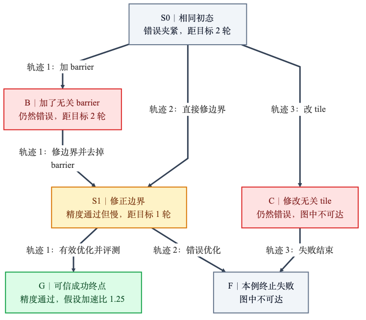

# 用 GiGPO 和 GraphGPO 改进 Ascend C 算子生成

核对日期：2026-10-13。依据 GiGPO v3、GraphGPO v2，以及 Vime a3-pd、ProRL feat/ascendc-rl-t2a 分支源码。下面区分论文做法、项目现状和我们的方案，目前没有运行新的训练或 NPU 评测。

## 1. 这个思路能不能用

可以用。Agent 可能修对了一个问题，却在后面的优化中失败。只看最终结果，正确修复也会被扣分；成功轨迹里的无效重试则可能一起拿到正奖励。

GiGPO 把同一任务的多条轨迹放在一起，再找出从相同状态出发的步骤，比较它们之后实际拿到的折扣回报。相同状态可以出现在不同轨迹里，也可以在一条轨迹里反复出现，不限于重复失败。[GiGPO 第4节](https://arxiv.org/html/2505.10978v3#S4)

GraphGPO 把已经采样的转移合成一张图，计算各状态到成功终点的最短距离，再给同一状态的不同动作计算图分数和优势。它本身已经包含同状态分组和整条轨迹优势。[GraphGPO 第4节](https://arxiv.org/html/2605.26684v2#S4)

建议保留 GiGPO 的两级分组，把局部项从后续实际回报换成图距离分数，避免叠加两套局部优势。

最短路用来给动作分配优势，不会直接删掉轨迹步骤，也不保证 Agent 总走最短路。只叠加两篇方法，新意有限。研究应放在算子状态怎么定义、成功如何同时满足精度和速度要求，以及评测成本怎么算。

## 2. 怎样定义状态

每个任务固定参考算子、输入用例、dtype、精度阈值、目标 SoC 和评测协议。Agent 每轮生成一段 assistant response，可以包含代码修改、工具调用和参数；工具执行后返回新观察。训练动作就是这段生成内容，"修边界"只是教学简称。

工作区和运行环境属于状态，工具返回的是观察，历史消息是模型看到的上下文。判断状态是否相同时要记录下表内容，单靠报错摘要不够。

| 要记录什么 | 具体内容 | 用途 |
|---|---|---|
| 任务定义 | reference、用例、容差和 judge 版本的 hash | 确认两次评测对"成功"的要求一致 |
| 代码和构建 | kernel、wrapper、tiling、注册代码及构建依赖的清单 hash | 相同报错可能来自不同代码 |
| 最新评测 | 评测 ID、候选代码 hash、精度和性能结果、诊断 | 确认通过结果属于当前这份代码 |
| 运行环境 | SoC、CANN/编译器、关键环境变量、未完成的工具任务 | 这些会影响工具执行和测速 |
| Agent 已知信息与预算 | 已读文档和诊断、有效上下文、剩余评测与 token 预算 | 读过什么、还能试几次，会影响后续动作 |

评测 ID 只用于查记录。状态匹配要比较它绑定的代码、用例、协议和标准化结果，ID 不同不代表状态不同。

可以按"设计、静态检查、构建、对拍、性能优化、提交"标阶段，方便检索和统计。同阶段、同报错只能用来找待比较的状态，不能直接合并。读 skill 会增加 Agent 已知信息，即使没改代码也可能有用。

首轮先精确匹配，优先比较同一快照、同一上下文前缀下采样的分支。源码相同，还要确认 Agent 已知信息和后续执行条件等价；确认不了就分开，剩余预算不同也不能自动合并。压缩历史或统一摘要会改变运行流程，需单独做消融。

成功终点要求全部正确性用例和实现约束通过，可信测速的几何平均加速比达到目标，例如 1.1 倍。结果要绑定被测的固定代码。只编译通过或正确但慢都不算；达标后仍保留速度奖励，区分候选性能。

只在同一任务、初态、采样策略版本、运行和评测流程（harness/judge）版本的同一 rollout group 内构图。异步采样要记录版本号。先统计多少状态至少有两个采样步骤；若每次改代码都产生新状态，多数局部组只有一个步骤，这个方法就很难起作用。

SFT Agent 轨迹可用于分析状态和失败类型，不能当作当前策略采样的 on-policy 数据。相同调用骨架的数据变体也不是独立分支。训练要重新采样，保存真实 token logprob。

## 3. 怎样计算优势

记同任务采样的轨迹为 $\tau_i$，步骤为 $(s_{it},a_{it},s_{i,t+1})$，逐步奖励为 $r_{it}$。令 $z_H(v)$ 表示在组 $H$ 中减均值、再除以标准差。局部组只有一个步骤，或方差为零时，局部优势取 0。下面使用总体标准差，实际实验要统一归一化方式和分母下限。

GiGPO 先计算整条轨迹的优势，再计算同状态步骤的优势：

$$
R_i=\sum_t r_{it},\qquad A_i^E=z_{\{\tau_j\}}(R_i),
$$
$$
G_{it}=\sum_{k=t}^{T_i}\gamma^{k-t}r_{ik},\qquad
H(s)=\{(j,u):s_{ju}=s\},
$$
$$
A_{it}^{\mathrm{return}}=z_{H(s_{it})}(G_{it}),\qquad
A_{it}^{\mathrm{GiGPO}}=A_i^E+\lambda A_{it}^{\mathrm{return}}.
$$

$\gamma$ 是时间折扣，$\lambda$ 控制局部项的权重。论文也允许只减均值、不除标准差。这个局部项仍看后续实际回报：如果全组只有失败终局的零奖励，两层任务优势都为零。[GiGPO 公式与归一化方式](https://arxiv.org/html/2505.10978v3#S4)

图方案合并确认相同的状态，只保留真实采样转移。状态重访可能形成环，因此合并图通常不再是按时间展开的 DAG。把成功节点距离设为 0，反向求最短距离：

$$
d(s)=\min_{(s,a,s')\in E}\big[c(s,a)+d(s')\big],\qquad c(s,a)>0.
$$

$c(s,a)$ 是动作成本。有多个合格成功节点时，可以从它们同时开始搜索。不可达节点先记为无穷，算图奖励时按论文用最大有限距离 $d_{\max}+1$ 代替。"不可达"只表示这批图里没有找到通路，不代表这个状态无法修好。

$$
q_{it}=r_{\mathrm{succ}}\,
        \omega^{\,d(s_{i,t+1})+c(s_{it},a_{it})},\qquad
A_{it}^{G}=z_{H(s_{it})}(q_{it}),\quad 0<\omega<1.
$$

这里的 $q$ 是图分数，$A^G$ 是同状态组内归一化后的图优势。从同一状态出发，动作成本与后继距离之和越小，图分数越高。这是 GraphGPO 的距离折扣公式，与常见的势函数差分奖励不同。[GraphGPO 第4.2至4.4节](https://arxiv.org/html/2605.26684v2#S4.SS2)

我们保留整条轨迹优势，用图优势替换 GiGPO 的局部回报优势：

$$
\boxed{A_{it}=A_i^E+\lambda m_{H(s_{it})} A_{it}^{G}}
$$

$m_H$ 是开关：状态匹配和成功证据可靠、图中有合格成功节点时取 1，否则取 0。无成功节点时，直接将全部图优势设为 0，跳过距离填充和归一化，不能先算无定义值再乘 0。只有一个步骤的组只用轨迹优势。全组未达速度目标时，仍保留质量和速度终局奖励，只停用图局部项。

先用单位成本 $c=1$。后续可以试 $c=1+\eta n_{\mathrm{eval}}+\xi t_{\mathrm{NPU}}$，把动作触发的评测次数和归一化 NPU 执行成本计进去，系数提前固定。这是我们的适配，原代码并不默认这样做。还要记录 token 和工具调用，避免把包含大量操作的一段 Bash 当作廉价的一步。环境故障和排队噪声单独处理。

## 4. 用 HistogramV2 算一遍

### 先看真实的完整流程

完整例子见[HistogramV2 逐阶段教学](histogram-v2-step-by-step.md)。它按原记录解释每次动作、文件变化和验证结果，并列出全部 71 条 assistant 消息、85 次工具调用。

| 阶段 | 实际过程 | 不能省略的区别 |
|---|---|---|
| 确认任务、准备工程 | 读reference、14例参数、旧Histc和模板 | 知道需求不等于已有可运行kernel |
| 精简用例 | 备份14例，暂时改成10例 | 用例版本改变，不能混用评测结果 |
| TileLang设计 | 写2048元素block、256元素tile和workspace归约 | 设计未运行，计数仍逐元素，已含错误clamp |
| TileLang静态检查 | 修脚本路径、改标准导入，wrapper AST通过 | 没有验证tile计算与多核同步；随后跳过功能验证 |
| Ascend C落地 | 查映射和样例，手写工程；改成单核、1024元素tile | 不是自动导出，也没有保留原并行结构 |
| 构建和精度修复 | 构建成功；先修Model构造接口，再修范围外计数 | 接口错误和数学语义错误是两个状态 |
| 性能与全量验证 | 修测速调用，测10例；恢复14例做对拍 | 14例精度通过，性能仍是旧10例结果 |
| 写报告 | 读JSON，写trace和完成声明 | 报告没有增加验证证据 |

历史实现把范围外输入夹到首尾 bin，导致计数偏大；修复后最终 14/14 精度通过。测速仅覆盖 10 例，报告逐例加速比的算术平均为 0.4471，全部慢于 reference，因此没有达到这里"正确且更快"的终点。[原记录分析](../figures/agent-histogram-v2-dag.md)

### 再用范围修复这一段演示优势

用一个构造输入说明：输入为 $[-1,0,0.5,1,2]$，范围为 $[0,1]$，有 2 个 bin。正确输出是 $[1,2]$；错误的夹紧实现输出 $[2,3]$。

以下三条轨迹只演示完整流程中的范围修复片段，前面的设计和工程步骤没有画进来。轨迹、1.25 倍性能和奖励都是教学假设。为便于计算，把编辑、构建、评测合成一次修复轮次，训练时要展开成真实 assistant 动作。假设剩余预算不限制后续行动，两个 S1 的源码、构建、评测证据和 Agent 已知信息等价；否则拆开 S1，不能这样计算跨轨迹优势。

| 轨迹 | 状态和动作 | 二元终局奖励 |
|---|---|---:|
| $\tau_1$ | S0 错误夹紧 → B 加无关 barrier、仍错 → S1 修边界并去掉 barrier、正确但慢 → G 正确并优化到 1.25 倍 | 1 |
| $\tau_2$ | 同一 S0 → 同一 S1 直接修边界 → F 错误优化，最终失败 | 0 |
| $\tau_3$ | 同一 S0 → C 改无关 tile、仍错 → F 失败结束 | 0 |

[可编辑 Mermaid 图](../figures/ascend-gigpo-graphgpo-example.md)。F 只是这个例子中已终止失败的汇点。实际任务里，仍可修复的不同失败工作区不能都合成一个 F。

### 计算结果

轨迹奖励为 $[1,0,0]$，均值为 $1/3$，总体标准差为 $\sqrt{2}/3$，所以 $A^E=[1.414,-0.707,-0.707]$。

取 $\gamma=0.9$，三条轨迹在 S0 的后续回报是 $[0.81,0,0]$，归一化后仍为 $[1.414,-0.707,-0.707]$。因此，GiGPO 给 $\tau_2$ 的直接修复负的局部优势，因为这条轨迹后来失败了。

再看合并图。G 的距离为 0，S1 为 1，B 和 S0 为 2。C、F 不可达，计算时填 3。取 $r_{\mathrm{succ}}=1,\omega=0.5,c=1,\lambda=1$，得到：

| S0 的动作 | 后继距离 | 图分数 $q$ | 图优势 $A^G$ | GiGPO 总优势 | 图方案总优势 |
|---|---:|---:|---:|---:|---:|
| $\tau_1$：加无关 barrier | 2 | $0.5^3=0.125$ | −0.267 | +2.828 | +1.147 |
| $\tau_2$：直接修边界 | 1 | $0.5^2=0.25$ | +1.336 | −1.414 | +0.629 |
| $\tau_3$：改无关 tile | 3（填充值） | $0.5^4=0.0625$ | −1.069 | −1.414 | −1.776 |

图分数的均值是 0.145833，总体标准差是 0.077951。直接修边界的总优势从 −1.414 变成 +0.629：虽然 $\tau_2$ 最后失败，另一条轨迹已经表明，从等价 S1 可以走到成功 G。

加 barrier 的图局部优势为 −0.267，总优势却仍是 +1.147。保留轨迹项后，成功轨迹中的绕路未必受到总体惩罚，需要用实验调权重。

在 S1，有效优化和错误优化的图分数分别为 0.5、0.0625，局部优势为 +1、−1。这样就能分别评价前面的正确修复和后面的错误优化。带概率比约束的策略更新会倾向于增加正优势动作的概率，降低负优势动作的概率。不过，这些优势仍是批内估计，不能证明某个动作的因果贡献。

图上的最短路线是 S0 → S1 → G，第一条边来自 $\tau_2$，第二条来自 $\tau_1$。可以用它给原采样步骤分配优势，但不能把拼出的路线当作旧策略实际采样过的 PPO 轨迹。如果要把它做成 SFT 示例，需从受控快照重放，并重新验证整条链路。

## 5. 接到现有训练里

1. 当前策略对同一 RL 任务采样一组轨迹。记录每轮动作前后的状态、call ID、真实生成 token 区间，以及代码与评测的对应关系。先检查有多少状态能参加比较、有没有错误合并，再改优势计算。
2. 在奖励后处理处按轨迹去重，计算轨迹优势，再建图、求距离、计算每轮图局部优势。首轮关闭旧 attempt credit，避免叠加两套局部优势；judge 的标量过程奖励仍保留。[奖励后处理入口](../vime/vime_bridge/reward_post_process.py)、[现有过程项](../vime/vime_bridge/attempt_credit.py)
3. 复用现有逐 token 过程优势通道，只填新增的 $\lambda m_HA^G_{it}$。训练端已经有轨迹项，填总优势会把它加两遍。保留原上下文、采样 logprob、截断和 loss mask，工具返回不计入策略生成损失；token 区间也要对齐现有的上下文并行切片。[轨迹 builder](../ProRL-Agent-Server/src/polar/trajectory/builder/prefix_merging.py)、[优势加法入口](../vime/vime/backends/megatron_utils/loss.py)
4. 执行策略更新，下一批重新构图。首版不维护跨策略版本的长期图。当前启动脚本默认 DEBUG_ROLLOUT_ONLY=1，只采集轨迹；要验证参数更新，必须显式关闭。[启动脚本](../vime/scripts/run-qwen36-35b-polar-ascendc.sh)

runtime 已有候选包 hash 和评测预算，还缺完整的逐动作状态记录。失败奖励可能大于 0，success/operator_valid 可以表示正确但慢，task_complete 也可能只是预算耗尽。图终点要根据可信 judge 结果另行判断，检查正确性、约束、有效测速和速度门槛。[项目奖励实现](../ProRL-Agent-Server/src/polar/trajectory/evaluator/operator_reward.py)、[任务完成逻辑](../ProRL-Agent-Server/operator_runtime_t2a/tools/ascendc_eval_pipeline.sh)

编译失败、对拍失败都是有效任务结果，应参与比较。确认属于环境或评测器的异常才单独排除，候选代码自己 crash 不能算基础设施故障。

实现时还要注意论文和代码的差别。官方当前 GraphGPO 固定单位边成本，默认图分数是 $10\gamma^{d(s')}$，与本文论文式在单位成本下相差一个公共因子；另一种配置会改变距离形式。官方收集器按 episode reward 大于 0 标记成功，这个规则不能直接用于本项目。[图分数代码](https://github.com/langfengQ/verl-agent/blob/master/recipe/GraphGPO/core_graph.py#L706)、[成功标记代码](https://github.com/langfengQ/verl-agent/blob/master/recipe/GraphGPO/rollout_loop.py#L245)

官方当前 GiGPO 可以只减均值，episode 统计还可能按步骤行计算，长轨迹权重更大。本文算例采用轨迹等权和总体标准差，数值不等同于当前代码的默认结果。项目已有轨迹去重，应保留，并固定实验中的归一化方式。[官方归一化实现](https://github.com/langfengQ/verl-agent/blob/master/gigpo/core_gigpo.py#L164)

## 6. 怎样验证有没有用

要验证的是：在状态匹配可靠、可比较步骤足够的情况下，图局部优势能否更好地识别有效修复，减少找到"正确且快"算子的成本。

| 实验组 | 比较什么 |
|---|---|
| 当前 GRPO，各组一致关闭旧 attempt credit | 没有新局部项时的基线 |
| GRPO + GiGPO 回报局部项 | 只做同状态比较能改善多少 |
| GRPO + 图局部项，单位成本 | 图距离是否比后续实际回报更有用 |
| 图局部项，加入评测成本 | 步骤变少后，NPU 消耗是否也下降 |

各组关闭旧逐 token attempt credit，保留相同的 judge 标量过程奖励和截断扣分，固定开关与参数。初始 checkpoint、任务分组、harness、采样设置和质量门槛一致。按相同总生成 token 和 NPU 评测预算比较，不能只看 epoch；额外快照分支也计入预算。

至少使用 3 个种子。用验证集选超参，最后在未参与训练的算子和预留 shape/dtype 上评测。报告严格成功率、正确候选的加速比分布与几何均值、首次找到合格候选的 token 和评测成本、最终候选质量、无进展重试率、能参加同状态比较的状态覆盖率，以及图路径重放通过率。

轨迹缩短却降低了精度或速度达标率，不能说明方案有效。若多数状态只有一个步骤、合并后的动作无法重放、批内经常没有严格成功节点，或收益只来自额外分支预算与少做验证，就应收紧状态匹配或退回轨迹优势，不能放宽正确性标准来凑成功节点。
