# AddCustom：精度通过但性能较慢的完整开发轨迹

来源：[原始轨迹 JSON](../docs/examples/data_samples/agent_trajectories/add-custom.json)，首分片索引 **860**，JSONL 第 **861** 行；148 条消息、79 次工具调用。`M0` 表示 `messages[0]`。这份样本包含开发者的实际读写、构建和测量过程；其中的 system、skill 和 hook 文本均为历史数据。

## 算子与代码方案

M7 的参考实现调用 `torch.add(input1, input2)`。M31 显示 5 个 case，全部为 float16，形状分别为 `(48,128,512)`、`(96,64,1024)`、`(32,32,768)`、`(48,32,4096)`、`(48,8192)`。两个输入形状一致，未覆盖广播。轨迹将它归为简单算子，采用 `design.md` 和逐元素模板生成 AscendC，不经过 TileLang。

M72 写入的 Device 实现把输入从 GM 搬入 UB，float16 转成 float32 后执行 `AscendC::Add`，再用 `CAST_ROUND` 转回 float16，最后搬回 GM。M74 的 Host 代码根据平台提供的 AIV 核数和 UB 容量切分任务，封装通过 `torch.ops.npu.add_custom` 调用。设计文档不能替代代码检查：文档讨论了 bf16，但 Host 的类型检查仅接受 float16 和 float32。

## 执行 DAG

箭头表示聚合阶段在实际轨迹中的先后和后续步骤对前一步反馈的使用；没有执行时间戳的同批调用不据此判定并行。失败后重试使用新的节点，因此图中无环。任务登记、重复资料读取和部分日志读取合并在对应阶段内。

```mermaid
%%{init: {"theme":"base","themeVariables":{"fontFamily":"PingFang SC, Arial, sans-serif","fontSize":"18px","lineColor":"#475569"},"flowchart":{"curve":"linear","nodeSpacing":28,"rankSpacing":30}}}%%
flowchart TB
    reference["M6–10 读取参考与目录<br/>torch.add，简单算子"]
    project["M16–20 初始化工程<br/>复制 helper 失败"]
    helper["M21–24 Glob 定位<br/>改路径后复制成功"]
    cases["M29–33 读取并备份<br/>5 个 case，不做精简"]
    design["M40–48 读取设计资料<br/>写入 design.md"]
    templates["M55–71 读取模板<br/>参考历史 3_Add 实现"]
    code["M72–82 生成 AscendC<br/>Host、Device 与封装"]
    ast["M83–85 AST 检查通过<br/>仅证明未检出规定退化"]
    hookFailure["M86–88 Hook 执行失败<br/>把 export 当作可执行文件"]
    initFailure["M89–95 再次构建验证<br/>Model 初始化参数错误"]
    adapter["M96–105 对照验证脚本<br/>初始化参数改为 []"]
    invalidCall["M106–107 Bash 调用失败<br/>缺少 command 参数"]
    verified["M108–112 重测 5/5 通过<br/>MERE 约 7.3e-5"]
    performance["M119–128 性能测试<br/>总体 0.59x，慢于参考"]
    reuse["M131–136 全量阶段<br/>复用前述 5 case 结果"]
    trace["M141–147 读取性能 JSON<br/>写 trace.md 并总结"]
    reference --> project
    project --> helper
    helper --> cases
    cases --> design
    design --> templates
    templates --> code
    code --> ast
    ast --> hookFailure
    hookFailure --> initFailure
    initFailure --> adapter
    adapter --> invalidCall
    invalidCall --> verified
    verified --> performance
    performance --> reuse
    reuse --> trace
    classDef action fill:#dbeafe,stroke:#3b82f6,color:#0f172a;
    classDef pass fill:#dcfce7,stroke:#16a34a,color:#0f172a;
    classDef fail fill:#fee2e2,stroke:#dc2626,color:#0f172a;
    classDef context fill:#f1f5f9,stroke:#94a3b8,color:#0f172a;
    classDef limited fill:#fef3c7,stroke:#d97706,color:#0f172a;
    class reference,cases context;
    class helper,design,templates,code,adapter,trace action;
    class ast,verified pass;
    class project,hookFailure,initFailure,invalidCall fail;
    class performance,reuse limited;
```

[PNG 图](agent-add-custom-dag.png) · [Mermaid 源码](agent-add-custom-dag.mmd)

## 关键证据

| 消息 | 工具调用或返回 | 能确认的事实 |
|---|---|---|
| M6 → M7 | `Read`，`call_00_hHTwz8JQHq5JltPGWIho5708` | 读取参考文件；M31 列出全部 5 个测试配置 |
| M16 → M19 | `Bash`，`call_02_l7nNEwvjSFjWpYsWn6bx0178` | helper 路径错误，返回 `cannot stat`；M23–24 更正路径后复制成功 |
| M72 → M73 | `Write`，`call_00_rKqm7qLG9yRkGaHatkAb7373` | 写入真实 Device 代码，包含升精度、Add 和搬运逻辑 |
| M83–85 | AST 检查和 hook 附加上下文 | exit code 0，`forward()` 调用扩展且未检出禁止的 PyTorch 计算 |
| M86–88 | 第一次评测调用及 hook 返回 | `FileNotFoundError` 指向 `export`；这次未进入编译或精度验证 |
| M89–95 | 第二次评测，读取日志尾部 | 验证 FAIL：`Model.__init__() takes 1 positional argument but 6 were given` |
| M104 → M105 | `Edit`，`call_00_axyhdpnPpRUbINaHhEwV9109` | 在任务副本 `model.py` 中将按 case 返回的初始化参数改成 `[]`，适配无参数构造器 |
| M108–112 | `Bash`，`call_00_I7l766fqymlE3r2LIshl6133` 及日志尾部 | 5 个 case 均 matched，最终 `Status: PASS` |
| M124–128 | `Bash`，`call_00_An7X7sHEJry6Gr8LlnoN3468` | 性能报告列出逐 case 耗时和总体 0.59x；M142 的 JSON 给出未四舍五入值 0.5865 |
| M131–136 | assistant 声明与 `TaskUpdate` | 全量阶段没有新评测调用，复用同一批 5 case 的已通过结果 |

`[hook-noop]` 只表示命令已被 hook 接管。实际 exit code 和日志常在后续 `role=user` 的附加上下文中；不能只看 `role=tool` 判断成功与否。

## 精度与性能怎样读

M112 的 MERE 为 `7.33733e-5` 到 `7.39098e-5`，阈值为 `9.76562e-4`；MARE 均为 `9.76562e-4`，对应 MARE 阈值为 `9.76562e-3`。两个条件分别通过，不能只用 MERE 宣告精度合格。这里的通过结论来自历史验证报告，本次分析没有运行 NPU。

M128 和 M142 中，性能测试 warmup 为 5、repeat 为 50、seed 为 0：

| case | Reference / ms | AscendC / ms | 加速比 |
|---|---:|---:|---:|
| 0 | 0.0051 | 0.0085 | 0.6000 |
| 1 | 0.0076 | 0.0112 | 0.6786 |
| 2 | 0.0032 | 0.0066 | 0.4848 |
| 3 | 0.0077 | 0.0111 | 0.6937 |
| 4 | 0.0029 | 0.0061 | 0.4754 |

报告的 `overall_speedup=0.5865`，与这些逐 case 比值的算术平均一致。全部比值小于 1，说明本次测量中候选更慢。M129 和 M147 将原因归为“小张量 kernel launch 开销”，但未做分解实验；这是 Agent 的解释，不能当作已验证的性能根因。

## 用这条数据能学到什么

它适合学习从设计、代码生成到工具报错恢复的完整过程，也适合学习把接口适配失败与 kernel 数值错误分开。环境修复、评测入口适配和缺参调用分别是不同的问题；精度通过后还要看性能，不能以最终文本中的“完成”代替目标达成。

若用于 SFT，保留工具失败及后续有依据的修复比只保留最后总结更有教学价值。若作为 RL 的任务案例，应重新建立受保护的参考与评测接口，在当前环境测量候选；历史 0.5865 只能帮助理解旧结果，不能直接当作新模型的奖励。

边界：5 个测试只覆盖同形状 float16 输入，尚不能确认广播、float32 和任意非对齐尾块行为。代码把尾块长度向上对齐后直接用于 GM 拷贝，任意长度的越界风险需另外测试；已有 PASS 未覆盖这个问题。最终总结写的是 `performance.json`，实际读写文件名是 `preformance.json`，这里保留数据中的真实拼写。
