# CosMath：编译修复、七轮设备超时与最终性能

来源：[原始轨迹 cos-math.json](../docs/examples/data_samples/agent_trajectories/cos-math.json)，原 Agent 分片 index 580，共 250 条消息。结论是：历史工具日志确认 **9 / 9 case 精度通过**；性能报告 `overall_speedup=0.8709`，整体慢于该报告中的参考实现。最后的“完成”不代表实现达到了加速目标。

M 编号使用原 JSON 的 `messages` 数组索引，从 0 开始。图按实际时间顺序聚合阶段，每次重测展开为后续节点，箭头表示这一轨迹中的推进关系；不是 NPU 内部的计算依赖图。蓝色为实际行动，绿色为日志确认的通过，红色为可见失败，灰色为上下文，琥珀色为声明、证据不足或不能据此推广的结果。工具被 hook 拦截时，实际输出可能出现在紧接着的 user-role `system-reminder` 中，不能只读 `hook-noop`。

本文只读历史记录，没有执行记录中的命令，也没有重新编译、训练或在 NPU 上测试。历史日志中的远端路径用于溯源，不是当前机器可访问的制品链接。
## DAG

```mermaid
%%{init: {"theme":"base","themeVariables":{"fontFamily":"PingFang SC, Arial, sans-serif","fontSize":"18px"},"flowchart":{"curve":"linear","htmlLabels":true,"wrappingWidth":340}}}%%
flowchart TB
    cosContext["M3、M7｜参考与用例<br/>逐元素 cos，9 个 case"]:::context
    cosDesign["M9–31｜修正模板路径<br/>保留 9 例，写 design.md"]:::action
    cosCode["M66–77｜生成完整工程<br/>初版 wrapper AST 通过"]:::passed
    cosHook["M78–82｜修正 hook 命令后<br/>DataCopyPad 三参编译失败"]:::failed
    cosInitFail["M83–86｜补第四参数<br/>构建成功，初始化参数失败"]:::failed
    cosTimeout1["M91–102｜修复初始化接口<br/>第 1 轮设备超时"]:::failed
    cosTimeout2["M105–112｜调整尾块长度<br/>第 2 轮设备超时"]:::failed
    cosTimeout3["M115–126｜改搬运并回模板<br/>第 3 轮设备超时"]:::failed
    cosTimeout4["M137–146｜加 barrier 与 padding<br/>第 4 轮设备超时"]:::failed
    cosTimeout5["M147–156｜换到设备 0<br/>第 5 轮设备超时"]:::failed
    cosTimeout6["M157–170｜清理重编与 bf16<br/>第 6 轮设备超时"]:::failed
    cosControl["M177–178｜运行 Muls 对照<br/>Muls 的 9 个 case 通过"]:::passed
    cosDispatch["M179–182｜运行时 dtype 分发<br/>再次发生搬运编译错误"]:::failed
    cosTimeout7["M185–192｜保留 Muls 结构改 Cos<br/>第 7 轮设备超时"]:::failed
    cosUbFix["M193–215｜查 Cos 头文件<br/>UB 系数改为 40"]:::action
    cosPass["M217–220｜重新评测<br/>CosMath 9 / 9 matched"]:::passed
    cosPerfFail["M224–225｜首次性能测试<br/>初始化参数再次失败"]:::failed
    cosPerfRepair["M232–235｜修改本地 reference<br/>get_init_inputs 返回空列表"]:::action
    cosPerf["M236–239｜9 例性能报告<br/>约 0.87 倍，整体更慢"]:::context
    cosSummary["M240–249｜无新增全量重测<br/>读取精确值 0.8709，声明完成"]:::uncertain
    cosContext --> cosDesign
    cosDesign --> cosCode
    cosCode --> cosHook
    cosHook --> cosInitFail
    cosInitFail --> cosTimeout1
    cosTimeout1 --> cosTimeout2
    cosTimeout2 --> cosTimeout3
    cosTimeout3 --> cosTimeout4
    cosTimeout4 --> cosTimeout5
    cosTimeout5 --> cosTimeout6
    cosTimeout6 --> cosControl
    cosControl --> cosDispatch
    cosDispatch --> cosTimeout7
    cosTimeout7 --> cosUbFix
    cosUbFix --> cosPass
    cosPass --> cosPerfFail
    cosPerfFail --> cosPerfRepair
    cosPerfRepair --> cosPerf
    cosPerf --> cosSummary
    classDef action fill:#DBEAFE,stroke:#2563EB,color:#172554,stroke-width:1.5px;
    classDef passed fill:#DCFCE7,stroke:#16A34A,color:#14532D,stroke-width:1.5px;
    classDef failed fill:#FEE2E2,stroke:#DC2626,color:#7F1D1D,stroke-width:1.5px;
    classDef context fill:#F1F5F9,stroke:#64748B,color:#0F172A,stroke-width:1.5px;
    classDef uncertain fill:#FEF3C7,stroke:#D97706,color:#78350F,stroke-width:1.5px;
```

## 从参考实现理解任务

M3 的 Read 返回中，内嵌 L69–79 的 `Model.forward(x)` 直接返回 `torch.cos(x)`；L84–92 用指定 shape/dtype 的 `torch.randn` 构造输入。M7 列出完整 9 例：float16、bfloat16、float32 各搭配 `[1]`、`[512,3]`、`[1,3,224,224]`。M19 备份计数也是 9，M20 决定不精简。因此后来的 9 例验证就是这份轨迹所见的完整 case 集，不能理解为覆盖任意值域、shape 和平台。

代码走 design.md 与模板生成路线。最终可见的 M185 kernel 使用 GM→UB 的四参 `DataCopyPad`，队列搬运，float32 直接 `AscendC::Cos`；低精度路径先 Cast 到 float32，执行 Cos，再 Cast 回目标类型，并加入 `PipeBarrier<PIPE_V>()`。这些是实际写入代码的内容，不等同于每条硬件解释都经过证明。

## 为什么图中保留七轮超时

第一类失败来自环境或接口：M10 模板路径错误，M80 hook 把环境变量前缀当可执行文件，M82 缺少 DataCopyPad 第四参数，M86 构造参数布局错误。它们分别发生在文件准备、命令执行、编译与模型实例化阶段，不能都叫“精度不匹配”。

实例化修复后，M102、112、126、146、156、170、192 七次不同重测结果均出现设备超时。中间试过实际尾长、搬运方式、同步、换设备、清理缓存与模板结构，但当时日志没有支持这些修改已解决问题。M178 的通过属于 **Muls 对照算子**，不是 CosMath；图单独命名，避免把对照测试通过移植成目标算子通过。

M215 的最终 host 编辑将 `bufferCoefficient` 从 float32 的 20、低精度的 16 改为统一 40，给 Cos 的内部临时空间留更多余量；M220 随后列出了所有 9 例 matched。这个先后关系支持“增大 UB 预算后该版本通过”。M221 将 UB 临时空间判为根因，但轨迹没有提供独立内存审计或控制变量实验，不能把此前每次超时都确定归因于同一原因。M127 写过 identity 调试代码，M142 却读取旧后台输出；不能据此另计一次已执行的 identity 实验。

## 精度与性能证据

M220 中 9 例全部 matched，MERE 都为 0；case 2 的 MARE 为 `0.000489235`，仍低于该项阈值。不要改写成“所有误差严格为零”。M242 明确说全量与原集合相同，没有额外运行一次全量测试。

M225 的首轮性能报告出现 reference 与 candidate 的初始化 TypeError。M234 修改了工作副本 `model.py` 的 `get_init_inputs()`，从每例空列表变为单个空列表；这是评测适配层的修改，不是 Cos 数学实现变化。随后 M239 与 M246 给出性能数据：warmup 5、repeats 50、seed 0；9 个 speedup 为 `1.0400, 0.9524, 0.6351, 0.9000, 1.0000, 0.6400, 0.8947, 1.0526, 0.7231`，报告 overall 为 `0.8709`。这个 overall 是报告采用的逐例比值汇总，不能解释成全部任务总耗时的比值，也不能当几何平均值。shape `[1,3,224,224]` 的三个 dtype 都慢于参考。

性能数字来自历史 `performance.py` 的 NPU profiling 报告；它记录算子事件并在取不到有效延迟时设有wall-clock兜底，不是本次重新计时。本文保留其报告口径，不将这些数字当作已统一覆盖Python、host计算及所有拷贝费用的端到端延迟。

## 关键证据锚点

| 消息 | 调用 ID / 原文片段 | 可支持的结论 |
|---|---|---|
| M3 | `call_00_8vs9v5IcrxQgXM0tTxdw3735`；`return torch.cos(x)` | 参考语义 |
| M82 | `call_00_QR9rIMQyFfQN2kgzxg4y4686`；`requires 4 arguments, but 3 were provided` | 实际编译失败 |
| M86 | `call_00_OwYDozB1R96EnTYG8O544227`；`Model.__init__() ... 10 were given` | 构建完成后，验证卡在实例化 |
| M102 | `call_00_U6brh34SBbzKykSeWss21943`；`Vector core execution timed out` | 第一轮可见设备运行失败 |
| M178 | `call_00_Lx1LkS7x881FhEPK5pmp7468`；`Status : PASS` | Muls 对照通过，非 CosMath |
| M215 | `call_00_FkbkVQ1gASZNQteyHcYf6541`；`bufferCoefficient = 40` | 最后一次关键 host 编辑 |
| M220 | `call_00_6zB2H2B4xPLC344inXSA6929`；9 行 matched，`Result: pass` | CosMath 9 例精度通过 |
| M246 | `call_00_FIMJKhrUecxD8CqRl8FQ0664`；`overall_speedup: 0.8709` | 已记录性能，不是加速成功 |

这条轨迹适合学习如何区分编译、实例化、设备运行、精度、性能五种信号。初版 wrapper AST 的 PASS 只证明当时静态检查满足规则；不能替代后续代码版本的全部运行验证。
