# FlashAttention 大 head dim：编译与精度完成，性能测试被停止

对应原始数据索引 **480**，证据来源是 [完整轨迹 JSON](../docs/examples/data_samples/agent_trajectories/flash-attention-large-head.json)，共 **374 条消息，M0–M373**。分析依据是历史消息与工具回包，没有重新执行算子。

最终纯 Vector 方案有 **全量 5/5 case 精度通过**的直接记录。性能测试启动后长时间运行，Agent 主动调用 `TaskStop`，没有完整性能报告，**加速比未知**。最终 trace 中的“性能测试超时”应理解为 Agent 对停止原因的总结；直接可观察到的动作是主动终止进程，不能补写一个实际未出现的超时判定或加速比。

```mermaid
%%{init: {"theme":"base","themeVariables":{"fontFamily":"PingFang SC, Arial","fontSize":"18px"},"flowchart":{"curve":"linear","htmlLabels":true,"nodeSpacing":30,"rankSpacing":42,"wrappingWidth":340}}}%%
flowchart TB
    reference["M2–M20｜读取参考与备份病例<br/>全量 5 case，没有精简"]:::context
    design["M31–M50｜生成 TileLang 设计<br/>修检查路径后 AST 通过"]:::action
    mixed["M81–M117｜生成 Cube/Vector 方案<br/>初版 wrapper AST 通过"]:::action
    paths["M118–M137｜评测入口调用失败<br/>调整环境变量与脚本路径"]:::fail
    queue["M140–M211｜直接构建并修队列 API<br/>编译多次失败"]:::fail
    fixpipe["M212–M257｜修 Fixpipe 后再编译<br/>仍失败；读取当前目标 API 实现"]:::fail
    vector["M260–M262｜重写成纯 Vector<br/>逐元素点积与在线 softmax"]:::action
    vectorfail["M264–M309｜修 SetValue、Exp、搬运<br/>多次编译失败后到 host 构建"]:::fail
    hostfix["M310–M320｜调整 SOC 与头文件<br/>将 tiling 定义从 device 头拆出"]:::action
    build["M322–M325｜重建并打包安装<br/>扩展库构建完成"]:::pass
    adapter["M326–M342｜修验证调用和模型接口<br/>JSON 路径、初始化参数适配"]:::action
    ubfail["M343–M344｜首次实际数值验证<br/>设备报 UB 地址越界"]:::fail
    smaller["M345–M348｜按 head dim 缩小块<br/>8、16、32；重建并安装"]:::action
    accuracy["M349–M350｜重新验证全部病例<br/>5/5 通过，MERE 与 MARE 为 0"]:::pass
    perfstart["M356–M357｜启动性能测试<br/>后台任务 b1r4vnfuu"]:::action
    running["M358–M363｜轮询日志及进程<br/>profiler 仍在运行，无完整报告"]:::unverified
    stop["M364–M365｜主动 TaskStop<br/>工具确认停止性能进程"]:::action
    restore["M366–M368｜恢复同一份 5 case<br/>未观察到恢复后的新验证调用"]:::unverified
    claim["M371–M373｜写 trace 与最终总结<br/>精度可追溯，性能加速比未知"]:::unverified

    reference --> design
    design --> mixed
    mixed --> paths
    paths --> queue
    queue --> fixpipe
    fixpipe --> vector
    vector --> vectorfail
    vectorfail --> hostfix
    hostfix --> build
    build --> adapter
    adapter --> ubfail
    ubfail --> smaller
    smaller --> accuracy
    accuracy --> perfstart
    perfstart --> running
    running --> stop
    stop --> restore
    restore --> claim

    classDef action fill:#DBEAFE,stroke:#2563EB,color:#172554,stroke-width:2px;
    classDef pass fill:#DCFCE7,stroke:#16A34A,color:#14532D,stroke-width:2px;
    classDef fail fill:#FEE2E2,stroke:#DC2626,color:#7F1D1D,stroke-width:2px;
    classDef context fill:#F3F4F6,stroke:#6B7280,color:#1F2937,stroke-width:2px;
    classDef unverified fill:#FEF3C7,stroke:#D97706,color:#78350F,stroke-width:2px;
    linkStyle default stroke:#475569,stroke-width:2px;
```

M 是零基消息索引。箭头串起不同工程版本下的后续操作，每次失败后的新方案向下展开，避免把重试画成一个模糊循环。聚合节点不表示内部调用同时执行。蓝色为操作，绿色为观察到通过，红色为失败，灰色为输入背景，琥珀色为仍缺少验证证据的状态或声明。

## 参考语义与真正覆盖的输入

M3 的 reference 将 query、key、value 转 float32，计算 `scores = query @ key.transpose(-1,-2) * scale_value`，再对最后一维 softmax，用权重乘 value，最终转 fp16。函数接收 `head_num`，但参考 forward 没有使用它来拆 head，也没有 mask、dropout 或 causal 条件。不能仅看算子名称就补入标准多头 FlashAttention 的其他语义。

M16 给出的全量 JSON 只有 5 case，整个过程未做病例精简：

| 原 case_id | Q/K/V 共同 shape | scale_value | head_num |
| --- | --- | --- | --- |
| 0 | `[2, 2048, 1024]` | 0.0625 | 8 |
| 1 | `[1, 4096, 512]` | 0.875 | 4 |
| 2 | `[1, 2048, 1024]` | 0.0625 | 16 |
| 3 | `[2, 4096, 256]` | 1.0 | 2 |
| 4 | `[1, 2048, 512]` | 0.5 | 16 |

输入生成器用 fp16 的 `torch.rand(shape) * 0.02 - 0.01`，即很小的随机数。这里的通过只覆盖这次生成的输入和这 5 种参数；没有大幅度输入、mask、不同 dtype 或更多形状的测试证据。

## 从 Cube/Vector 设计到实际纯 Vector 代码

最初生成的 TileLang 设计采用 Cube 计算 QK 与 PV，Vector 计算在线 softmax。M50 是 TileLang AST 通过，不是 TileLang 数值通过；M117 是初版 `model_new_ascendc.py` 的 AST 通过，也不是后续 C++ 实现的完整验证。

评测入口路径及环境变量调用失败后，Agent 改用直接 CMake/make。早期构建出现队列 API、`PIPE_FIX` 和 Fixpipe 参数问题。M253 的编译器无法匹配 `Fixpipe` 重载；M257 读取的当前目标实现中存在 `ASCENDC_REPORT_NOT_SUPPORT(false, "Fixpipe from CO1 to GM")`。这支持“当时所用编译目标与所选 API 路径不匹配/不支持”的调查结果，**不能推广成所有 Ascend 硬件都不支持 Fixpipe**。M312 后面又明确更改了 `SOC_VERSION=Ascend910B3`，因此平台选择也是这个调试过程的一部分。

M260 起改成纯 Vector。后续代码以分块方式加载 Q/K/V，使用 `GetValue`/`SetValue` 等逐元素访问计算点积和加权和，并通过 AscendC Exp 及在线最大值、累加和维护 softmax。它在算法组织上仍是分块在线 attention，但没有实现最初设计中 Cube 矩阵乘的高吞吐路径。把该算法写成嵌套标量循环，与使用硬件矩阵乘原语，在性能上有很大区别；实际速度仍需测量，不能仅凭复杂度替它生成一个数值。

后续先修 SetValue 参数、不可用的 `expf`、DataCopy 调用，再解决 host 误包含 device 头的问题，将 tiling 结构抽成独立头文件。M323 明确显示扩展构建到 100%，随后完成 wheel 安装。这才是编译层面的成功证据。

真正执行数值验证前还修了两项参考脚本适配：JSON 文件名需带 `5_` 前缀，`get_init_inputs()` 需返回 `[]`。这些改动发生在 `model.py`，但记录未显示修改它的 forward 数学表达式。M344 随后报 `ub address out of bounds`，说明“可编译”与“可运行”仍是不同门槛。M345 将 block_m/block_n 从较大值降为按 dim 选择 8/16/32，重建安装后 M350 才得到所有病例通过。

## 精度完成与性能未完成的边界

M350 的五条 comparison 均为 `matched, MERE=0, MARE=0`，阈值 `0.000976562`、MARE 阈值 `0.00976562`，最后有 `Result: pass`。这是完整 5 case 的真实工具回包。不能把所有指标为 0 解释为对任意输入都精确等价；它们是该验证器对这一批实际输入的结果。

M356 发起 `performance.py`，M357 返回后台任务 ID `b1r4vnfuu`。M359/M361 留有 reference 各病例及候选 profiler 的进度信息，M363 确认进程仍在运行，M364/M365 是明确的停止请求与成功确认。记录没有完整 reference/candidate 耗时表、Overall speedup 或已保存性能报告，故无法给出有效加速比，也不能用整个任务耗时除以病例数得到单次 kernel 延迟。profiling、warmup、编译外部开销与异步进度都可能包含在这段墙钟时间中。

M366 恢复原备份 JSON，因原来就只有 5 case，其内容范围没有增加。之后没有新的 verification 调用；M368 的阶段判断沿用 M350 已有结果。可以说“此前已验证全量 5 case”，不能画出一次并不存在的“恢复后再次全量验证通过”。M371 的 trace 声称性能很慢及测试被终止，M373 又给出完成总结，都不能将性能阶段变成有效得分。

初始 AST 结果也早于多数实现修改。若用于当前 RL，需要用最终代码、固定 reference 和固定病例重新跑正式 judge，并完成带明确同步与计时边界的性能评测。这里没有修改 golden 计算来绕过数值检查的可见证据，但没有独立重测就无法确认当前环境中的接受结果。

## 可定位的关键证据

| 消息与调用 ID | 记录中的关键内容 | 支持的判断 |
| --- | --- | --- |
| M3，`call_00_zj0e7cRDZEa7IkM5kwdC8104` | `scores = torch.matmul(query, key.transpose(-1, -2))` | 参考的 attention 语义与小范围随机输入。 |
| M16，`call_01_JHzb2tSz1LJT93HjsL1I0718` | 5 行 JSON，head dim 为 256、512、1024 | 全量病例数与参数范围。 |
| M257，`call_00_6Z4jTPMmPorsQk1FmFeJ5007` | `Fixpipe from CO1 to GM` 的不支持实现 | 当前编译路径的限制；不是跨平台定律。 |
| M323，`call_00_BoZ9l3rs33E5os1toewD4161` | `[100%] Built target ..._ext` | 最终路径确实编译成扩展库。 |
| M344，`call_00_ET_pERd0wBsxCaYzeZY2bwO4429` | `VEC instruction error: the ub address out of bounds` | 编译通过后仍有真实运行错误。 |
| M345→M346，`call_00_nZy4jTVbQfJxaRe7xOOu9471` | dim≥1024 用 8，dim≥512 用 16，其余用 32 | 与之后精度通过相连的具体 tiling 修复。 |
| M349→M350，`call_00_rpikJcnKjwlMd2WA5J109237` | 5 条 matched；`Result: pass` | 全量五病例的历史精度结果。 |
| M356，`call_00_42A4WjQazUXgUJ2d9oM54332` | 启动 `performance.py` | 性能测试确实开始，但开始不等于完成。 |
| M364→M365，`call_00_EWDgXG2EDuNp2IF5Sp9J7326` | `Successfully stopped task: b1r4vnfuu` | 可观察到的是主动终止，性能结果缺失。 |

本例最值得学习的是分开记录编译通过、设备运行成功、数值通过与性能完成。每一道门槛需要自己的证据，Task 状态和最终回复不能替代下一道门槛。
