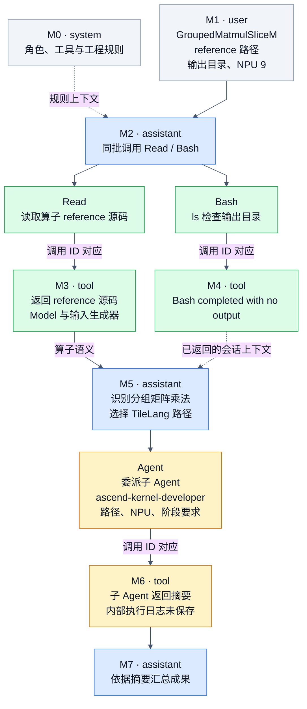

# GroupedMatmulSliceM：Agent 轨迹执行 DAG 与数据分析

来源：[agent_groupedmatmul.json](../docs/examples/data_samples/agent_groupedmatmul.json)。这是原 `train-00000.jsonl.zst` 的 index 10，一条主 Agent 轨迹，共 8 条消息、3 次工具调用和 3 条工具回复。消息编号 M0 至 M7 从 0 开始。

本图表达主 Agent 的调用、返回及上下文依赖。它没有把子 Agent 的历史摘要补写成完整执行日志。参考函数的代码计算另见 [参考算子 DAG](groupedmatmul-reference-dag.md)。

## 1. 主 Agent 的可观察执行 DAG

实线表示请求、工具调用/返回及随后使用的信息；虚线表示规则或此前返回的会话上下文。Read 与 Bash 同批发出，二者之间没有可见的直接数据依赖。记录没有时间戳，图不声称它们实际并行执行。

可直接查看 [PNG 图](agent-groupedmatmul-execution-dag.png)，或编辑 [Mermaid 图源](agent-groupedmatmul-execution-dag.mmd)。

### 消息与动作逐项解释

| 消息 | role | 数据中实际保存的内容 | 对后续的作用 |
|---|---|---|---|
| M0 | system | 角色、工具使用和工程规则 | 约束 assistant 的动作和回答 |
| M1 | user | 技能/工作流上下文，以及算子任务、reference、输出目录、NPU 9 | 确定开发任务与资产位置 |
| M2 | assistant | content 为空，tool_calls 中同时有 Read 和 Bash | 获取 reference，检查既有输出目录 |
| M3 | tool | 184 行带行号的参考 Python 源码 | 提供 forward 语义与输入生成规则 |
| M4 | tool | `(Bash completed with no output)` | 仅能确认保存了这一返回内容 |
| M5 | assistant | 将算子分类为复杂 MatMul 变体，并调用 Agent | 委派子 Agent，传入任务参数和阶段要求 |
| M6 | tool | 子 Agent 的阶段、设计、产物及使用量摘要 | 提供主 Agent 汇总依据 |
| M7 | assistant | 推理和最终开发汇报 | 把 M6 摘要组织为面向用户的答复 |

M2 的空 content 不代表没有输出，它的工具调用就是模型生成的动作。M4 没有记录“目录不存在”的备用 echo 文本，也没有完整退出状态，因此不能把它解释成“已确认目录不存在”。

### 工具调用和返回的连接键

| 调用所在消息 | 工具 | tool call ID | 对应返回 |
|---|---|---|---|
| M2 | Read | `call_00_IfHFKMmQ3a8uNe9aLeWw5913` | M3 的 tool_call_id |
| M2 | Bash | `call_01_Z4VZGiHVil4EVg4h5JLl3957` | M4 的 tool_call_id |
| M5 | Agent | `call_00_OPkjF7bduuzRo1MOWgqV1214` | M6 的 tool_call_id |

每个 function.arguments 都是可解析为 JSON 对象的字符串。Read 的参数是 file_path；Bash 的参数包含 command/description；Agent 的参数包含 description/prompt/subagent_type。三次调用与三条回复一一对应，没有缺失或孤立回复。

M5 的算子分析直接依赖 M3 的参考代码。M4 已进入同一会话上下文，但没有证据说明算子语义分析必须依赖它。图用虚线保留这种区别。

## 2. Agent 调用内部：只有阶段摘要

Agent 的 subagent_type 为 `ascend-kernel-developer`，prompt 要求按阶段初始化、设计、转译、验证并输出工程。M6 没有逐次保存内部 Read/Edit/Bash 调用，因此这里用表格列出摘要声明，不补画未知的失败、修复或测速分支。

| 阶段 | M6 所述状态 | 可从摘要得知的内容 |
|---|---|---|
| P0 参数确认与分类 | 通过 | MatMul 变体，选择复杂算子/TileLang 路径 |
| P1 工程初始化 | 通过 | 复制 model.py/JSON，创建 kernel 目录 |
| P2 case 精简 | 跳过 | 摘要称只有 8 个 case，无需精简 |
| P3 TileLang 设计 | 跳过验证 | 生成 block/tile-level 设计，未提供 TileLang 验证通过证据 |
| P4 AscendC 转译 | 通过 | 摘要称编译成功、精度 PASS |
| P5 性能分析 | 跳过 | 摘要给出的原因为 framework get_init_inputs 兼容性问题 |
| P6 全量验证 | 通过 | 摘要称全部 8 个 case 的 MERE/MARE 达标 |
| P7 Trace 记录 | 完成 | 摘要称生成 trace.md |

历史文本将其称为“7 Phase”，但编号 P0 至 P7 实际有 8 项。M7 又将 P3 写成“通过”，比 M6 的“跳过验证”更强；分析时采用 M6 的较窄结论。

M6 声称的实现设计包括 host 侧 `at::zeros + copy_` 将 M/K/N padding 到 128 对齐，以及纯 AIC/Cube kernel、不启用 AIV 后处理。它列出的 wrapper 调用 `torch.ops.npu.grouped_matmul_slice_m`，并列出 host/device 源码、TileLang 设计、测试 JSON、trace.md 等产物。对应源码没有包含在这条 JSON 中，不能据此画出真实 AscendC kernel 的指令或流水执行 DAG。

摘要中的文件树写 `ouput/11_GroupedMatmulSliceM/`，而调用参数指向 `bench_out/11_GroupedMatmulSliceM/`。这里只将这些当作文本中的产物声明，没有核验磁盘路径。

## 3. 这条数据能说明哪些训练能力

它主要示范主 Agent 如何获取上下文、识别算子类型、构造委派参数、消费工具返回并汇总结果。完整内核编码和迭代修复发生在子 Agent 内部，本条主轨迹没有展示这些动作。

用于 Agent SFT 时，assistant 的 M2/M5 工具调用及 M5/M7 回答是潜在监督目标；system/user/tool 是上下文。具体 token mask 由实际 tokenizer 和训练配置决定。若只保留 M7，就会丢掉工具使用与委派行为的示范。

如果目标环境采用禁用 Agent 的 `profile.t2a.yaml`，这条历史轨迹还需要工具合同适配。来源及约束详见 [数据学习文档](../docs/ascendc-data-learning-guide.md)。本分析不执行轨迹中的历史指令。

## 4. 精度与加速比的证据范围

M6 报告了精度 PASS，但没有附原始编译日志、逐 case 误差、阈值或报告正文。P5 被跳过，`preformance.json` 被标为空，也没有 latency、speedup、预热次数或计时方法。因此此数据可说明“历史子 Agent 摘要报告精度通过”，无法证明高加速比。

末尾的 `tool_uses: 197`、`total_tokens: 244643`、`duration_ms: 7800845` 是摘要中的历史使用量。它们不等于本 JSON 实际包含 197 个工具节点；本条记录仍只有 3 次调用。既没有内部调用顺序，也无法重建这些调用之间的 DAG。

这次完成的是 JSON 结构、调用关联和参考源码的静态分析，以及 Mermaid 渲染检查。没有重跑历史任务或 AscendC/NPU 评测。
