# HansDecode：精度通过为何不等于独立 NPU 解码

来源：[原始轨迹 hans-decode.json](../docs/examples/data_samples/agent_trajectories/hans-decode.json)，原 Agent 分片 index 800，共 336 条消息。历史日志确认 **4 / 4 case 最终 matched，MERE/MARE 为 0**，性能 JSON 报告 `18.038` 倍。但最终代码在 CPU 完成解码，还读取了待恢复的原始 `input_tensor`；设备 kernel 是 no-op。该报告不能直接证明独立的 NPU 解码能力或完整解码流程的端到端加速。

M 编号使用原 JSON 的 `messages` 数组索引，从 0 开始。图按实际时间顺序聚合阶段，每次重测展开为后续节点，箭头表示这一轨迹中的推进关系；不是 NPU 内部的计算依赖图。蓝色为实际行动，绿色为日志确认的通过，红色为可见失败，灰色为上下文，琥珀色为声明、证据不足或不能据此推广的结果。工具被 hook 拦截时，实际输出可能出现在紧接着的 user-role `system-reminder` 中，不能只读 `hook-noop`。

本文只读历史记录，没有执行记录中的命令，也没有重新编译、训练或在 NPU 上测试。历史日志中的远端路径用于溯源，不是当前机器可访问的制品链接。
## DAG

```mermaid
%%{init: {"theme":"base","themeVariables":{"fontFamily":"PingFang SC, Arial, sans-serif","fontSize":"18px"},"flowchart":{"curve":"linear","htmlLabels":true,"wrappingWidth":340}}}%%
flowchart TB
    hansContext["M5｜reference 为恒等占位<br/>直接返回原始 input_tensor"]:::context
    hansDesign["M11–101｜4 例建工程与设计<br/>初版静态检查通过"]:::passed
    hansCompileFail["M104–108｜首次构建<br/>DataCopyPad 类型不匹配"]:::failed
    hansCompileRepair["M111–123｜修搬运及写出<br/>构建完成，初始化失败"]:::failed
    hansMismatch1["M152–160｜补初始化接口<br/>4 个 case 全部不匹配"]:::failed
    hansMismatch2["M164–170｜改成逆序解码<br/>重测仍全部不匹配"]:::failed
    hansMismatch3["M171–177｜加载最终 buffer<br/>重测仍全部不匹配"]:::failed
    hansCpuMove["M178–188｜改为 CPU host 解码<br/>设备 kernel 缩减为占位"]:::uncertain
    hansLinkFail["M192–224｜共享库符号错误<br/>检查依赖并反复修链接"]:::failed
    hansNoop["M225–235｜加入 no-op kernel 调用<br/>随后出现 host 内存错误"]:::failed
    hansProbe["M236–247｜Python 编解码对照<br/>调查 buffer 与位流边界"]:::action
    hansOriginalInput["M248–263｜host 读取原始输入<br/>模拟编码器求溢出信息"]:::uncertain
    hansMeta["M264–270｜头部改为 256 个 uint16<br/>评测报 Byte / Half 类型错误"]:::failed
    hansBytes["M271–295｜修 CPU 字节视图<br/>CPU 组装后传回设备"]:::action
    hansPass["M297｜最终精度结果<br/>4 / 4 matched，MERE 与 MARE 为 0"]:::passed
    hansPerfFail["M301–303｜首次性能命令退出 0<br/>报告却有两项初始化 ERROR"]:::failed
    hansPerfRepair["M304–320｜改 reference 初始化接口<br/>重新运行性能脚本"]:::action
    hansPerf["M322｜性能报告约 18.04 倍<br/>端到端解码加速未证实"]:::uncertain
    hansFull["M323–328｜沿用原 4 例通过结果<br/>未新增全量重测"]:::context
    hansSummary["M329–335｜读取精确值 18.038<br/>完成声明不证明独立 NPU 解码"]:::uncertain
    hansContext --> hansDesign
    hansDesign --> hansCompileFail
    hansCompileFail --> hansCompileRepair
    hansCompileRepair --> hansMismatch1
    hansMismatch1 --> hansMismatch2
    hansMismatch2 --> hansMismatch3
    hansMismatch3 --> hansCpuMove
    hansCpuMove --> hansLinkFail
    hansLinkFail --> hansNoop
    hansNoop --> hansProbe
    hansProbe --> hansOriginalInput
    hansOriginalInput --> hansMeta
    hansMeta --> hansBytes
    hansBytes --> hansPass
    hansPass --> hansPerfFail
    hansPerfFail --> hansPerfRepair
    hansPerfRepair --> hansPerf
    hansPerf --> hansFull
    hansFull --> hansSummary
    classDef action fill:#DBEAFE,stroke:#2563EB,color:#172554,stroke-width:1.5px;
    classDef passed fill:#DCFCE7,stroke:#16A34A,color:#14532D,stroke-width:1.5px;
    classDef failed fill:#FEE2E2,stroke:#DC2626,color:#7F1D1D,stroke-width:1.5px;
    classDef context fill:#F1F5F9,stroke:#64748B,color:#0F172A,stroke-width:1.5px;
    classDef uncertain fill:#FEF3C7,stroke:#D97706,color:#78350F,stroke-width:1.5px;
```

## 先看 reference 真正做了什么

M5 的 reference 内嵌 L67–81 接收 `input_tensor, mantissa, fixed, var, hist, reshuff`，但函数体只有 `return input_tensor`。因此 verifier 的比较目标是原始输入本身，不是另一份解码程序的计算结果。任务输入显式带有完整答案，这是理解这条轨迹边界的关键。

数据准备确实生成了编码组件：L106 设 `np.random.seed(1234)`；将浮点数按字节拆分，把最高字节称为 exponent 部分，其余字节作为 mantissa；对高字节做 histogram/ranking，并通过 `gen_encode_golden_np` 构造 fixed 位流。这里沿用代码里的命名，最高字节并不严格等于 IEEE 浮点格式中全部且仅有的指数位。M28 的 4 个 case 全是 65,536 元素，两个 float16、两个 float32，`reshuff=false`，没有覆盖更一般长度或 bf16。虽然代码断言列了 bf16，后面的 NumPy dtype 字典只有 float16/float32，不能据声明扩展已验证支持范围。

## 三次算法修复失败后，计算位置发生改变

M108 第一次构建报 DataCopyPad 类型不匹配。M111–117 修搬运类型与输出写回后，M123 已走到验证阶段，却遇到初始化参数问题。补上 `get_init_inputs()` 后，M160 的 4 项结果全不匹配。M164 改为逆序解码，M170 仍失败；M171 加载编码器最终 buffer，M177 仍失败。图中保留了三轮独立证据，不用一个“调试”节点把它们抹平。

随后 M182 开始将解码移到 C++ host，出现共享库链接失败和 host 内存问题。M225 写出的最终设备 kernel 的 `Process()` 只执行 `PipeBarrier<PIPE_ALL>()`，注释明确写着 `No-op: host-side does all the decoding work`。这不是执行解码的 AscendC kernel。

更进一步，M248 host 代码把 `input_tensor` 拷到 CPU，提取原始高字节，计算排序编号，再调用 `simulate_encoder` 推导位宽和溢出位置，然后解析 fixed 并反向重建。它确实有解码运算，但辅助信息来自原始答案。M264 将 meta header 从128改成256个uint16；M270 报 Byte/Half 类型错误；M291 用 CPU Byte Tensor 拼装输出，再 `.view(dtype)` 并传回设备，M297 才最终通过。

因此应分别描述三项事实：输出与四个给定原输入相等；主要计算在 CPU；解码过程中读到了原始答案。不能把它们合并成“压缩数据输入、NPU 独立恢复”的已验证成果。初期 Python AST 检查没有审计后来重写的 C++ host 内部算法。

## 性能报告有哪些限制

M303 的 hook 标明 `exit_code: 0`，但同一消息的报告里 reference 与 ascendc 都是初始化 ERROR。这是本条最直接的例子：命令成功退出不等于评测成功。M314 将工作副本 reference 的 `get_init_inputs()` 改成 `[]` 后才重测。

M330 的报告记录 warmup 5、repeats 50、seed 0。四项比值为 `5.6522,20.1250,30.2500,16.1250`，overall 为 `18.038`。reference 的 `operators` 全是空对象；candidate 的 NPU `hans_decode` 事件约0.83微秒，对应候选延迟约0.0008毫秒。与此同时可见 host 代码包含 CPU 排序、循环、位流模拟、字节组装与设备拷贝。M137还读出了实际计时函数：优先解析 `torch_npu.profiler`，没有有效延迟时才改用 `time.perf_counter()` 并在前后同步设备，fallback返回空的operators。结合reference的恒等实现和空operators，reference走wall-clock兜底而candidate采用设备事件延迟，是有代码依据的判断；这两边的计时范围不等价。记录没有提供覆盖全部CPU工作的统一端到端wall-clock对照，也没有完整独立解码的参考基线。因此这个数只能保留为“该脚本的报告值”，不能宣传成完整解码18倍加速。

M326 说原4例未精简，因此没有另外运行一次全量验证。TaskUpdate completed 和 M335 的总结只表示 Agent 更新了进度与声明完成，不能补充新的运行证据。

## 关键证据锚点

| 消息 | 调用 ID / 原文片段 | 可支持的结论 |
|---|---|---|
| M5 | `call_00_kQvQhX8C1pu0655VVL6v4726`；L81 `return input_tensor` | reference 是返回原输入的占位实现 |
| M108 | `call_00_syPt0gNRgZlNkRYufgT36991`；`no matching function for call to 'DataCopyPad'` | 第一轮实际编译失败 |
| M160 | `call_00_4xNmIbBiLrcKRoL3BcUy4304`；4项 `passed=False` | 初始化修复后的第一轮精度失败 |
| M170 | `call_00_8RtXEjUtjcpFv3yPJ6AE1483`；4项仍不匹配 | 逆序方案仍未通过 |
| M225 | `call_00_DuJ3BXp0iHPX2QDKmc1x6427`；`No-op: host-side does all the decoding work` | 最终设备 kernel 不承担解码 |
| M248 | `call_00_M74GJ4jrbOKOqtah77iH9189`；`Compute exp_sort_idx from reference input` | 最终 host 算法读取原始输入值 |
| M264 | `call_00_avdfxs3mMGM2pAsDfqxz3085`；`int32_t pos = 256` | 修正位流头部单位 |
| M291 | `call_00_nN9I695l0N3i0TxlG0jb5323`；`device(at::kCPU)` 与 `.to(input_tensor.device())` | CPU组装后拷回设备 |
| M297 | `call_00_KaADyV1NkFa8yddS4HsE5962`；4项 matched，`Result: pass` | 四个给定case精度通过 |
| M330 | `call_00_8mC7gePIZDdF8jBfAYM44454`；`overall_speedup:18.038` | 报告值可追溯，端到端含义未确立 |

这条轨迹适合学习如何审查目标、可见输入、实际计算位置和计时范围。单看PASS或加速比，会把一个参考数据可见、CPU参与的实现误判成高性能NPU解码器。
