# HistogramV2：修正范围外计数后通过，全量精度与性能子集要分开

来源：[原始轨迹 histogram-v2.json](../docs/examples/data_samples/agent_trajectories/histogram-v2.json)，原 Agent 分片 index 840，共 168 条消息。最终工具日志确认 **14 / 14 全量 case matched**。性能是在此前的 **10 例精简集**上测得，报告 overall 为 `0.4471` 倍；没有14例全量性能报告，不能把两种覆盖范围混用。

M 编号使用原 JSON 的 `messages` 数组索引，从 0 开始。图按实际时间顺序聚合阶段，每次重测展开为后续节点，箭头表示这一轨迹中的推进关系；不是 NPU 内部的计算依赖图。蓝色为实际行动，绿色为日志确认的通过，红色为可见失败，灰色为上下文，琥珀色为声明、证据不足或不能据此推广的结果。工具被 hook 拦截时，实际输出可能出现在紧接着的 user-role `system-reminder` 中，不能只读 `hook-noop`。

本文只读历史记录，没有执行记录中的命令，也没有重新编译、训练或在 NPU 上测试。历史日志中的远端路径用于溯源，不是当前机器可访问的制品链接。
## DAG

```mermaid
%%{init: {"theme":"base","themeVariables":{"fontFamily":"PingFang SC, Arial, sans-serif","fontSize":"18px"},"flowchart":{"curve":"linear","htmlLabels":true,"wrappingWidth":340}}}%%
flowchart TB
    histContext["M3｜参考算子语义<br/>histc 计数后转 int32"]:::context
    histInit["M9–34｜模板、Histc 参考<br/>读取并备份原始 14 例"]:::action
    histSubset["M35–36｜写入 10 例子集<br/>保留 7 种 dtype"]:::action
    histDesign["M47–52｜写 Block / Tile 设计<br/>以及 TileLang wrapper"]:::action
    histAstFail["M53–62｜AST 检测失败<br/>动态导入未被识别"]:::failed
    histAstPass["M67–71｜改成标准导入<br/>TileLang AST 通过"]:::passed
    histTlSkip["M72｜跳过 TileLang 功能验证<br/>设计没有运行正确性证据"]:::uncertain
    histKernel["M92–103｜写 AscendC 工程<br/>单核标量累加 histogram"]:::action
    histAscAst["M104–106｜初版 wrapper<br/>AscendC AST 通过"]:::passed
    histCtorFail["M107–111｜构建及安装完成<br/>模型初始化参数失败"]:::failed
    histCtorFix["M118–119｜补初始化接口<br/>准备重新运行 verifier"]:::action
    histMismatch["M120–126｜第二轮结果<br/>10 个 case 都有计数错误"]:::failed
    histRangeFix["M129–130｜改边界语义<br/>跳过范围外元素"]:::action
    histSubsetExit["M131–133｜修复后重测<br/>exit 0；逐例尾部未展开"]:::uncertain
    histPerfFail["M134–145｜性能脚本重试<br/>hook 与初始化先后失败"]:::failed
    histPerfFix["M148–154｜修 reference 初始化<br/>改 env 前缀后重跑"]:::action
    histPerf["M156｜10 例性能报告<br/>overall 约 0.45 倍"]:::context
    histRestore["M157–160｜恢复备份 14 例<br/>执行全量评测"]:::action
    histPass["M162｜完整逐例结果<br/>14 / 14 matched"]:::passed
    histSummary["M163–167｜读取精确值 0.4471<br/>记录完成声明，非性能下界"]:::uncertain
    histContext --> histInit
    histInit --> histSubset
    histSubset --> histDesign
    histDesign --> histAstFail
    histAstFail --> histAstPass
    histAstPass --> histTlSkip
    histTlSkip --> histKernel
    histKernel --> histAscAst
    histAscAst --> histCtorFail
    histCtorFail --> histCtorFix
    histCtorFix --> histMismatch
    histMismatch --> histRangeFix
    histRangeFix --> histSubsetExit
    histSubsetExit --> histPerfFail
    histPerfFail --> histPerfFix
    histPerfFix --> histPerf
    histPerf --> histRestore
    histRestore --> histPass
    histPass --> histSummary
    classDef action fill:#DBEAFE,stroke:#2563EB,color:#172554,stroke-width:1.5px;
    classDef passed fill:#DCFCE7,stroke:#16A34A,color:#14532D,stroke-width:1.5px;
    classDef failed fill:#FEE2E2,stroke:#DC2626,color:#7F1D1D,stroke-width:1.5px;
    classDef context fill:#F1F5F9,stroke:#64748B,color:#0F172A,stroke-width:1.5px;
    classDef uncertain fill:#FEF3C7,stroke:#D97706,color:#78350F,stroke-width:1.5px;
```

## 参考语义与用例

M3 内嵌 L65–66 的 reference 是：先把 input 转 float32，再 `torch.histc(...,bins,min[0].item(),max[0].item())`，最后转 int32。输出是长度为 bins 的整数计数。准备函数反复生成 min/max，直到 min小于max；该轨迹没有评测两者相等时的自动范围路径。

原集合14例覆盖 float16、float32、int64、int32、int16、int8、uint8，bins为2至32。M35实际写入的精简集合保留原 case_id `0,1,2,3,4,5,6,8,10,12`，共10例。注意后续报告中的 `index=7` 是子集第8条，对应原case_id=8，不能直接套原数组索引解释。

M47、49的 TileLang设计包括分块与归约，但实际落地的AscendC不是这套多核实现：M94 host固定 `usedCoreNum=1`；M92 kernel将输入按最多1024元素的tile处理，做减min、缩放、floor转bin编号，再在标量循环里逐个更新本地直方图，最后写出。Host还将输入转float32，读取min/max并创建输出及tiling数据。

## 两类失败与实际修复

TileLang wrapper初版使用动态导入，M62 AST认为没有找到 `design.tile_level.*` 的kernel builder。M67改成标准导入后，M71静态检查通过。M72明确跳过TileLang功能验证，所以图只给AST绿色，功能正确性标为未验证。

AscendC M106也通过了wrapper AST，但M111的运行报告仍失败：工程已构建安装，问题是 `Model.__init__()` 收到了10个case的初始化列表。M118在candidate补一个返回 `[]` 的初始化函数后，M126第一次真正比较10例输出，全部有计数差异。

错误实现把所有小于min或大于max的值夹到首尾bin，导致首尾计数偏大。M129改为：低于范围跳过；高于max跳过；等于max落到最后一个bin。这是语义修复，不是调整误差阈值。教学构造例：input为 `[-1,0,0.5,1,2]`，min=0、max=1、bins=2，范围外的-1和2不计入，正确计数为 `[1,2]`；旧夹紧方案会得到 `[2,3]`。该例只是便于心算，不是运行日志中的真实随机输入。

修复后的M133只保留hook输出的开头，其中 `exit_code:0` 可见，但逐例结果尾部没有展开；M134自述“所有case匹配”。本图不把这句升级为独立10/10逐例证据。后来恢复原始集合，M162明确列出case[0]至case[13]全部matched及 `Result:pass`，这是完整且更强的精度证据。

## 性能与实现边界

M134–152间性能测试先后被hook命令解析与初始化列表问题阻塞。M148修改工作副本reference的 `get_init_inputs()` 为 `[]`，M153用env前缀重新执行后得到报告。M164记录warmup5、repeats50、seed0，以及10项speedup：`0.8203,0.2647,0.1953,0.0161,0.0231,0.0352,0.7609,0.7404,0.8217,0.7932`，overall为`0.4471`。

最慢相对表现的子集index3，shape `[64,128,256]`、float32、bins8，reference为0.7593ms，candidate为47.0286ms，比值0.0161。这个实现没有得到性能提升。M157/M167把标量累积慢称为直方图的“固有特性”，这超出了证据：可确认的是本实现选择单核和逐元素标量累加，不能据此证明所有直方图实现都必须这样，也不能据此给出理论性能下界。

性能运行结束后M158才恢复14例，M162是全量精度复测。M164虽然是在恢复文件后读取，但文件内部只有10条性能结果；`json_path` 相同不等于它已自动刷新为14例测试。

性能数字来自历史 `performance.py` 的 NPU profiling 报告；它记录算子事件并在取不到有效延迟时设有wall-clock兜底，不是本次重新计时。本文保留其报告口径，不将这些数字当作已统一覆盖Python、host计算及所有拷贝费用的端到端延迟。

## 关键证据锚点

| 消息 | 调用 ID / 原文片段 | 可支持的结论 |
|---|---|---|
| M3 | `call_00_OoEfD2DZJv8vtttAYjCi6712`；`torch.histc(...).to(torch.int32)` | 参考输入输出合同 |
| M35 | `call_00_CeKTsNOMxZ4XY2WlkOF53571`；10行JSON | 实际精简集合，不只看摘要 |
| M62→M71 | hook返回先 `[FAIL]` 后 `[PASS] TileLang 实现验证通过` | 导入修复通过静态检查，非功能验证 |
| M92 | `call_00_Mb4D593asAWyo3dqu75t1281`；逐元素 `localHist.SetValue` | 实际kernel采用标量累加 |
| M94 | `call_00_5IOhs3ZNiVI5BUTcgIGm9518`；`usedCoreNum = 1` | 实际只启动一个核 |
| M126 | `call_00_ThWdDXbBF8EuCV3k7VYs3077`；10项计数不匹配 | 初始化修复后仍有语义错误 |
| M129 | `call_00_7vnIe9MN1RT2hfez4nRJ7319`；范围外使用 `continue` | 首尾bin过计数的实际修复 |
| M133 | `hook-call_00_4WPMSZDqFKOULLoHbzCC6688`；`exit_code:0` | 重测退出成功，展示内容不足以逐项核实 |
| M156 | `call_00_5MOl7aYvszPzbmEty6Pa9372`；`Overall speedup:0.45x` | 10例性能运行完成 |
| M162 | `call_00_ET_MeXQPpIxvpZ7kucSBBgH7582`；14项matched | 全量精度通过 |
| M164 | `call_00_gzi3kDm5P4ex6RnGIoeM7159`；`overall_speedup:0.4471` | 精确报告值与10例覆盖范围 |

这条轨迹适合学习三条独立标准：wrapper静态检查、算子数学语义正确、性能达到目标。它们在记录中各有独立证据，没有任何一个能替代另两个。
