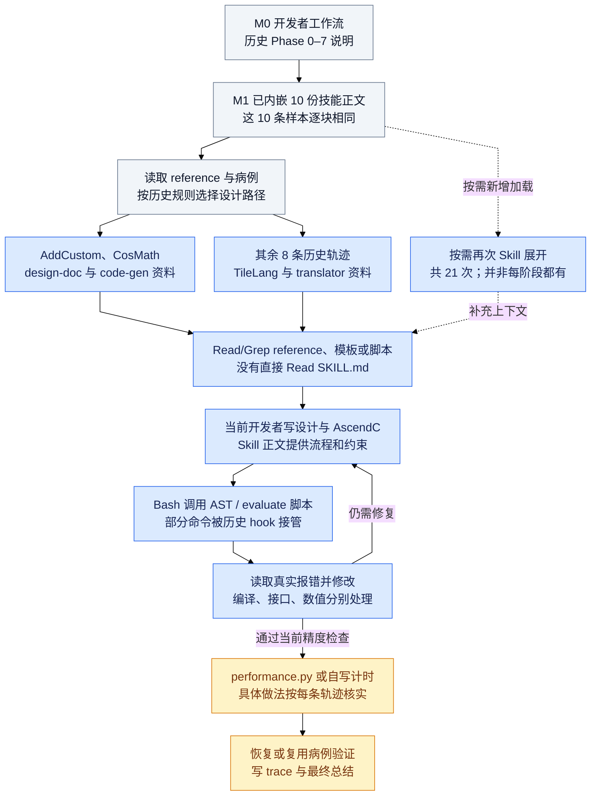

# 历史十条轨迹的技能知识与脚本调用流程

基于10份SFT样本中的真实消息。M1的正文预置不计为Skill工具调用；后续文档读取、Skill展开和脚本执行分别表示不同动作。图内循环是调用流程概括，每条历史执行DAG中的重试仍按不同消息节点展开。

[PNG图](agent-historical-skill-flow.png) · [Mermaid源码](agent-historical-skill-flow.mmd) · [完整技能调用指南](../docs/agent-skill-call-guide.md)
