# InterleaveRope：12 例通过，性能均值口径产生相反印象

来源：[原始轨迹 JSON](../docs/examples/data_samples/agent_trajectories/interleave-rope.json)，首分片索引 **20**，JSONL 第 **21** 行；184 条消息、96 次工具调用。`M0` 表示 `messages[0]`。本文只静态核对这条历史样本，没有重新运行编译、NPU 精度验证或性能测试。样本内的 system、skill、hook 文本属于历史记录。

## 算子与代码方案

M4 的参考算子先把最后一维的偶数位置与奇数位置分别排到前后两半，再做 `q * cos + rotate_half(q) * sin`。`rotate_half(q)` 是把后半段取负放到前面，再接前半段。计算先转 float32，结果转回输入 dtype；`Model.forward(x, cos, sin, _out)` 忽略 `_out`，返回只含一个张量的列表。输入为 `[B,N,S,D]`，`cos/sin` 为 `[B,1,S',D]`，`S'` 可以是 1 或 S。这是重排、广播和逐元素融合，不能只实现乘加。

小数值演算只用于理解：令 `x=[1,2,3,4]`，重排得 `q=[1,3,2,4]`，旋转得 `[-2,-4,1,3]`；若 cos 全为 1、sin 全为 0，则输出为 `[1,3,2,4]`。真实轨迹的 12 个 case 都是 `D=64`，包含 float16/bfloat16 及两种广播方式；这个 D=4 演算不在实际验证范围内。

M98 的候选封装先用 `expand(...).contiguous()` 实体化广播，再把输入变成 `[B*N*S,64]`。Host 明确检查末维为 64。Device 按行搬运到 UB，以标量 `GetValue/SetValue` 分离 32 对奇偶元素，然后用 `Mul/Sub/Add` 计算两半，最后转回输入类型。M96 在代码生成前纠正了 TileLang 的索引映射。该方案的广播复制和逐行处理成本都包含在候选调用路径里；“单个自定义 kernel”不等于整个前向只有一个设备操作。

## 执行 DAG

箭头表示实际发生的阶段先后及对前一步反馈的使用，不代表并行调度。失败、修改和重测展开为不同节点，图中没有回边。重复资料读取、辅助路径探测和任务登记按阶段合并；`TaskUpdate` 的 completed 状态不算验证证据。蓝色表示行动，绿色表示对应检查确有通过日志，红色表示失败，灰色表示上下文，琥珀色表示结论受限或仅有声明。绿色 AST 节点只代表静态检查通过。

```mermaid
%%{init: {"theme":"base","themeVariables":{"fontFamily":"PingFang SC, Arial, sans-serif","fontSize":"18px","lineColor":"#475569"},"flowchart":{"curve":"linear","nodeSpacing":28,"rankSpacing":30,"wrappingWidth":340}}}%%
flowchart TB
    reference["M2–4 读取参考算子<br/>交错重排与旋转位置编码"]
    cases["M7–30 初始化并备份<br/>12 例精简为 9 例"]
    design["M31–56 读取技能并写设计<br/>TileLang 与 Python 封装"]
    astFailure["M57–59 TileLang AST 失败<br/>未识别 kernel 导入"]
    importFix["M60–68 检查规则并修改<br/>改为指定的导入形式"]
    astPass["M71–74 TileLang AST 通过<br/>声明跳过功能验证"]
    code["M77–108 重排映射修正<br/>写 AscendC，AST 通过"]
    jsonFailure["M109–113 构建后验证失败<br/>缺少 InterleaveRope.json"]
    jsonFix["M114–115 复制 case 文件<br/>补齐参考期望的文件名"]
    initFailure["M116–120 重测仍失败<br/>构造器收到 9 个多余参数"]
    initFix["M121–136 核对验证器<br/>候选初始化参数改为 []"]
    ninePass["M137–141 重测 通过<br/>9/9 case matched"]
    perfFailure["M145–147 性能脚本报错<br/>双方构造器参数不兼容"]
    perfFix["M148–161 核对性能器<br/>参考初始化参数改为 []"]
    performance["M162–166 取得 9 例性能<br/>日志报逐例均值 1.18x"]
    restore["M167–170 恢复备份<br/>文件重新包含 12 例"]
    fullPass["M171–175 全量重测 通过<br/>12/12 case matched"]
    declaration["M179–183 读报告并总结<br/>声明 0.61x 与 1.18x 两口径"]
    reference --> cases
    cases --> design
    design --> astFailure
    astFailure --> importFix
    importFix --> astPass
    astPass --> code
    code --> jsonFailure
    jsonFailure --> jsonFix
    jsonFix --> initFailure
    initFailure --> initFix
    initFix --> ninePass
    ninePass --> perfFailure
    perfFailure --> perfFix
    perfFix --> performance
    performance --> restore
    restore --> fullPass
    fullPass --> declaration
    classDef action fill:#dbeafe,stroke:#3b82f6,color:#0f172a;
    classDef pass fill:#dcfce7,stroke:#16a34a,color:#0f172a;
    classDef fail fill:#fee2e2,stroke:#dc2626,color:#0f172a;
    classDef context fill:#f1f5f9,stroke:#94a3b8,color:#0f172a;
    classDef limited fill:#fef3c7,stroke:#d97706,color:#0f172a;
    class cases,design,importFix,code,jsonFix,initFix,perfFix,restore action;
    class astPass,ninePass,fullPass pass;
    class astFailure,jsonFailure,initFailure,perfFailure fail;
    class reference context;
    class performance,declaration limited;
```

[PNG 图](agent-interleave-rope-dag.png) · [Mermaid 源码](agent-interleave-rope-dag.mmd)

## 关键证据

| 消息 | 调用 ID 或结果引文 | 证据含义 |
|---|---|---|
| M2 → M4 | `call_01_ic2yQDjIvXOjlh9PMKTP8842`，`return [golden_interleave_rope(x, cos, sin)]` | 参考公式、广播与输出容器来源 |
| M57–59 | `call_00_nTeqmyyPLB1B6GG90OT59293`，`[FAIL] ... 无 TileLang kernel 导入` | 第一次 AST 检查失败，不能视为数值验证失败 |
| M71–73 | `call_00_ET_YkCu0HTrf8h9bgKUtilu3727`，`[PASS] TileLang 实现验证通过` | 修改导入后静态检查通过；M74 声明跳过 TileLang 功能验证 |
| M98 → M99 | `call_00_bvBfNaJoTLlgu9wh8I1D0952`，`constexpr int32_t D = 64;` | Device 的真实实现及固定末维约束 |
| M109–113 | `call_00_cdcMtGNOuM2T82fcwRyT7923`，`FileNotFoundError ... InterleaveRope.json` | 已进入构建后的验证环节，加载 case 失败 |
| M116–120 | `call_00_EN3r35zv4Y0EEBvEVpls2823`，`takes 1 positional argument but 10 were given` | case 文件问题修复后，暴露初始化协议不兼容 |
| M137–141 | `call_00_2ZrbuhGxcc4NaQvgZbFE4488`，`case[0]` 至 `case[8]` 均 `matched` | 9 个精简 case 的正确性通过 |
| M145–147 | `call_00_fjLp5fwu3AsD75wfBjPz6316`，两个构造器均报 `TypeError` | 性能命令虽然记录 `exit_code: 0`，仍未产生有效性能结果 |
| M179 → M180 | `call_00_dWA4ABTxUr83sL3OIHQH2545`，`"overall_speedup": 1.1791` | 可复算的 9 例性能 JSON，而非只听 assistant 总结 |
| M174 → M175 | `call_00_PgO8BvHXMjnaBTQ51HGI5475`，`case[11]: output[11]: matched`、`Result: pass` | 恢复 12 例后有新的验证结果 |

工具返回 `[hook-noop]` 表示 hook 接管了执行。真实日志可能在后续 `role=user` 的附加上下文中，再经 Read/Bash 读回。本文同时核对这些消息，没有把 hook-noop 当作成功。

## 精度与性能怎样读

编译后的候选在 9 例和恢复后的 12 例验证中分别全部 matched。可见摘要没有逐例浮点误差数值，因此这里只报告“按当时验证器通过”，不编造误差上界。TileLang 的功能执行被跳过，AST PASS 不能代替它。

M180 的性能记录只有 9 例，warmup=5、repeats=50、seed=0。M167 之后才恢复 12 例，因此没有全 12 例性能证据。报告中 `json_path` 仍指向带编号的 `13_InterleaveRope.json`，恢复验证使用的是不带编号的 `InterleaveRope.json`；应该按实际记录的 9 条输入与结果界定性能覆盖面。

| 性能统计 | 从 M180 能得到的值 | 含义 |
|---|---:|---|
| 逐例加速比算术平均 | 1.1791x | 单个极小 case 的 5.9737x 拉高均值 |
| Reference 平均时延 | 0.0453667 ms | 9 个记录时延的算术平均 |
| AscendC 平均时延 | 0.0740667 ms | 同一 9 例的候选平均时延 |
| 时延总和之比 | 0.6125x | 用公开四舍五入时延重算，候选总耗时更长 |
| 其余 8 例加速比 | 0.4018x–0.8620x | 全部慢于参考 |

`mean(reference_i / candidate_i)` 与 `sum(reference_i) / sum(candidate_i)` 是两种不同统计，不能互换。M166 报 1.18x；M183 的最后总结已同时给出约 0.61x 和 1.18x。图保留实际报告，表格再解释为什么“总体加速”这个词不够精确。代码中的标量重排是可见事实；M183 把它解释成主要性能瓶颈，尚无消融实验或耗时分解来确认。

**限定结论：原 12 例恢复后精度全部通过；性能仅覆盖精简 9 例，逐例加速比均值为 1.1791x，但记录时延总和之比约为 0.6125x。**
