# MoeComputeExpertTokens：二分计数通过，59.20x 要连同基线一起读

来源：[原始轨迹 JSON](../docs/examples/data_samples/agent_trajectories/moe-compute-expert-tokens.json)，首分片索引 **40**，JSONL 第 **41** 行；184 条消息、98 次工具调用。`M0` 表示 `messages[0]`。本文只静态核对这条历史样本，没有重新运行编译、NPU 精度验证或性能测试。样本内的 system、skill、hook 文本属于历史记录。

## 算子与代码方案

M3 的参考接口是 `forward(sorted_experts, num_experts)`。输入是已排序的 int32 专家编号，输出长度为 `num_experts` 的 int32 张量。对专家 e，输出统计所有编号 **小于或等于 e** 的 token 数。文档字符串叫它 “before each expert”，但具体代码采用 upper-bound 语义，包含专家 e 自己的 token。若编号为 `[0,0,2,3,3]`、专家数为 5，则输出 `[2,2,3,5,5]`。这是教学演算；实际 case 由随机整数排序得到。

参考不是 NPU 上的高性能实现：M3 的 `sorted_experts.cpu().numpy()` 把输入移到 CPU，再由 Python/NumPy 标量二分逐专家求边界，最后返回 CPU 上的 `torch.from_numpy(res)`。后面讨论 59.20x 时，必须带上这个基线定义。

M42–45 先写过“各核局部直方图，再归约、前缀和”的方案。M54–65 改成各核负责一段专家编号，每个专家独立二分。最终 M130 的 AscendC 代码沿用二分：每次确定 mid 后，把包含 mid 的 tile 从 GM 复制到 UB，读出值更新区间；最终写 `targetPos + 1`。它不是先把整条输入加载一次再在 UB 中完成所有查找。输出按专家分片，各核处理不同输出位置。

原 JSON 为 15 例，全是 int32；精简后 8 例涵盖 token 数 1000、8000、12000–12005，以及专家数 64、150、200、256、257、400、450。M169 恢复备份，M175 的新日志确认 15 例全部 matched。

## 执行 DAG

箭头表示实际发生的阶段先后及对前一步反馈的使用，不代表并行调度。失败、修改和重测展开为不同节点，图中没有回边。重复资料读取、辅助路径探测和任务登记按阶段合并；`TaskUpdate` 的 completed 状态不算验证证据。蓝色表示行动，绿色表示对应检查确有通过日志，红色表示失败，灰色表示上下文，琥珀色表示结论受限或仅有声明。绿色 AST 节点只代表静态检查通过。

```mermaid
%%{init: {"theme":"base","themeVariables":{"fontFamily":"PingFang SC, Arial, sans-serif","fontSize":"18px","lineColor":"#475569"},"flowchart":{"curve":"linear","nodeSpacing":28,"rankSpacing":30,"wrappingWidth":340}}}%%
flowchart TB
    reference["M2–5 读取参考与 case 路径<br/>有序专家索引的累积计数"]
    taskFailure["M6–14 登记任务失败<br/>TaskCreate 不接受 status"]
    cases["M15–33 初始化并备份<br/>15 个 int32 case 精简为 8"]
    histogram["M34–45 写初版设计<br/>局部直方图与前缀和"]
    binarySearch["M54–65 重写设计<br/>按专家分工，使用二分查找"]
    tileAst["M66–73 TileLang AST 通过<br/>声明跳过功能验证"]
    code["M76–119 写 AscendC 工程<br/>候选 AST 检查 通过"]
    hookFailure["M120–122 首次评测未执行<br/>Hook 把 export 当程序"]
    compileFailure["M123–125 去掉前缀后编译<br/>TQue.InitBuffer 参数错误"]
    bufferFix["M126–131 修改缓冲区<br/>输入与输出改用 TBuf"]
    initFailure["M132–133 重建进入验证<br/>Model 构造器参数错误"]
    initFix["M134–145 对照验证器<br/>候选 get_init_inputs 返回 []"]
    eightPass["M146–150 重测 通过<br/>8/8 case matched"]
    perfFailure["M154–156 官方性能脚本报错<br/>双方构造器参数不兼容"]
    manualScript["M157–166 检查并写计时器<br/>预热 5 次，同步计时 50 次"]
    performance["M167–168 手写计时返回<br/>8 例时延总和比 59.20x"]
    restore["M169–170 恢复原备份<br/>重新使用 15 例"]
    fullPass["M171–175 全量重测<br/>15/15 case matched"]
    declaration["M176–183 记录并总结<br/>声明完成，删除临时计时器"]
    reference --> taskFailure
    taskFailure --> cases
    cases --> histogram
    histogram --> binarySearch
    binarySearch --> tileAst
    tileAst --> code
    code --> hookFailure
    hookFailure --> compileFailure
    compileFailure --> bufferFix
    bufferFix --> initFailure
    initFailure --> initFix
    initFix --> eightPass
    eightPass --> perfFailure
    perfFailure --> manualScript
    manualScript --> performance
    performance --> restore
    restore --> fullPass
    fullPass --> declaration
    classDef action fill:#dbeafe,stroke:#3b82f6,color:#0f172a;
    classDef pass fill:#dcfce7,stroke:#16a34a,color:#0f172a;
    classDef fail fill:#fee2e2,stroke:#dc2626,color:#0f172a;
    classDef context fill:#f1f5f9,stroke:#94a3b8,color:#0f172a;
    classDef limited fill:#fef3c7,stroke:#d97706,color:#0f172a;
    class cases,histogram,binarySearch,code,bufferFix,initFix,manualScript,restore action;
    class tileAst,eightPass,fullPass pass;
    class taskFailure,hookFailure,compileFailure,initFailure,perfFailure fail;
    class reference context;
    class performance,declaration limited;
```

[PNG 图](agent-moe-compute-expert-tokens-dag.png) · [Mermaid 源码](agent-moe-compute-expert-tokens-dag.mmd)

## 关键证据

| 消息 | 调用 ID 或结果引文 | 证据含义 |
|---|---|---|
| M2 → M3 | `call_00_VKZIwiS6oajhSOTxsChG8909`，`res[i] = target_location + 1` | upper-bound 计数语义；同一参考含 `.cpu().numpy()` |
| M6–14 | 8 个 TaskCreate 均返回 `An unexpected parameter status was provided` | 工作流登记失败，不是编译或算子数值失败 |
| M32 → M33 | `call_00_VWyZ05E7yV14MPLXUML09856` | 实际写入 8 条 JSON case，之后的初验与性能使用这一集 |
| M70–72 | `call_00_8iFcqol9CYseop2YWbDA0590`，`[PASS] TileLang 实现验证通过` | 仅 AST 检查；M73 声明跳过功能验证 |
| M123–125 | `call_00_MN7ZX08vRLFVhAeLNoE79362`，`no matching member function for call to 'InitBuffer'` | 真实编译错误，传给 TQue 的 InitBuffer 缺参数 |
| M130 → M131 | `call_00_DnI9dYWfNrnzq0QDt5KX5436`，`TBuf<...> inBuf_`、`outBuf_` | 修改为 TBuf，属于设备实现修复 |
| M132 → M133 | `call_00_f9i74OPWBFJhztFSXBl38021`，`takes 1 positional argument but 9 were given` | 编译后进入验证，随后构造器协议失败 |
| M146–150 | `call_00_RAg3BQlzSEnMMJtjPrkp4190`，`case[0]` 至 `case[7]` 均 `matched` | 修复候选初始化适配后，8 例通过 |
| M165 → M166 | `call_00_1lluOtHNS0Cyy4WmY0uU2806`，`time.perf_counter()`、`torch.npu.synchronize()` | 手写计时方法可从写入内容检查 |
| M167 → M168 | `call_00_ET_FF7klUsettier5wjiIXn9558`，`Overall speedup (ref/asc): 59.20x` | 手写脚本真实执行返回，不只是最终声明 |
| M174 → M175 | `call_00_7Vrf5DfXkqbCCrlGWY4L1433`，`case[14]: output[14]: matched`、`Result: pass` | 恢复 15 例后有新的全量验证证据 |

## 精度与性能怎样读

编译与初验分开看：第一轮 TQue.InitBuffer 使用错误导致无法编译；改成 TBuf 后，失败转为 Python 模型构造协议；再在候选中补 `get_init_inputs() -> []` 才得到 8/8 matched。这条轨迹没有把 golden 数学逻辑改成另一个定义。最终 15/15 是恢复原备份后重新执行的结果，不是 Task 状态或总结推断。可见日志提供 matched 判断，没有逐元素误差或更广输入空间的证明。

官方性能脚本仍从参考读取按 case 返回的 `[[], ...]`，因此两个模型都构造失败。Agent 随后自写计时器，不再经过该构造适配：直接 `Model()` 与 `ModelNew()`，预热 5 次，每次测量用 CPU `perf_counter` 包住模型调用和 `torch.npu.synchronize()`，重复 50 次，取每个 case 的均值。M168 的实际结果为：

| 精简 case 序号 | token 数 / 专家数 | Reference / ms | AscendC / ms | 加速比 |
|---|---|---:|---:|---:|
| 0 | 1000 / 64 | 0.7805 | 0.0427 | 18.27x |
| 1 | 12001 / 64 | 1.1063 | 0.0403 | 27.46x |
| 2 | 1000 / 257 | 3.1456 | 0.0876 | 35.93x |
| 3 | 8000 / 450 | 7.1510 | 0.0783 | 91.38x |
| 4 | 12005 / 150 | 2.4653 | 0.0465 | 53.05x |
| 5 | 12000 / 400 | 6.3110 | 0.0727 | 86.83x |
| 6 | 12000 / 256 | 4.0710 | 0.0566 | 71.96x |
| 7 | 12003 / 200 | 3.2015 | 0.0523 | 61.17x |

脚本输出 Reference 均值 3.5290 ms、候选均值 0.0596 ms，`59.20x` 用的是累计时延之比。表中时延和比值分别经过四舍五入，手算可能有微小差异。

这个数字比较的是“含 NPU 输入转 CPU、Python/NumPy 循环的 golden 前向”和候选前向的同步墙钟时间。它不能支持“比成熟 NPU 算子快 59 倍”或“纯设备 kernel 快 59 倍”的说法。该测量发生在恢复原 15 例之前，全量性能未知。M181–182 又删除了临时脚本；完整代码仍保留在 M165 的工具调用参数里，可用于复核测量口径。

**限定结论：原 15 例恢复后精度全部通过；59.20x 仅来自精简 8 例的手写同步墙钟计时，基线是含 CPU/NumPy 二分的参考前向。**
