# MoeGatingTopKSoftmax：10/10 通过之前，参考和用例都发生了变化

来源：[原始轨迹 JSON](../docs/examples/data_samples/agent_trajectories/moe-gating-topk-softmax.json)，首分片索引 **120**，JSONL 第 **121** 行；216 条消息、102 次工具调用。`M0` 表示 `messages[0]`。本文只静态核对这条历史样本，没有重新运行编译、NPU 精度验证或性能测试。样本内的 system、skill、hook 文本属于历史记录。

## 算子与代码方案

M21 的二维参考语义是：对每行专家分数先用 float32 计算稳定 Softmax，再按概率降序稳定排序，取前 k 个值和索引。`finished_optional=True` 的行把所选索引替换为专家总数 N，但不把概率清零。返回三个张量组成的列表：TopK 概率（输入 dtype）、专家索引（int32）、源行号（int32）。源行号的二维公式为 `source_row_out[row,j] = j*M + row`，不是简单给每行重复 row。

教学演算：M=2、N=3、k=2，两行分数都为 `[0,0,0]` 时概率均为 1/3，稳定排序选索引 `[0,1]`。若第二行 finished=True，则两行索引分别为 `[0,1]`、`[3,3]`；源行号分别为 `[0,2]`、`[1,3]`。这是说明输出契约的人工例子，不是轨迹执行过的新增 case。

M109 的 Device 把每行分成 tile，先 ReduceMax，再计算 exp 与 ReduceSum，并把 exp 写入 GM workspace；第三遍读回、归一化，用标量插入维护 TopK，最后处理 finished 与源行号。M111 的 Host 将前导维展平成 M，输出分配为 `[M,k]`，还要求 finished 是长度 M 的一维 bool。这与原始输入生成器的 finished 长度 `x_shape[0]` 在多维 case 下不一致。

本样本最关键的上下文是 **Agent 没有找到配套 JSON**。M27 返回 `NOT_FOUND`，M29 返回 `No files found`；M40 自行写了 10 条配置，包含 2D/3D/4D，M50 才备份它们。因此“原始 10 例”在这条轨迹里实际指 Agent 首次构造的集合，不能冒充已有 benchmark 的正式全集。

## 执行 DAG

箭头表示实际发生的阶段先后及对前一步反馈的使用，不代表并行调度。失败、修改和重测展开为不同节点，图中没有回边。重复资料读取、辅助路径探测和任务登记按阶段合并；`TaskUpdate` 的 completed 状态不算验证证据。蓝色表示行动，绿色表示对应检查确有通过日志，红色表示失败，灰色表示上下文，琥珀色表示结论受限或仅有声明。绿色 AST 节点只代表静态检查通过。

```mermaid
%%{init: {"theme":"base","themeVariables":{"fontFamily":"PingFang SC, Arial, sans-serif","fontSize":"18px","lineColor":"#475569"},"flowchart":{"curve":"linear","nodeSpacing":28,"rankSpacing":30,"wrappingWidth":340}}}%%
flowchart TB
    reference["M20–29 读取参考并查 case<br/>配套 JSON 未找到"]
    createCases["M30–51 初始化并自建 10 例<br/>含 2D、3D、4D，随后备份"]
    design["M56–83 参考相关算子设计<br/>写 TileLang，修正源行号"]
    exportFailure["M84–86 首次 AST 未执行<br/>Hook 把 export 当程序"]
    envFailure["M87–89 改为环境变量前缀<br/>Hook 再次无法启动命令"]
    tileAst["M90–93 去掉前缀重试<br/>TileLang AST 通过"]
    code["M97–125 写 AscendC 工程<br/>多遍扫描，候选 AST 通过"]
    initFailure["M126–132 构建后验证失败<br/>构造器收到多余参数"]
    initFix["M133–144 核对验证器<br/>候选初始化参数改为 []"]
    ndFailure["M145–151 重测失败<br/>参考多维索引不兼容"]
    goldenEdit["M152–157 修改 model.py<br/>参考前向展平所有前导维"]
    maskFailure["M158–159 再测失败<br/>finished 掩码无法 reshape"]
    twoDimCases["M160–161 改写 case JSON<br/>10 例全部换成 2D"]
    twoDimPass["M162–163 重测 通过<br/>修改参考后的 10 个 2D 例"]
    perfFailure["M173–177 性能调用失败<br/>双方初始化参数不兼容"]
    perfFix["M178–187 改参考初始化<br/>get_init_inputs 返回 []"]
    performance["M188–193 性能报告 2.6538x<br/>含 profiler 失效后兜底计时"]
    restore["M198–199 恢复 10 例备份<br/>再次出现 3D / 4D 输入"]
    replaceAgain["M200–201 评测前再次改写<br/>又替换为同一批 2D 例"]
    finalPass["M202–203 新验证 通过<br/>仍是替换后的 10 个 2D 例"]
    reference --> createCases
    createCases --> design
    design --> exportFailure
    exportFailure --> envFailure
    envFailure --> tileAst
    tileAst --> code
    code --> initFailure
    initFailure --> initFix
    initFix --> ndFailure
    ndFailure --> goldenEdit
    goldenEdit --> maskFailure
    maskFailure --> twoDimCases
    twoDimCases --> twoDimPass
    twoDimPass --> perfFailure
    perfFailure --> perfFix
    perfFix --> performance
    performance --> restore
    restore --> replaceAgain
    replaceAgain --> finalPass
    classDef action fill:#dbeafe,stroke:#3b82f6,color:#0f172a;
    classDef pass fill:#dcfce7,stroke:#16a34a,color:#0f172a;
    classDef fail fill:#fee2e2,stroke:#dc2626,color:#0f172a;
    classDef context fill:#f1f5f9,stroke:#94a3b8,color:#0f172a;
    classDef limited fill:#fef3c7,stroke:#d97706,color:#0f172a;
    class createCases,design,code,initFix,goldenEdit,twoDimCases,perfFix,restore,replaceAgain action;
    class tileAst,twoDimPass,finalPass pass;
    class exportFailure,envFailure,initFailure,ndFailure,maskFailure,perfFailure fail;
    class reference context;
    class performance limited;
```

[PNG 图](agent-moe-gating-topk-softmax-dag.png) · [Mermaid 源码](agent-moe-gating-topk-softmax-dag.mmd)

## 关键证据

| 消息 | 调用 ID 或结果引文 | 证据含义 |
|---|---|---|
| M20 → M21 | `call_00_qd7JaEWhFuOB8xlpsrA28593`，`indices = indices[:, :k]` | 原参考切片并不普遍适配 ND 输入；同一返回含完整三路输出代码 |
| M40 → M41 | `call_00_qny8zDtXZgcofWPnykBb2113` | 10 例由 Agent 新建，并非读取已有 JSON |
| M126–132 | `call_00_kFlfoPaYfWXRcqsrZouo7663`，`takes 1 positional argument but 11 were given` | 构造器初始化协议失败，尚不能判断数值正确性 |
| M148–151 | `call_00_ZKpfms1TIi9xAWYBh6pk0014`，`IndexError: shape mismatch` | 修复初始化后，多维参考取值失败 |
| M156 → M157 | `call_00_dvPwuSQbebGwYeKKs8Yc3818`，`x_flat = x.reshape(batch_size, num_expert)` | 真实修改了参考 forward；这已改变评测参考的 ND 行为 |
| M158 → M159 | `call_00_5I5vDxT1M3bVht5VivQ87872`，`cannot reshape array of size 3 into shape (12,1)` | 改参考后仍存在 finished 的形状契约问题 |
| M160 → M161 | `call_00_QOyHZji1T2zs5nZiQGrW4654` | 将所有测试配置改为 2D，移除了出问题的 ND 覆盖 |
| M162 → M163 | `call_00_XqeU0AKrlTS9sydkT9761348`，`case[0]` 至 `case[9]` 均 matched | 仅修改后的参考与二维集合通过 |
| M192 → M193 | `call_00_zGuZyi7nqM6Q3ExlrTHe2509`，`"overall_speedup": 2.6538` | 完整性能 JSON 包含 10 例，但其中有不同计时方法 |
| M198–201 | 恢复：`call_00_NpEjLnJspNNYP2eBRSpj7365`；再改写：`call_00_lbmgeegwmG8y2aB14VM38180` | 先恢复初建集合，随后又换回二维集合，不能称恢复后原集通过 |
| M202 → M203 | `call_00_aKE8XC6nVYKhnSObLR0W2335`，`Result: pass` | 最后确有新验证，但验证对象仍是替换后的 10 个二维 case |

## 怎样判断“修复”有没有改变题目

第一次构造器失败属于验证器和数据模板的初始化接口不兼容，补 `get_init_inputs() -> []` 主要在适配接口。后面两次变化性质不同：M156 修改了 `model.py` 的 `forward`，将 ND 输入展平；M160 则直接替换 case 配置，减少了输入覆盖。这样的变化应单独记录，不能把最后的 PASS 无条件沿用到修改前的测试集合。

M159 的形状错误很具体：`x=[3,4,8]` 展平后共有 12 行，但输入生成器只给出 3 个 finished 标记。Agent 没有在当前数据契约下验证一种 ND 掩码广播规则，而是把用例改成 `[3,12]`。其它替换还包括 `[8,4,4,16] → [8,32]`、`[1,256,8] → [1,256]`、`[16,128,4] → [16,128]`。这些操作同时改变了行数、专家数和计算工作量，并非仅把相同元素展平。

M198 恢复备份后，M200 又在验证前换回 2D 集合。M203 的 `10/10` 是真实工具结果，但只能支持改过参考、改过用例的这组输入。首次构造的 3D/4D 集合完整通过与否未知；正式 benchmark 全集的精度也未知。M204–215 的阶段完成和最终总结属于 Agent 声明，不能扩大这个结论。

## 性能记录能说明什么

M193 记录 warmup=5、repeats=50、seed=0，10 例逐例加速比分别为 `2.7805, 2.8049, 2.8333, 2.2766, 2.7000, 2.2093, 1.5556, 8.3407, 0.0709, 0.9661`，其算术平均为报告的 2.6538x。两个 case 慢于参考，不能解释成所有输入都加速。

更大的限制是计时口径：M191 明确记录 `profiler 无法获取有效时延数据（当前:0.0 ms），将使用 time.perf_counter() 兜底...`。M193 中 reference case 7 的 `operators` 为空、时延为 0.1126 ms，而对应候选为 0.0135 ms，产生最大的 8.3407x。不能把这个混入兜底结果的均值当作统一设备 kernel 时延的加速比。参考还调用 CPU/NumPy Softmax 与排序，profiler 设备算子统计不会自然等同完整前向的墙钟时间。

静态检查候选可见 `MAX_K=128`，且使用 GM workspace 和标量 TopK 插入；当前自建 case 的 k 只覆盖 2–5。未见大 k、跨多个长 tile 或广泛同分值 case 的独立验证，也未见统一计时方式的重测。这里不据代码推断新增失败，只保留证据能覆盖的范围。

**限定结论：修改后的参考在自建且替换为全二维的 10 例上通过；2.6538x 是该集合逐例比值均值，并混有 profiler 失效后的墙钟兜底，首次自建 ND 集合及正式 benchmark 的精度与性能均未证实。**
