# QuantMatmul：从混合核失败到 CPU/NPU 混合实现

对应原始数据索引 **320**，证据来源是 [完整轨迹 JSON](../docs/examples/data_samples/agent_trajectories/quant-matmul.json)，共 **542 条消息，M0–M541**。本页只读分析历史记录，未重新编译或执行 NPU 测试。

这条轨迹最终有 **10/10 case 精度通过**的工具输出，但 reference 已被改成 CPU 整数矩阵乘，候选也含 CPU 反量化。历史性能工具报告 **605.21x**，发生在恢复全量病例之前的 **5 case 精简集**；它不能直接代表原始参考实现与纯 NPU 候选之间的受控加速比。

```mermaid
%%{init: {"theme":"base","themeVariables":{"fontFamily":"PingFang SC, Arial","fontSize":"18px"},"flowchart":{"curve":"linear","htmlLabels":true,"nodeSpacing":30,"rankSpacing":42,"wrappingWidth":340}}}%%
flowchart TB
    reference["M2–M10｜读取参考与病例<br/>int8 矩阵乘；全量 10 case"]:::context
    design["M19–M53｜备份后精简到 5 case<br/>生成 TileLang；AST 检查通过"]:::action
    firstbuild["M87–M151｜初版 AscendC 构建<br/>编译修补后遇到初始化错误"]:::fail
    referror["M152–M158｜修正初始化接口再测<br/>参考 NPU matmul 不支持 int32"]:::fail
    cpuref["M167–M168｜改写参考 forward<br/>CPU 矩阵乘与反量化，再回 NPU"]:::unverified
    mixfail["M169–M237｜混合核多轮修改和重测<br/>设备同步超时；中间也有编译错误"]:::fail
    dualfail["M240–M354｜拆分 AIC 与 AIV 并重测<br/>API 编译、Vector 异常、精度失败"]:::fail
    mixretry["M355–M404｜再次改为混合核<br/>两次测试仍报 507014 超时"]:::fail
    dualretry["M405–M424｜再次拆分双核<br/>两次测试报 PythonDispatcher 异常"]:::fail
    hybrid["M429–M436｜清理后写新方案<br/>AIC 矩阵乘，加 CPU 反量化"]:::action
    wrongrows["M438–M467｜修指针、核数、预取<br/>多轮精度仍失败"]:::fail
    locate["M468–M493｜独立检查矩阵输出<br/>首行片段正确，后续行不匹配"]:::action
    stride["M496–M499｜修改 Fixpipe CopyOut<br/>目标行跨度改为实际 N"]:::action
    fivepass["M502–M503｜重新编译和验证<br/>精简集 5/5 通过"]:::pass
    prefetch["M504–M509｜恢复预取与 K 补齐配置<br/>再次验证 5/5 通过"]:::pass
    perfargs["M515–M517｜首次性能调用<br/>hook 将重定向当参数，报错"]:::fail
    perf["M518–M526｜性能工具完成<br/>报 605.21x；参考已改到 CPU"]:::unverified
    restore["M527–M528｜恢复原始病例 JSON<br/>重新得到 10 case"]:::action
    tenpass["M529–M533｜全量精度验证<br/>10/10 通过；MERE 与 MARE 为 0"]:::pass
    claim["M537–M541｜读 JSON 并写 trace<br/>605.2087x；完成属声明"]:::unverified

    reference --> design
    design --> firstbuild
    firstbuild --> referror
    referror --> cpuref
    cpuref --> mixfail
    mixfail --> dualfail
    dualfail --> mixretry
    mixretry --> dualretry
    dualretry --> hybrid
    hybrid --> wrongrows
    wrongrows --> locate
    locate --> stride
    stride --> fivepass
    fivepass --> prefetch
    prefetch --> perfargs
    perfargs --> perf
    perf --> restore
    restore --> tenpass
    tenpass --> claim

    classDef action fill:#DBEAFE,stroke:#2563EB,color:#172554,stroke-width:2px;
    classDef pass fill:#DCFCE7,stroke:#16A34A,color:#14532D,stroke-width:2px;
    classDef fail fill:#FEE2E2,stroke:#DC2626,color:#7F1D1D,stroke-width:2px;
    classDef context fill:#F3F4F6,stroke:#6B7280,color:#1F2937,stroke-width:2px;
    classDef unverified fill:#FEF3C7,stroke:#D97706,color:#78350F,stroke-width:2px;
    linkStyle default stroke:#475569,stroke-width:2px;
```

图中 M 为 JSON 的零基消息索引。箭头表示当前工程状态下继续进行的后续操作，重试按时间展开成新节点；同一节点聚合的调用不代表并发。蓝色为操作，绿色为已观察到的通过，红色为失败，灰色为输入背景，琥珀色为需要限定或尚未独立验证的结论。AST 检查通过仅说明当时传入的 wrapper 检查通过，不能代替编译、数值验证或最终实现的合规检查。

## 参考算子究竟计算什么

M3 中的 `Model.forward` 接收 int8 的 `a[m,k]`、`b[k,n]`，先以 int32 计算矩阵乘，再转 float32，并逐列乘 `scale[n]`、逐行乘 `per_token_scale[m]`。其语义可写为 `out[i,j] = float(sum_k a[i,k]*b[k,j]) * scale[j] * per_token_scale[i]`。输入矩阵随机整数取值为 -16 到 16；病例中的 dtype 用于缩放因子，不能把它误读为矩阵乘输入 dtype。

原始 JSON 有 10 case。M21 实际写入 5 case，保留原 case_id **0、2、3、7、8**。后续日志中的 `case[0]` 等是当前列表位置，并不总等于原 case_id。M527 才恢复 10 case，因而性能测试与最后精度测试使用的病例集不同。

## 代码如何变化，哪些修复有直接证据

初始方案尝试把 AIC/Cube 的矩阵乘与 AIV/Vector 的反量化合在一次混合核流程中。除了编译 API 问题，它先撞到了评测接口问题：`get_init_inputs()` 返回按 case 组织的列表，被当前验证脚本当成构造参数展开。M143 的 `[[]]` 修补仍失败，M152 改成 `[]` 后才能继续。

接下来 M158 明确指出 reference 中 NPU 的 int32 matmul 不受支持。M167 修改的对象是 **`model.py` 的参考 forward**：把输入复制到 CPU，在 CPU 做整数矩阵乘和反量化，再把结果放回原设备。这一改动保留了算子数学意图，却改变了被测参考的执行设备、传输成本及性能基线。记录没有显示最后恢复参考 forward；恢复 JSON 不等于恢复 reference。

混合核反复出现设备同步超时后，Agent 尝试 AIC/AIV 双核、队列与缓冲修改，又遇到 Vector core 异常、精度失败和 PythonDispatcher 错误。M429 清理旧安装后，M431/M436 形成更简单的方案：NPU AIC 只生成 int32 矩阵乘结果，C++ host 再把结果与 scale 复制到 CPU，循环反量化，最后回传 NPU。M444 修正了 CPU int32 指针读取方式。这是实际跨 CPU/NPU 执行，不能仅因 Python wrapper 调用 `torch.ops.npu` 就称为完整 NPU 融合算子。

多轮精度错误最后通过独立检查进一步定位：一些小形状正确，但当前大形状的首行片段正确、其余多行完全不匹配。M498 把 `FixpipeParamsV220.dstStride` 改成实际输出矩阵列跨度 `b_dvalue_`，随后 M503 的 5 case 全部通过。M504/M506 恢复预取和 K 补齐配置，再次获得 M509 的 5 case 通过。这个“修改输出跨度→重测通过”的因果证据，比最终总结中笼统的“多轮优化成功”更具体。

## 精度、性能与未覆盖部分

M533 明确列出 `case[0]` 到 `case[9]` 全部 matched，MERE 与 MARE 均为 0，阈值分别为 `0.00012207`、`0.0012207`，并有 `Result: pass`。应表述为“恢复的 10 case 在这次历史验证中通过，与已经修改过的 CPU reference 比较”，不能扩展为未见病例或独立保护 golden 的正式 judge 也通过。

M518 成功发起性能工具，M522/M526 先显示报告片段；随后 M537/M538 **完整读取了 `preformance.json`**。此前读取 `performance.json` 的失败只是文件名不符，不代表最终缺少 JSON。完整报告记载 `warmup=5`、`repeats=50`、`seed=0`，并列出精简集全部 5 case：

| 当前列表 index | 原 case_id | Reference 报告耗时 / ms | AscendC 报告耗时 / ms | 报告 speedup |
| --- | --- | ---: | ---: | ---: |
| 0 | 0 | 11.2461 | 0.0240 | 468.5875x |
| 1 | 2 | 3.7735 | 0.0190 | 198.6053x |
| 2 | 3 | 13.6151 | 0.0192 | 709.1198x |
| 3 | 7 | 16.8631 | 0.0179 | 942.0726x |
| 4 | 8 | 14.5070 | 0.0205 | 707.6585x |

五个 `speedup` 的算术平均为 `605.20874`，四舍五入后就是 JSON 的 `overall_speedup=605.2087`，终端显示为 **605.21x**。这份报告可以按**逐 case 加速比的算术平均**复核，不能把它称为几何平均或两组平均耗时之比。

报告还揭示了计时边界问题。reference 的五个 `operators` 都是空字典；候选则列出 `aclnnInplaceCopy`、`aclnnInplaceZero`、`quant_matmul` 的非零事件数值，其余许多 ATen/host 名称为 0。以 index=0 为例，三项合计 `11.8040725 + 5.0726125 + 7.123095 = 23.99978`，换算成毫秒与 `latency_ms=0.024` 一致；另外四例也与非零事件合计的毫秒舍入值一致。这支持候选报告采用所列设备事件之和的解释，**没有证明 CPU 反量化循环及完整 host 等待时间被计入**。reference 空 operator 明细也不足以单独说明它的 wall-clock/fallback 计时实现。完整 JSON 让这些限制更可见，但仍不构成统一端到端计时的证明。

因此可以引用历史报告中的 605.21x，并同时说明参考迁到 CPU、候选包含 CPU 反量化及两侧计时覆盖未被统一验证；不能把它写成原始 reference 下的纯 NPU 算子加速。M538 只是读取已有的 5 case 性能报告，最后的 10 case 精度测试之后没有新的性能测试；**全量 10 case 的性能未知**。

初始 M114 的 AscendC AST 通过早于最终 C++ CPU 路径，且命令的目标是 `model_new_ascendc.py`。没有证据表明这个通过覆盖了后续 C++ host 运算，或证明最终产物满足当前 RL 环境的反回退要求。要迁入当前任务，需保留受保护 reference，按当前约束处理设备不支持问题，并重新提交最终候选进行正式编译、精度与性能评测。

## 可以逐条定位的证据

| 消息与调用 ID | 记录中的关键内容 | 支持的结论 |
| --- | --- | --- |
| M158，`call_00_FJ03Y39gRY03DgwDZOKJ7221` | `Tensor self not implemented for DT_INT32` | 原始参考在此次 NPU 环境执行失败。 |
| M167→M168，`call_00_stbgU2jwHjuV3Vsfjvrn0266` | `a_cpu = a.cpu()`；`torch.matmul(a_cpu.to(torch.int32), ...)` | 修改的是参考 forward 的执行路径。 |
| M444→M445，`call_00_JrxG5HCmcs91h3DngkRb8446` | `c_i32...contiguous().cpu()`；CPU 双循环后 `result.to(a.device())` | 最终候选包含 CPU 反量化与传输。 |
| M498→M499，`call_00_Y1uo3IrDO6kYFJ4Vi2850369` | `params.dstStride = b_dvalue_` | 输出矩阵行跨度被明确修正。 |
| M518，`call_00_1McCS7wD5hEPiSTD5KEo3386` | `performance.py --output_dir ... --output ...` | 发起实际历史性能测试；不是只写报告。 |
| M526，`call_00_W2qhwRpy1RoYVTRTCX0u1833` | `Overall speedup: 605.21x` | 工具确实报告该数，随后还能读取完整 JSON。 |
| M537→M538，`call_00_Pe2nKhCriRYCQGiuDVD70542` | `warmup: 5`、`repeats: 50`；五例明细及 `overall_speedup: 605.2087` | 可复核算术平均；候选数值对应设备事件之和，CPU 计算计时覆盖未被证明。 |
| M533，`call_00_ET_pTFqnOiOoNo7myu38H9H1678` | 10 条 `matched, MERE=0, MARE=0`；`Result: pass` | 完整病例集的这一次精度验证通过。 |

本例适合学习“错误日志驱动局部修复”和“数值通过后仍要审查执行边界”。M539 的 trace 与 M541 的最终回复属于 Agent 写出的总结，不能把设备事件报告升级为端到端测量，也不能覆盖此前发生的 golden 修改。
