# ScaledMaskedSoftmaxV2：精度修复与预处理边界

对应原始数据索引 **420**，证据来源是 [完整轨迹 JSON](../docs/examples/data_samples/agent_trajectories/scaled-masked-softmax-v2.json)，共 **248 条消息，M0–M247**。本页分析历史工具记录，未在本机执行 NPU 测试。

最终可确认的结果是 **14/14 case 精度通过**。性能只测了此前的 **9 case 精简集**：自写脚本在 NPU 同步后计算 wall-clock 均时，reference **0.0589 ms**、候选 **0.1041 ms**，两者均值之比为 **0.57x**，候选更慢。最终方案把 mask 和 scale 运算放进 Python wrapper，依然在 NPU tensor 上执行；这不是 CPU 数据回退，但也不是把全部运算融合进一个手写 AscendC kernel。

```mermaid
%%{init: {"theme":"base","themeVariables":{"fontFamily":"PingFang SC, Arial","fontSize":"18px"},"flowchart":{"curve":"linear","htmlLabels":true,"nodeSpacing":30,"rankSpacing":42,"wrappingWidth":340}}}%%
flowchart TB
    reference["M2–M5｜读取参考与 14 case<br/>缩放、布尔掩码、末维 softmax"]:::context
    setup["M18–M34｜修复模板路径并备份<br/>成功精简为 9 case"]:::action
    design["M51–M59｜生成 TileLang 设计<br/>AST 检查通过，未见功能运行"]:::action
    ascend["M73–M86｜生成初版 AscendC<br/>当时的 wrapper AST 检查通过"]:::action
    compilefail["M87–M91｜首次编译失败<br/>DataCopyPad 参数不匹配"]:::fail
    initfail["M94–M103｜修复制接口并重建<br/>编译后遇到模型初始化错误"]:::fail
    precisionfail["M112–M118｜修正初始化接口<br/>9 case 数值验证失败"]:::fail
    queuefail["M121–M136｜改 mask 缓冲与队列<br/>两轮重测仍失败"]:::fail
    dtypefail["M139–M179｜改 dtype、搬运和缓冲<br/>多轮重测仍失败"]:::fail
    rewritefail["M180–M193｜做拷贝诊断并重写<br/>新的验证仍报精度失败"]:::fail
    preprocess["M194–M200｜将 mask 和 scale<br/>移到 Python wrapper 的 NPU 运算"]:::action
    ninepass["M202–M203｜重新编译验证<br/>精简集 9/9 通过"]:::pass
    finalwrapper["M204–M207｜重写最终 wrapper<br/>预处理后传零 mask 与 scale 1"]:::action
    perffail["M211–M232｜尝试性能脚本<br/>路径、初始化及解包错误"]:::fail
    timing["M233–M234｜自写同步 wall-clock 测试<br/>9 case 均时比 0.57x，未加速"]:::unverified
    restore["M238｜恢复 14 case JSON<br/>立即调用完整精度验证"]:::action
    fullpass["M239｜全量 14/14 通过<br/>各 case 有独立 matched 输出"]:::pass
    claim["M243–M247｜写 trace 并总结<br/>全量性能及最终 AST 无新证据"]:::unverified

    reference --> setup
    setup --> design
    design --> ascend
    ascend --> compilefail
    compilefail --> initfail
    initfail --> precisionfail
    precisionfail --> queuefail
    queuefail --> dtypefail
    dtypefail --> rewritefail
    rewritefail --> preprocess
    preprocess --> ninepass
    ninepass --> finalwrapper
    finalwrapper --> perffail
    perffail --> timing
    timing --> restore
    restore --> fullpass
    fullpass --> claim

    classDef action fill:#DBEAFE,stroke:#2563EB,color:#172554,stroke-width:2px;
    classDef pass fill:#DCFCE7,stroke:#16A34A,color:#14532D,stroke-width:2px;
    classDef fail fill:#FEE2E2,stroke:#DC2626,color:#7F1D1D,stroke-width:2px;
    classDef context fill:#F3F4F6,stroke:#6B7280,color:#1F2937,stroke-width:2px;
    classDef unverified fill:#FEF3C7,stroke:#D97706,color:#78350F,stroke-width:2px;
    linkStyle default stroke:#475569,stroke-width:2px;
```

M 是 JSON 的零基消息索引。箭头表示当前工程状态下继续进行的操作，反复失败与后续修复展开成不同节点，节点内聚合不证明调用并发。蓝色是操作，绿色是观察到通过，红色是失败，灰色是输入背景，琥珀色提示结果的范围或验证缺口。

## 参考计算与病例范围

M3 参考的 `forward(x, mask, scale)` 先将 x 转成 float32 并乘 scale，再计算 `x_f * (1-mask_f) + (-10000)*mask_f`，对最后一维做 softmax，最后转回 x 的 dtype。x 的布局是 `[batch, num_heads, seq_len, head_dim]`；mask 可以在 batch、head 维广播。mask 为 True 的位置被设为有限负值 -10000，不能自动改写成负无穷并假设所有边界行为完全一致。

原始 14 case 覆盖 fp16、fp32、bf16，scale 为 0.5、1.0、2.0，并含不同广播方式。M27 备份病例，M29 首次 Write 因未先 Read 失败，M33 成功写入 9 case。此后的局部验证和 M233 性能脚本均以这个精简 JSON 为输入；M238 才恢复原始 14 case。

## 多轮修复后，实际提交的方案是什么

M51–M59 生成 TileLang 文件并获得 AST 检查通过。这个阶段没有功能测试输出。M73–M86 生成初版 AscendC device/host/注册/构建文件及 wrapper，初版 wrapper 也通过 AST 检查。接着 M91 的编译器报告 `DataCopyPad` 签名不匹配，说明 AST 通过并不能保证 C++ 能编译。

修复搬运参数后，M103 遇到模型构造参数错误；M112 在候选 wrapper 中添加返回空列表的 `get_init_inputs()`。通过接口门槛后，M118 显示数值仍失败。随后 Agent 尝试直接 TBuf、专用 mask 队列、int8/int32/float32 mask 转换、缓冲区大小及拷贝诊断，多次重测仍失败。记录不足以把全部失败归结为一个已证明的“mask 硬件 bug”；最后的替换方案成功，并不等于原路径根因已经被唯一定位。

M200 是决定性的执行边界变化：wrapper 用 PyTorch 对 NPU tensor 做 float32 转换、scale、mask 广播及掩码表达式，再把结果展平。随后向自定义算子传 **全零 mask 与 scale=1.0**，使自定义核实际只需完成 softmax。M206 将这一路径保存为最终 wrapper。它还创建 dummy mask，输出 reshape 并转回原 dtype。这里“host/Python 预处理”指由 host 发起 NPU tensor 运算；代码没有显示把 x 搬到 CPU。

还要区分数学效果与实际指令：M194 写出的 device 代码仍保留加载 mask、乘 scale、应用 mask 等路径，只是调用参数让这些步骤的数学效果退化为恒等操作。不能凭 wrapper 注释中的“kernel only does softmax”断言编译器已经消除了全部 dummy mask 搬运和运算，更不能把 wrapper docstring 中的“single operator call”读成端到端只有一个 NPU kernel。

## 精度和性能分别证明了什么

M203 列出精简集 9 case 通过。M238 恢复完整 JSON 后，M239 列出 `case[0]` 到 `case[13]` 全部 matched 并打印 `Result: pass`。MERE 最大可见值为 `5.96046e-08`；不同输出 dtype 的阈值不同，不能把一行 fp16 阈值复制成所有 case 的统一阈值。这条轨迹没有成功修改 reference forward 的记录，主要适配发生在候选 wrapper。

性能脚本最初有路径和构造参数错误，后改为 M233 中可直接检查的 Python 计时代码。它读取当前 9 case；每例先对 reference 与候选各 warmup **5 次**，同步 NPU，再分别计时 **30 次**调用；每段结束执行 `torch.npu.synchronize()`。`time.time()` 的计时范围包住整个 `ModelNew.forward`，因此从代码范围看包含 wrapper 中发起的预处理、分配、自定义算子与输出转换，以及等候 NPU 完成的耗时，不能解释为单独 softmax device kernel 延迟。

脚本先分别求 9 个 reference 均时和 9 个 candidate 均时的算术平均，再用 `avg_ref / avg_asc` 得到 **0.57x**。它不是逐 case 加速比的算术平均，也不是几何平均。M234 原始输出显示 case[1] 到 case[8]，case[0] 那行未保留在显示片段中；汇总与脚本遍历范围支持这是当时 9 case 的整体结果，但不能补造缺失的 case[0] 数字。

没有恢复全量后的性能测试，所以 **14 case 全量加速比未知**。也没有 M206 最终 wrapper 的重新 AST 检查：M86 的通过发生在预处理移入 wrapper 之前。当前 RL 环境若限制用 PyTorch 完成目标计算，必须按当前约束重新审查这版实现。历史数值通过不能替代这一检查。

## 关键证据

| 消息与调用 ID | 记录中的关键内容 | 可以确认的事项 |
| --- | --- | --- |
| M2→M3，`call_00_jto0wZAkh1YCTc0YYXQb4202` | `torch.softmax(x_f, dim=-1).to(orig_dtype)` | 目标是末维 softmax，并保持输入 dtype。 |
| M112→M113，`call_00_CXNsVtB6VdEtBHCqKgSo4433` | `def get_init_inputs(): ... return []` | 修补了候选初始化契约。 |
| M200→M201，`call_00_MHEUfNGZfkDcWVmp3EFG9723` | `x_fp32 = x_fp32 * (1.0 - mask_fp32) + -10000.0 * mask_fp32` | 目标算子的部分计算进入 wrapper。 |
| M202→M203，`call_00_LXX15mLN4BGQ7U3oeoO52534` | 9 条 matched；`Result: pass` | 精简病例集的数值验证通过。 |
| M206→M207，`call_00_sP8QKxn832klGaI6FgkC9530` | `torch.ops.npu.scaled_masked_softmax_v2(x_flat, dummy_mask, 1.0)` | 最终自定义核的实际输入参数。 |
| M233→M234，`call_00_YDAlFcEcNREWlqRIZRVX8721` | `warmup, repeat = 5, 30`；`torch.npu.synchronize()`；`speedup=0.57x` | 可核对计时范围与聚合公式，候选未加速。 |
| M238→M239，`call_00_DWQHLGGcFLMr1zenGkJc5552` | 恢复 `.json.bak` 后 14 条 matched | 完整病例集的历史精度验证通过。 |

本例把两个学习问题放在一起：数值错误可以通过改变执行边界暂时解决，但训练目标若是生成高性能的完整 AscendC 算子，就必须同时核对计算究竟在哪一层完成，以及性能是否覆盖这一整条路径。M243/M247 的阶段完成声明不能代替上述范围说明。
