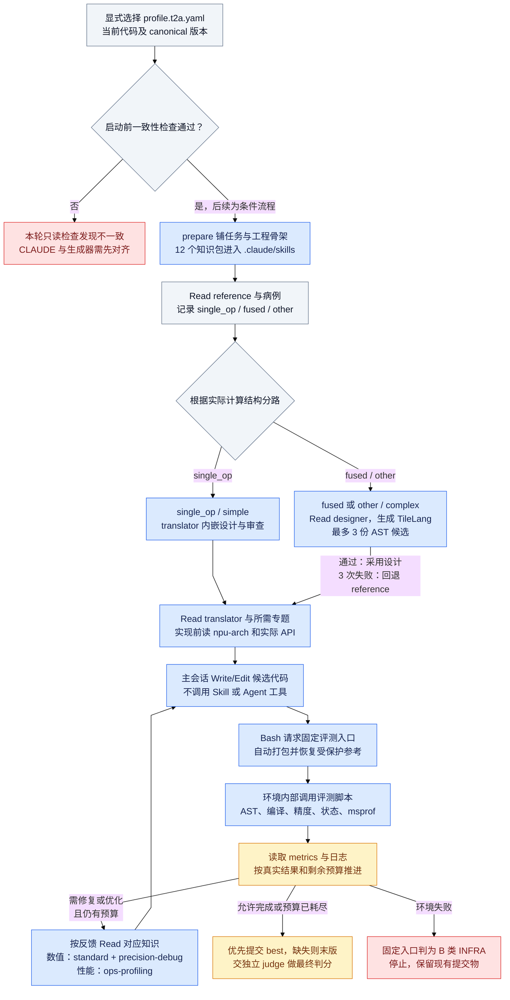

# 当前t2a知识读取与固定评测流程

依据当前committed canonical及显式t2a配置的条件流程。本轮启动前一致性检查失败，因此图明确标出需先对齐的分支；后续节点并不表示已启动训练。当前 Skill/Agent 工具禁用，文档由 Read 进入上下文，评测脚本由固定入口在环境内部执行。复杂路径 AST 通过时保留 TileLang 设计，连续 3 份候选失败才回退 reference。末节点为提交和判分，并不表示正确性或性能已经达标；若没有 best，则尝试末版提交物。

[PNG图](agent-t2a-skill-flow.png) · [Mermaid源码](agent-t2a-skill-flow.mmd) · [完整技能调用指南](../docs/agent-skill-call-guide.md)
