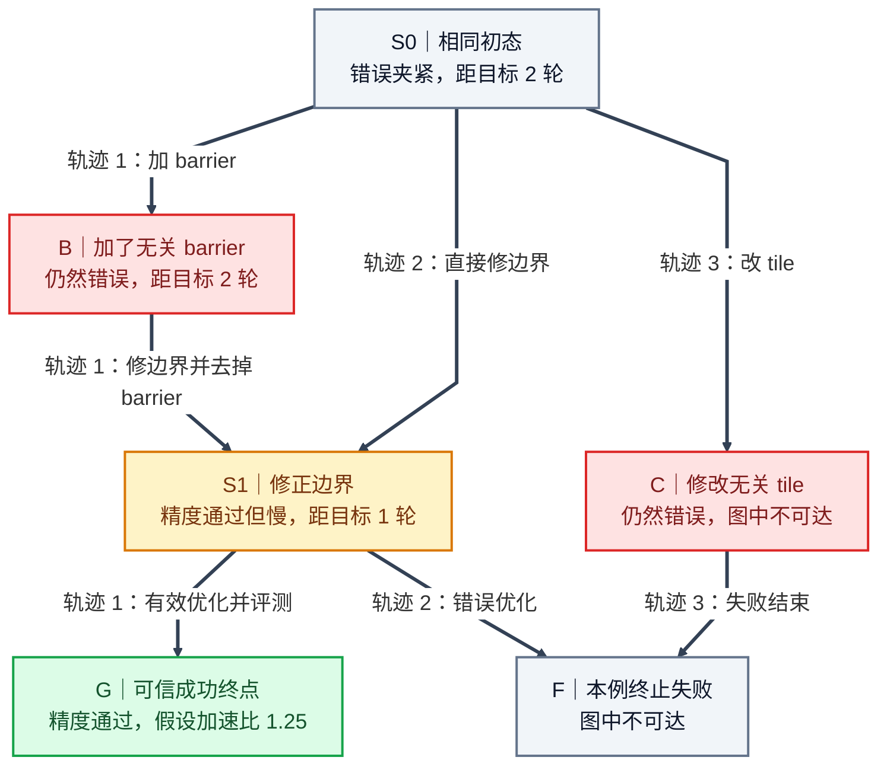

# HistogramV2 算例：把三条轨迹合成状态图

三条轨迹和性能数值都是教学假设。我们也假设两个 S1 的源码、构建、评测证据和 Agent 已知信息等价，预算不限制后续行动，才能把它们合并。每条边代表一次修复轮次，实际训练要展开成真实 assistant 动作。F 只表示这个例子里已经终止的失败，仍可修复的不同工作区要分开。

最短路用来给原采样动作分配优势。S0 到 G 的两步路线来自不同轨迹，不能当作实际采样过的完整轨迹。计算过程见[研究文档](../docs/ascendc-gigpo-graphgpo-research.md)。

这张图只画边界修复的假想分支，没有画前面的 TileLang 设计和 Ascend C 工程。完整历史流程见[逐阶段教学](../docs/histogram-v2-step-by-step.md)。

## 图形验证

图已用本地 Mermaid CLI 渲染，并查看 PNG。六个节点的名称、通过状态和距离与正文一致。已逐边核对 S0→B、B→S1、S1→G、S0→S1、S1→F、S0→C、C→F，七条边方向都符合算例。图中没有交叉或遮挡，四种颜色分别表示初态/终止、错误、正确但慢、合格成功。代码块与原始 mmd 相同。视觉评分为 9/10，图可用。

[查看 PNG](ascend-gigpo-graphgpo-example.png)
