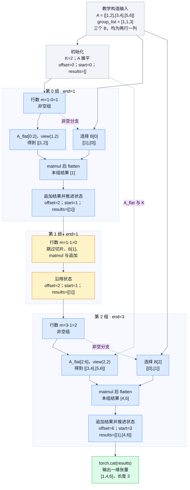

# GroupedMatmulSliceM：参考代码的计算 DAG

来源：[agent_groupedmatmul.json](../docs/examples/data_samples/agent_groupedmatmul.json) 的 `messages[3].content`。下文 L71 等行号来自工具返回中内嵌源码左侧的行号。

这张图使用一个小输入将循环展开为三个组，所以没有循环回边，是真正的 DAG。输入与数值是教学构造，不是历史 NPU 执行结果；参考 Python 仍按 for 循环顺序执行，图不表示三个组实际并行。

## 1. 参考源码实际实现什么

`forward(a,b,group_list)` 的输入形状为 A `[M,K]`、B `[G,K,N]`，group_list 长度为 G。group_list 保存每组在 A 的 M 轴上的累计结束位置，不能当作每组行数。

核心逻辑来自 L71 至 L88：

```python
results = []
k = a.shape[1]
offset_a = 0
a = a.flatten()
start_idx = 0
for ind, end_idx in enumerate(group_list):
    m = end_idx - start_idx
    if m > 0:
        size_a = m * k
        group_a_flat = a[offset_a:offset_a + size_a]
        group_b = b[ind]
        group_a = group_a_flat.view(m, k)
        result = torch.matmul(group_a, group_b).flatten()
        results.append(result)
        offset_a += size_a
        start_idx = end_idx
return torch.cat(results)
```

重要合同：每组结果先 flatten，最后 cat，返回一维张量。对于生成器产生的正常输入且 M 大于 0，其长度为 M×N。并非直接返回二维 `[M,N]`。函数没有 group_type 参数，也没有其他分组模式的分支。

## 2. 以含空组的小例展开代码

```text
A = [[1,2], [3,4], [5,6]]
B[0] = [[1], [0]]
B[1] = [[9], [9]]
B[2] = [[0], [1]]
group_list = [1,1,3]
```



可直接查看 [PNG 图](groupedmatmul-reference-dag.png)，或编辑 [Mermaid 图源](groupedmatmul-reference-dag.mmd)。实线表示所选分支内的输入、计算与状态依赖；虚线标明非空分支条件或跨迭代复用的输入。

| ind | end | 进入时 start | 当前行数 | 使用的 A | 使用的 B | 展平结果 |
|---:|---:|---:|---:|---|---|---|
| 0 | 1 | 0 | 1 | `[[1,2]]` | B[0] | `[1]` |
| 1 | 1 | 1 | 0 | 跳过 | 不读取 B[1] | 不追加 |
| 2 | 3 | 1 | 2 | `[[3,4],[5,6]]` | B[2] | `[4,6]` |

拼接得到 `[1,4,6]`。空组不会将 B 的索引压紧：第 2 组仍使用 B[2]。offset_a/start_idx 只在正行数分支中推进。

## 3. 测试输入怎样生成

`get_input_groups()` 在 L163 至 L168 逐行读取同目录 `GroupedMatmulSliceM.json`，转换 case 字段并调用 get_inputs，再收集每条 case 的 `[a,b,group_list]`。这条轨迹没有读取 JSON 正文，摘要中的“8 case”不能展开成八组实际参数。

get_inputs 的 L97 至 L108 从 case 取 M/K/N/groupCount/dtype，依次执行：

1. `torch.rand([M,K])*2-1` 生成 A。
2. `torch.rand([G,K,N])*2-1` 生成 B。
3. `torch.randint(0,M+1,(G,))` 生成累计终点候选，将最后一个值设为 M，再排序。

因此生成的 group_list 非递减、允许 0 和重复终点，并以 M 为最大值。重复终点产生空组，是应处理的正常输入。此片段没有设置随机种子，也不能据输入之间的数学独立性声称采样实际并行。

`get_init_inputs()` 在 L171 至 L183 为每条 case 生成初始化参数；当前 get_init_inputs_per_case 无条件返回 `[]`，所以每条 case 对应无参 Model 初始化。输入准备函数没有直接执行 forward，评测器怎样实例化和运行 Model 不在这段代码中。

## 4. 阅读时需要保留的边界

若直接传入非单调 group_list，源码没有显式合法性校验，非正行数分支会被跳过；它不能据此被解释为支持任意逆序分段。若所有组为空，会走到 `torch.cat([])`，没有返回空张量的专门处理。

L62 的“实现 add 算子”和 L113 的“sinh 初始化”是与实际代码不符的遗留注释。算子语义应依据 L71 至 L88 的实际 matmul/cat 实现。

此图只分析记录中可见的 PyTorch reference。真实 AscendC host/device 源码未包含在该 JSON 中，无法重建 DMA、Cube 指令、同步事件或核间执行的 DAG。
